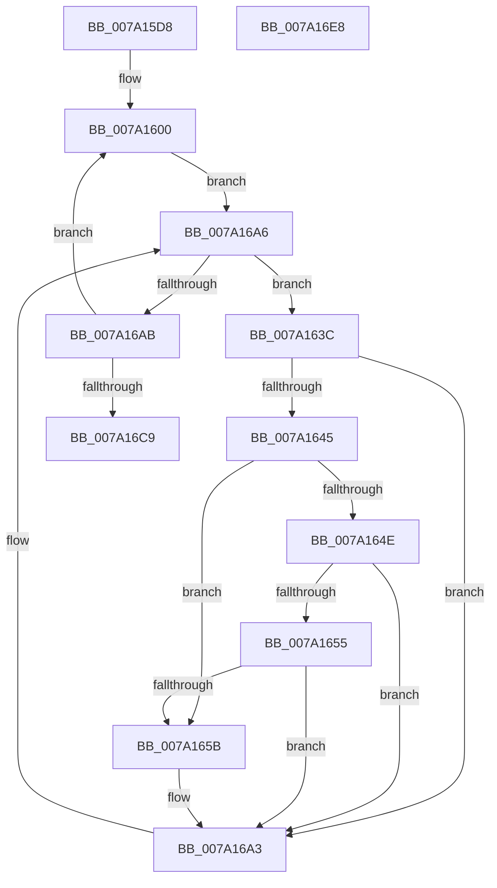

# SepDeleteUnreferencedLogonSessionsInSilo

- RVA: `0x007A15D8`–`0x007A16E9` (길이 `273` bytes)
- VA: `0x00000001407A15D8`
- 실행 섹션: `PAGE`
- PDB 이름 있음: `예`; PDB Function 태그: `아니요`
- unwind 정보 RVA: `0x0009C52C`
- 디코드: `76`개 명령, `273/273` bytes 표시
- 미해석 바이트: `0` (있으면 어셈블리에 `.byte`로 보존)

> 이 문서는 커널 이미지의 기계어와 PDB 기호를 분석해 생성했습니다. 4번과 5번은 함수 원형과 자료형을 바이너리 사용 방식에서 추정한 C 해석이며 원본 소스 복구 결과는 아닙니다.

## 1. Dependencies

- 직접 호출 지점: **9**; 고유 호출 대상: **6**
- 직접 호출자로 확인된 함수: **1**
- RIP 상대 이미지 참조: **2**

### Outgoing calls
- `0x007A15F1` → [PsAttachSiloToCurrentThread](../../text/44/PsAttachSiloToCurrentThread_function_004428C0.md) (function, `0x004428C0`)
- `0x007A1631` → [ExAcquireResourceExclusiveLite](../../text/21/ExAcquireResourceExclusiveLite_function_00214E20.md) (function, `0x00214E20`)
- `0x007A1667` → [ExReleaseResourceLite](../../text/25/ExReleaseResourceLite_function_0025FA10.md) (function, `0x0025FA10`)
- `0x007A166C` → [KeLeaveCriticalRegion](../../text/25/KeLeaveCriticalRegion_function_0025D8B0.md) (function, `0x0025D8B0`)
- `0x007A1678` → [SepDeleteLogonSessionTrack](../AA/SepDeleteLogonSessionTrack_function_00AA04E0.md) (function, `0x00AA04E0`)
- `0x007A1693` → [ExAcquireResourceExclusiveLite](../../text/21/ExAcquireResourceExclusiveLite_function_00214E20.md) (function, `0x00214E20`)
- `0x007A16AE` → [ExReleaseResourceLite](../../text/25/ExReleaseResourceLite_function_0025FA10.md) (function, `0x0025FA10`)
- `0x007A16B3` → [KeLeaveCriticalRegion](../../text/25/KeLeaveCriticalRegion_function_0025D8B0.md) (function, `0x0025D8B0`)
- `0x007A16CC` → [PsDetachSiloFromCurrentThread](../../text/44/PsDetachSiloFromCurrentThread_function_00449AC0.md) (function, `0x00449AC0`)

### Direct callers
- [SeShutdownServerSilo](../79/SeShutdownServerSilo_function_0079C4DC.md) at `0x0079C569`

### Static image references
- `0x007A160C` → RVA `0x00FD9AF0` (`PAGEDATA`; read)
- `0x007A1621` → RVA `0x00E67F20` (`.data`; read)

## 2. Other-region calls and transfers

- 다른 실행 섹션으로 향하는 call: **8**
  - `0x007A15F1` → [PsAttachSiloToCurrentThread](../../text/44/PsAttachSiloToCurrentThread_function_004428C0.md) (`PAGE` → `.text`)
  - `0x007A1631` → [ExAcquireResourceExclusiveLite](../../text/21/ExAcquireResourceExclusiveLite_function_00214E20.md) (`PAGE` → `.text`)
  - `0x007A1667` → [ExReleaseResourceLite](../../text/25/ExReleaseResourceLite_function_0025FA10.md) (`PAGE` → `.text`)
  - `0x007A166C` → [KeLeaveCriticalRegion](../../text/25/KeLeaveCriticalRegion_function_0025D8B0.md) (`PAGE` → `.text`)
  - `0x007A1693` → [ExAcquireResourceExclusiveLite](../../text/21/ExAcquireResourceExclusiveLite_function_00214E20.md) (`PAGE` → `.text`)
  - `0x007A16AE` → [ExReleaseResourceLite](../../text/25/ExReleaseResourceLite_function_0025FA10.md) (`PAGE` → `.text`)
  - `0x007A16B3` → [KeLeaveCriticalRegion](../../text/25/KeLeaveCriticalRegion_function_0025D8B0.md) (`PAGE` → `.text`)
  - `0x007A16CC` → [PsDetachSiloFromCurrentThread](../../text/44/PsDetachSiloFromCurrentThread_function_00449AC0.md) (`PAGE` → `.text`)
- 별도 외부 분기/꼬리 이동을 확인하지 못했습니다.

## 3. Assembly (complete function range)

```asm
007A15D8  48 89 5C 24 08                  mov qword ptr [rsp + 8], rbx
007A15DD  48 89 6C 24 18                  mov qword ptr [rsp + 0x18], rbp
007A15E2  56                              push rsi
007A15E3  57                              push rdi
007A15E4  41 54                           push r12
007A15E6  41 56                           push r14
007A15E8  41 57                           push r15
007A15EA  48 83 EC 20                     sub rsp, 0x20
007A15EE  4C 8B F1                        mov r14, rcx
007A15F1  E8 CA 12 CA FF                  call 0x1404428c0
007A15F6  33 FF                           xor edi, edi
007A15F8  4C 8B E0                        mov r12, rax
007A15FB  33 F6                           xor esi, esi
007A15FD  8D 6F 10                        lea ebp, [rdi + 0x10]
007A1600  65 48 8B 0C 25 88 01 00 00      mov rcx, qword ptr gs:[0x188]
007A1609  48 8B C7                        mov rax, rdi
007A160C  48 8B 1D DD 84 83 00            mov rbx, qword ptr [rip + 0x8384dd]
007A1613  83 E0 03                        and eax, 3
007A1616  4C 6B F8 68                     imul r15, rax, 0x68
007A161A  66 FF 89 E4 01 00 00            dec word ptr [rcx + 0x1e4]
007A1621  48 8D 05 F8 68 6C 00            lea rax, [rip + 0x6c68f8]
007A1628  4C 03 F8                        add r15, rax
007A162B  B2 01                           mov dl, 1
007A162D  49 8B CF                        mov rcx, r15
007A1630  90                              nop
007A1631  E8 EA 37 A7 FF                  call 0x140214e20
007A1636  48 8B 0C 1E                     mov rcx, qword ptr [rsi + rbx]
007A163A  EB 6A                           jmp 0x1407a16a6
007A163C  4C 39 B1 A8 00 00 00            cmp qword ptr [rcx + 0xa8], r14
007A1643  75 5E                           jne 0x1407a16a3
007A1645  48 8B 51 20                     mov rdx, qword ptr [rcx + 0x20]
007A1649  48 85 D2                        test rdx, rdx
007A164C  74 0D                           je 0x1407a165b
007A164E  8B 41 28                        mov eax, dword ptr [rcx + 0x28]
007A1651  A8 08                           test al, 8
007A1653  75 4E                           jne 0x1407a16a3
007A1655  48 83 FA 01                     cmp rdx, 1
007A1659  75 48                           jne 0x1407a16a3
007A165B  48 8B 41 08                     mov rax, qword ptr [rcx + 8]
007A165F  49 8B CF                        mov rcx, r15
007A1662  48 89 44 24 58                  mov qword ptr [rsp + 0x58], rax
007A1667  E8 A4 E3 AB FF                  call 0x14025fa10
007A166C  E8 3F C2 AB FF                  call 0x14025d8b0
007A1671  33 D2                           xor edx, edx
007A1673  48 8D 4C 24 58                  lea rcx, [rsp + 0x58]
007A1678  E8 63 EE 2F 00                  call 0x140aa04e0
007A167D  65 48 8B 04 25 88 01 00 00      mov rax, qword ptr gs:[0x188]
007A1686  B2 01                           mov dl, 1
007A1688  49 8B CF                        mov rcx, r15
007A168B  66 FF 88 E4 01 00 00            dec word ptr [rax + 0x1e4]
007A1692  90                              nop
007A1693  E8 88 37 A7 FF                  call 0x140214e20
007A1698  48 8B 05 51 84 83 00            mov rax, qword ptr [rip + 0x838451]
007A169F  48 8D 0C F8                     lea rcx, [rax + rdi*8]
007A16A3  48 8B 09                        mov rcx, qword ptr [rcx]
007A16A6  48 85 C9                        test rcx, rcx
007A16A9  75 91                           jne 0x1407a163c
007A16AB  49 8B CF                        mov rcx, r15
007A16AE  E8 5D E3 AB FF                  call 0x14025fa10
007A16B3  E8 F8 C1 AB FF                  call 0x14025d8b0
007A16B8  48 FF C7                        inc rdi
007A16BB  48 83 C6 08                     add rsi, 8
007A16BF  48 83 ED 01                     sub rbp, 1
007A16C3  0F 85 37 FF FF FF               jne 0x1407a1600
007A16C9  49 8B CC                        mov rcx, r12
007A16CC  E8 EF 83 CA FF                  call 0x140449ac0
007A16D1  48 8B 5C 24 50                  mov rbx, qword ptr [rsp + 0x50]
007A16D6  48 8B 6C 24 60                  mov rbp, qword ptr [rsp + 0x60]
007A16DB  48 83 C4 20                     add rsp, 0x20
007A16DF  41 5F                           pop r15
007A16E1  41 5E                           pop r14
007A16E3  41 5C                           pop r12
007A16E5  5F                              pop rdi
007A16E6  5E                              pop rsi
007A16E7  C3                              ret
007A16E8  CC                              int3
```

## 4. C-style interpretation (structured pseudocode)

```c
__int64 __fastcall SepDeleteUnreferencedLogonSessionsInSilo(__int64 a1)
{
    __int64 result;
    __int64 v_r15;
    __int64 v_rbp;
    __int64 v_rdi;
    __int64 v_rsi;
    __int64 v_rsp;
    unsigned __int64 v_stack_p10;
    unsigned __int64 v_stack_p18;
    unsigned __int64 v_stack_p8;

    v_stack_p8 = v_rbx;
    v_stack_p18 = v_rbp;
    v_rsp = (v_rsp) - (32);
    result = PsAttachSiloToCurrentThread(a1, a2, a3, a4);
    v_rdi = 0;
    v_rsi = 0;
loc_007A1600:
    result = (unsigned int)((0) & (3));
    v_r15 = (v_r15) * (result);
    v_r15 = (v_r15) + (v_rip + 7104760);
    result = ExAcquireResourceExclusiveLite(v_r15, 1, a3, a4);
    goto loc_007A16A6;
loc_007A163C:
    if ((*(unsigned __int64 *)(*(unsigned __int64 *)(v_rsi + *(unsigned __int64 *)(v_rip + 8619229) * 1) + 168)) != a1) goto loc_007A16A3;
    if (*(unsigned __int64 *)(*(unsigned __int64 *)(v_rsi + *(unsigned __int64 *)(v_rip + 8619229) * 1) + 32) == 0) goto loc_007A165B;
    if ((((unsigned __int8)((unsigned int)(*(unsigned int *)(*(unsigned __int64 *)(v_rsi + *(unsigned __int64 *)(v_rip + 8619229) * 1) + 40)))) & (8)) != 0) goto loc_007A16A3;
    result = (unsigned int)(*(unsigned int *)(*(unsigned __int64 *)(v_rsi + *(unsigned __int64 *)(v_rip + 8619229) * 1) + 40));
    if ((*(unsigned __int64 *)(*(unsigned __int64 *)(v_rsi + *(unsigned __int64 *)(v_rip + 8619229) * 1) + 32)) == 1) {
        result = *(unsigned __int64 *)(*(unsigned __int64 *)(v_rsi + *(unsigned __int64 *)(v_rip + 8619229) * 1) + 8);
        a1 = v_r15;
        v_stack_p10 = result;
        result = ExReleaseResourceLite(a1, *(unsigned __int64 *)(*(unsigned __int64 *)(v_rsi + *(unsigned __int64 *)(v_rip + 8619229) * 1) + 32), a3, a4);
        result = KeLeaveCriticalRegion(a1, *(unsigned __int64 *)(*(unsigned __int64 *)(v_rsi + *(unsigned __int64 *)(v_rip + 8619229) * 1) + 32), a3, a4);
        a2 = 0;
        a1 = v_stack_p10;
        result = SepDeleteLogonSessionTrack(a1, a2, a3, a4);
        result = *(unsigned __int64 *)(gs_base + (0 + 392));
        a2 = 1;
        a1 = v_r15;
        result = ExAcquireResourceExclusiveLite(a1, a2, a3, a4);
        result = *(unsigned __int64 *)(v_rip + 8619089);
        a1 = result + v_rdi * 8;
    }
loc_007A16A6:
    if (*(unsigned __int64 *)(a1) != 0) goto loc_007A163C;
    result = ExReleaseResourceLite(v_r15, a2, a3, a4);
    result = KeLeaveCriticalRegion(v_r15, a2, a3, a4);
    v_rdi = (v_rdi) + 1;
    v_rsi = (v_rsi) + (8);
    v_rbp = (v_rdi + 16) - (1);
    if (condition_is_not_equal) goto loc_007A1600;
    result = PsDetachSiloFromCurrentThread(result, a2, a3, a4);
    v_rsp = (v_rsp) + (32);
    return result;
}
```

## 5. (Beta) C Style

```c
int64_t SepDeleteUnreferencedLogonSessionsInSilo(int64_t Arg1)
{
    int64_t result;
    int64_t local_r15;
    int64_t local_rbp;
    int64_t local_rdi;
    int64_t local_rsi;
    int64_t local_rsp;
    uint64_t v_stack_p10;
    uint64_t v_stack_p18;
    uint64_t v_stack_p8;

    v_stack_p8 = local_rbx;
    v_stack_p18 = local_rbp;
    local_rsp = (local_rsp) - (32);
    result = PsAttachSiloToCurrentThread(Arg1, a2, a3, a4);
    local_rdi = 0;
    local_rsi = 0;
loc_007A1600:
    result = (uint32_t)((0) & (3));
    local_r15 = (local_r15) * (result);
    local_r15 = (local_r15) + (v_rip + 7104760);
    result = ExAcquireResourceExclusiveLite(local_r15, 1, a3, a4);
    goto loc_007A16A6;
loc_007A163C:
    if ((*(uint64_t *)(*(uint64_t *)(local_rsi + *(uint64_t *)(v_rip + 0x8384DD) * 1) + 0xA8)) != Arg1) goto loc_007A16A3;
    if (*(uint64_t *)(*(uint64_t *)(local_rsi + *(uint64_t *)(v_rip + 0x8384DD) * 1) + 0x20) == 0) goto loc_007A165B;
    if ((((uint8_t)((uint32_t)(*(uint32_t *)(*(uint64_t *)(local_rsi + *(uint64_t *)(v_rip + 0x8384DD) * 1) + 0x28)))) & (8)) != 0) goto loc_007A16A3;
    result = (uint32_t)(*(uint32_t *)(*(uint64_t *)(local_rsi + *(uint64_t *)(v_rip + 0x8384DD) * 1) + 0x28));
    if ((*(uint64_t *)(*(uint64_t *)(local_rsi + *(uint64_t *)(v_rip + 0x8384DD) * 1) + 0x20)) == 1) {
        result = *(uint64_t *)(*(uint64_t *)(local_rsi + *(uint64_t *)(v_rip + 0x8384DD) * 1) + 0x8);
        Arg1 = local_r15;
        v_stack_p10 = result;
        result = ExReleaseResourceLite(Arg1, *(uint64_t *)(*(uint64_t *)(local_rsi + *(uint64_t *)(v_rip + 0x8384DD) * 1) + 0x20), a3, a4);
        result = KeLeaveCriticalRegion(Arg1, *(uint64_t *)(*(uint64_t *)(local_rsi + *(uint64_t *)(v_rip + 0x8384DD) * 1) + 0x20), a3, a4);
        a2 = 0;
        Arg1 = v_stack_p10;
        result = SepDeleteLogonSessionTrack(Arg1, a2, a3, a4);
        result = *(uint64_t *)(gs_base + (0 + 0x188));
        a2 = 1;
        Arg1 = local_r15;
        result = ExAcquireResourceExclusiveLite(Arg1, a2, a3, a4);
        result = *(uint64_t *)(v_rip + 0x838451);
        Arg1 = result + local_rdi * 8;
    }
loc_007A16A6:
    if (*(uint64_t *)(Arg1) != 0) goto loc_007A163C;
    result = ExReleaseResourceLite(local_r15, a2, a3, a4);
    result = KeLeaveCriticalRegion(local_r15, a2, a3, a4);
    local_rdi = (local_rdi) + 1;
    local_rsi = (local_rsi) + (8);
    local_rbp = (local_rdi + 16) - (1);
    if (condition_is_not_equal) goto loc_007A1600;
    result = PsDetachSiloFromCurrentThread(result, a2, a3, a4);
    local_rsp = (local_rsp) + (32);
    return result;
}
```

## 6. Execution-region graph

[열기: 2D/3D 그래프와 함수 탐색 컨트롤 패널](../../../control-panel.html?section=page&rva=0x007A15D8&view=graph)

- 2D 그래프는 위에서 아래로 흐르고, 3D 그래프는 빈 공간을 드래그해 회전합니다. Shift+드래그는 이동, 휠은 확대·축소, 함수 노드 선택은 대상 보고서 이동입니다.

### Static fallback


