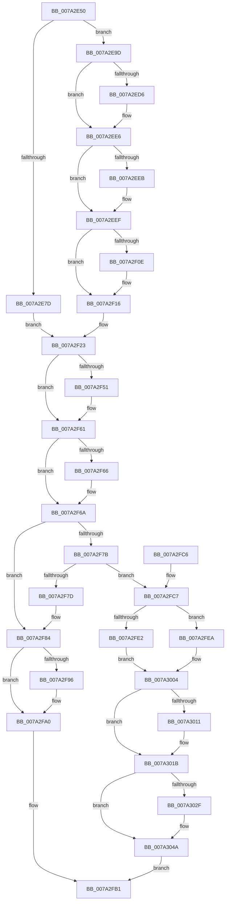

# SepDereferenceAntiTamperEntry

- RVA: `0x007A2E50`–`0x007A3052` (길이 `514` bytes)
- VA: `0x00000001407A2E50`
- 실행 섹션: `PAGE`
- PDB 이름 있음: `예`; PDB Function 태그: `아니요`
- unwind 정보 RVA: `0x000D168C`
- 디코드: `144`개 명령, `514/514` bytes 표시
- 미해석 바이트: `0` (있으면 어셈블리에 `.byte`로 보존)

> 이 문서는 커널 이미지의 기계어와 PDB 기호를 분석해 생성했습니다. 4번과 5번은 함수 원형과 자료형을 바이너리 사용 방식에서 추정한 C 해석이며 원본 소스 복구 결과는 아닙니다.

## 1. Dependencies

- 직접 호출 지점: **18**; 고유 호출 대상: **12**
- 직접 호출자로 확인된 함수: **4**
- RIP 상대 이미지 참조: **2**

### Outgoing calls
- `0x007A2EBD` → [KeAbPreAcquire](../../text/21/KeAbPreAcquire_function_00210230.md) (function, `0x00210230`)
- `0x007A2EE1` → [ExfAcquirePushLockSharedEx](../../text/21/ExfAcquirePushLockSharedEx_function_0021044C.md) (function, `0x0021044C`)
- `0x007A2EF8` → [SepGetTokenSessionAntiTamperMapEntry](../../text/60/SepGetTokenSessionAntiTamperMapEntry_function_0060B104.md) (function, `0x0060B104`)
- `0x007A2F11` → [ExfReleasePushLockShared](../../text/26/ExfReleasePushLockShared_function_00263440.md) (function, `0x00263440`)
- `0x007A2F19` → [KeAbPostRelease](../../text/2E/KeAbPostRelease_function_002E1600.md) (function, `0x002E1600`)
- `0x007A2F1E` → [KeLeaveCriticalRegion](../../text/25/KeLeaveCriticalRegion_function_0025D8B0.md) (function, `0x0025D8B0`)
- `0x007A2F41` → [KeAbPreAcquire](../../text/21/KeAbPreAcquire_function_00210230.md) (function, `0x00210230`)
- `0x007A2F5C` → [ExfAcquirePushLockExclusiveEx](../../text/20/ExfAcquirePushLockExclusiveEx_function_0020FC90.md) (function, `0x0020FC90`)
- `0x007A2F9B` → [ExfTryToWakePushLock](../../text/26/ExfTryToWakePushLock_function_00265DD0.md) (function, `0x00265DD0`)
- `0x007A2FA5` → [KeAbPostRelease](../../text/2E/KeAbPostRelease_function_002E1600.md) (function, `0x002E1600`)
- `0x007A2FAA` → [KeLeaveCriticalRegion](../../text/25/KeLeaveCriticalRegion_function_0025D8B0.md) (function, `0x0025D8B0`)
- `0x007A2FD6` → [RtlRemoveEntryHashTable](../../text/2E/RtlRemoveEntryHashTable_function_002EEF00.md) (function, `0x002EEF00`)
- `0x007A3016` → [ExfTryToWakePushLock](../../text/26/ExfTryToWakePushLock_function_00265DD0.md) (function, `0x00265DD0`)
- `0x007A3020` → [KeAbPostRelease](../../text/2E/KeAbPostRelease_function_002E1600.md) (function, `0x002E1600`)
- `0x007A3025` → [KeLeaveCriticalRegion](../../text/25/KeLeaveCriticalRegion_function_0025D8B0.md) (function, `0x0025D8B0`)
- `0x007A3033` → [SepDeleteAntiTamperPolicy](../../text/60/SepDeleteAntiTamperPolicy_function_0060AA7C.md) (function, `0x0060AA7C`)
- `0x007A303B` → [SepFreeObjectTypeMacls](../79/SepFreeObjectTypeMacls_function_0079D564.md) (function, `0x0079D564`)
- `0x007A3045` → [ExFreePoolWithTag](../../poolcode/B8/ExFreePoolWithTag_function_00B82870.md) (function, `0x00B82870`)

### Direct callers
- [SeExchangePrimaryToken](SeExchangePrimaryToken_function_007A07BC.md) at `0x007A0959`
- [SeSubProcessToken](../AA/SeSubProcessToken_function_00AAD570.md) at `0x00AAD978`
- [SeSetSessionIdToken](../AF/SeSetSessionIdToken_function_00AF1F0C.md) at `0x00AF2037`
- [SepTokenDeleteMethod](../AF/SepTokenDeleteMethod_function_00AF23D0.md) at `0x00AF24EE`

### Static image references
- `0x007A2E88` → RVA `0x00F04D20` (`.data`; read)
- `0x007A2EA6` → RVA `0x00F04D10` (`.data`; read)

## 2. Other-region calls and transfers

- 다른 실행 섹션으로 향하는 call: **17**
  - `0x007A2EBD` → [KeAbPreAcquire](../../text/21/KeAbPreAcquire_function_00210230.md) (`PAGE` → `.text`)
  - `0x007A2EE1` → [ExfAcquirePushLockSharedEx](../../text/21/ExfAcquirePushLockSharedEx_function_0021044C.md) (`PAGE` → `.text`)
  - `0x007A2EF8` → [SepGetTokenSessionAntiTamperMapEntry](../../text/60/SepGetTokenSessionAntiTamperMapEntry_function_0060B104.md) (`PAGE` → `.text`)
  - `0x007A2F11` → [ExfReleasePushLockShared](../../text/26/ExfReleasePushLockShared_function_00263440.md) (`PAGE` → `.text`)
  - `0x007A2F19` → [KeAbPostRelease](../../text/2E/KeAbPostRelease_function_002E1600.md) (`PAGE` → `.text`)
  - `0x007A2F1E` → [KeLeaveCriticalRegion](../../text/25/KeLeaveCriticalRegion_function_0025D8B0.md) (`PAGE` → `.text`)
  - `0x007A2F41` → [KeAbPreAcquire](../../text/21/KeAbPreAcquire_function_00210230.md) (`PAGE` → `.text`)
  - `0x007A2F5C` → [ExfAcquirePushLockExclusiveEx](../../text/20/ExfAcquirePushLockExclusiveEx_function_0020FC90.md) (`PAGE` → `.text`)
  - `0x007A2F9B` → [ExfTryToWakePushLock](../../text/26/ExfTryToWakePushLock_function_00265DD0.md) (`PAGE` → `.text`)
  - `0x007A2FA5` → [KeAbPostRelease](../../text/2E/KeAbPostRelease_function_002E1600.md) (`PAGE` → `.text`)
  - `0x007A2FAA` → [KeLeaveCriticalRegion](../../text/25/KeLeaveCriticalRegion_function_0025D8B0.md) (`PAGE` → `.text`)
  - `0x007A2FD6` → [RtlRemoveEntryHashTable](../../text/2E/RtlRemoveEntryHashTable_function_002EEF00.md) (`PAGE` → `.text`)
  - `0x007A3016` → [ExfTryToWakePushLock](../../text/26/ExfTryToWakePushLock_function_00265DD0.md) (`PAGE` → `.text`)
  - `0x007A3020` → [KeAbPostRelease](../../text/2E/KeAbPostRelease_function_002E1600.md) (`PAGE` → `.text`)
  - `0x007A3025` → [KeLeaveCriticalRegion](../../text/25/KeLeaveCriticalRegion_function_0025D8B0.md) (`PAGE` → `.text`)
  - `0x007A3033` → [SepDeleteAntiTamperPolicy](../../text/60/SepDeleteAntiTamperPolicy_function_0060AA7C.md) (`PAGE` → `.text`)
  - `0x007A3045` → [ExFreePoolWithTag](../../poolcode/B8/ExFreePoolWithTag_function_00B82870.md) (`PAGE` → `POOLCODE`)
- 별도 외부 분기/꼬리 이동을 확인하지 못했습니다.

## 3. Assembly (complete function range)

```asm
007A2E50  48 89 5C 24 08                  mov qword ptr [rsp + 8], rbx
007A2E55  55                              push rbp
007A2E56  56                              push rsi
007A2E57  57                              push rdi
007A2E58  41 54                           push r12
007A2E5A  41 55                           push r13
007A2E5C  41 56                           push r14
007A2E5E  41 57                           push r15
007A2E60  48 83 EC 20                     sub rsp, 0x20
007A2E64  45 33 FF                        xor r15d, r15d
007A2E67  8B E9                           mov ebp, ecx
007A2E69  48 83 CB FF                     or rbx, 0xffffffffffffffff
007A2E6D  4C 89 7C 24 70                  mov qword ptr [rsp + 0x70], r15
007A2E72  48 8B F2                        mov rsi, rdx
007A2E75  45 8B F7                        mov r14d, r15d
007A2E78  83 F9 05                        cmp ecx, 5
007A2E7B  73 20                           jae 0x1407a2e9d
007A2E7D  48 8D 0C AD 00 00 00 00         lea rcx, [rbp*4]
007A2E85  48 03 CD                        add rcx, rbp
007A2E88  48 8D 05 91 1E 76 00            lea rax, [rip + 0x761e91]
007A2E8F  48 8D 04 C8                     lea rax, [rax + rcx*8]
007A2E93  48 89 44 24 70                  mov qword ptr [rsp + 0x70], rax
007A2E98  E9 86 00 00 00                  jmp 0x1407a2f23
007A2E9D  65 48 8B 04 25 88 01 00 00      mov rax, qword ptr gs:[0x188]
007A2EA6  4C 8D 25 63 1E 76 00            lea r12, [rip + 0x761e63]
007A2EAD  45 33 C0                        xor r8d, r8d
007A2EB0  33 D2                           xor edx, edx
007A2EB2  49 8B CC                        mov rcx, r12
007A2EB5  66 01 98 E4 01 00 00            add word ptr [rax + 0x1e4], bx
007A2EBC  90                              nop
007A2EBD  E8 6E D3 A6 FF                  call 0x140210230
007A2EC2  48 8B F8                        mov rdi, rax
007A2EC5  33 C0                           xor eax, eax
007A2EC7  44 8D 68 11                     lea r13d, [rax + 0x11]
007A2ECB  F0 4C 0F B1 2D 3C 1E 76 00      lock cmpxchg qword ptr [rip + 0x761e3c], r13
007A2ED4  74 10                           je 0x1407a2ee6
007A2ED6  4D 8B CC                        mov r9, r12
007A2ED9  4C 8B C7                        mov r8, rdi
007A2EDC  33 D2                           xor edx, edx
007A2EDE  49 8B CC                        mov rcx, r12
007A2EE1  E8 66 D5 A6 FF                  call 0x14021044c
007A2EE6  48 85 FF                        test rdi, rdi
007A2EE9  74 04                           je 0x1407a2eef
007A2EEB  C6 47 0A 01                     mov byte ptr [rdi + 0xa], 1
007A2EEF  4C 8D 44 24 70                  lea r8, [rsp + 0x70]
007A2EF4  33 D2                           xor edx, edx
007A2EF6  8B CD                           mov ecx, ebp
007A2EF8  E8 07 82 E6 FF                  call 0x14060b104
007A2EFD  44 8B F0                        mov r14d, eax
007A2F00  49 8B C5                        mov rax, r13
007A2F03  F0 4C 0F B1 3D 04 1E 76 00      lock cmpxchg qword ptr [rip + 0x761e04], r15
007A2F0C  74 08                           je 0x1407a2f16
007A2F0E  49 8B CC                        mov rcx, r12
007A2F11  E8 2A 05 AC FF                  call 0x140263440
007A2F16  49 8B CC                        mov rcx, r12
007A2F19  E8 E2 E6 B3 FF                  call 0x1402e1600
007A2F1E  E8 8D A9 AB FF                  call 0x14025d8b0
007A2F23  65 48 8B 04 25 88 01 00 00      mov rax, qword ptr gs:[0x188]
007A2F2C  45 33 C0                        xor r8d, r8d
007A2F2F  48 8B 7C 24 70                  mov rdi, qword ptr [rsp + 0x70]
007A2F34  33 D2                           xor edx, edx
007A2F36  48 8B CF                        mov rcx, rdi
007A2F39  66 01 98 E4 01 00 00            add word ptr [rax + 0x1e4], bx
007A2F40  90                              nop
007A2F41  E8 EA D2 A6 FF                  call 0x140210230
007A2F46  F0 48 0F BA 2F 00               lock bts qword ptr [rdi], 0
007A2F4C  48 8B E8                        mov rbp, rax
007A2F4F  73 10                           jae 0x1407a2f61
007A2F51  48 8B 4C 24 70                  mov rcx, qword ptr [rsp + 0x70]
007A2F56  48 8B D0                        mov rdx, rax
007A2F59  4C 8B C1                        mov r8, rcx
007A2F5C  E8 2F CD A6 FF                  call 0x14020fc90
007A2F61  48 85 ED                        test rbp, rbp
007A2F64  74 04                           je 0x1407a2f6a
007A2F66  C6 45 0A 01                     mov byte ptr [rbp + 0xa], 1
007A2F6A  48 8B C3                        mov rax, rbx
007A2F6D  F0 48 0F C1 46 18               lock xadd qword ptr [rsi + 0x18], rax
007A2F73  48 03 C3                        add rax, rbx
007A2F76  48 85 C0                        test rax, rax
007A2F79  7F 09                           jg 0x1407a2f84
007A2F7B  74 4A                           je 0x1407a2fc7
007A2F7D  B9 0E 00 00 00                  mov ecx, 0xe
007A2F82  CD 29                           int 0x29
007A2F84  48 8B 44 24 70                  mov rax, qword ptr [rsp + 0x70]
007A2F89  F0 48 0F C1 18                  lock xadd qword ptr [rax], rbx
007A2F8E  80 E3 06                        and bl, 6
007A2F91  80 FB 02                        cmp bl, 2
007A2F94  75 0A                           jne 0x1407a2fa0
007A2F96  48 8B 4C 24 70                  mov rcx, qword ptr [rsp + 0x70]
007A2F9B  E8 30 2E AC FF                  call 0x140265dd0
007A2FA0  48 8B 4C 24 70                  mov rcx, qword ptr [rsp + 0x70]
007A2FA5  E8 56 E6 B3 FF                  call 0x1402e1600
007A2FAA  E8 01 A9 AB FF                  call 0x14025d8b0
007A2FAF  33 C0                           xor eax, eax
007A2FB1  48 8B 5C 24 60                  mov rbx, qword ptr [rsp + 0x60]
007A2FB6  48 83 C4 20                     add rsp, 0x20
007A2FBA  41 5F                           pop r15
007A2FBC  41 5E                           pop r14
007A2FBE  41 5D                           pop r13
007A2FC0  41 5C                           pop r12
007A2FC2  5F                              pop rdi
007A2FC3  5E                              pop rsi
007A2FC4  5D                              pop rbp
007A2FC5  C3                              ret
007A2FC6  CC                              int3
007A2FC7  48 8B 7C 24 70                  mov rdi, qword ptr [rsp + 0x70]
007A2FCC  45 33 C0                        xor r8d, r8d
007A2FCF  48 8B D6                        mov rdx, rsi
007A2FD2  48 8B 4F 18                     mov rcx, qword ptr [rdi + 0x18]
007A2FD6  E8 25 BF B4 FF                  call 0x1402eef00
007A2FDB  40 8A E8                        mov bpl, al
007A2FDE  84 C0                           test al, al
007A2FE0  75 08                           jne 0x1407a2fea
007A2FE2  41 BE 01 00 00 C0               mov r14d, 0xc0000001
007A2FE8  EB 1A                           jmp 0x1407a3004
007A2FEA  8B 56 28                        mov edx, dword ptr [rsi + 0x28]
007A2FED  FF CA                           dec edx
007A2FEF  8B CA                           mov ecx, edx
007A2FF1  83 E2 07                        and edx, 7
007A2FF4  48 C1 E9 03                     shr rcx, 3
007A2FF8  48 03 4F 10                     add rcx, qword ptr [rdi + 0x10]
007A2FFC  0F BE 01                        movsx eax, byte ptr [rcx]
007A2FFF  0F B3 D0                        btr eax, edx
007A3002  88 01                           mov byte ptr [rcx], al
007A3004  F0 48 0F C1 1F                  lock xadd qword ptr [rdi], rbx
007A3009  80 E3 06                        and bl, 6
007A300C  80 FB 02                        cmp bl, 2
007A300F  75 0A                           jne 0x1407a301b
007A3011  48 8B 4C 24 70                  mov rcx, qword ptr [rsp + 0x70]
007A3016  E8 B5 2D AC FF                  call 0x140265dd0
007A301B  48 8B 4C 24 70                  mov rcx, qword ptr [rsp + 0x70]
007A3020  E8 DB E5 B3 FF                  call 0x1402e1600
007A3025  E8 86 A8 AB FF                  call 0x14025d8b0
007A302A  40 84 ED                        test bpl, bpl
007A302D  74 1B                           je 0x1407a304a
007A302F  48 8B 4E 30                     mov rcx, qword ptr [rsi + 0x30]
007A3033  E8 44 7A E6 FF                  call 0x14060aa7c
007A3038  48 8B CE                        mov rcx, rsi
007A303B  E8 24 A5 FF FF                  call 0x14079d564
007A3040  33 D2                           xor edx, edx
007A3042  48 8B CE                        mov rcx, rsi
007A3045  E8 26 F8 3D 00                  call 0x140b82870
007A304A  41 8B C6                        mov eax, r14d
007A304D  E9 5F FF FF FF                  jmp 0x1407a2fb1
```

## 4. C-style interpretation (structured pseudocode)

```c
__int64 __fastcall SepDereferenceAntiTamperEntry(int a1, __int64 a2, int a3)
{
    __int64 result;
    __int64 v_r15;
    __int64 v_rbx;
    __int64 v_rsp;
    unsigned __int64 v_stack_p18;
    unsigned __int64 v_stack_p70;
    unsigned __int64 v_stack_p8;

    v_stack_p8 = v_rbx;
    v_rsp = (v_rsp) - (32);
    v_r15 = 0;
    v_rbx = (v_rbx) | (-1);
    v_stack_p18 = 0;
    if (a1 >= 5) goto loc_007A2E9D;
    a1 = ((unsigned int)(a1) * 4) + ((unsigned int)(a1));
    v_stack_p18 = v_rip + 7741073 + a1 * 8;
    goto loc_007A2F23;
loc_007A2E9D:
    a3 = 0;
    a2 = 0;
    result = KeAbPreAcquire(v_rip + 7741027, a2, a3, a4);
    result = 0;
    if (!(condition_is_equal)) {
        a4 = v_rip + 7741027;
        a3 = 0;
        a2 = 0;
        a1 = v_rip + 7741027;
        result = ExfAcquirePushLockSharedEx(a1, a2, a3, a4);
    }
    if (result != 0) {
        *(unsigned __int8 *)(result + 10) = 1;
    }
    a2 = 0;
    result = SepGetTokenSessionAntiTamperMapEntry((unsigned int)((unsigned int)((unsigned int)(a1))), a2, v_stack_p18, a4);
    result = result + 17;
    if (!(condition_is_equal)) {
        a1 = v_rip + 7741027;
        result = ExfReleasePushLockShared(a1, a2, v_stack_p18, a4);
    }
    result = KeAbPostRelease(v_rip + 7741027, a2, v_stack_p18, a4);
    result = KeLeaveCriticalRegion(v_rip + 7741027, a2, v_stack_p18, a4);
loc_007A2F23:
    a3 = 0;
    a2 = 0;
    result = KeAbPreAcquire(v_stack_p18, a2, a3, a4);
    if (!(condition_is_above_or_equal)) {
        a1 = v_stack_p18;
        a2 = result;
        a3 = a1;
        result = ExfAcquirePushLockExclusiveEx(a1, a2, a3, a4);
    }
    if (result != 0) {
        *(unsigned __int8 *)(result + 10) = 1;
    }
    result = (v_rbx) + (v_rbx);
    if (condition_is_greater) goto loc_007A2F84;
    if (result == 0) goto loc_007A2FC7;
loc_007A2F84:
    v_rbx = (unsigned __int8)((v_rbx) & (6));
    result = v_stack_p18;
    if (((unsigned __int8)(v_rbx)) == 2) {
        a1 = v_stack_p18;
        result = ExfTryToWakePushLock(a1, a2, a3, a4);
    }
    result = KeAbPostRelease(v_stack_p18, a2, a3, a4);
    result = KeLeaveCriticalRegion(v_stack_p18, a2, a3, a4);
    result = 0;
loc_007A2FB1:
    v_rsp = (v_rsp) + (32);
    return result;
loc_007A2FC7:
    a3 = 0;
    result = RtlRemoveEntryHashTable(*(unsigned __int64 *)(v_stack_p70 + 24), a2, a3, a4);
    if ((unsigned __int8)(result) != 0) goto loc_007A2FEA;
    goto loc_007A3004;
loc_007A2FEA:
    a2 = (unsigned int)(((unsigned int)(*(unsigned int *)(a2 + 40))) - 1);
    a2 = (unsigned int)((a2) & (7));
    a1 = ((unsigned int)((unsigned int)(a2))) >> (3);
    a1 = (a1) + (*(unsigned __int64 *)(v_stack_p70 + 16));
    *(unsigned __int8 *)(a1) = (unsigned __int8)((__int8)(*(unsigned __int8 *)(a1)));
loc_007A3004:
    v_rbx = (unsigned __int8)((v_stack_p8) & (6));
    result = (__int8)(*(unsigned __int8 *)(a1));
    if (((unsigned __int8)(v_rbx)) == 2) {
        a1 = v_stack_p70;
        result = ExfTryToWakePushLock(a1, a2, a3, a4);
    }
    result = KeAbPostRelease(v_stack_p70, a2, a3, a4);
    result = KeLeaveCriticalRegion(v_stack_p70, a2, a3, a4);
    if ((unsigned __int8)((unsigned __int8)(result)) != 0) {
        a1 = *(unsigned __int64 *)(a2 + 48);
        result = SepDeleteAntiTamperPolicy(a1, a2, a3, a4);
        a1 = a2;
        result = SepFreeObjectTypeMacls(a1, a2, a3, a4);
        a2 = 0;
        a1 = 0;
        result = ExFreePoolWithTag(a1, a2, a3, a4);
    }
    goto loc_007A2FB1;
}
```

## 5. (Beta) C Style

```c
int64_t SepDereferenceAntiTamperEntry(int32_t Arg1, void *Arg2, int32_t Arg3)
{
    uint8_t *arg2 = (uint8_t *)Arg2;

    int64_t result;
    int64_t local_r15;
    int64_t local_rbx;
    int64_t local_rsp;
    uint64_t v_stack_p18;
    uint64_t v_stack_p70;
    uint64_t v_stack_p8;

    v_stack_p8 = local_rbx;
    local_rsp = (local_rsp) - (32);
    local_r15 = 0;
    local_rbx = (local_rbx) | (-1);
    v_stack_p18 = 0;
    if (Arg1 >= 5) goto loc_007A2E9D;
    Arg1 = ((uint32_t)(Arg1) * 4) + ((uint32_t)(Arg1));
    v_stack_p18 = v_rip + 7741073 + Arg1 * 8;
    goto loc_007A2F23;
loc_007A2E9D:
    Arg3 = 0;
    Arg2 = 0;
    result = KeAbPreAcquire(v_rip + 7741027, Arg2, Arg3, a4);
    result = 0;
    if (!(condition_is_equal)) {
        a4 = v_rip + 7741027;
        Arg3 = 0;
        Arg2 = 0;
        Arg1 = v_rip + 7741027;
        result = ExfAcquirePushLockSharedEx(Arg1, Arg2, Arg3, a4);
    }
    if (result != 0) {
        *(uint8_t *)(result + 0xA) = 1;
    }
    Arg2 = 0;
    result = SepGetTokenSessionAntiTamperMapEntry((uint32_t)((uint32_t)((uint32_t)(Arg1))), Arg2, v_stack_p18, a4);
    result = result + 17;
    if (!(condition_is_equal)) {
        Arg1 = v_rip + 7741027;
        result = ExfReleasePushLockShared(Arg1, Arg2, v_stack_p18, a4);
    }
    result = KeAbPostRelease(v_rip + 7741027, Arg2, v_stack_p18, a4);
    result = KeLeaveCriticalRegion(v_rip + 7741027, Arg2, v_stack_p18, a4);
loc_007A2F23:
    Arg3 = 0;
    Arg2 = 0;
    result = KeAbPreAcquire(v_stack_p18, Arg2, Arg3, a4);
    if (!(condition_is_above_or_equal)) {
        Arg1 = v_stack_p18;
        Arg2 = result;
        Arg3 = Arg1;
        result = ExfAcquirePushLockExclusiveEx(Arg1, Arg2, Arg3, a4);
    }
    if (result != 0) {
        *(uint8_t *)(result + 0xA) = 1;
    }
    result = (local_rbx) + (local_rbx);
    if (condition_is_greater) goto loc_007A2F84;
    if (result == 0) goto loc_007A2FC7;
loc_007A2F84:
    local_rbx = (uint8_t)((local_rbx) & (6));
    result = v_stack_p18;
    if (((uint8_t)(local_rbx)) == 2) {
        Arg1 = v_stack_p18;
        result = ExfTryToWakePushLock(Arg1, Arg2, Arg3, a4);
    }
    result = KeAbPostRelease(v_stack_p18, Arg2, Arg3, a4);
    result = KeLeaveCriticalRegion(v_stack_p18, Arg2, Arg3, a4);
    result = 0;
loc_007A2FB1:
    local_rsp = (local_rsp) + (32);
    return result;
loc_007A2FC7:
    Arg3 = 0;
    result = RtlRemoveEntryHashTable(*(uint64_t *)(v_stack_p70 + 0x18), Arg2, Arg3, a4);
    if ((uint8_t)(result) != 0) goto loc_007A2FEA;
    goto loc_007A3004;
loc_007A2FEA:
    Arg2 = (uint32_t)(((uint32_t)(*(uint32_t *)(arg2 + 0x28))) - 1);
    Arg2 = (uint32_t)((Arg2) & (7));
    Arg1 = ((uint32_t)((uint32_t)(Arg2))) >> (3);
    Arg1 = (Arg1) + (*(uint64_t *)(v_stack_p70 + 0x10));
    *(uint8_t *)(Arg1) = (uint8_t)((int8_t)(*(uint8_t *)(Arg1)));
loc_007A3004:
    local_rbx = (uint8_t)((v_stack_p8) & (6));
    result = (int8_t)(*(uint8_t *)(Arg1));
    if (((uint8_t)(local_rbx)) == 2) {
        Arg1 = v_stack_p70;
        result = ExfTryToWakePushLock(Arg1, Arg2, Arg3, a4);
    }
    result = KeAbPostRelease(v_stack_p70, Arg2, Arg3, a4);
    result = KeLeaveCriticalRegion(v_stack_p70, Arg2, Arg3, a4);
    if ((uint8_t)((uint8_t)(result)) != 0) {
        Arg1 = *(uint64_t *)(arg2 + 0x30);
        result = SepDeleteAntiTamperPolicy(Arg1, Arg2, Arg3, a4);
        Arg1 = Arg2;
        result = SepFreeObjectTypeMacls(Arg1, Arg2, Arg3, a4);
        Arg2 = 0;
        Arg1 = 0;
        result = ExFreePoolWithTag(Arg1, Arg2, Arg3, a4);
    }
    goto loc_007A2FB1;
}
```

### 관측된 메모리 오프셋

구조체 형식이 확인되지 않은 접근은 인자 기준의 오프셋으로만 기록했습니다.

| 기준 인자 | 오프셋 표현 | 폭 (bit) | 접근 |
|---|---:|---:|---|
| `Arg2` | `+ 0x18` | `64` | `R/W` |
| `Arg2` | `+ 0x28` | `32` | `R` |
| `Arg2` | `+ 0x30` | `64` | `R` |

## 6. Execution-region graph

[열기: 2D/3D 그래프와 함수 탐색 컨트롤 패널](../../../control-panel.html?section=page&rva=0x007A2E50&view=graph)

- 2D 그래프는 위에서 아래로 흐르고, 3D 그래프는 빈 공간을 드래그해 회전합니다. Shift+드래그는 이동, 휠은 확대·축소, 함수 노드 선택은 대상 보고서 이동입니다.

### Static fallback


