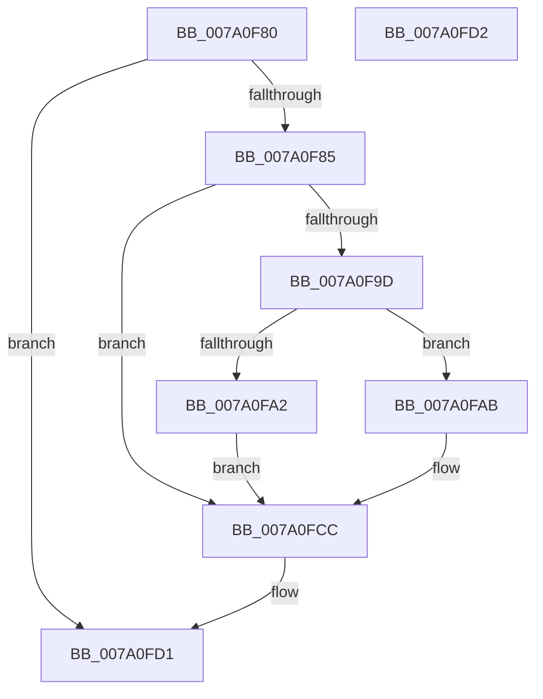

# SepDereferenceSidValuesBlock

- RVA: `0x007A0F80`–`0x007A0FD3` (길이 `83` bytes)
- VA: `0x00000001407A0F80`
- 실행 섹션: `PAGE`
- PDB 이름 있음: `예`; PDB Function 태그: `아니요`
- unwind 정보 RVA: `0x000BDB64`
- 디코드: `27`개 명령, `83/83` bytes 표시
- 미해석 바이트: `0` (있으면 어셈블리에 `.byte`로 보존)

> 이 문서는 커널 이미지의 기계어와 PDB 기호를 분석해 생성했습니다. 4번과 5번은 함수 원형과 자료형을 바이너리 사용 방식에서 추정한 C 해석이며 원본 소스 복구 결과는 아닙니다.

## 1. Dependencies

- 직접 호출 지점: **2**; 고유 호출 대상: **2**
- 직접 호출자로 확인된 함수: **3**
- RIP 상대 이미지 참조: **0**

### Outgoing calls
- `0x007A0FBD` → [SepLogTokenSidManagement](../79/SepLogTokenSidManagement_function_0079DA10.md) (function, `0x0079DA10`)
- `0x007A0FC7` → [ExFreePoolWithTag](../../poolcode/B8/ExFreePoolWithTag_function_00B82870.md) (function, `0x00B82870`)

### Direct callers
- [SepDeleteLogonSessionSidValues](SepDeleteLogonSessionSidValues_function_007A0EC4.md) at `0x007A0EDE`
- [SepDeleteTokenUserAndGroups](SepDeleteTokenUserAndGroups_function_007A0EF8.md) at `0x007A0F57`
- [SepSetTokenUserAndGroups](../9F/SepSetTokenUserAndGroups_function_009FDCD0.md) at `0x009FDEFB`

### Static image references
- 디코드된 RIP-relative 메모리 참조가 없습니다.

## 2. Other-region calls and transfers

- 다른 실행 섹션으로 향하는 call: **1**
  - `0x007A0FC7` → [ExFreePoolWithTag](../../poolcode/B8/ExFreePoolWithTag_function_00B82870.md) (`PAGE` → `POOLCODE`)
- 별도 외부 분기/꼬리 이동을 확인하지 못했습니다.

## 3. Assembly (complete function range)

```asm
007A0F80  48 85 C9                        test rcx, rcx
007A0F83  74 4C                           je 0x1407a0fd1
007A0F85  53                              push rbx
007A0F86  48 83 EC 30                     sub rsp, 0x30
007A0F8A  48 8B D9                        mov rbx, rcx
007A0F8D  48 83 C8 FF                     or rax, 0xffffffffffffffff
007A0F91  F0 48 0F C1 41 08               lock xadd qword ptr [rcx + 8], rax
007A0F97  48 83 E8 01                     sub rax, 1
007A0F9B  7F 2F                           jg 0x1407a0fcc
007A0F9D  48 85 C0                        test rax, rax
007A0FA0  74 09                           je 0x1407a0fab
007A0FA2  B9 0E 00 00 00                  mov ecx, 0xe
007A0FA7  CD 29                           int 0x29
007A0FA9  EB 21                           jmp 0x1407a0fcc
007A0FAB  4C 89 44 24 20                  mov qword ptr [rsp + 0x20], r8
007A0FB0  4C 8B CA                        mov r9, rdx
007A0FB3  45 33 C0                        xor r8d, r8d
007A0FB6  48 8B D3                        mov rdx, rbx
007A0FB9  41 8D 48 05                     lea ecx, [r8 + 5]
007A0FBD  E8 4E CA FF FF                  call 0x14079da10
007A0FC2  33 D2                           xor edx, edx
007A0FC4  48 8B CB                        mov rcx, rbx
007A0FC7  E8 A4 18 3E 00                  call 0x140b82870
007A0FCC  48 83 C4 30                     add rsp, 0x30
007A0FD0  5B                              pop rbx
007A0FD1  C3                              ret
007A0FD2  CC                              int3
```

## 4. C-style interpretation (structured pseudocode)

```c
__int64 __fastcall SepDereferenceSidValuesBlock(__int64 a1, __int64 a2, __int64 a3)
{
    __int64 result;
    __int64 v_rsp;
    unsigned __int64 v_stack_m18;

    if (a1 == 0) goto loc_007A0FD1;
    v_rsp = (v_rsp) - (48);
    result = (result) | (-1);
    result = (result) - (1);
    if (condition_is_greater) goto loc_007A0FCC;
    if (result == 0) goto loc_007A0FAB;
    goto loc_007A0FCC;
loc_007A0FAB:
    v_stack_m18 = a3;
    a3 = 0;
    result = SepLogTokenSidManagement(a3 + 5, a1, a3, a2);
    a2 = 0;
    result = ExFreePoolWithTag(a1, a2, a3, a2);
loc_007A0FCC:
    v_rsp = (v_rsp) + (48);
loc_007A0FD1:
    return result;
}
```

## 5. (Beta) C Style

```c
int64_t SepDereferenceSidValuesBlock(int64_t Arg1, int64_t Arg2, int64_t Arg3)
{
    int64_t result;
    int64_t local_rsp;
    uint64_t v_stack_m18;

    if (Arg1 == 0) goto loc_007A0FD1;
    local_rsp = (local_rsp) - (48);
    result = (result) | (-1);
    result = (result) - (1);
    if (condition_is_greater) goto loc_007A0FCC;
    if (result == 0) goto loc_007A0FAB;
    goto loc_007A0FCC;
loc_007A0FAB:
    v_stack_m18 = Arg3;
    Arg3 = 0;
    result = SepLogTokenSidManagement(Arg3 + 5, Arg1, Arg3, Arg2);
    Arg2 = 0;
    result = ExFreePoolWithTag(Arg1, Arg2, Arg3, Arg2);
loc_007A0FCC:
    local_rsp = (local_rsp) + (48);
loc_007A0FD1:
    return result;
}
```

## 6. Execution-region graph

[열기: 2D/3D 그래프와 함수 탐색 컨트롤 패널](../../../control-panel.html?section=page&rva=0x007A0F80&view=graph)

- 2D 그래프는 위에서 아래로 흐르고, 3D 그래프는 빈 공간을 드래그해 회전합니다. Shift+드래그는 이동, 휠은 확대·축소, 함수 노드 선택은 대상 보고서 이동입니다.

### Static fallback


