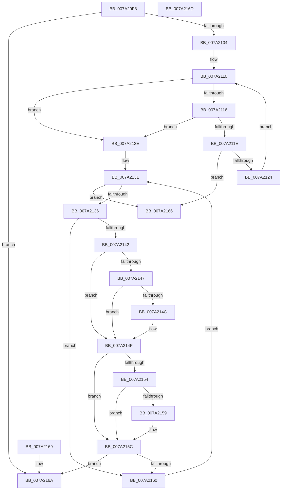

# SepEqualAsciiWideStringCaseInSensitive

- RVA: `0x007A20F8`–`0x007A216E` (길이 `118` bytes)
- VA: `0x00000001407A20F8`
- 실행 섹션: `PAGE`
- PDB 이름 있음: `예`; PDB Function 태그: `아니요`
- unwind 정보 RVA: `0x000DB714`
- 디코드: `44`개 명령, `118/118` bytes 표시
- 미해석 바이트: `0` (있으면 어셈블리에 `.byte`로 보존)

> 이 문서는 커널 이미지의 기계어와 PDB 기호를 분석해 생성했습니다. 4번과 5번은 함수 원형과 자료형을 바이너리 사용 방식에서 추정한 C 해석이며 원본 소스 복구 결과는 아닙니다.

## 1. Dependencies

- 직접 호출 지점: **0**; 고유 호출 대상: **0**
- 직접 호출자로 확인된 함수: **1**
- RIP 상대 이미지 참조: **0**

### Outgoing calls
- 직접 디코드된 call 명령이 없습니다.

### Direct callers
- [SepSecureBootFindMatchingRegistryRule](SepSecureBootFindMatchingRegistryRule_function_007A2414.md) at `0x007A2489`
- [SepSecureBootFindMatchingRegistryRule](SepSecureBootFindMatchingRegistryRule_function_007A2414.md) at `0x007A24BF`

### Static image references
- 디코드된 RIP-relative 메모리 참조가 없습니다.

## 2. Other-region calls and transfers

- 다른 실행 섹션으로 향하는 call: **0**
- 별도 외부 분기/꼬리 이동을 확인하지 못했습니다.

## 3. Assembly (complete function range)

```asm
007A20F8  44 0F B7 01                     movzx r8d, word ptr [rcx]
007A20FC  0F B7 02                        movzx eax, word ptr [rdx]
007A20FF  44 3B C0                        cmp r8d, eax
007A2102  75 66                           jne 0x1407a216a
007A2104  48 8B 49 08                     mov rcx, qword ptr [rcx + 8]
007A2108  4C 8B 4A 08                     mov r9, qword ptr [rdx + 8]
007A210C  4E 8D 14 01                     lea r10, [rcx + r8]
007A2110  41 83 F8 08                     cmp r8d, 8
007A2114  72 18                           jb 0x1407a212e
007A2116  49 8B 01                        mov rax, qword ptr [r9]
007A2119  48 39 01                        cmp qword ptr [rcx], rax
007A211C  75 10                           jne 0x1407a212e
007A211E  41 83 E8 08                     sub r8d, 8
007A2122  74 42                           je 0x1407a2166
007A2124  48 83 C1 08                     add rcx, 8
007A2128  49 83 C1 08                     add r9, 8
007A212C  EB E2                           jmp 0x1407a2110
007A212E  4C 2B C9                        sub r9, rcx
007A2131  49 3B CA                        cmp rcx, r10
007A2134  73 30                           jae 0x1407a2166
007A2136  0F B7 01                        movzx eax, word ptr [rcx]
007A2139  41 0F B7 14 09                  movzx edx, word ptr [r9 + rcx]
007A213E  3B C2                           cmp eax, edx
007A2140  74 1E                           je 0x1407a2160
007A2142  83 F8 61                        cmp eax, 0x61
007A2145  72 08                           jb 0x1407a214f
007A2147  83 F8 7A                        cmp eax, 0x7a
007A214A  77 03                           ja 0x1407a214f
007A214C  83 C0 E0                        add eax, -0x20
007A214F  83 FA 61                        cmp edx, 0x61
007A2152  72 08                           jb 0x1407a215c
007A2154  83 FA 7A                        cmp edx, 0x7a
007A2157  77 03                           ja 0x1407a215c
007A2159  83 C2 E0                        add edx, -0x20
007A215C  3B C2                           cmp eax, edx
007A215E  75 0A                           jne 0x1407a216a
007A2160  48 83 C1 02                     add rcx, 2
007A2164  EB CB                           jmp 0x1407a2131
007A2166  B0 01                           mov al, 1
007A2168  C3                              ret
007A2169  CC                              int3
007A216A  32 C0                           xor al, al
007A216C  C3                              ret
007A216D  CC                              int3
```

## 4. C-style interpretation (structured pseudocode)

```c
__int64 __fastcall SepEqualAsciiWideStringCaseInSensitive(__int64 a1, __int64 a2)
{
    __int64 result;

    if (((unsigned int)(*(unsigned __int16 *)(a1))) != ((unsigned int)(*(unsigned __int16 *)(a2)))) goto loc_007A216A;
loc_007A2110:
    if (((unsigned int)(*(unsigned __int16 *)(a1))) < 8) goto loc_007A212E;
    if ((*(unsigned __int64 *)(*(unsigned __int64 *)(a1 + 8))) != (*(unsigned __int64 *)(*(unsigned __int64 *)(a2 + 8)))) goto loc_007A212E;
    a3 = (unsigned int)((*(unsigned __int16 *)(a1)) - (8));
    if (condition_is_equal) goto loc_007A2166;
    a1 = (*(unsigned __int64 *)(a1 + 8)) + (8);
    a4 = (*(unsigned __int64 *)(a2 + 8)) + (8);
    goto loc_007A2110;
loc_007A212E:
    a4 = (a4) - (a1);
loc_007A2131:
    if (a1 >= (*(unsigned __int64 *)(a1 + 8) + *(unsigned __int16 *)(a1) * 1)) goto loc_007A2166;
    if (((unsigned int)(*(unsigned __int16 *)(a1))) == ((unsigned int)(*(unsigned __int16 *)(a4 + a1 * 1)))) goto loc_007A2160;
    if (((unsigned int)(*(unsigned __int16 *)(a1))) < 97) goto loc_007A214F;
    result = *(unsigned __int16 *)(a1);
    if (((unsigned int)(*(unsigned __int16 *)(a1))) <= 122) {
        result = (unsigned int)((*(unsigned __int16 *)(a1)) + (-32));
    }
    if (((unsigned int)(*(unsigned __int16 *)(a4 + a1 * 1))) < 97) goto loc_007A215C;
    if (((unsigned int)(*(unsigned __int16 *)(a4 + a1 * 1))) <= 122) {
        a2 = (unsigned int)((*(unsigned __int16 *)(a4 + a1 * 1)) + (-32));
    }
    if (((unsigned int)(result)) != ((unsigned int)(a2))) goto loc_007A216A;
loc_007A2160:
    a1 = (a1) + (2);
    goto loc_007A2131;
loc_007A2166:
    return 1;
loc_007A216A:
    result = 0;
    return result;
}
```

## 5. (Beta) C Style

```c
int64_t SepEqualAsciiWideStringCaseInSensitive(void *Arg1, void *Arg2)
{
    uint8_t *arg1 = (uint8_t *)Arg1;
    uint8_t *arg2 = (uint8_t *)Arg2;

    int64_t result;

    if (((uint32_t)(*(uint16_t *)(arg1))) != ((uint32_t)(*(uint16_t *)(arg2)))) goto loc_007A216A;
loc_007A2110:
    if (((uint32_t)(*(uint16_t *)(arg1))) < 8) goto loc_007A212E;
    if ((*(uint64_t *)(*(uint64_t *)(arg1 + 0x8))) != (*(uint64_t *)(*(uint64_t *)(arg2 + 0x8)))) goto loc_007A212E;
    a3 = (uint32_t)((*(uint16_t *)(arg1)) - (8));
    if (condition_is_equal) goto loc_007A2166;
    Arg1 = (*(uint64_t *)(arg1 + 0x8)) + (8);
    a4 = (*(uint64_t *)(arg2 + 0x8)) + (8);
    goto loc_007A2110;
loc_007A212E:
    a4 = (a4) - (Arg1);
loc_007A2131:
    if (Arg1 >= (*(uint64_t *)(arg1 + 0x8) + *(uint16_t *)(arg1) * 1)) goto loc_007A2166;
    if (((uint32_t)(*(uint16_t *)(arg1))) == ((uint32_t)(*(uint16_t *)(a4 + arg1 * 1)))) goto loc_007A2160;
    if (((uint32_t)(*(uint16_t *)(arg1))) < 97) goto loc_007A214F;
    result = *(uint16_t *)(arg1);
    if (((uint32_t)(*(uint16_t *)(arg1))) <= 122) {
        result = (uint32_t)((*(uint16_t *)(arg1)) + (-32));
    }
    if (((uint32_t)(*(uint16_t *)(a4 + arg1 * 1))) < 97) goto loc_007A215C;
    if (((uint32_t)(*(uint16_t *)(a4 + arg1 * 1))) <= 122) {
        Arg2 = (uint32_t)((*(uint16_t *)(a4 + arg1 * 1)) + (-32));
    }
    if (((uint32_t)(result)) != ((uint32_t)(Arg2))) goto loc_007A216A;
loc_007A2160:
    Arg1 = (Arg1) + (2);
    goto loc_007A2131;
loc_007A2166:
    return 1;
loc_007A216A:
    result = 0;
    return result;
}
```

### 관측된 메모리 오프셋

구조체 형식이 확인되지 않은 접근은 인자 기준의 오프셋으로만 기록했습니다.

| 기준 인자 | 오프셋 표현 | 폭 (bit) | 접근 |
|---|---:|---:|---|
| `Arg1` | `+ 0x0` | `16` | `R` |
| `Arg1` | `+ 0x8` | `64` | `R` |
| `Arg2` | `+ 0x0` | `16` | `R` |
| `Arg2` | `+ 0x8` | `64` | `R` |

## 6. Execution-region graph

[열기: 2D/3D 그래프와 함수 탐색 컨트롤 패널](../../../control-panel.html?section=page&rva=0x007A20F8&view=graph)

- 2D 그래프는 위에서 아래로 흐르고, 3D 그래프는 빈 공간을 드래그해 회전합니다. Shift+드래그는 이동, 휠은 확대·축소, 함수 노드 선택은 대상 보고서 이동입니다.

### Static fallback


