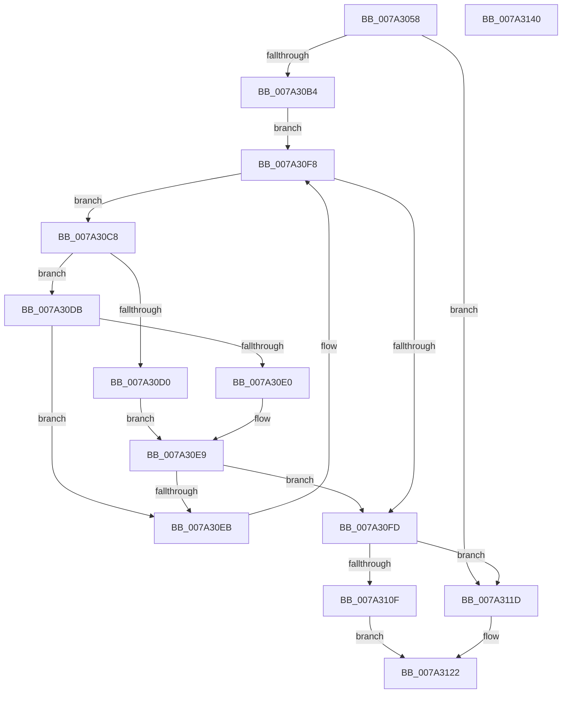

# SepFindMatchingLowBoxNumberEntries

- RVA: `0x007A3058`–`0x007A3141` (길이 `233` bytes)
- VA: `0x00000001407A3058`
- 실행 섹션: `PAGE`
- PDB 이름 있음: `예`; PDB Function 태그: `아니요`
- unwind 정보 RVA: `0x000C3AF8`
- 디코드: `74`개 명령, `233/233` bytes 표시
- 미해석 바이트: `0` (있으면 어셈블리에 `.byte`로 보존)

> 이 문서는 커널 이미지의 기계어와 PDB 기호를 분석해 생성했습니다. 4번과 5번은 함수 원형과 자료형을 바이너리 사용 방식에서 추정한 C 해석이며 원본 소스 복구 결과는 아닙니다.

## 1. Dependencies

- 직접 호출 지점: **4**; 고유 호출 대상: **3**
- 직접 호출자로 확인된 함수: **1**
- RIP 상대 이미지 참조: **0**

### Outgoing calls
- `0x007A30AB` → [RtlInitEnumerationHashTable](../../text/2E/RtlInitEnumerationHashTable_function_002ED0C0.md) (function, `0x002ED0C0`)
- `0x007A30BC` → [RtlEnumerateEntryHashTable](../../text/2E/RtlEnumerateEntryHashTable_function_002EEDE0.md) (function, `0x002EEDE0`)
- `0x007A30F3` → [RtlEnumerateEntryHashTable](../../text/2E/RtlEnumerateEntryHashTable_function_002EEDE0.md) (function, `0x002EEDE0`)
- `0x007A3105` → [RtlEndEnumerationHashTable](../../text/44/RtlEndEnumerationHashTable_function_00444700.md) (function, `0x00444700`)

### Direct callers
- [SepIsParentOfChildAppContainer](SepIsParentOfChildAppContainer_function_007A34C0.md) at `0x007A35F9`

### Static image references
- 디코드된 RIP-relative 메모리 참조가 없습니다.

## 2. Other-region calls and transfers

- 다른 실행 섹션으로 향하는 call: **4**
  - `0x007A30AB` → [RtlInitEnumerationHashTable](../../text/2E/RtlInitEnumerationHashTable_function_002ED0C0.md) (`PAGE` → `.text`)
  - `0x007A30BC` → [RtlEnumerateEntryHashTable](../../text/2E/RtlEnumerateEntryHashTable_function_002EEDE0.md) (`PAGE` → `.text`)
  - `0x007A30F3` → [RtlEnumerateEntryHashTable](../../text/2E/RtlEnumerateEntryHashTable_function_002EEDE0.md) (`PAGE` → `.text`)
  - `0x007A3105` → [RtlEndEnumerationHashTable](../../text/44/RtlEndEnumerationHashTable_function_00444700.md) (`PAGE` → `.text`)
- 별도 외부 분기/꼬리 이동을 확인하지 못했습니다.

## 3. Assembly (complete function range)

```asm
007A3058  4C 8B DC                        mov r11, rsp
007A305B  49 89 5B 08                     mov qword ptr [r11 + 8], rbx
007A305F  49 89 6B 10                     mov qword ptr [r11 + 0x10], rbp
007A3063  49 89 73 18                     mov qword ptr [r11 + 0x18], rsi
007A3067  57                              push rdi
007A3068  41 54                           push r12
007A306A  41 55                           push r13
007A306C  41 56                           push r14
007A306E  41 57                           push r15
007A3070  48 83 EC 50                     sub rsp, 0x50
007A3074  4C 8B BC 24 A0 00 00 00         mov r15, qword ptr [rsp + 0xa0]
007A307C  33 C0                           xor eax, eax
007A307E  49 21 01                        and qword ptr [r9], rax
007A3081  0F 57 C0                        xorps xmm0, xmm0
007A3084  44 8B EA                        mov r13d, edx
007A3087  4D 8B F1                        mov r14, r9
007A308A  0F 11 44 24 20                  movups xmmword ptr [rsp + 0x20], xmm0
007A308F  49 21 07                        and qword ptr [r15], rax
007A3092  49 8D 53 A8                     lea rdx, [r11 - 0x58]
007A3096  0F 11 44 24 30                  movups xmmword ptr [rsp + 0x30], xmm0
007A309B  45 8B E0                        mov r12d, r8d
007A309E  49 89 43 C8                     mov qword ptr [r11 - 0x38], rax
007A30A2  48 8B E9                        mov rbp, rcx
007A30A5  40 32 F6                        xor sil, sil
007A30A8  40 32 FF                        xor dil, dil
007A30AB  E8 10 A0 B4 FF                  call 0x1402ed0c0
007A30B0  84 C0                           test al, al
007A30B2  74 69                           je 0x1407a311d
007A30B4  48 8D 54 24 20                  lea rdx, [rsp + 0x20]
007A30B9  48 8B CD                        mov rcx, rbp
007A30BC  E8 1F BD B4 FF                  call 0x1402eede0
007A30C1  BB 01 00 00 00                  mov ebx, 1
007A30C6  EB 30                           jmp 0x1407a30f8
007A30C8  8B 48 28                        mov ecx, dword ptr [rax + 0x28]
007A30CB  41 3B CD                        cmp ecx, r13d
007A30CE  75 0B                           jne 0x1407a30db
007A30D0  49 89 06                        mov qword ptr [r14], rax
007A30D3  40 8A F3                        mov sil, bl
007A30D6  40 3A FB                        cmp dil, bl
007A30D9  EB 0E                           jmp 0x1407a30e9
007A30DB  41 3B CC                        cmp ecx, r12d
007A30DE  75 0B                           jne 0x1407a30eb
007A30E0  49 89 07                        mov qword ptr [r15], rax
007A30E3  40 8A FB                        mov dil, bl
007A30E6  40 3A F3                        cmp sil, bl
007A30E9  74 12                           je 0x1407a30fd
007A30EB  48 8D 54 24 20                  lea rdx, [rsp + 0x20]
007A30F0  48 8B CD                        mov rcx, rbp
007A30F3  E8 E8 BC B4 FF                  call 0x1402eede0
007A30F8  48 85 C0                        test rax, rax
007A30FB  75 CB                           jne 0x1407a30c8
007A30FD  48 8D 54 24 20                  lea rdx, [rsp + 0x20]
007A3102  48 8B CD                        mov rcx, rbp
007A3105  E8 F6 15 CA FF                  call 0x140444700
007A310A  40 3A F3                        cmp sil, bl
007A310D  75 0E                           jne 0x1407a311d
007A310F  40 2A DF                        sub bl, dil
007A3112  F6 DB                           neg bl
007A3114  1B C0                           sbb eax, eax
007A3116  25 25 02 00 C0                  and eax, 0xc0000225
007A311B  EB 05                           jmp 0x1407a3122
007A311D  B8 25 02 00 C0                  mov eax, 0xc0000225
007A3122  4C 8D 5C 24 50                  lea r11, [rsp + 0x50]
007A3127  49 8B 5B 30                     mov rbx, qword ptr [r11 + 0x30]
007A312B  49 8B 6B 38                     mov rbp, qword ptr [r11 + 0x38]
007A312F  49 8B 73 40                     mov rsi, qword ptr [r11 + 0x40]
007A3133  49 8B E3                        mov rsp, r11
007A3136  41 5F                           pop r15
007A3138  41 5E                           pop r14
007A313A  41 5D                           pop r13
007A313C  41 5C                           pop r12
007A313E  5F                              pop rdi
007A313F  C3                              ret
007A3140  CC                              int3
```

## 4. C-style interpretation (structured pseudocode)

```c
__int64 __fastcall SepFindMatchingLowBoxNumberEntries(__int64 a1, int a2, int a3, __int64 a4, __int64 a5)
{
    __int64 result;
    __int64 v_rbx;
    __int64 v_rdi;
    __int64 v_rsi;
    __int64 v_rsp;
    unsigned __int64 v_stack_m28;
    unsigned __int64 v_stack_m48;
    unsigned __int64 v_stack_m58;

    *(unsigned __int64 *)(v_rsp + 8) = v_rbx;
    *(unsigned __int64 *)(v_rsp + 16) = v_rbp;
    *(unsigned __int64 *)(v_rsp + 24) = v_rsi;
    v_rsp = (v_rsp) - (80);
    result = 0;
    v_stack_m58 = v_xmm0;
    v_stack_m48 = v_xmm0;
    *(unsigned __int64 *)(v_rsp - 56) = 0;
    v_rsi = 0;
    v_rdi = 0;
    result = RtlInitEnumerationHashTable(a1, v_rsp - 88, a3, a4);
    if ((unsigned __int8)(result) == 0) goto loc_007A311D;
    result = RtlEnumerateEntryHashTable(a1, v_stack_m58, a3, a4);
    goto loc_007A30F8;
loc_007A30C8:
    if (((unsigned int)((unsigned int)(*(unsigned int *)(result + 40)))) != ((unsigned int)((unsigned int)(a2)))) goto loc_007A30DB;
    *(unsigned __int64 *)(a4) = result;
    goto loc_007A30E9;
loc_007A30DB:
    if (((unsigned int)((unsigned int)(*(unsigned int *)(result + 40)))) != ((unsigned int)((unsigned int)(a3)))) goto loc_007A30EB;
    *(unsigned __int64 *)(a5) = result;
loc_007A30E9:
    if (1 == 1) goto loc_007A30FD;
loc_007A30EB:
    result = RtlEnumerateEntryHashTable(a1, v_stack_m58, a3, a4);
loc_007A30F8:
    if (result != 0) goto loc_007A30C8;
loc_007A30FD:
    result = RtlEndEnumerationHashTable(a1, v_stack_m58, a3, a4);
    if (1 != 1) goto loc_007A311D;
    v_rbx = (unsigned __int8)((1) - (1));
    v_rbx = (unsigned __int8)(-(v_rbx));
    result = (unsigned int)((result) & (0xC0000225ULL));
    goto loc_007A3122;
loc_007A311D:
loc_007A3122:
    return (unsigned int)(0xC0000225ULL);
}
```

## 5. (Beta) C Style

```c
int64_t SepFindMatchingLowBoxNumberEntries(int64_t Arg1, int32_t Arg2, int32_t Arg3, void *Arg4, void *Arg5)
{
    uint8_t *arg4 = (uint8_t *)Arg4;
    uint8_t *arg5 = (uint8_t *)Arg5;

    int64_t result;
    int64_t local_rbx;
    int64_t local_rdi;
    int64_t local_rsi;
    int64_t local_rsp;
    uint64_t v_stack_m28;
    uint64_t v_stack_m48;
    uint64_t v_stack_m58;

    *(uint64_t *)(local_rsp + 0x8) = local_rbx;
    *(uint64_t *)(local_rsp + 0x10) = local_rbp;
    *(uint64_t *)(local_rsp + 0x18) = local_rsi;
    local_rsp = (local_rsp) - (80);
    result = 0;
    v_stack_m58 = v_xmm0;
    v_stack_m48 = v_xmm0;
    *(uint64_t *)(local_rsp - 0x38) = 0;
    local_rsi = 0;
    local_rdi = 0;
    result = RtlInitEnumerationHashTable(Arg1, local_rsp - 88, Arg3, Arg4);
    if ((uint8_t)(result) == 0) goto loc_007A311D;
    result = RtlEnumerateEntryHashTable(Arg1, v_stack_m58, Arg3, Arg4);
    goto loc_007A30F8;
loc_007A30C8:
    if (((uint32_t)((uint32_t)(*(uint32_t *)(result + 0x28)))) != ((uint32_t)((uint32_t)(Arg2)))) goto loc_007A30DB;
    *(uint64_t *)(arg4) = result;
    goto loc_007A30E9;
loc_007A30DB:
    if (((uint32_t)((uint32_t)(*(uint32_t *)(result + 0x28)))) != ((uint32_t)((uint32_t)(Arg3)))) goto loc_007A30EB;
    *(uint64_t *)(arg5) = result;
loc_007A30E9:
    if (1 == 1) goto loc_007A30FD;
loc_007A30EB:
    result = RtlEnumerateEntryHashTable(Arg1, v_stack_m58, Arg3, Arg4);
loc_007A30F8:
    if (result != 0) goto loc_007A30C8;
loc_007A30FD:
    result = RtlEndEnumerationHashTable(Arg1, v_stack_m58, Arg3, Arg4);
    if (1 != 1) goto loc_007A311D;
    local_rbx = (uint8_t)((1) - (1));
    local_rbx = (uint8_t)(-(local_rbx));
    result = (uint32_t)((result) & (0xC0000225ULL));
    goto loc_007A3122;
loc_007A311D:
loc_007A3122:
    return (uint32_t)(0xC0000225ULL);
}
```

### 관측된 메모리 오프셋

구조체 형식이 확인되지 않은 접근은 인자 기준의 오프셋으로만 기록했습니다.

| 기준 인자 | 오프셋 표현 | 폭 (bit) | 접근 |
|---|---:|---:|---|
| `Arg4` | `+ 0x0` | `64` | `R/W` |
| `Arg4` | `+ 0x0` | `64` | `W` |
| `Arg5` | `+ 0x0` | `64` | `R/W` |
| `Arg5` | `+ 0x0` | `64` | `W` |

## 6. Execution-region graph

[열기: 2D/3D 그래프와 함수 탐색 컨트롤 패널](../../../control-panel.html?section=page&rva=0x007A3058&view=graph)

- 2D 그래프는 위에서 아래로 흐르고, 3D 그래프는 빈 공간을 드래그해 회전합니다. Shift+드래그는 이동, 휠은 확대·축소, 함수 노드 선택은 대상 보고서 이동입니다.

### Static fallback


