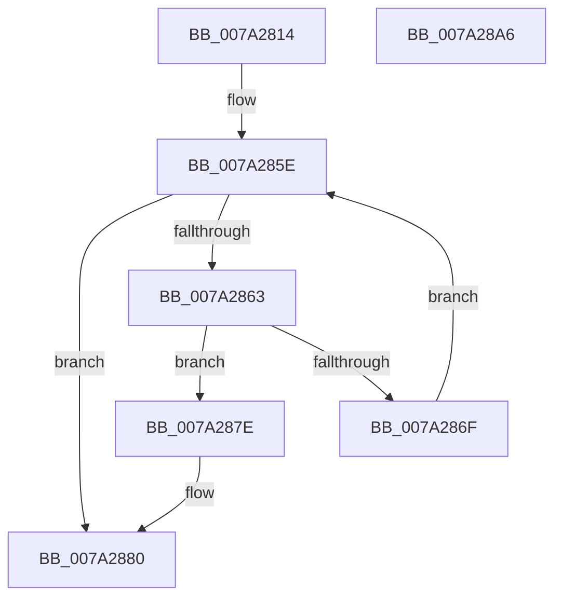

# SepFindMatchingLuidEntry

- RVA: `0x007A2814`–`0x007A28A7` (길이 `147` bytes)
- VA: `0x00000001407A2814`
- 실행 섹션: `PAGE`
- PDB 이름 있음: `예`; PDB Function 태그: `아니요`
- unwind 정보 RVA: `0x00060130`
- 디코드: `45`개 명령, `147/147` bytes 표시
- 미해석 바이트: `0` (있으면 어셈블리에 `.byte`로 보존)

> 이 문서는 커널 이미지의 기계어와 PDB 기호를 분석해 생성했습니다. 4번과 5번은 함수 원형과 자료형을 바이너리 사용 방식에서 추정한 C 해석이며 원본 소스 복구 결과는 아닙니다.

## 1. Dependencies

- 직접 호출 지점: **2**; 고유 호출 대상: **2**
- 직접 호출자로 확인된 함수: **1**
- RIP 상대 이미지 참조: **0**

### Outgoing calls
- `0x007A2859` → [RtlLookupEntryHashTable](../../text/3F/RtlLookupEntryHashTable_function_003FAE50.md) (function, `0x003FAE50`)
- `0x007A2877` → [RtlGetNextEntryHashTable](../../text/44/RtlGetNextEntryHashTable_function_00446C20.md) (function, `0x00446C20`)

### Direct callers
- [SepIsValidProcUniqueLuid](SepIsValidProcUniqueLuid_function_007A28B0.md) at `0x007A2931`

### Static image references
- 디코드된 RIP-relative 메모리 참조가 없습니다.

## 2. Other-region calls and transfers

- 다른 실행 섹션으로 향하는 call: **2**
  - `0x007A2859` → [RtlLookupEntryHashTable](../../text/3F/RtlLookupEntryHashTable_function_003FAE50.md) (`PAGE` → `.text`)
  - `0x007A2877` → [RtlGetNextEntryHashTable](../../text/44/RtlGetNextEntryHashTable_function_00446C20.md) (`PAGE` → `.text`)
- 별도 외부 분기/꼬리 이동을 확인하지 못했습니다.

## 3. Assembly (complete function range)

```asm
007A2814  4C 8B DC                        mov r11, rsp
007A2817  49 89 5B 08                     mov qword ptr [r11 + 8], rbx
007A281B  49 89 6B 10                     mov qword ptr [r11 + 0x10], rbp
007A281F  49 89 73 18                     mov qword ptr [r11 + 0x18], rsi
007A2823  49 89 7B 20                     mov qword ptr [r11 + 0x20], rdi
007A2827  41 56                           push r14
007A2829  48 83 EC 40                     sub rsp, 0x40
007A282D  33 C0                           xor eax, eax
007A282F  33 DB                           xor ebx, ebx
007A2831  48 8B F2                        mov rsi, rdx
007A2834  0F 57 C0                        xorps xmm0, xmm0
007A2837  0F 11 44 24 20                  movups xmmword ptr [rsp + 0x20], xmm0
007A283C  49 89 43 E8                     mov qword ptr [r11 - 0x18], rax
007A2840  4D 8B F0                        mov r14, r8
007A2843  48 8B 02                        mov rax, qword ptr [rdx]
007A2846  4D 8D 43 D8                     lea r8, [r11 - 0x28]
007A284A  48 85 C0                        test rax, rax
007A284D  8D 53 01                        lea edx, [rbx + 1]
007A2850  48 8B E9                        mov rbp, rcx
007A2853  8B FB                           mov edi, ebx
007A2855  48 0F 45 D0                     cmovne rdx, rax
007A2859  E8 F2 85 C5 FF                  call 0x1403fae50
007A285E  48 85 C0                        test rax, rax
007A2861  74 1D                           je 0x1407a2880
007A2863  48 8B F8                        mov rdi, rax
007A2866  48 8B 40 20                     mov rax, qword ptr [rax + 0x20]
007A286A  48 39 06                        cmp qword ptr [rsi], rax
007A286D  74 0F                           je 0x1407a287e
007A286F  48 8D 54 24 20                  lea rdx, [rsp + 0x20]
007A2874  48 8B CD                        mov rcx, rbp
007A2877  E8 A4 43 CA FF                  call 0x140446c20
007A287C  EB E0                           jmp 0x1407a285e
007A287E  B3 01                           mov bl, 1
007A2880  F6 DB                           neg bl
007A2882  48 1B C0                        sbb rax, rax
007A2885  48 23 C7                        and rax, rdi
007A2888  49 89 06                        mov qword ptr [r14], rax
007A288B  48 8B 5C 24 50                  mov rbx, qword ptr [rsp + 0x50]
007A2890  48 8B 6C 24 58                  mov rbp, qword ptr [rsp + 0x58]
007A2895  48 8B 74 24 60                  mov rsi, qword ptr [rsp + 0x60]
007A289A  48 8B 7C 24 68                  mov rdi, qword ptr [rsp + 0x68]
007A289F  48 83 C4 40                     add rsp, 0x40
007A28A3  41 5E                           pop r14
007A28A5  C3                              ret
007A28A6  CC                              int3
```

## 4. C-style interpretation (structured pseudocode)

```c
__int64 __fastcall SepFindMatchingLuidEntry(__int64 a1, __int64 a2, __int64 a3)
{
    __int64 result;
    __int64 v_rbx;
    __int64 v_rsp;
    unsigned __int64 v_stack_m28;
    unsigned __int64 v_stack_p10;
    unsigned __int64 v_stack_p18;
    unsigned __int64 v_stack_p20;
    unsigned __int64 v_stack_p8;

    *(unsigned __int64 *)(v_rsp + 8) = v_rbx;
    *(unsigned __int64 *)(v_rsp + 16) = v_rbp;
    *(unsigned __int64 *)(v_rsp + 24) = v_rsi;
    *(unsigned __int64 *)(v_rsp + 32) = v_rdi;
    v_rsp = (v_rsp) - (64);
    result = 0;
    v_rbx = 0;
    v_stack_m28 = v_xmm0;
    *(unsigned __int64 *)(v_rsp - 24) = 0;
    a2 = v_rbx + 1;
    if (*(unsigned __int64 *)(a2) != 0) { a2 = *(unsigned __int64 *)(a2); }
    result = RtlLookupEntryHashTable(a1, a2, v_rsp - 40, a4);
loc_007A285E:
    if (result == 0) goto loc_007A2880;
    if ((*(unsigned __int64 *)(a2)) == (*(unsigned __int64 *)(result + 32))) goto loc_007A287E;
    result = RtlGetNextEntryHashTable(a1, v_stack_m28, v_rsp - 40, a4);
    goto loc_007A285E;
loc_007A287E:
loc_007A2880:
    v_rbx = (unsigned __int8)(-(1));
    result = (result) & (result);
    *(unsigned __int64 *)(a3) = result;
    v_rsp = (v_rsp) + (64);
    return result;
}
```

## 5. (Beta) C Style

```c
int64_t SepFindMatchingLuidEntry(int64_t Arg1, void *Arg2, void *Arg3)
{
    uint8_t *arg2 = (uint8_t *)Arg2;
    uint8_t *arg3 = (uint8_t *)Arg3;

    int64_t result;
    int64_t local_rbx;
    int64_t local_rsp;
    uint64_t v_stack_m28;
    uint64_t v_stack_p10;
    uint64_t v_stack_p18;
    uint64_t v_stack_p20;
    uint64_t v_stack_p8;

    *(uint64_t *)(local_rsp + 0x8) = local_rbx;
    *(uint64_t *)(local_rsp + 0x10) = local_rbp;
    *(uint64_t *)(local_rsp + 0x18) = local_rsi;
    *(uint64_t *)(local_rsp + 0x20) = local_rdi;
    local_rsp = (local_rsp) - (64);
    result = 0;
    local_rbx = 0;
    v_stack_m28 = v_xmm0;
    *(uint64_t *)(local_rsp - 0x18) = 0;
    Arg2 = local_rbx + 1;
    if (*(uint64_t *)(arg2) != 0) { Arg2 = *(uint64_t *)(arg2); }
    result = RtlLookupEntryHashTable(Arg1, Arg2, local_rsp - 40, a4);
loc_007A285E:
    if (result == 0) goto loc_007A2880;
    if ((*(uint64_t *)(arg2)) == (*(uint64_t *)(result + 0x20))) goto loc_007A287E;
    result = RtlGetNextEntryHashTable(Arg1, v_stack_m28, local_rsp - 40, a4);
    goto loc_007A285E;
loc_007A287E:
loc_007A2880:
    local_rbx = (uint8_t)(-(1));
    result = (result) & (result);
    *(uint64_t *)(arg3) = result;
    local_rsp = (local_rsp) + (64);
    return result;
}
```

### 관측된 메모리 오프셋

구조체 형식이 확인되지 않은 접근은 인자 기준의 오프셋으로만 기록했습니다.

| 기준 인자 | 오프셋 표현 | 폭 (bit) | 접근 |
|---|---:|---:|---|
| `Arg2` | `+ 0x0` | `64` | `R` |
| `Arg3` | `+ 0x0` | `64` | `W` |

## 6. Execution-region graph

[열기: 2D/3D 그래프와 함수 탐색 컨트롤 패널](../../../control-panel.html?section=page&rva=0x007A2814&view=graph)

- 2D 그래프는 위에서 아래로 흐르고, 3D 그래프는 빈 공간을 드래그해 회전합니다. Shift+드래그는 이동, 휠은 확대·축소, 함수 노드 선택은 대상 보고서 이동입니다.

### Static fallback


