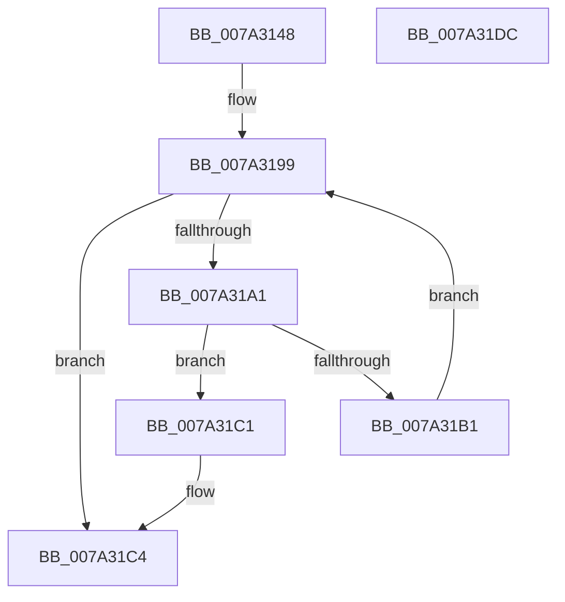

# SepFindSharedSidEntry

- RVA: `0x007A3148`–`0x007A31DD` (길이 `149` bytes)
- VA: `0x00000001407A3148`
- 실행 섹션: `PAGE`
- PDB 이름 있음: `예`; PDB Function 태그: `아니요`
- unwind 정보 RVA: `0x0007D3C0`
- 디코드: `43`개 명령, `149/149` bytes 표시
- 미해석 바이트: `0` (있으면 어셈블리에 `.byte`로 보존)

> 이 문서는 커널 이미지의 기계어와 PDB 기호를 분석해 생성했습니다. 4번과 5번은 함수 원형과 자료형을 바이너리 사용 방식에서 추정한 C 해석이며 원본 소스 복구 결과는 아닙니다.

## 1. Dependencies

- 직접 호출 지점: **3**; 고유 호출 대상: **3**
- 직접 호출자로 확인된 함수: **2**
- RIP 상대 이미지 참조: **1**

### Outgoing calls
- `0x007A3194` → [RtlLookupEntryHashTable](../../text/3F/RtlLookupEntryHashTable_function_003FAE50.md) (function, `0x003FAE50`)
- `0x007A31A8` → [RtlEqualSid](../../text/40/RtlEqualSid_function_00400AD0.md) (function, `0x00400AD0`)
- `0x007A31BA` → [RtlGetNextEntryHashTable](../../text/44/RtlGetNextEntryHashTable_function_00446C20.md) (function, `0x00446C20`)

### Direct callers
- [SepDeReferenceSharedSidEntries](SepDeReferenceSharedSidEntries_function_007A2D40.md) at `0x007A2DB3`
- [SepInsertOrReferenceSharedSidEntries](SepInsertOrReferenceSharedSidEntries_function_007A32A8.md) at `0x007A333C`
- [SepInsertOrReferenceSharedSidEntries](SepInsertOrReferenceSharedSidEntries_function_007A32A8.md) at `0x007A341B`

### Static image references
- `0x007A315C` → RVA `0x00FD8088` (`PAGEDATA`; read)

## 2. Other-region calls and transfers

- 다른 실행 섹션으로 향하는 call: **3**
  - `0x007A3194` → [RtlLookupEntryHashTable](../../text/3F/RtlLookupEntryHashTable_function_003FAE50.md) (`PAGE` → `.text`)
  - `0x007A31A8` → [RtlEqualSid](../../text/40/RtlEqualSid_function_00400AD0.md) (`PAGE` → `.text`)
  - `0x007A31BA` → [RtlGetNextEntryHashTable](../../text/44/RtlGetNextEntryHashTable_function_00446C20.md) (`PAGE` → `.text`)
- 별도 외부 분기/꼬리 이동을 확인하지 못했습니다.

## 3. Assembly (complete function range)

```asm
007A3148  4C 8B DC                        mov r11, rsp
007A314B  49 89 5B 08                     mov qword ptr [r11 + 8], rbx
007A314F  49 89 6B 10                     mov qword ptr [r11 + 0x10], rbp
007A3153  49 89 73 18                     mov qword ptr [r11 + 0x18], rsi
007A3157  57                              push rdi
007A3158  48 83 EC 40                     sub rsp, 0x40
007A315C  48 8B 2D 25 4F 83 00            mov rbp, qword ptr [rip + 0x834f25]
007A3163  33 C0                           xor eax, eax
007A3165  0F 57 C0                        xorps xmm0, xmm0
007A3168  33 DB                           xor ebx, ebx
007A316A  0F 11 44 24 20                  movups xmmword ptr [rsp + 0x20], xmm0
007A316F  49 89 43 E8                     mov qword ptr [r11 - 0x18], rax
007A3173  48 8B F1                        mov rsi, rcx
007A3176  0F B6 41 01                     movzx eax, byte ptr [rcx + 1]
007A317A  FF C8                           dec eax
007A317C  44 8B 44 81 08                  mov r8d, dword ptr [rcx + rax*4 + 8]
007A3181  48 8B 4D 08                     mov rcx, qword ptr [rbp + 8]
007A3185  45 85 C0                        test r8d, r8d
007A3188  49 8D 50 01                     lea rdx, [r8 + 1]
007A318C  49 0F 45 D0                     cmovne rdx, r8
007A3190  4D 8D 43 D8                     lea r8, [r11 - 0x28]
007A3194  E8 B7 7C C5 FF                  call 0x1403fae50
007A3199  48 8B F8                        mov rdi, rax
007A319C  48 85 C0                        test rax, rax
007A319F  74 23                           je 0x1407a31c4
007A31A1  48 8B 50 20                     mov rdx, qword ptr [rax + 0x20]
007A31A5  48 8B CE                        mov rcx, rsi
007A31A8  E8 23 D9 C5 FF                  call 0x140400ad0
007A31AD  84 C0                           test al, al
007A31AF  75 10                           jne 0x1407a31c1
007A31B1  48 8B 4D 08                     mov rcx, qword ptr [rbp + 8]
007A31B5  48 8D 54 24 20                  lea rdx, [rsp + 0x20]
007A31BA  E8 61 3A CA FF                  call 0x140446c20
007A31BF  EB D8                           jmp 0x1407a3199
007A31C1  48 8B DF                        mov rbx, rdi
007A31C4  48 8B 6C 24 58                  mov rbp, qword ptr [rsp + 0x58]
007A31C9  48 8B C3                        mov rax, rbx
007A31CC  48 8B 5C 24 50                  mov rbx, qword ptr [rsp + 0x50]
007A31D1  48 8B 74 24 60                  mov rsi, qword ptr [rsp + 0x60]
007A31D6  48 83 C4 40                     add rsp, 0x40
007A31DA  5F                              pop rdi
007A31DB  C3                              ret
007A31DC  CC                              int3
```

## 4. C-style interpretation (structured pseudocode)

```c
__int64 __fastcall SepFindSharedSidEntry(__int64 a1)
{
    __int64 result;
    __int64 v_rbx;
    __int64 v_rsp;
    unsigned __int64 v_stack_m28;
    unsigned __int64 v_stack_p10;
    unsigned __int64 v_stack_p18;
    unsigned __int64 v_stack_p8;

    *(unsigned __int64 *)(v_rsp + 8) = v_rbx;
    *(unsigned __int64 *)(v_rsp + 16) = v_rbp;
    *(unsigned __int64 *)(v_rsp + 24) = v_rsi;
    v_rsp = (v_rsp) - (64);
    result = 0;
    v_rbx = 0;
    v_stack_m28 = v_xmm0;
    *(unsigned __int64 *)(v_rsp - 24) = 0;
    result = (unsigned int)((*(unsigned __int8 *)(a1 + 1)) - 1);
    a2 = (unsigned int)(*(unsigned int *)(a1 + result * 4 + 8)) + 1;
    if ((unsigned int)((unsigned int)(*(unsigned int *)(a1 + result * 4 + 8))) != 0) { a2 = (unsigned int)(*(unsigned int *)(a1 + result * 4 + 8)); }
    result = RtlLookupEntryHashTable(*(unsigned __int64 *)(*(unsigned __int64 *)(v_rip + 8605477) + 8), a2, v_rsp - 40, a4);
loc_007A3199:
    if (result == 0) goto loc_007A31C4;
    result = RtlEqualSid(a1, *(unsigned __int64 *)(result + 32), v_rsp - 40, a4);
    if ((unsigned __int8)(result) != 0) goto loc_007A31C1;
    result = RtlGetNextEntryHashTable(*(unsigned __int64 *)(*(unsigned __int64 *)(v_rip + 8605477) + 8), v_stack_m28, v_rsp - 40, a4);
    goto loc_007A3199;
loc_007A31C1:
loc_007A31C4:
    v_rsp = (v_rsp) + (64);
    return result;
}
```

## 5. (Beta) C Style

```c
int64_t SepFindSharedSidEntry(void *Arg1)
{
    uint8_t *arg1 = (uint8_t *)Arg1;

    int64_t result;
    int64_t local_rbx;
    int64_t local_rsp;
    uint64_t v_stack_m28;
    uint64_t v_stack_p10;
    uint64_t v_stack_p18;
    uint64_t v_stack_p8;

    *(uint64_t *)(local_rsp + 0x8) = local_rbx;
    *(uint64_t *)(local_rsp + 0x10) = local_rbp;
    *(uint64_t *)(local_rsp + 0x18) = local_rsi;
    local_rsp = (local_rsp) - (64);
    result = 0;
    local_rbx = 0;
    v_stack_m28 = v_xmm0;
    *(uint64_t *)(local_rsp - 0x18) = 0;
    result = (uint32_t)((*(uint8_t *)(arg1 + 0x1)) - 1);
    a2 = (uint32_t)(*(uint32_t *)(arg1 + result * 4 + 0x8)) + 1;
    if ((uint32_t)((uint32_t)(*(uint32_t *)(arg1 + result * 4 + 0x8))) != 0) { a2 = (uint32_t)(*(uint32_t *)(arg1 + result * 4 + 0x8)); }
    result = RtlLookupEntryHashTable(*(uint64_t *)(*(uint64_t *)(v_rip + 0x834F25) + 0x8), a2, local_rsp - 40, a4);
loc_007A3199:
    if (result == 0) goto loc_007A31C4;
    result = RtlEqualSid(Arg1, *(uint64_t *)(result + 0x20), local_rsp - 40, a4);
    if ((uint8_t)(result) != 0) goto loc_007A31C1;
    result = RtlGetNextEntryHashTable(*(uint64_t *)(*(uint64_t *)(v_rip + 0x834F25) + 0x8), v_stack_m28, local_rsp - 40, a4);
    goto loc_007A3199;
loc_007A31C1:
loc_007A31C4:
    local_rsp = (local_rsp) + (64);
    return result;
}
```

### 관측된 메모리 오프셋

구조체 형식이 확인되지 않은 접근은 인자 기준의 오프셋으로만 기록했습니다.

| 기준 인자 | 오프셋 표현 | 폭 (bit) | 접근 |
|---|---:|---:|---|
| `Arg1` | `+ 0x1` | `8` | `R` |
| `Arg1` | `+ 0x8 + rax*4` | `32` | `R` |

## 6. Execution-region graph

[열기: 2D/3D 그래프와 함수 탐색 컨트롤 패널](../../../control-panel.html?section=page&rva=0x007A3148&view=graph)

- 2D 그래프는 위에서 아래로 흐르고, 3D 그래프는 빈 공간을 드래그해 회전합니다. Shift+드래그는 이동, 휠은 확대·축소, 함수 노드 선택은 대상 보고서 이동입니다.

### Static fallback


