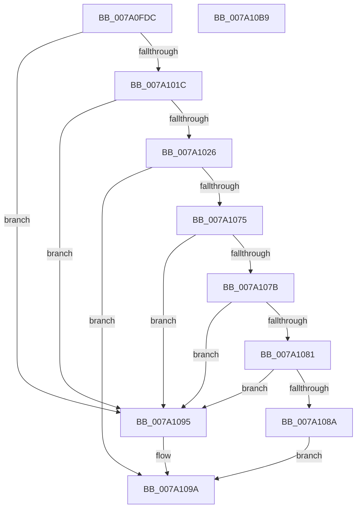

# SepGetAgentIdClaimValue

- RVA: `0x007A0FDC`–`0x007A10BA` (길이 `222` bytes)
- VA: `0x00000001407A0FDC`
- 실행 섹션: `PAGE`
- PDB 이름 있음: `예`; PDB Function 태그: `아니요`
- unwind 정보 RVA: `0x000D1460`
- 디코드: `60`개 명령, `222/222` bytes 표시
- 미해석 바이트: `0` (있으면 어셈블리에 `.byte`로 보존)

> 이 문서는 커널 이미지의 기계어와 PDB 기호를 분석해 생성했습니다. 4번과 5번은 함수 원형과 자료형을 바이너리 사용 방식에서 추정한 C 해석이며 원본 소스 복구 결과는 아닙니다.

## 1. Dependencies

- 직접 호출 지점: **4**; 고유 호출 대상: **4**
- 직접 호출자로 확인된 함수: **1**
- RIP 상대 이미지 참조: **2**

### Outgoing calls
- `0x007A1031` → [RtlInitUnicodeString](../../text/42/RtlInitUnicodeString_function_0042A780.md) (function, `0x0042A780`)
- `0x007A1040` → [memset](../../text/6C/memset_function_006C6C40.md) (function, `0x006C6C40`)
- `0x007A106C` → [AuthzBasepQuerySecurityAttributeAndValues](../../text/30/AuthzBasepQuerySecurityAttributeAndValues_function_00300090.md) (function, `0x00300090`)
- `0x007A10A1` → [_security_check_cookie](../../text/6A/_security_check_cookie_function_006AC640.md) (function, `0x006AC640`)

### Direct callers
- [NtQueryInformationToken](../AE/NtQueryInformationToken_function_00AECDD0.md) at `0x00AEFE92`

### Static image references
- `0x007A0FF0` → RVA `0x00E0A740` (`.data`; read)
- `0x007A1026` → RVA `0x00B05EC0` (` ?? ::NNGAKEGL::`string'`; read)

## 2. Other-region calls and transfers

- 다른 실행 섹션으로 향하는 call: **4**
  - `0x007A1031` → [RtlInitUnicodeString](../../text/42/RtlInitUnicodeString_function_0042A780.md) (`PAGE` → `.text`)
  - `0x007A1040` → [memset](../../text/6C/memset_function_006C6C40.md) (`PAGE` → `.text`)
  - `0x007A106C` → [AuthzBasepQuerySecurityAttributeAndValues](../../text/30/AuthzBasepQuerySecurityAttributeAndValues_function_00300090.md) (`PAGE` → `.text`)
  - `0x007A10A1` → [_security_check_cookie](../../text/6A/_security_check_cookie_function_006AC640.md) (`PAGE` → `.text`)
- 별도 외부 분기/꼬리 이동을 확인하지 못했습니다.

## 3. Assembly (complete function range)

```asm
007A0FDC  48 89 5C 24 18                  mov qword ptr [rsp + 0x18], rbx
007A0FE1  55                              push rbp
007A0FE2  56                              push rsi
007A0FE3  57                              push rdi
007A0FE4  48 8D 6C 24 B9                  lea rbp, [rsp - 0x47]
007A0FE9  48 81 EC 90 00 00 00            sub rsp, 0x90
007A0FF0  48 8B 05 49 97 66 00            mov rax, qword ptr [rip + 0x669749]
007A0FF7  48 33 C4                        xor rax, rsp
007A0FFA  48 89 45 37                     mov qword ptr [rbp + 0x37], rax
007A0FFE  33 C0                           xor eax, eax
007A1000  0F 57 C0                        xorps xmm0, xmm0
007A1003  89 45 EB                        mov dword ptr [rbp - 0x15], eax
007A1006  48 8B DA                        mov rbx, rdx
007A1009  48 8B 81 48 04 00 00            mov rax, qword ptr [rcx + 0x448]
007A1010  48 8B F9                        mov rdi, rcx
007A1013  0F 11 45 D7                     movups xmmword ptr [rbp - 0x29], xmm0
007A1017  48 85 C0                        test rax, rax
007A101A  74 79                           je 0x1407a1095
007A101C  48 83 B8 40 02 00 00 00         cmp qword ptr [rax + 0x240], 0
007A1024  74 6F                           je 0x1407a1095
007A1026  48 8D 15 93 4E 36 00            lea rdx, [rip + 0x364e93]
007A102D  48 8D 4D D7                     lea rcx, [rbp - 0x29]
007A1031  E8 4A 97 C8 FF                  call 0x14042a780
007A1036  33 D2                           xor edx, edx
007A1038  48 8D 4D E7                     lea rcx, [rbp - 0x19]
007A103C  44 8D 42 48                     lea r8d, [rdx + 0x48]
007A1040  E8 FB 5B F2 FF                  call 0x1406c6c40
007A1045  48 8B 87 48 04 00 00            mov rax, qword ptr [rdi + 0x448]
007A104C  BE 03 00 00 00                  mov esi, 3
007A1051  0F 10 45 D7                     movups xmm0, xmmword ptr [rbp - 0x29]
007A1055  89 75 E7                        mov dword ptr [rbp - 0x19], esi
007A1058  48 8B 88 40 02 00 00            mov rcx, qword ptr [rax + 0x240]
007A105F  48 89 4D EF                     mov qword ptr [rbp - 0x11], rcx
007A1063  48 8D 4D E7                     lea rcx, [rbp - 0x19]
007A1067  F3 0F 7F 45 F7                  movdqu xmmword ptr [rbp - 9], xmm0
007A106C  E8 1F F0 B5 FF                  call 0x140300090
007A1071  85 C0                           test eax, eax
007A1073  78 25                           js 0x1407a109a
007A1075  66 39 75 07                     cmp word ptr [rbp + 7], si
007A1079  75 1A                           jne 0x1407a1095
007A107B  83 7D 0F 00                     cmp dword ptr [rbp + 0xf], 0
007A107F  74 14                           je 0x1407a1095
007A1081  48 8B 45 17                     mov rax, qword ptr [rbp + 0x17]
007A1085  48 85 C0                        test rax, rax
007A1088  74 0B                           je 0x1407a1095
007A108A  0F 10 00                        movups xmm0, xmmword ptr [rax]
007A108D  33 C0                           xor eax, eax
007A108F  F3 0F 7F 03                     movdqu xmmword ptr [rbx], xmm0
007A1093  EB 05                           jmp 0x1407a109a
007A1095  B8 25 02 00 C0                  mov eax, 0xc0000225
007A109A  48 8B 4D 37                     mov rcx, qword ptr [rbp + 0x37]
007A109E  48 33 CC                        xor rcx, rsp
007A10A1  E8 9A B5 F0 FF                  call 0x1406ac640
007A10A6  48 8B 9C 24 C0 00 00 00         mov rbx, qword ptr [rsp + 0xc0]
007A10AE  48 81 C4 90 00 00 00            add rsp, 0x90
007A10B5  5F                              pop rdi
007A10B6  5E                              pop rsi
007A10B7  5D                              pop rbp
007A10B8  C3                              ret
007A10B9  CC                              int3
```

## 4. C-style interpretation (structured pseudocode)

```c
__int64 __fastcall SepGetAgentIdClaimValue(__int64 a1, __int64 a2)
{
    __int64 result;
    __int64 v_rsp;
    unsigned __int64 v_stack_m28;
    unsigned __int64 v_stack_m48;
    unsigned int v_stack_m50;
    unsigned __int16 v_stack_m58;
    unsigned __int64 v_stack_m5F;
    unsigned __int64 v_stack_m68;
    unsigned __int64 v_stack_m70;
    unsigned int v_stack_m74;
    unsigned __int64 v_stack_m78;
    unsigned __int64 v_stack_m88;
    unsigned __int64 v_stack_p18;

    v_stack_p18 = v_rbx;
    v_rsp = (v_rsp) - (144);
    result = (*(unsigned __int64 *)(v_rip + 6723401)) ^ (v_rsp);
    v_stack_m28 = result;
    result = 0;
    v_stack_m74 = 0;
    v_stack_m88 = v_xmm0;
    if (*(unsigned __int64 *)(a1 + 1096) == 0) goto loc_007A1095;
    if ((*(unsigned __int64 *)(*(unsigned __int64 *)(a1 + 1096) + 576)) == 0) goto loc_007A1095;
    result = RtlInitUnicodeString(v_stack_m88, v_rip + 3559059, a3, a4);
    a2 = 0;
    result = memset(v_stack_m78, a2, a2 + 72, a4);
    v_stack_m78 = 3;
    v_stack_m70 = *(unsigned __int64 *)(*(unsigned __int64 *)(a1 + 1096) + 576);
    v_stack_m68 = v_xmm0;
    result = AuthzBasepQuerySecurityAttributeAndValues(v_stack_m78, a2, a2 + 72, a4);
    if (sign_flag) goto loc_007A109A;
    if (v_stack_m58 != 3) goto loc_007A1095;
    if (v_stack_m50 == 0) goto loc_007A1095;
    if (v_stack_m48 == 0) goto loc_007A1095;
    result = 0;
    *(unsigned __int64 *)(a2) = v_xmm0;
    goto loc_007A109A;
loc_007A1095:
loc_007A109A:
    a1 = (v_stack_m28) ^ (v_rsp);
    result = _security_check_cookie(a1, a2, a2 + 72, a4);
    v_rsp = (v_rsp) + (144);
    return result;
}
```

## 5. (Beta) C Style

```c
int64_t SepGetAgentIdClaimValue(void *Arg1, void *Arg2)
{
    uint8_t *arg1 = (uint8_t *)Arg1;
    uint8_t *arg2 = (uint8_t *)Arg2;

    int64_t result;
    int64_t local_rsp;
    uint64_t v_stack_m28;
    uint64_t v_stack_m48;
    uint32_t v_stack_m50;
    uint16_t v_stack_m58;
    uint64_t v_stack_m5F;
    uint64_t v_stack_m68;
    uint64_t v_stack_m70;
    uint32_t v_stack_m74;
    uint64_t v_stack_m78;
    uint64_t v_stack_m88;
    uint64_t v_stack_p18;

    v_stack_p18 = local_rbx;
    local_rsp = (local_rsp) - (144);
    result = (*(uint64_t *)(v_rip + 0x669749)) ^ (local_rsp);
    v_stack_m28 = result;
    result = 0;
    v_stack_m74 = 0;
    v_stack_m88 = v_xmm0;
    if (*(uint64_t *)(arg1 + 0x448) == 0) goto loc_007A1095;
    if ((*(uint64_t *)(*(uint64_t *)(arg1 + 0x448) + 0x240)) == 0) goto loc_007A1095;
    result = RtlInitUnicodeString(v_stack_m88, v_rip + 3559059, a3, a4);
    Arg2 = 0;
    result = memset(v_stack_m78, Arg2, Arg2 + 72, a4);
    v_stack_m78 = 3;
    v_stack_m70 = *(uint64_t *)(*(uint64_t *)(arg1 + 0x448) + 0x240);
    v_stack_m68 = v_xmm0;
    result = AuthzBasepQuerySecurityAttributeAndValues(v_stack_m78, Arg2, Arg2 + 72, a4);
    if (sign_flag) goto loc_007A109A;
    if (v_stack_m58 != 3) goto loc_007A1095;
    if (v_stack_m50 == 0) goto loc_007A1095;
    if (v_stack_m48 == 0) goto loc_007A1095;
    result = 0;
    *(uint64_t *)(arg2) = v_xmm0;
    goto loc_007A109A;
loc_007A1095:
loc_007A109A:
    Arg1 = (v_stack_m28) ^ (local_rsp);
    result = _security_check_cookie(Arg1, Arg2, Arg2 + 72, a4);
    local_rsp = (local_rsp) + (144);
    return result;
}
```

### 관측된 메모리 오프셋

구조체 형식이 확인되지 않은 접근은 인자 기준의 오프셋으로만 기록했습니다.

| 기준 인자 | 오프셋 표현 | 폭 (bit) | 접근 |
|---|---:|---:|---|
| `Arg1` | `+ 0x448` | `64` | `R` |
| `Arg2` | `+ 0x0` | `128` | `W` |

## 6. Execution-region graph

[열기: 2D/3D 그래프와 함수 탐색 컨트롤 패널](../../../control-panel.html?section=page&rva=0x007A0FDC&view=graph)

- 2D 그래프는 위에서 아래로 흐르고, 3D 그래프는 빈 공간을 드래그해 회전합니다. Shift+드래그는 이동, 휠은 확대·축소, 함수 노드 선택은 대상 보고서 이동입니다.

### Static fallback


