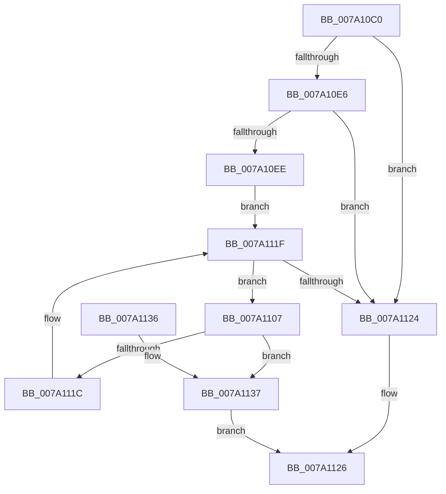

# SepGetAgentIdFromOriginClaim

- RVA: `0x007A10C0`–`0x007A1142` (길이 `130` bytes)
- VA: `0x00000001407A10C0`
- 실행 섹션: `PAGE`
- PDB 이름 있음: `예`; PDB Function 태그: `아니요`
- unwind 정보 RVA: `0x000D1404`
- 디코드: `39`개 명령, `130/130` bytes 표시
- 미해석 바이트: `0` (있으면 어셈블리에 `.byte`로 보존)

> 이 문서는 커널 이미지의 기계어와 PDB 기호를 분석해 생성했습니다. 4번과 5번은 함수 원형과 자료형을 바이너리 사용 방식에서 추정한 C 해석이며 원본 소스 복구 결과는 아닙니다.

## 1. Dependencies

- 직접 호출 지점: **2**; 고유 호출 대상: **2**
- 직접 호출자로 확인된 함수: **1**
- RIP 상대 이미지 참조: **1**

### Outgoing calls
- `0x007A10F9` → [RtlInitUnicodeString](../../text/42/RtlInitUnicodeString_function_0042A780.md) (function, `0x0042A780`)
- `0x007A1113` → [RtlEqualUnicodeString](../93/RtlEqualUnicodeString_function_00932A20.md) (function, `0x00932A20`)

### Direct callers
- [SeSubProcessToken](../AA/SeSubProcessToken_function_00AAD570.md) at `0x00AADC61`

### Static image references
- `0x007A10EE` → RVA `0x00B05F10` (` ?? ::NNGAKEGL::`string'`; read)

## 2. Other-region calls and transfers

- 다른 실행 섹션으로 향하는 call: **1**
  - `0x007A10F9` → [RtlInitUnicodeString](../../text/42/RtlInitUnicodeString_function_0042A780.md) (`PAGE` → `.text`)
- 별도 외부 분기/꼬리 이동을 확인하지 못했습니다.

## 3. Assembly (complete function range)

```asm
007A10C0  48 8B C4                        mov rax, rsp
007A10C3  48 89 58 08                     mov qword ptr [rax + 8], rbx
007A10C7  48 89 70 10                     mov qword ptr [rax + 0x10], rsi
007A10CB  57                              push rdi
007A10CC  48 83 EC 30                     sub rsp, 0x30
007A10D0  49 83 20 00                     and qword ptr [r8], 0
007A10D4  0F 57 C0                        xorps xmm0, xmm0
007A10D7  49 8B F8                        mov rdi, r8
007A10DA  48 8B D9                        mov rbx, rcx
007A10DD  0F 11 40 E8                     movups xmmword ptr [rax - 0x18], xmm0
007A10E1  48 85 C9                        test rcx, rcx
007A10E4  74 3E                           je 0x1407a1124
007A10E6  81 FA 18 02 00 00               cmp edx, 0x218
007A10EC  75 36                           jne 0x1407a1124
007A10EE  48 8D 15 1B 4E 36 00            lea rdx, [rip + 0x364e1b]
007A10F5  48 8D 48 E8                     lea rcx, [rax - 0x18]
007A10F9  E8 82 96 C8 FF                  call 0x14042a780
007A10FE  48 8B 9B 10 02 00 00            mov rbx, qword ptr [rbx + 0x210]
007A1105  EB 18                           jmp 0x1407a111f
007A1107  41 B0 01                        mov r8b, 1
007A110A  48 8D 54 24 20                  lea rdx, [rsp + 0x20]
007A110F  48 8D 4B E0                     lea rcx, [rbx - 0x20]
007A1113  E8 08 19 19 00                  call 0x140932a20
007A1118  84 C0                           test al, al
007A111A  75 1B                           jne 0x1407a1137
007A111C  48 8B 1B                        mov rbx, qword ptr [rbx]
007A111F  48 85 DB                        test rbx, rbx
007A1122  75 E3                           jne 0x1407a1107
007A1124  32 C0                           xor al, al
007A1126  48 8B 5C 24 40                  mov rbx, qword ptr [rsp + 0x40]
007A112B  48 8B 74 24 48                  mov rsi, qword ptr [rsp + 0x48]
007A1130  48 83 C4 30                     add rsp, 0x30
007A1134  5F                              pop rdi
007A1135  C3                              ret
007A1136  CC                              int3
007A1137  48 8D 4B F0                     lea rcx, [rbx - 0x10]
007A113B  B0 01                           mov al, 1
007A113D  48 89 0F                        mov qword ptr [rdi], rcx
007A1140  EB E4                           jmp 0x1407a1126
```

## 4. C-style interpretation (structured pseudocode)

```c
__int64 __fastcall SepGetAgentIdFromOriginClaim(__int64 a1, int a2, __int64 a3)
{
    __int64 result;
    __int64 v_rsp;
    unsigned __int64 v_stack_m18;
    unsigned __int64 v_stack_p10;
    unsigned __int64 v_stack_p8;

    *(unsigned __int64 *)(v_rsp + 8) = v_rbx;
    *(unsigned __int64 *)(v_rsp + 16) = v_rsi;
    v_rsp = (v_rsp) - (48);
    *(unsigned __int64 *)(v_rsp - 24) = v_xmm0;
    if (a1 == 0) goto loc_007A1124;
    if (a2 != 536) goto loc_007A1124;
    result = RtlInitUnicodeString(v_rsp - 24, v_rip + 3558939, a3, a4);
    goto loc_007A111F;
loc_007A1107:
    result = RtlEqualUnicodeString(*(unsigned __int64 *)(a1 + 528) - 32, v_stack_m18, 1, a4);
    if ((unsigned __int8)(result) != 0) goto loc_007A1137;
loc_007A111F:
    if (*(unsigned __int64 *)(*(unsigned __int64 *)(a1 + 528)) != 0) goto loc_007A1107;
loc_007A1124:
    result = 0;
loc_007A1126:
    v_rsp = (v_rsp) + (48);
    return result;
loc_007A1137:
    *(unsigned __int64 *)(a3) = v_stack_p8 - 16;
    goto loc_007A1126;
}
```

## 5. (Beta) C Style

```c
int64_t SepGetAgentIdFromOriginClaim(void *Arg1, int32_t Arg2, void *Arg3)
{
    uint8_t *arg1 = (uint8_t *)Arg1;
    uint8_t *arg3 = (uint8_t *)Arg3;

    int64_t result;
    int64_t local_rsp;
    uint64_t v_stack_m18;
    uint64_t v_stack_p10;
    uint64_t v_stack_p8;

    *(uint64_t *)(local_rsp + 0x8) = local_rbx;
    *(uint64_t *)(local_rsp + 0x10) = local_rsi;
    local_rsp = (local_rsp) - (48);
    *(uint64_t *)(local_rsp - 0x18) = v_xmm0;
    if (Arg1 == NULL) goto loc_007A1124;
    if (Arg2 != 536) goto loc_007A1124;
    result = RtlInitUnicodeString(local_rsp - 24, v_rip + 3558939, Arg3, a4);
    goto loc_007A111F;
loc_007A1107:
    result = RtlEqualUnicodeString(*(uint64_t *)(arg1 + 0x210) - 32, v_stack_m18, 1, a4);
    if ((uint8_t)(result) != 0) goto loc_007A1137;
loc_007A111F:
    if (*(uint64_t *)(*(uint64_t *)(arg1 + 0x210)) != 0) goto loc_007A1107;
loc_007A1124:
    result = 0;
loc_007A1126:
    local_rsp = (local_rsp) + (48);
    return result;
loc_007A1137:
    *(uint64_t *)(arg3) = v_stack_p8 - 16;
    goto loc_007A1126;
}
```

### 관측된 메모리 오프셋

구조체 형식이 확인되지 않은 접근은 인자 기준의 오프셋으로만 기록했습니다.

| 기준 인자 | 오프셋 표현 | 폭 (bit) | 접근 |
|---|---:|---:|---|
| `Arg1` | `+ 0x210` | `64` | `R` |
| `Arg3` | `+ 0x0` | `64` | `R/W` |
| `Arg3` | `+ 0x0` | `64` | `W` |

## 6. Execution-region graph

[열기: 2D/3D 그래프와 함수 탐색 컨트롤 패널](../../../control-panel.html?section=page&rva=0x007A10C0&view=graph)

- 2D 그래프는 위에서 아래로 흐르고, 3D 그래프는 빈 공간을 드래그해 회전합니다. Shift+드래그는 이동, 휠은 확대·축소, 함수 노드 선택은 대상 보고서 이동입니다.

### Static fallback


