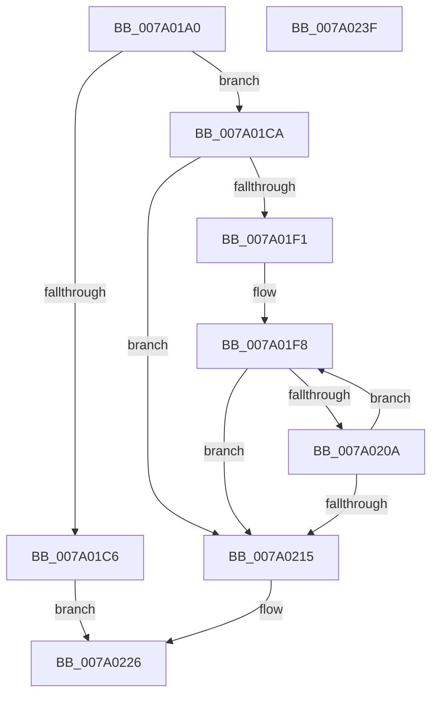

# SepIdAssignableAsGroup

- RVA: `0x007A01A0`–`0x007A0240` (길이 `160` bytes)
- VA: `0x00000001407A01A0`
- 실행 섹션: `PAGE`
- PDB 이름 있음: `예`; PDB Function 태그: `아니요`
- unwind 정보 RVA: `0x00060300`
- 디코드: `48`개 명령, `160/160` bytes 표시
- 미해석 바이트: `0` (있으면 어셈블리에 `.byte`로 보존)

> 이 문서는 커널 이미지의 기계어와 PDB 기호를 분석해 생성했습니다. 4번과 5번은 함수 원형과 자료형을 바이너리 사용 방식에서 추정한 C 해석이며 원본 소스 복구 결과는 아닙니다.

## 1. Dependencies

- 직접 호출 지점: **4**; 고유 호출 대상: **4**
- 직접 호출자로 확인된 함수: **1**
- RIP 상대 이미지 참조: **0**

### Outgoing calls
- `0x007A01E3` → [ExAcquireResourceSharedLite](../../text/21/ExAcquireResourceSharedLite_function_00211BC0.md) (function, `0x00211BC0`)
- `0x007A01FE` → [RtlEqualSid](../../text/40/RtlEqualSid_function_00400AD0.md) (function, `0x00400AD0`)
- `0x007A0219` → [ExReleaseResourceLite](../../text/25/ExReleaseResourceLite_function_0025FA10.md) (function, `0x0025FA10`)
- `0x007A021E` → [KeLeaveCriticalRegion](../../text/25/KeLeaveCriticalRegion_function_0025D8B0.md) (function, `0x0025D8B0`)

### Direct callers
- [NtSetInformationToken](../AF/NtSetInformationToken_function_00AF0530.md) at `0x00AF0988`

### Static image references
- 디코드된 RIP-relative 메모리 참조가 없습니다.

## 2. Other-region calls and transfers

- 다른 실행 섹션으로 향하는 call: **4**
  - `0x007A01E3` → [ExAcquireResourceSharedLite](../../text/21/ExAcquireResourceSharedLite_function_00211BC0.md) (`PAGE` → `.text`)
  - `0x007A01FE` → [RtlEqualSid](../../text/40/RtlEqualSid_function_00400AD0.md) (`PAGE` → `.text`)
  - `0x007A0219` → [ExReleaseResourceLite](../../text/25/ExReleaseResourceLite_function_0025FA10.md) (`PAGE` → `.text`)
  - `0x007A021E` → [KeLeaveCriticalRegion](../../text/25/KeLeaveCriticalRegion_function_0025D8B0.md) (`PAGE` → `.text`)
- 별도 외부 분기/꼬리 이동을 확인하지 못했습니다.

## 3. Assembly (complete function range)

```asm
007A01A0  48 89 5C 24 08                  mov qword ptr [rsp + 8], rbx
007A01A5  48 89 6C 24 10                  mov qword ptr [rsp + 0x10], rbp
007A01AA  48 89 74 24 18                  mov qword ptr [rsp + 0x18], rsi
007A01AF  57                              push rdi
007A01B0  41 56                           push r14
007A01B2  41 57                           push r15
007A01B4  48 83 EC 20                     sub rsp, 0x20
007A01B8  40 32 FF                        xor dil, dil
007A01BB  4C 8B F2                        mov r14, rdx
007A01BE  48 8B D9                        mov rbx, rcx
007A01C1  48 85 D2                        test rdx, rdx
007A01C4  75 04                           jne 0x1407a01ca
007A01C6  32 C0                           xor al, al
007A01C8  EB 5C                           jmp 0x1407a0226
007A01CA  65 48 8B 04 25 88 01 00 00      mov rax, qword ptr gs:[0x188]
007A01D3  B2 01                           mov dl, 1
007A01D5  33 ED                           xor ebp, ebp
007A01D7  66 FF 88 E4 01 00 00            dec word ptr [rax + 0x1e4]
007A01DE  90                              nop
007A01DF  48 8B 49 30                     mov rcx, qword ptr [rcx + 0x30]
007A01E3  E8 D8 19 A7 FF                  call 0x140211bc0
007A01E8  44 8B 7B 7C                     mov r15d, dword ptr [rbx + 0x7c]
007A01EC  45 85 FF                        test r15d, r15d
007A01EF  74 24                           je 0x1407a0215
007A01F1  48 8B B3 98 00 00 00            mov rsi, qword ptr [rbx + 0x98]
007A01F8  48 8B 16                        mov rdx, qword ptr [rsi]
007A01FB  49 8B CE                        mov rcx, r14
007A01FE  E8 CD 08 C6 FF                  call 0x140400ad0
007A0203  40 8A F8                        mov dil, al
007A0206  84 C0                           test al, al
007A0208  75 0B                           jne 0x1407a0215
007A020A  FF C5                           inc ebp
007A020C  48 83 C6 10                     add rsi, 0x10
007A0210  41 3B EF                        cmp ebp, r15d
007A0213  72 E3                           jb 0x1407a01f8
007A0215  48 8B 4B 30                     mov rcx, qword ptr [rbx + 0x30]
007A0219  E8 F2 F7 AB FF                  call 0x14025fa10
007A021E  E8 8D D6 AB FF                  call 0x14025d8b0
007A0223  40 8A C7                        mov al, dil
007A0226  48 8B 5C 24 40                  mov rbx, qword ptr [rsp + 0x40]
007A022B  48 8B 6C 24 48                  mov rbp, qword ptr [rsp + 0x48]
007A0230  48 8B 74 24 50                  mov rsi, qword ptr [rsp + 0x50]
007A0235  48 83 C4 20                     add rsp, 0x20
007A0239  41 5F                           pop r15
007A023B  41 5E                           pop r14
007A023D  5F                              pop rdi
007A023E  C3                              ret
007A023F  CC                              int3
```

## 4. C-style interpretation (structured pseudocode)

```c
__int64 __fastcall SepIdAssignableAsGroup(__int64 a1, __int64 a2)
{
    __int64 result;
    __int64 v_rbp;
    __int64 v_rdi;
    __int64 v_rsi;
    __int64 v_rsp;
    unsigned __int64 v_stack_p10;
    unsigned __int64 v_stack_p18;
    unsigned __int64 v_stack_p8;

    v_stack_p8 = v_rbx;
    v_stack_p10 = v_rbp;
    v_stack_p18 = v_rsi;
    v_rsp = (v_rsp) - (32);
    v_rdi = 0;
    if (a2 != 0) goto loc_007A01CA;
    result = 0;
    goto loc_007A0226;
loc_007A01CA:
    v_rbp = 0;
    result = ExAcquireResourceSharedLite(*(unsigned __int64 *)(a1 + 48), 1, a3, a4);
    if ((unsigned int)((unsigned int)(*(unsigned int *)(a1 + 124))) == 0) goto loc_007A0215;
loc_007A01F8:
    result = RtlEqualSid(a2, *(unsigned __int64 *)(*(unsigned __int64 *)(a1 + 152)), a3, a4);
    if ((unsigned __int8)(result) != 0) goto loc_007A0215;
    v_rbp = (unsigned int)((v_rbp) + 1);
    v_rsi = (*(unsigned __int64 *)(a1 + 152)) + (16);
    if (((unsigned int)(v_rbp)) < ((unsigned int)((unsigned int)(*(unsigned int *)(a1 + 124))))) goto loc_007A01F8;
loc_007A0215:
    result = ExReleaseResourceLite(*(unsigned __int64 *)(a1 + 48), *(unsigned __int64 *)(*(unsigned __int64 *)(a1 + 152)), a3, a4);
    result = KeLeaveCriticalRegion(*(unsigned __int64 *)(a1 + 48), *(unsigned __int64 *)(*(unsigned __int64 *)(a1 + 152)), a3, a4);
loc_007A0226:
    v_rsp = (v_rsp) + (32);
    return (unsigned __int8)((unsigned __int8)(result));
}
```

## 5. (Beta) C Style

```c
int64_t SepIdAssignableAsGroup(void *Arg1, int64_t Arg2)
{
    uint8_t *arg1 = (uint8_t *)Arg1;

    int64_t result;
    int64_t local_rbp;
    int64_t local_rdi;
    int64_t local_rsi;
    int64_t local_rsp;
    uint64_t v_stack_p10;
    uint64_t v_stack_p18;
    uint64_t v_stack_p8;

    v_stack_p8 = local_rbx;
    v_stack_p10 = local_rbp;
    v_stack_p18 = local_rsi;
    local_rsp = (local_rsp) - (32);
    local_rdi = 0;
    if (Arg2 != 0) goto loc_007A01CA;
    result = 0;
    goto loc_007A0226;
loc_007A01CA:
    local_rbp = 0;
    result = ExAcquireResourceSharedLite(*(uint64_t *)(arg1 + 0x30), 1, a3, a4);
    if ((uint32_t)((uint32_t)(*(uint32_t *)(arg1 + 0x7C))) == 0) goto loc_007A0215;
loc_007A01F8:
    result = RtlEqualSid(Arg2, *(uint64_t *)(*(uint64_t *)(arg1 + 0x98)), a3, a4);
    if ((uint8_t)(result) != 0) goto loc_007A0215;
    local_rbp = (uint32_t)((local_rbp) + 1);
    local_rsi = (*(uint64_t *)(arg1 + 0x98)) + (16);
    if (((uint32_t)(local_rbp)) < ((uint32_t)((uint32_t)(*(uint32_t *)(arg1 + 0x7C))))) goto loc_007A01F8;
loc_007A0215:
    result = ExReleaseResourceLite(*(uint64_t *)(arg1 + 0x30), *(uint64_t *)(*(uint64_t *)(arg1 + 0x98)), a3, a4);
    result = KeLeaveCriticalRegion(*(uint64_t *)(arg1 + 0x30), *(uint64_t *)(*(uint64_t *)(arg1 + 0x98)), a3, a4);
loc_007A0226:
    local_rsp = (local_rsp) + (32);
    return (uint8_t)((uint8_t)(result));
}
```

### 관측된 메모리 오프셋

구조체 형식이 확인되지 않은 접근은 인자 기준의 오프셋으로만 기록했습니다.

| 기준 인자 | 오프셋 표현 | 폭 (bit) | 접근 |
|---|---:|---:|---|
| `Arg1` | `+ 0x30` | `64` | `R` |
| `Arg1` | `+ 0x7C` | `32` | `R` |
| `Arg1` | `+ 0x98` | `64` | `R` |

## 6. Execution-region graph

[열기: 2D/3D 그래프와 함수 탐색 컨트롤 패널](../../../control-panel.html?section=page&rva=0x007A01A0&view=graph)

- 2D 그래프는 위에서 아래로 흐르고, 3D 그래프는 빈 공간을 드래그해 회전합니다. Shift+드래그는 이동, 휠은 확대·축소, 함수 노드 선택은 대상 보고서 이동입니다.

### Static fallback


