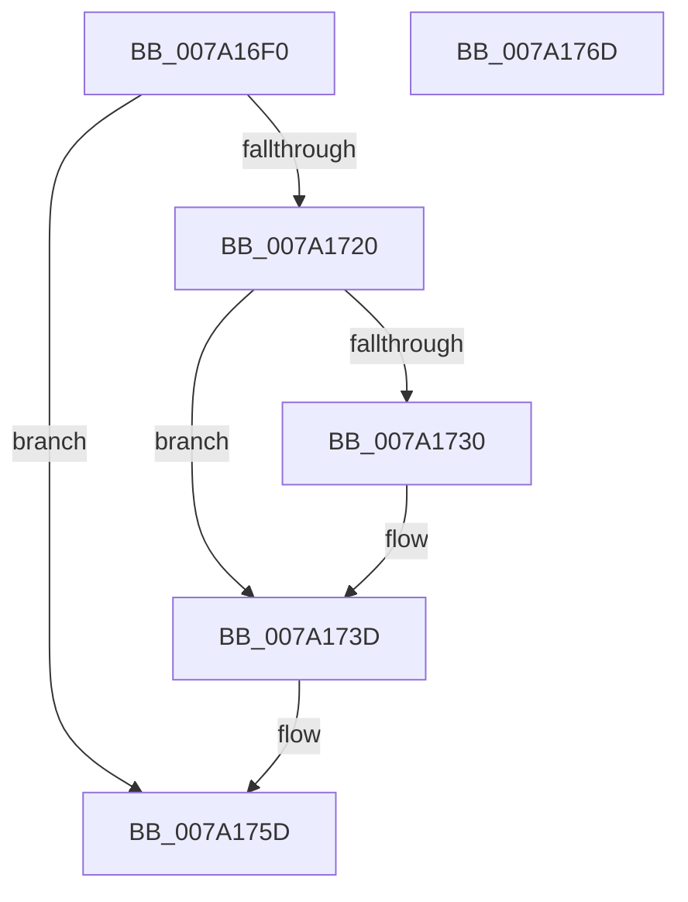

# SepInformFileSystemsOfDeletedLogon

- RVA: `0x007A16F0`–`0x007A176E` (길이 `126` bytes)
- VA: `0x00000001407A16F0`
- 실행 섹션: `PAGE`
- PDB 이름 있음: `예`; PDB Function 태그: `아니요`
- unwind 정보 RVA: `0x00060BC4`
- 디코드: `34`개 명령, `126/126` bytes 표시
- 미해석 바이트: `0` (있으면 어셈블리에 `.byte`로 보존)

> 이 문서는 커널 이미지의 기계어와 PDB 기호를 분석해 생성했습니다. 4번과 5번은 함수 원형과 자료형을 바이너리 사용 방식에서 추정한 C 해석이며 원본 소스 복구 결과는 아닙니다.

## 1. Dependencies

- 직접 호출 지점: **3**; 고유 호출 대상: **3**
- 직접 호출자로 확인된 함수: **1**
- RIP 상대 이미지 참조: **1**

### Outgoing calls
- `0x007A1713` → [ExAllocatePool2](../../poolcode/B8/ExAllocatePool2_function_00B820F0.md) (function, `0x00B820F0`)
- `0x007A1738` → [ObfReferenceObjectWithTag](../../text/21/ObfReferenceObjectWithTag_function_00210710.md) (function, `0x00210710`)
- `0x007A1758` → [ExQueueWorkItem](../../text/2F/ExQueueWorkItem_function_002F9520.md) (function, `0x002F9520`)

### Direct callers
- [SepDeReferenceLogonSession](../AF/SepDeReferenceLogonSession_function_00AF25EC.md) at `0x00AF27CF`

### Static image references
- `0x007A1741` → RVA `0x007A1910` (`SepNotifyFileSystems`; read)

## 2. Other-region calls and transfers

- 다른 실행 섹션으로 향하는 call: **3**
  - `0x007A1713` → [ExAllocatePool2](../../poolcode/B8/ExAllocatePool2_function_00B820F0.md) (`PAGE` → `POOLCODE`)
  - `0x007A1738` → [ObfReferenceObjectWithTag](../../text/21/ObfReferenceObjectWithTag_function_00210710.md) (`PAGE` → `.text`)
  - `0x007A1758` → [ExQueueWorkItem](../../text/2F/ExQueueWorkItem_function_002F9520.md) (`PAGE` → `.text`)
- 별도 외부 분기/꼬리 이동을 확인하지 못했습니다.

## 3. Assembly (complete function range)

```asm
007A16F0  48 89 5C 24 08                  mov qword ptr [rsp + 8], rbx
007A16F5  48 89 74 24 10                  mov qword ptr [rsp + 0x10], rsi
007A16FA  57                              push rdi
007A16FB  48 83 EC 20                     sub rsp, 0x20
007A16FF  48 8B FA                        mov rdi, rdx
007A1702  48 8B F1                        mov rsi, rcx
007A1705  BA 30 00 00 00                  mov edx, 0x30
007A170A  41 B8 53 65 46 53               mov r8d, 0x53466553
007A1710  8D 4A 10                        lea ecx, [rdx + 0x10]
007A1713  E8 D8 09 3E 00                  call 0x140b820f0
007A1718  48 8B D8                        mov rbx, rax
007A171B  48 85 C0                        test rax, rax
007A171E  74 3D                           je 0x1407a175d
007A1720  48 8B 0E                        mov rcx, qword ptr [rsi]
007A1723  48 89 48 20                     mov qword ptr [rax + 0x20], rcx
007A1727  48 89 78 28                     mov qword ptr [rax + 0x28], rdi
007A172B  48 85 FF                        test rdi, rdi
007A172E  74 0D                           je 0x1407a173d
007A1730  BA 53 65 46 53                  mov edx, 0x53466553
007A1735  48 8B CF                        mov rcx, rdi
007A1738  E8 D3 EF A6 FF                  call 0x140210710
007A173D  48 83 23 00                     and qword ptr [rbx], 0
007A1741  48 8D 05 C8 01 00 00            lea rax, [rip + 0x1c8]
007A1748  BA 01 00 00 00                  mov edx, 1
007A174D  48 89 43 10                     mov qword ptr [rbx + 0x10], rax
007A1751  48 8B CB                        mov rcx, rbx
007A1754  48 89 5B 18                     mov qword ptr [rbx + 0x18], rbx
007A1758  E8 C3 7D B5 FF                  call 0x1402f9520
007A175D  48 8B 5C 24 30                  mov rbx, qword ptr [rsp + 0x30]
007A1762  48 8B 74 24 38                  mov rsi, qword ptr [rsp + 0x38]
007A1767  48 83 C4 20                     add rsp, 0x20
007A176B  5F                              pop rdi
007A176C  C3                              ret
007A176D  CC                              int3
```

## 4. C-style interpretation (structured pseudocode)

```c
__int64 __fastcall SepInformFileSystemsOfDeletedLogon(__int64 a1, __int64 a2)
{
    __int64 result;
    __int64 v_rsp;
    unsigned __int64 v_stack_p10;
    unsigned __int64 v_stack_p8;

    v_stack_p8 = v_rbx;
    v_stack_p10 = v_rsi;
    v_rsp = (v_rsp) - (32);
    result = ExAllocatePool2(48 + 16, 48, (unsigned int)(0x53466553ULL), a4);
    if (result == 0) goto loc_007A175D;
    *(unsigned __int64 *)(result + 32) = *(unsigned __int64 *)(a1);
    *(unsigned __int64 *)(result + 40) = a2;
    if (a2 != 0) {
        a2 = 0x53466553ULL;
        a1 = a2;
        result = ObfReferenceObjectWithTag(a1, a2, (unsigned int)(0x53466553ULL), a4);
    }
    *(unsigned __int64 *)(result + 16) = v_rip + 456;
    *(unsigned __int64 *)(result + 24) = result;
    result = ExQueueWorkItem(result, 1, (unsigned int)(0x53466553ULL), a4);
loc_007A175D:
    v_rsp = (v_rsp) + (32);
    return result;
}
```

## 5. (Beta) C Style

```c
int64_t SepInformFileSystemsOfDeletedLogon(void *Arg1, int64_t Arg2)
{
    uint8_t *arg1 = (uint8_t *)Arg1;

    int64_t result;
    int64_t local_rsp;
    uint64_t v_stack_p10;
    uint64_t v_stack_p8;

    v_stack_p8 = local_rbx;
    v_stack_p10 = local_rsi;
    local_rsp = (local_rsp) - (32);
    result = ExAllocatePool2(48 + 16, 48, (uint32_t)(0x53466553ULL), a4);
    if (result == 0) goto loc_007A175D;
    *(uint64_t *)(result + 0x20) = *(uint64_t *)(arg1);
    *(uint64_t *)(result + 0x28) = Arg2;
    if (Arg2 != 0) {
        Arg2 = 0x53466553ULL;
        Arg1 = Arg2;
        result = ObfReferenceObjectWithTag(Arg1, Arg2, (uint32_t)(0x53466553ULL), a4);
    }
    *(uint64_t *)(result + 0x10) = v_rip + 456;
    *(uint64_t *)(result + 0x18) = result;
    result = ExQueueWorkItem(result, 1, (uint32_t)(0x53466553ULL), a4);
loc_007A175D:
    local_rsp = (local_rsp) + (32);
    return result;
}
```

### 관측된 메모리 오프셋

구조체 형식이 확인되지 않은 접근은 인자 기준의 오프셋으로만 기록했습니다.

| 기준 인자 | 오프셋 표현 | 폭 (bit) | 접근 |
|---|---:|---:|---|
| `Arg1` | `+ 0x0` | `64` | `R` |

## 6. Execution-region graph

[열기: 2D/3D 그래프와 함수 탐색 컨트롤 패널](../../../control-panel.html?section=page&rva=0x007A16F0&view=graph)

- 2D 그래프는 위에서 아래로 흐르고, 3D 그래프는 빈 공간을 드래그해 회전합니다. Shift+드래그는 이동, 휠은 확대·축소, 함수 노드 선택은 대상 보고서 이동입니다.

### Static fallback


