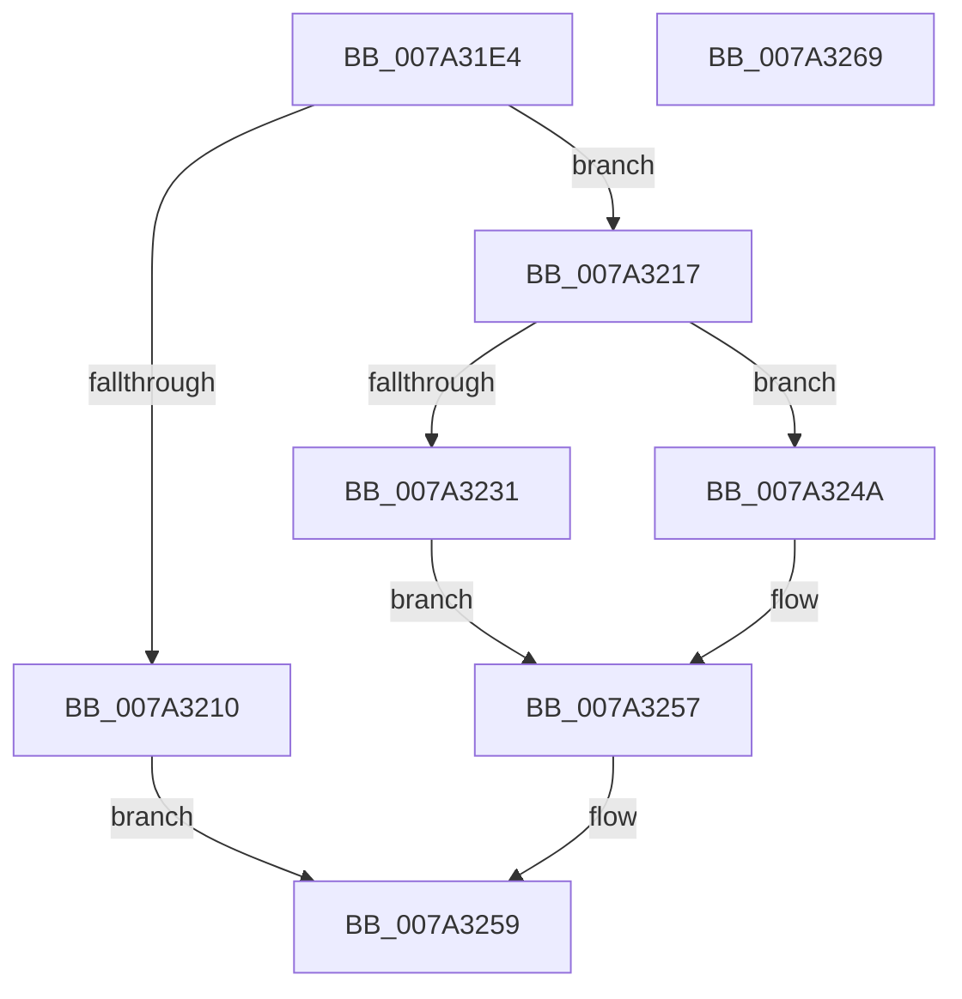

# SepInitializeLowBoxNumberTable

- RVA: `0x007A31E4`–`0x007A326A` (길이 `134` bytes)
- VA: `0x00000001407A31E4`
- 실행 섹션: `PAGE`
- PDB 이름 있음: `예`; PDB Function 태그: `아니요`
- unwind 정보 RVA: `0x00060BC4`
- 디코드: `38`개 명령, `134/134` bytes 표시
- 미해석 바이트: `0` (있으면 어셈블리에 `.byte`로 보존)

> 이 문서는 커널 이미지의 기계어와 PDB 기호를 분석해 생성했습니다. 4번과 5번은 함수 원형과 자료형을 바이너리 사용 방식에서 추정한 C 해석이며 원본 소스 복구 결과는 아닙니다.

## 1. Dependencies

- 직접 호출 지점: **4**; 고유 호출 대상: **4**
- 직접 호출자로 확인된 함수: **2**
- RIP 상대 이미지 참조: **0**

### Outgoing calls
- `0x007A3207` → [RtlCreateHashTable](../../text/48/RtlCreateHashTable_function_0048C3E0.md) (function, `0x0048C3E0`)
- `0x007A3227` → [ExAllocatePool2](../../poolcode/B8/ExAllocatePool2_function_00B820F0.md) (function, `0x00B820F0`)
- `0x007A323F` → [RtlClearAllBits](../../text/45/RtlClearAllBits_function_00450230.md) (function, `0x00450230`)
- `0x007A324D` → [RtlDeleteHashTable](../../text/48/RtlDeleteHashTable_function_0048C570.md) (function, `0x0048C570`)

### Direct callers
- [SepSetTokenLowboxNumberEntry](../../text/60/SepSetTokenLowboxNumberEntry_function_0060B594.md) at `0x0060B754`
- [sub_00B3E69E](../B3/Unknown_function_00B3E69E.md) at `0x00B3E6B3`

### Static image references
- 디코드된 RIP-relative 메모리 참조가 없습니다.

## 2. Other-region calls and transfers

- 다른 실행 섹션으로 향하는 call: **4**
  - `0x007A3207` → [RtlCreateHashTable](../../text/48/RtlCreateHashTable_function_0048C3E0.md) (`PAGE` → `.text`)
  - `0x007A3227` → [ExAllocatePool2](../../poolcode/B8/ExAllocatePool2_function_00B820F0.md) (`PAGE` → `POOLCODE`)
  - `0x007A323F` → [RtlClearAllBits](../../text/45/RtlClearAllBits_function_00450230.md) (`PAGE` → `.text`)
  - `0x007A324D` → [RtlDeleteHashTable](../../text/48/RtlDeleteHashTable_function_0048C570.md) (`PAGE` → `.text`)
- 별도 외부 분기/꼬리 이동을 확인하지 못했습니다.

## 3. Assembly (complete function range)

```asm
007A31E4  48 89 5C 24 08                  mov qword ptr [rsp + 8], rbx
007A31E9  48 89 74 24 10                  mov qword ptr [rsp + 0x10], rsi
007A31EE  57                              push rdi
007A31EF  48 83 EC 20                     sub rsp, 0x20
007A31F3  48 8D 71 18                     lea rsi, [rcx + 0x18]
007A31F7  48 8B F9                        mov rdi, rcx
007A31FA  33 DB                           xor ebx, ebx
007A31FC  48 8B CE                        mov rcx, rsi
007A31FF  45 33 C0                        xor r8d, r8d
007A3202  48 89 1E                        mov qword ptr [rsi], rbx
007A3205  33 D2                           xor edx, edx
007A3207  E8 D4 91 CE FF                  call 0x14048c3e0
007A320C  84 C0                           test al, al
007A320E  75 07                           jne 0x1407a3217
007A3210  B8 9A 00 00 C0                  mov eax, 0xc000009a
007A3215  EB 42                           jmp 0x1407a3259
007A3217  BA 80 00 00 00                  mov edx, 0x80
007A321C  B9 00 01 00 00                  mov ecx, 0x100
007A3221  41 B8 53 65 4C 73               mov r8d, 0x734c6553
007A3227  E8 C4 EE 3D 00                  call 0x140b820f0
007A322C  48 85 C0                        test rax, rax
007A322F  74 19                           je 0x1407a324a
007A3231  48 8D 4F 08                     lea rcx, [rdi + 8]
007A3235  C7 01 00 04 00 00               mov dword ptr [rcx], 0x400
007A323B  48 89 41 08                     mov qword ptr [rcx + 8], rax
007A323F  E8 EC CF CA FF                  call 0x140450230
007A3244  C6 47 20 01                     mov byte ptr [rdi + 0x20], 1
007A3248  EB 0D                           jmp 0x1407a3257
007A324A  48 8B 0E                        mov rcx, qword ptr [rsi]
007A324D  E8 1E 93 CE FF                  call 0x14048c570
007A3252  BB 9A 00 00 C0                  mov ebx, 0xc000009a
007A3257  8B C3                           mov eax, ebx
007A3259  48 8B 5C 24 30                  mov rbx, qword ptr [rsp + 0x30]
007A325E  48 8B 74 24 38                  mov rsi, qword ptr [rsp + 0x38]
007A3263  48 83 C4 20                     add rsp, 0x20
007A3267  5F                              pop rdi
007A3268  C3                              ret
007A3269  CC                              int3
```

## 4. C-style interpretation (structured pseudocode)

```c
__int64 __fastcall SepInitializeLowBoxNumberTable(__int64 a1, int a2, int a3)
{
    __int64 result;
    __int64 v_rbx;
    __int64 v_rsp;
    unsigned __int64 v_stack_p10;
    unsigned __int64 v_stack_p8;

    v_stack_p8 = v_rbx;
    v_stack_p10 = v_rsi;
    v_rsp = (v_rsp) - (32);
    v_rbx = 0;
    a3 = 0;
    *(unsigned __int64 *)(a1 + 24) = 0;
    a2 = 0;
    result = RtlCreateHashTable(a1 + 24, a2, a3, a4);
    if ((unsigned __int8)(result) != 0) goto loc_007A3217;
    goto loc_007A3259;
loc_007A3217:
    result = ExAllocatePool2(256, 128, (unsigned int)(0x734C6553ULL), a4);
    if (result == 0) goto loc_007A324A;
    *(unsigned int *)(a1 + 8) = 0x400ULL;
    *(unsigned __int64 *)(a1 + 8 + 8) = result;
    result = RtlClearAllBits(a1 + 8, 128, (unsigned int)(0x734C6553ULL), a4);
    *(unsigned __int8 *)(a1 + 32) = 1;
    goto loc_007A3257;
loc_007A324A:
    result = RtlDeleteHashTable(*(unsigned __int64 *)(a1 + 24), 128, (unsigned int)(0x734C6553ULL), a4);
loc_007A3257:
loc_007A3259:
    v_rsp = (v_rsp) + (32);
    return (unsigned int)((unsigned int)((unsigned int)(0xC000009AULL)));
}
```

## 5. (Beta) C Style

```c
int64_t SepInitializeLowBoxNumberTable(void *Arg1, int32_t Arg2, int32_t Arg3)
{
    uint8_t *arg1 = (uint8_t *)Arg1;

    int64_t result;
    int64_t local_rbx;
    int64_t local_rsp;
    uint64_t v_stack_p10;
    uint64_t v_stack_p8;

    v_stack_p8 = local_rbx;
    v_stack_p10 = local_rsi;
    local_rsp = (local_rsp) - (32);
    local_rbx = 0;
    Arg3 = 0;
    *(uint64_t *)(arg1 + 0x18) = 0;
    Arg2 = 0;
    result = RtlCreateHashTable(Arg1 + 24, Arg2, Arg3, a4);
    if ((uint8_t)(result) != 0) goto loc_007A3217;
    goto loc_007A3259;
loc_007A3217:
    result = ExAllocatePool2(256, 128, (uint32_t)(0x734C6553ULL), a4);
    if (result == 0) goto loc_007A324A;
    *(uint32_t *)(arg1 + 0x8) = 0x400ULL;
    *(uint64_t *)(arg1 + 0x8 + 0x8) = result;
    result = RtlClearAllBits(Arg1 + 8, 128, (uint32_t)(0x734C6553ULL), a4);
    *(uint8_t *)(arg1 + 0x20) = 1;
    goto loc_007A3257;
loc_007A324A:
    result = RtlDeleteHashTable(*(uint64_t *)(arg1 + 0x18), 128, (uint32_t)(0x734C6553ULL), a4);
loc_007A3257:
loc_007A3259:
    local_rsp = (local_rsp) + (32);
    return (uint32_t)((uint32_t)((uint32_t)(0xC000009AULL)));
}
```

### 관측된 메모리 오프셋

구조체 형식이 확인되지 않은 접근은 인자 기준의 오프셋으로만 기록했습니다.

| 기준 인자 | 오프셋 표현 | 폭 (bit) | 접근 |
|---|---:|---:|---|
| `Arg1` | `+ 0x0` | `32` | `W` |
| `Arg1` | `+ 0x0` | `64` | `R` |
| `Arg1` | `+ 0x0` | `64` | `W` |
| `Arg1` | `+ 0x8` | `64` | `R` |
| `Arg1` | `+ 0x8` | `64` | `W` |
| `Arg1` | `+ 0x18` | `64` | `R` |
| `Arg1` | `+ 0x20` | `8` | `W` |

## 6. Execution-region graph

[열기: 2D/3D 그래프와 함수 탐색 컨트롤 패널](../../../control-panel.html?section=page&rva=0x007A31E4&view=graph)

- 2D 그래프는 위에서 아래로 흐르고, 3D 그래프는 빈 공간을 드래그해 회전합니다. Shift+드래그는 이동, 휠은 확대·축소, 함수 노드 선택은 대상 보고서 이동입니다.

### Static fallback


