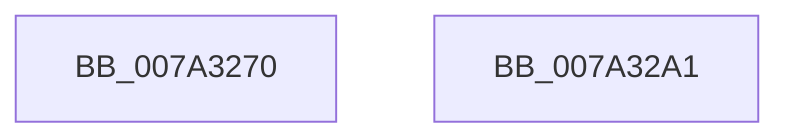

# SepInitializeSharedSidMap

- RVA: `0x007A3270`–`0x007A32A2` (길이 `50` bytes)
- VA: `0x00000001407A3270`
- 실행 섹션: `PAGE`
- PDB 이름 있음: `예`; PDB Function 태그: `아니요`
- unwind 정보 RVA: `0x0005C788`
- 디코드: `15`개 명령, `50/50` bytes 표시
- 미해석 바이트: `0` (있으면 어셈블리에 `.byte`로 보존)

> 이 문서는 커널 이미지의 기계어와 PDB 기호를 분석해 생성했습니다. 4번과 5번은 함수 원형과 자료형을 바이너리 사용 방식에서 추정한 C 해석이며 원본 소스 복구 결과는 아닙니다.

## 1. Dependencies

- 직접 호출 지점: **1**; 고유 호출 대상: **1**
- 직접 호출자로 확인된 함수: **1**
- RIP 상대 이미지 참조: **1**

### Outgoing calls
- `0x007A328C` → [RtlCreateHashTable](../../text/48/RtlCreateHashTable_function_0048C3E0.md) (function, `0x0048C3E0`)

### Direct callers
- [SepVariableInitialization](../../init/C4/SepVariableInitialization_function_00C483A4.md) at `0x00C4A575`

### Static image references
- `0x007A3274` → RVA `0x00FD8088` (`PAGEDATA`; read)

## 2. Other-region calls and transfers

- 다른 실행 섹션으로 향하는 call: **1**
  - `0x007A328C` → [RtlCreateHashTable](../../text/48/RtlCreateHashTable_function_0048C3E0.md) (`PAGE` → `.text`)
- 별도 외부 분기/꼬리 이동을 확인하지 못했습니다.

## 3. Assembly (complete function range)

```asm
007A3270  48 83 EC 28                     sub rsp, 0x28
007A3274  48 8B 05 0D 4E 83 00            mov rax, qword ptr [rip + 0x834e0d]
007A327B  45 33 C0                        xor r8d, r8d
007A327E  33 D2                           xor edx, edx
007A3280  48 83 20 00                     and qword ptr [rax], 0
007A3284  48 8D 48 08                     lea rcx, [rax + 8]
007A3288  48 83 21 00                     and qword ptr [rcx], 0
007A328C  E8 4F 91 CE FF                  call 0x14048c3e0
007A3291  F6 D8                           neg al
007A3293  1B C0                           sbb eax, eax
007A3295  F7 D0                           not eax
007A3297  25 17 00 00 C0                  and eax, 0xc0000017
007A329C  48 83 C4 28                     add rsp, 0x28
007A32A0  C3                              ret
007A32A1  CC                              int3
```

## 4. C-style interpretation (structured pseudocode)

```c
__int64 __fastcall SepInitializeSharedSidMap(__int64 a1, int a2, int a3)
{
    __int64 result;
    __int64 v_rsp;

    v_rsp = (v_rsp) - (40);
    a3 = 0;
    a2 = 0;
    result = RtlCreateHashTable(*(unsigned __int64 *)(v_rip + 8605197) + 8, a2, a3, a4);
    result = (unsigned __int8)(-(result));
    result = (unsigned int)(~(result));
    result = (unsigned int)((result) & (0xC0000017ULL));
    v_rsp = (v_rsp) + (40);
    return result;
}
```

## 5. (Beta) C Style

```c
int64_t SepInitializeSharedSidMap(int64_t Arg1, int32_t Arg2, int32_t Arg3)
{
    int64_t result;
    int64_t local_rsp;

    local_rsp = (local_rsp) - (40);
    Arg3 = 0;
    Arg2 = 0;
    result = RtlCreateHashTable(*(uint64_t *)(v_rip + 0x834E0D) + 8, Arg2, Arg3, a4);
    result = (uint8_t)(-(result));
    result = (uint32_t)(~(result));
    result = (uint32_t)((result) & (0xC0000017ULL));
    local_rsp = (local_rsp) + (40);
    return result;
}
```

## 6. Execution-region graph

[열기: 2D/3D 그래프와 함수 탐색 컨트롤 패널](../../../control-panel.html?section=page&rva=0x007A3270&view=graph)

- 2D 그래프는 위에서 아래로 흐르고, 3D 그래프는 빈 공간을 드래그해 회전합니다. Shift+드래그는 이동, 휠은 확대·축소, 함수 노드 선택은 대상 보고서 이동입니다.

### Static fallback


