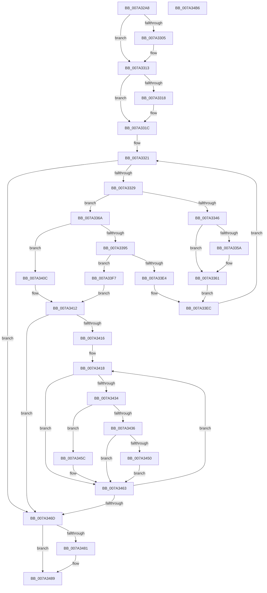

# SepInsertOrReferenceSharedSidEntries

- RVA: `0x007A32A8`–`0x007A34B7` (길이 `527` bytes)
- VA: `0x00000001407A32A8`
- 실행 섹션: `PAGE`
- PDB 이름 있음: `예`; PDB Function 태그: `아니요`
- unwind 정보 RVA: `0x000BCDB8`
- 디코드: `145`개 명령, `527/527` bytes 표시
- 미해석 바이트: `0` (있으면 어셈블리에 `.byte`로 보존)

> 이 문서는 커널 이미지의 기계어와 PDB 기호를 분석해 생성했습니다. 4번과 5번은 함수 원형과 자료형을 바이너리 사용 방식에서 추정한 C 해석이며 원본 소스 복구 결과는 아닙니다.

## 1. Dependencies

- 직접 호출 지점: **13**; 고유 호출 대상: **11**
- 직접 호출자로 확인된 함수: **1**
- RIP 상대 이미지 참조: **1**

### Outgoing calls
- `0x007A32F5` → [KeAbPreAcquire](../../text/21/KeAbPreAcquire_function_00210230.md) (function, `0x00210230`)
- `0x007A330E` → [ExfAcquirePushLockExclusiveEx](../../text/20/ExfAcquirePushLockExclusiveEx_function_0020FC90.md) (function, `0x0020FC90`)
- `0x007A333C` → [SepFindSharedSidEntry](SepFindSharedSidEntry_function_007A3148.md) (function, `0x007A3148`)
- `0x007A3388` → [ExAllocatePool2](../../poolcode/B8/ExAllocatePool2_function_00B820F0.md) (function, `0x00B820F0`)
- `0x007A33AD` → [RtlCopySid](../9A/RtlCopySid_function_009A9A50.md) (function, `0x009A9A50`)
- `0x007A33DB` → [RtlInsertEntryHashTable](../../text/43/RtlInsertEntryHashTable_function_00437660.md) (function, `0x00437660`)
- `0x007A3405` → [ExFreePoolWithTag](../../poolcode/B8/ExFreePoolWithTag_function_00B82870.md) (function, `0x00B82870`)
- `0x007A341B` → [SepFindSharedSidEntry](SepFindSharedSidEntry_function_007A3148.md) (function, `0x007A3148`)
- `0x007A3447` → [RtlRemoveEntryHashTable](../../text/2E/RtlRemoveEntryHashTable_function_002EEF00.md) (function, `0x002EEF00`)
- `0x007A3455` → [ExFreePoolWithTag](../../poolcode/B8/ExFreePoolWithTag_function_00B82870.md) (function, `0x00B82870`)
- `0x007A3484` → [ExfTryToWakePushLock](../../text/26/ExfTryToWakePushLock_function_00265DD0.md) (function, `0x00265DD0`)
- `0x007A348C` → [KeAbPostRelease](../../text/2E/KeAbPostRelease_function_002E1600.md) (function, `0x002E1600`)
- `0x007A3491` → [KeLeaveCriticalRegion](../../text/25/KeLeaveCriticalRegion_function_0025D8B0.md) (function, `0x0025D8B0`)

### Direct callers
- [SepSetTokenCapabilities](../9C/SepSetTokenCapabilities_function_009C9AF4.md) at `0x009C9C99`

### Static image references
- `0x007A32EB` → RVA `0x00FD8088` (`PAGEDATA`; read)

## 2. Other-region calls and transfers

- 다른 실행 섹션으로 향하는 call: **10**
  - `0x007A32F5` → [KeAbPreAcquire](../../text/21/KeAbPreAcquire_function_00210230.md) (`PAGE` → `.text`)
  - `0x007A330E` → [ExfAcquirePushLockExclusiveEx](../../text/20/ExfAcquirePushLockExclusiveEx_function_0020FC90.md) (`PAGE` → `.text`)
  - `0x007A3388` → [ExAllocatePool2](../../poolcode/B8/ExAllocatePool2_function_00B820F0.md) (`PAGE` → `POOLCODE`)
  - `0x007A33DB` → [RtlInsertEntryHashTable](../../text/43/RtlInsertEntryHashTable_function_00437660.md) (`PAGE` → `.text`)
  - `0x007A3405` → [ExFreePoolWithTag](../../poolcode/B8/ExFreePoolWithTag_function_00B82870.md) (`PAGE` → `POOLCODE`)
  - `0x007A3447` → [RtlRemoveEntryHashTable](../../text/2E/RtlRemoveEntryHashTable_function_002EEF00.md) (`PAGE` → `.text`)
  - `0x007A3455` → [ExFreePoolWithTag](../../poolcode/B8/ExFreePoolWithTag_function_00B82870.md) (`PAGE` → `POOLCODE`)
  - `0x007A3484` → [ExfTryToWakePushLock](../../text/26/ExfTryToWakePushLock_function_00265DD0.md) (`PAGE` → `.text`)
  - `0x007A348C` → [KeAbPostRelease](../../text/2E/KeAbPostRelease_function_002E1600.md) (`PAGE` → `.text`)
  - `0x007A3491` → [KeLeaveCriticalRegion](../../text/25/KeLeaveCriticalRegion_function_0025D8B0.md) (`PAGE` → `.text`)
- 별도 외부 분기/꼬리 이동을 확인하지 못했습니다.

## 3. Assembly (complete function range)

```asm
007A32A8  48 8B C4                        mov rax, rsp
007A32AB  48 89 58 08                     mov qword ptr [rax + 8], rbx
007A32AF  48 89 68 10                     mov qword ptr [rax + 0x10], rbp
007A32B3  48 89 70 20                     mov qword ptr [rax + 0x20], rsi
007A32B7  44 89 40 18                     mov dword ptr [rax + 0x18], r8d
007A32BB  57                              push rdi
007A32BC  41 54                           push r12
007A32BE  41 55                           push r13
007A32C0  41 56                           push r14
007A32C2  41 57                           push r15
007A32C4  48 83 EC 20                     sub rsp, 0x20
007A32C8  65 48 8B 04 25 88 01 00 00      mov rax, qword ptr gs:[0x188]
007A32D1  41 8B E8                        mov ebp, r8d
007A32D4  4C 8B F2                        mov r14, rdx
007A32D7  4C 8B E1                        mov r12, rcx
007A32DA  48 83 CB FF                     or rbx, 0xffffffffffffffff
007A32DE  45 33 C0                        xor r8d, r8d
007A32E1  33 D2                           xor edx, edx
007A32E3  66 01 98 E4 01 00 00            add word ptr [rax + 0x1e4], bx
007A32EA  90                              nop
007A32EB  48 8B 3D 96 4D 83 00            mov rdi, qword ptr [rip + 0x834d96]
007A32F2  48 8B CF                        mov rcx, rdi
007A32F5  E8 36 CF A6 FF                  call 0x140210230
007A32FA  F0 48 0F BA 2F 00               lock bts qword ptr [rdi], 0
007A3300  48 8B F0                        mov rsi, rax
007A3303  73 0E                           jae 0x1407a3313
007A3305  4C 8B C7                        mov r8, rdi
007A3308  48 8B D0                        mov rdx, rax
007A330B  48 8B CF                        mov rcx, rdi
007A330E  E8 7D C9 A6 FF                  call 0x14020fc90
007A3313  48 85 F6                        test rsi, rsi
007A3316  74 04                           je 0x1407a331c
007A3318  C6 46 0A 01                     mov byte ptr [rsi + 0xa], 1
007A331C  33 FF                           xor edi, edi
007A331E  45 33 FF                        xor r15d, r15d
007A3321  3B FD                           cmp edi, ebp
007A3323  0F 83 44 01 00 00               jae 0x1407a346d
007A3329  8B F7                           mov esi, edi
007A332B  48 03 F6                        add rsi, rsi
007A332E  41 8B 44 F4 08                  mov eax, dword ptr [r12 + rsi*8 + 8]
007A3333  41 89 44 F6 08                  mov dword ptr [r14 + rsi*8 + 8], eax
007A3338  49 8B 0C F4                     mov rcx, qword ptr [r12 + rsi*8]
007A333C  E8 07 FE FF FF                  call 0x1407a3148
007A3341  48 85 C0                        test rax, rax
007A3344  74 24                           je 0x1407a336a
007A3346  B9 01 00 00 00                  mov ecx, 1
007A334B  F0 48 0F C1 48 18               lock xadd qword ptr [rax + 0x18], rcx
007A3351  48 FF C1                        inc rcx
007A3354  48 83 F9 01                     cmp rcx, 1
007A3358  7F 07                           jg 0x1407a3361
007A335A  B9 0E 00 00 00                  mov ecx, 0xe
007A335F  CD 29                           int 0x29
007A3361  48 8B 48 20                     mov rcx, qword ptr [rax + 0x20]
007A3365  E9 82 00 00 00                  jmp 0x1407a33ec
007A336A  49 8B 04 F4                     mov rax, qword ptr [r12 + rsi*8]
007A336E  41 B8 53 65 53 73               mov r8d, 0x73536553
007A3374  0F B6 48 01                     movzx ecx, byte ptr [rax + 1]
007A3378  44 8D 2C CD 60 00 00 00         lea r13d, [rcx*8 + 0x60]
007A3380  B9 00 01 00 00                  mov ecx, 0x100
007A3385  41 8B D5                        mov edx, r13d
007A3388  E8 63 ED 3D 00                  call 0x140b820f0
007A338D  48 8B E8                        mov rbp, rax
007A3390  48 85 C0                        test rax, rax
007A3393  74 77                           je 0x1407a340c
007A3395  48 8D 50 28                     lea rdx, [rax + 0x28]
007A3399  48 C7 40 18 01 00 00 00         mov qword ptr [rax + 0x18], 1
007A33A1  48 89 50 20                     mov qword ptr [rax + 0x20], rdx
007A33A5  41 8D 4D D8                     lea ecx, [r13 - 0x28]
007A33A9  4D 8B 04 F4                     mov r8, qword ptr [r12 + rsi*8]
007A33AD  E8 9E 66 20 00                  call 0x1409a9a50
007A33B2  49 8B 14 F4                     mov rdx, qword ptr [r12 + rsi*8]
007A33B6  0F B6 4A 01                     movzx ecx, byte ptr [rdx + 1]
007A33BA  FF C9                           dec ecx
007A33BC  8B 4C 8A 08                     mov ecx, dword ptr [rdx + rcx*4 + 8]
007A33C0  48 8B D5                        mov rdx, rbp
007A33C3  85 C9                           test ecx, ecx
007A33C5  4C 8D 41 01                     lea r8, [rcx + 1]
007A33C9  4C 0F 45 C1                     cmovne r8, rcx
007A33CD  48 8B 0D B4 4C 83 00            mov rcx, qword ptr [rip + 0x834cb4]
007A33D4  45 33 C9                        xor r9d, r9d
007A33D7  48 8B 49 08                     mov rcx, qword ptr [rcx + 8]
007A33DB  E8 80 42 C9 FF                  call 0x140437660
007A33E0  84 C0                           test al, al
007A33E2  74 13                           je 0x1407a33f7
007A33E4  48 8B 4D 20                     mov rcx, qword ptr [rbp + 0x20]
007A33E8  8B 6C 24 60                     mov ebp, dword ptr [rsp + 0x60]
007A33EC  49 89 0C F6                     mov qword ptr [r14 + rsi*8], rcx
007A33F0  FF C7                           inc edi
007A33F2  E9 2A FF FF FF                  jmp 0x1407a3321
007A33F7  BA 53 65 53 73                  mov edx, 0x73536553
007A33FC  48 8B CD                        mov rcx, rbp
007A33FF  41 BF 01 00 00 C0               mov r15d, 0xc0000001
007A3405  E8 66 F4 3D 00                  call 0x140b82870
007A340A  EB 06                           jmp 0x1407a3412
007A340C  41 BF 17 00 00 C0               mov r15d, 0xc0000017
007A3412  85 FF                           test edi, edi
007A3414  74 57                           je 0x1407a346d
007A3416  8B F7                           mov esi, edi
007A3418  49 8B 0E                        mov rcx, qword ptr [r14]
007A341B  E8 28 FD FF FF                  call 0x1407a3148
007A3420  48 8B F8                        mov rdi, rax
007A3423  48 8B CB                        mov rcx, rbx
007A3426  F0 48 0F C1 48 18               lock xadd qword ptr [rax + 0x18], rcx
007A342C  48 03 CB                        add rcx, rbx
007A342F  48 85 C9                        test rcx, rcx
007A3432  7F 2F                           jg 0x1407a3463
007A3434  75 26                           jne 0x1407a345c
007A3436  48 8B 0D 4B 4C 83 00            mov rcx, qword ptr [rip + 0x834c4b]
007A343D  45 33 C0                        xor r8d, r8d
007A3440  48 8B D0                        mov rdx, rax
007A3443  48 8B 49 08                     mov rcx, qword ptr [rcx + 8]
007A3447  E8 B4 BA B4 FF                  call 0x1402eef00
007A344C  84 C0                           test al, al
007A344E  74 13                           je 0x1407a3463
007A3450  33 D2                           xor edx, edx
007A3452  48 8B CF                        mov rcx, rdi
007A3455  E8 16 F4 3D 00                  call 0x140b82870
007A345A  EB 07                           jmp 0x1407a3463
007A345C  B9 0E 00 00 00                  mov ecx, 0xe
007A3461  CD 29                           int 0x29
007A3463  49 83 C6 10                     add r14, 0x10
007A3467  48 83 EE 01                     sub rsi, 1
007A346B  75 AB                           jne 0x1407a3418
007A346D  48 8B 3D 14 4C 83 00            mov rdi, qword ptr [rip + 0x834c14]
007A3474  F0 48 0F C1 1F                  lock xadd qword ptr [rdi], rbx
007A3479  80 E3 06                        and bl, 6
007A347C  80 FB 02                        cmp bl, 2
007A347F  75 08                           jne 0x1407a3489
007A3481  48 8B CF                        mov rcx, rdi
007A3484  E8 47 29 AC FF                  call 0x140265dd0
007A3489  48 8B CF                        mov rcx, rdi
007A348C  E8 6F E1 B3 FF                  call 0x1402e1600
007A3491  E8 1A A4 AB FF                  call 0x14025d8b0
007A3496  48 8B 5C 24 50                  mov rbx, qword ptr [rsp + 0x50]
007A349B  41 8B C7                        mov eax, r15d
007A349E  48 8B 6C 24 58                  mov rbp, qword ptr [rsp + 0x58]
007A34A3  48 8B 74 24 68                  mov rsi, qword ptr [rsp + 0x68]
007A34A8  48 83 C4 20                     add rsp, 0x20
007A34AC  41 5F                           pop r15
007A34AE  41 5E                           pop r14
007A34B0  41 5D                           pop r13
007A34B2  41 5C                           pop r12
007A34B4  5F                              pop rdi
007A34B5  C3                              ret
007A34B6  CC                              int3
```

## 4. C-style interpretation (structured pseudocode)

```c
__int64 __fastcall SepInsertOrReferenceSharedSidEntries(__int64 a1, __int64 a2, int a3, int a4)
{
    __int64 result;
    __int64 v_r14;
    __int64 v_r15;
    __int64 v_rbx;
    __int64 v_rdi;
    __int64 v_rsi;
    __int64 v_rsp;
    unsigned __int64 v_stack_p10;
    unsigned int v_stack_p18;
    unsigned __int64 v_stack_p20;
    unsigned __int64 v_stack_p8;

    *(unsigned __int64 *)(v_rsp + 8) = v_rbx;
    *(unsigned __int64 *)(v_rsp + 16) = v_rbp;
    *(unsigned __int64 *)(v_rsp + 32) = v_rsi;
    *(unsigned int *)(v_rsp + 24) = a3;
    v_rsp = (v_rsp) - (32);
    v_rbx = (v_rbx) | (-1);
    a3 = 0;
    a2 = 0;
    result = KeAbPreAcquire(*(unsigned __int64 *)(v_rip + 8605078), a2, a3, a4);
    if (!(condition_is_above_or_equal)) {
        a3 = *(unsigned __int64 *)(v_rip + 8605078);
        a2 = result;
        a1 = *(unsigned __int64 *)(v_rip + 8605078);
        result = ExfAcquirePushLockExclusiveEx(a1, a2, a3, a4);
    }
    if (result != 0) {
        *(unsigned __int8 *)(result + 10) = 1;
    }
    v_rdi = 0;
    v_r15 = 0;
loc_007A3321:
    if (0 >= ((unsigned int)((unsigned int)(a3)))) goto loc_007A346D;
    v_rsi = (0) + (0);
    *(unsigned int *)(a2 + v_rsi * 8 + 8) = (unsigned int)((unsigned int)(*(unsigned int *)(a1 + v_rsi * 8 + 8)));
    result = SepFindSharedSidEntry(*(unsigned __int64 *)(a1 + v_rsi * 8), a2, a3, a4);
    if (result == 0) goto loc_007A336A;
    a1 = (1) + 1;
    if (a1 <= 1) {
        a1 = 14;
    }
    goto loc_007A33EC;
loc_007A336A:
    result = ExAllocatePool2(256, (unsigned int)((unsigned int)(*(unsigned __int8 *)(*(unsigned __int64 *)(a1 + v_rsi * 8) + 1) * 8 + 96)), (unsigned int)(0x73536553ULL), a4);
    if (result == 0) goto loc_007A340C;
    *(unsigned __int64 *)(result + 24) = 1;
    *(unsigned __int64 *)(result + 32) = result + 40;
    result = RtlCopySid(*(unsigned __int8 *)(*(unsigned __int64 *)(a1 + v_rsi * 8) + 1) * 8 + 96 - 40, result + 40, *(unsigned __int64 *)(a1 + v_rsi * 8), a4);
    a1 = (unsigned int)((*(unsigned __int8 *)(*(unsigned __int64 *)(a1 + v_rsi * 8) + 1)) - 1);
    a3 = (unsigned int)(*(unsigned int *)(*(unsigned __int64 *)(a1 + v_rsi * 8) + a1 * 4 + 8)) + 1;
    if ((unsigned int)((unsigned int)(*(unsigned int *)(*(unsigned __int64 *)(a1 + v_rsi * 8) + a1 * 4 + 8))) != 0) { a3 = (unsigned int)(*(unsigned int *)(*(unsigned __int64 *)(a1 + v_rsi * 8) + a1 * 4 + 8)); }
    a4 = 0;
    result = RtlInsertEntryHashTable(*(unsigned __int64 *)(*(unsigned __int64 *)(v_rip + 8604852) + 8), result, a3, a4);
    if ((unsigned __int8)(result) == 0) goto loc_007A33F7;
loc_007A33EC:
    *(unsigned __int64 *)(a2 + v_rsi * 8) = *(unsigned __int64 *)(result + 32);
    v_rdi = (unsigned int)((v_rdi) + 1);
    goto loc_007A3321;
loc_007A33F7:
    result = ExFreePoolWithTag((unsigned int)(v_stack_p18), (unsigned int)(0x73536553ULL), a3, a4);
    goto loc_007A3412;
loc_007A340C:
loc_007A3412:
    if ((unsigned int)(v_rdi) == 0) goto loc_007A346D;
loc_007A3418:
    result = SepFindSharedSidEntry(*(unsigned __int64 *)(a2), (unsigned int)(0x73536553ULL), a3, a4);
    a1 = (v_rbx) + (v_rbx);
    if (condition_is_greater) goto loc_007A3463;
    if (a1 != 0) goto loc_007A345C;
    a3 = 0;
    result = RtlRemoveEntryHashTable(*(unsigned __int64 *)(*(unsigned __int64 *)(v_rip + 8604747) + 8), result, a3, a4);
    if ((unsigned __int8)(result) == 0) goto loc_007A3463;
    a2 = 0;
    result = ExFreePoolWithTag(result, a2, a3, a4);
    goto loc_007A3463;
loc_007A345C:
loc_007A3463:
    v_r14 = (a2) + (16);
    v_rsi = ((unsigned int)((unsigned int)(v_rdi))) - (1);
    if (condition_is_not_equal) goto loc_007A3418;
loc_007A346D:
    v_rbx = (unsigned __int8)((v_rbx) & (6));
    if (((unsigned __int8)(v_rbx)) == 2) {
        a1 = *(unsigned __int64 *)(v_rip + 8604692);
        result = ExfTryToWakePushLock(a1, a2, a3, a4);
    }
    result = KeAbPostRelease(*(unsigned __int64 *)(v_rip + 8604692), a2, a3, a4);
    result = KeLeaveCriticalRegion(*(unsigned __int64 *)(v_rip + 8604692), a2, a3, a4);
    v_rsp = (v_rsp) + (32);
    return (unsigned int)((unsigned int)((unsigned int)(0xC0000017ULL)));
}
```

## 5. (Beta) C Style

```c
int64_t SepInsertOrReferenceSharedSidEntries(void *Arg1, void *Arg2, int32_t Arg3, int32_t Arg4)
{
    uint8_t *arg1 = (uint8_t *)Arg1;
    uint8_t *arg2 = (uint8_t *)Arg2;

    int64_t result;
    int64_t local_r14;
    int64_t local_r15;
    int64_t local_rbx;
    int64_t local_rdi;
    int64_t local_rsi;
    int64_t local_rsp;
    uint64_t v_stack_p10;
    uint32_t v_stack_p18;
    uint64_t v_stack_p20;
    uint64_t v_stack_p8;

    *(uint64_t *)(local_rsp + 0x8) = local_rbx;
    *(uint64_t *)(local_rsp + 0x10) = local_rbp;
    *(uint64_t *)(local_rsp + 0x20) = local_rsi;
    *(uint32_t *)(local_rsp + 0x18) = Arg3;
    local_rsp = (local_rsp) - (32);
    local_rbx = (local_rbx) | (-1);
    Arg3 = 0;
    Arg2 = 0;
    result = KeAbPreAcquire(*(uint64_t *)(v_rip + 0x834D96), Arg2, Arg3, Arg4);
    if (!(condition_is_above_or_equal)) {
        Arg3 = *(uint64_t *)(v_rip + 0x834D96);
        Arg2 = result;
        Arg1 = *(uint64_t *)(v_rip + 0x834D96);
        result = ExfAcquirePushLockExclusiveEx(Arg1, Arg2, Arg3, Arg4);
    }
    if (result != 0) {
        *(uint8_t *)(result + 0xA) = 1;
    }
    local_rdi = 0;
    local_r15 = 0;
loc_007A3321:
    if (0 >= ((uint32_t)((uint32_t)(Arg3)))) goto loc_007A346D;
    local_rsi = (0) + (0);
    *(uint32_t *)(arg2 + local_rsi * 8 + 0x8) = (uint32_t)((uint32_t)(*(uint32_t *)(arg1 + local_rsi * 8 + 0x8)));
    result = SepFindSharedSidEntry(*(uint64_t *)(arg1 + local_rsi * 8), Arg2, Arg3, Arg4);
    if (result == 0) goto loc_007A336A;
    Arg1 = (1) + 1;
    if (Arg1 <= 1) {
        Arg1 = 14;
    }
    goto loc_007A33EC;
loc_007A336A:
    result = ExAllocatePool2(256, (uint32_t)((uint32_t)(*(uint8_t *)(*(uint64_t *)(arg1 + local_rsi * 8) + 0x1) * 8 + 96)), (uint32_t)(0x73536553ULL), Arg4);
    if (result == 0) goto loc_007A340C;
    *(uint64_t *)(result + 0x18) = 1;
    *(uint64_t *)(result + 0x20) = result + 40;
    result = RtlCopySid(*(uint8_t *)(*(uint64_t *)(arg1 + local_rsi * 8) + 0x1) * 8 + 96 - 40, result + 40, *(uint64_t *)(arg1 + local_rsi * 8), Arg4);
    Arg1 = (uint32_t)((*(uint8_t *)(*(uint64_t *)(arg1 + local_rsi * 8) + 0x1)) - 1);
    Arg3 = (uint32_t)(*(uint32_t *)(*(uint64_t *)(arg1 + local_rsi * 8) + arg1 * 4 + 0x8)) + 1;
    if ((uint32_t)((uint32_t)(*(uint32_t *)(*(uint64_t *)(arg1 + local_rsi * 8) + arg1 * 4 + 0x8))) != 0) { Arg3 = (uint32_t)(*(uint32_t *)(*(uint64_t *)(arg1 + local_rsi * 8) + arg1 * 4 + 0x8)); }
    Arg4 = 0;
    result = RtlInsertEntryHashTable(*(uint64_t *)(*(uint64_t *)(v_rip + 0x834CB4) + 0x8), result, Arg3, Arg4);
    if ((uint8_t)(result) == 0) goto loc_007A33F7;
loc_007A33EC:
    *(uint64_t *)(arg2 + local_rsi * 8) = *(uint64_t *)(result + 0x20);
    local_rdi = (uint32_t)((local_rdi) + 1);
    goto loc_007A3321;
loc_007A33F7:
    result = ExFreePoolWithTag((uint32_t)(v_stack_p18), (uint32_t)(0x73536553ULL), Arg3, Arg4);
    goto loc_007A3412;
loc_007A340C:
loc_007A3412:
    if ((uint32_t)(local_rdi) == 0) goto loc_007A346D;
loc_007A3418:
    result = SepFindSharedSidEntry(*(uint64_t *)(arg2), (uint32_t)(0x73536553ULL), Arg3, Arg4);
    Arg1 = (local_rbx) + (local_rbx);
    if (condition_is_greater) goto loc_007A3463;
    if (Arg1 != NULL) goto loc_007A345C;
    Arg3 = 0;
    result = RtlRemoveEntryHashTable(*(uint64_t *)(*(uint64_t *)(v_rip + 0x834C4B) + 0x8), result, Arg3, Arg4);
    if ((uint8_t)(result) == 0) goto loc_007A3463;
    Arg2 = 0;
    result = ExFreePoolWithTag(result, Arg2, Arg3, Arg4);
    goto loc_007A3463;
loc_007A345C:
loc_007A3463:
    local_r14 = (Arg2) + (16);
    local_rsi = ((uint32_t)((uint32_t)(local_rdi))) - (1);
    if (condition_is_not_equal) goto loc_007A3418;
loc_007A346D:
    local_rbx = (uint8_t)((local_rbx) & (6));
    if (((uint8_t)(local_rbx)) == 2) {
        Arg1 = *(uint64_t *)(v_rip + 0x834C14);
        result = ExfTryToWakePushLock(Arg1, Arg2, Arg3, Arg4);
    }
    result = KeAbPostRelease(*(uint64_t *)(v_rip + 0x834C14), Arg2, Arg3, Arg4);
    result = KeLeaveCriticalRegion(*(uint64_t *)(v_rip + 0x834C14), Arg2, Arg3, Arg4);
    local_rsp = (local_rsp) + (32);
    return (uint32_t)((uint32_t)((uint32_t)(0xC0000017ULL)));
}
```

### 관측된 메모리 오프셋

구조체 형식이 확인되지 않은 접근은 인자 기준의 오프셋으로만 기록했습니다.

| 기준 인자 | 오프셋 표현 | 폭 (bit) | 접근 |
|---|---:|---:|---|
| `Arg1` | `+ 0x0 + rsi*8` | `64` | `R` |
| `Arg1` | `+ 0x8 + rsi*8` | `32` | `R` |
| `Arg2` | `+ 0x0` | `64` | `R` |
| `Arg2` | `+ 0x0 + rsi*8` | `64` | `W` |
| `Arg2` | `+ 0x8 + rsi*8` | `32` | `W` |

## 6. Execution-region graph

[열기: 2D/3D 그래프와 함수 탐색 컨트롤 패널](../../../control-panel.html?section=page&rva=0x007A32A8&view=graph)

- 2D 그래프는 위에서 아래로 흐르고, 3D 그래프는 빈 공간을 드래그해 회전합니다. Shift+드래그는 이동, 휠은 확대·축소, 함수 노드 선택은 대상 보고서 이동입니다.

### Static fallback


