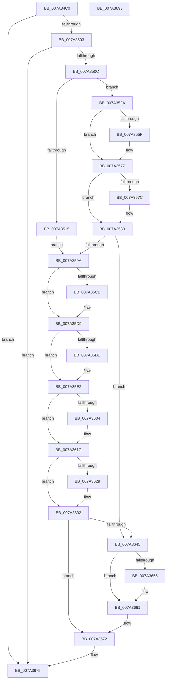

# SepIsParentOfChildAppContainer

- RVA: `0x007A34C0`–`0x007A3694` (길이 `468` bytes)
- VA: `0x00000001407A34C0`
- 실행 섹션: `PAGE`
- PDB 이름 있음: `예`; PDB Function 태그: `아니요`
- unwind 정보 RVA: `0x000A9A64`
- 디코드: `126`개 명령, `468/468` bytes 표시
- 미해석 바이트: `0` (있으면 어셈블리에 `.byte`로 보존)

> 이 문서는 커널 이미지의 기계어와 PDB 기호를 분석해 생성했습니다. 4번과 5번은 함수 원형과 자료형을 바이너리 사용 방식에서 추정한 C 해석이며 원본 소스 복구 결과는 아닙니다.

## 1. Dependencies

- 직접 호출 지점: **13**; 고유 호출 대상: **10**
- 직접 호출자로 확인된 함수: **1**
- RIP 상대 이미지 참조: **2**

### Outgoing calls
- `0x007A3547` → [KeAbPreAcquire](../../text/21/KeAbPreAcquire_function_00210230.md) (function, `0x00210230`)
- `0x007A3572` → [ExfAcquirePushLockSharedEx](../../text/21/ExfAcquirePushLockSharedEx_function_0021044C.md) (function, `0x0021044C`)
- `0x007A358B` → [SepGetTokenSessionMapEntry](../../text/48/SepGetTokenSessionMapEntry_function_00489654.md) (function, `0x00489654`)
- `0x007A35B7` → [KeAbPreAcquire](../../text/21/KeAbPreAcquire_function_00210230.md) (function, `0x00210230`)
- `0x007A35D4` → [ExfAcquirePushLockExclusiveEx](../../text/20/ExfAcquirePushLockExclusiveEx_function_0020FC90.md) (function, `0x0020FC90`)
- `0x007A35F9` → [SepFindMatchingLowBoxNumberEntries](SepFindMatchingLowBoxNumberEntries_function_007A3058.md) (function, `0x007A3058`)
- `0x007A3614` → [RtlIsParentOfChildAppContainer](../70/RtlIsParentOfChildAppContainer_function_007047CC.md) (function, `0x007047CC`)
- `0x007A362D` → [ExfTryToWakePushLock](../../text/26/ExfTryToWakePushLock_function_00265DD0.md) (function, `0x00265DD0`)
- `0x007A3636` → [KeAbPostRelease](../../text/2E/KeAbPostRelease_function_002E1600.md) (function, `0x002E1600`)
- `0x007A363B` → [KeLeaveCriticalRegion](../../text/25/KeLeaveCriticalRegion_function_0025D8B0.md) (function, `0x0025D8B0`)
- `0x007A365C` → [ExfReleasePushLockShared](../../text/26/ExfReleasePushLockShared_function_00263440.md) (function, `0x00263440`)
- `0x007A3668` → [KeAbPostRelease](../../text/2E/KeAbPostRelease_function_002E1600.md) (function, `0x002E1600`)
- `0x007A366D` → [KeLeaveCriticalRegion](../../text/25/KeLeaveCriticalRegion_function_0025D8B0.md) (function, `0x0025D8B0`)

### Direct callers
- [SeIsParentOfChildAppContainer](../79/SeIsParentOfChildAppContainer_function_0079CEC0.md) at `0x0079CEC4`

### Static image references
- `0x007A3519` → RVA `0x00F0FEA0` (`.data`; read)
- `0x007A3533` → RVA `0x00F0FE88` (`.data`; read)

## 2. Other-region calls and transfers

- 다른 실행 섹션으로 향하는 call: **11**
  - `0x007A3547` → [KeAbPreAcquire](../../text/21/KeAbPreAcquire_function_00210230.md) (`PAGE` → `.text`)
  - `0x007A3572` → [ExfAcquirePushLockSharedEx](../../text/21/ExfAcquirePushLockSharedEx_function_0021044C.md) (`PAGE` → `.text`)
  - `0x007A358B` → [SepGetTokenSessionMapEntry](../../text/48/SepGetTokenSessionMapEntry_function_00489654.md) (`PAGE` → `.text`)
  - `0x007A35B7` → [KeAbPreAcquire](../../text/21/KeAbPreAcquire_function_00210230.md) (`PAGE` → `.text`)
  - `0x007A35D4` → [ExfAcquirePushLockExclusiveEx](../../text/20/ExfAcquirePushLockExclusiveEx_function_0020FC90.md) (`PAGE` → `.text`)
  - `0x007A362D` → [ExfTryToWakePushLock](../../text/26/ExfTryToWakePushLock_function_00265DD0.md) (`PAGE` → `.text`)
  - `0x007A3636` → [KeAbPostRelease](../../text/2E/KeAbPostRelease_function_002E1600.md) (`PAGE` → `.text`)
  - `0x007A363B` → [KeLeaveCriticalRegion](../../text/25/KeLeaveCriticalRegion_function_0025D8B0.md) (`PAGE` → `.text`)
  - `0x007A365C` → [ExfReleasePushLockShared](../../text/26/ExfReleasePushLockShared_function_00263440.md) (`PAGE` → `.text`)
  - `0x007A3668` → [KeAbPostRelease](../../text/2E/KeAbPostRelease_function_002E1600.md) (`PAGE` → `.text`)
  - `0x007A366D` → [KeLeaveCriticalRegion](../../text/25/KeLeaveCriticalRegion_function_0025D8B0.md) (`PAGE` → `.text`)
- 별도 외부 분기/꼬리 이동을 확인하지 못했습니다.

## 3. Assembly (complete function range)

```asm
007A34C0  48 89 5C 24 08                  mov qword ptr [rsp + 8], rbx
007A34C5  48 89 74 24 10                  mov qword ptr [rsp + 0x10], rsi
007A34CA  48 89 7C 24 18                  mov qword ptr [rsp + 0x18], rdi
007A34CF  55                              push rbp
007A34D0  41 54                           push r12
007A34D2  41 55                           push r13
007A34D4  41 56                           push r14
007A34D6  41 57                           push r15
007A34D8  48 8B EC                        mov rbp, rsp
007A34DB  48 83 EC 50                     sub rsp, 0x50
007A34DF  33 C0                           xor eax, eax
007A34E1  8B F1                           mov esi, ecx
007A34E3  48 89 45 48                     mov qword ptr [rbp + 0x48], rax
007A34E7  45 8B F8                        mov r15d, r8d
007A34EA  48 89 45 E8                     mov qword ptr [rbp - 0x18], rax
007A34EE  44 8B E2                        mov r12d, edx
007A34F1  48 89 45 E0                     mov qword ptr [rbp - 0x20], rax
007A34F5  44 8A E8                        mov r13b, al
007A34F8  44 8A F0                        mov r14b, al
007A34FB  85 D2                           test edx, edx
007A34FD  0F 84 72 01 00 00               je 0x1407a3675
007A3503  45 85 C0                        test r8d, r8d
007A3506  0F 84 69 01 00 00               je 0x1407a3675
007A350C  48 83 CB FF                     or rbx, 0xffffffffffffffff
007A3510  83 FE 05                        cmp esi, 5
007A3513  73 15                           jae 0x1407a352a
007A3515  48 8D 0C B6                     lea rcx, [rsi + rsi*4]
007A3519  48 8D 05 80 C9 76 00            lea rax, [rip + 0x76c980]
007A3520  48 8D 04 C8                     lea rax, [rax + rcx*8]
007A3524  48 89 45 48                     mov qword ptr [rbp + 0x48], rax
007A3528  EB 70                           jmp 0x1407a359a
007A352A  65 48 8B 04 25 88 01 00 00      mov rax, qword ptr gs:[0x188]
007A3533  48 8D 0D 4E C9 76 00            lea rcx, [rip + 0x76c94e]
007A353A  45 33 C0                        xor r8d, r8d
007A353D  33 D2                           xor edx, edx
007A353F  66 01 98 E4 01 00 00            add word ptr [rax + 0x1e4], bx
007A3546  90                              nop
007A3547  E8 E4 CC A6 FF                  call 0x140210230
007A354C  48 8B F8                        mov rdi, rax
007A354F  33 C0                           xor eax, eax
007A3551  8D 48 11                        lea ecx, [rax + 0x11]
007A3554  F0 48 0F B1 0D 2B C9 76 00      lock cmpxchg qword ptr [rip + 0x76c92b], rcx
007A355D  74 18                           je 0x1407a3577
007A355F  4C 8D 0D 22 C9 76 00            lea r9, [rip + 0x76c922]
007A3566  4C 8B C7                        mov r8, rdi
007A3569  33 D2                           xor edx, edx
007A356B  48 8D 0D 16 C9 76 00            lea rcx, [rip + 0x76c916]
007A3572  E8 D5 CE A6 FF                  call 0x14021044c
007A3577  48 85 FF                        test rdi, rdi
007A357A  74 04                           je 0x1407a3580
007A357C  C6 47 0A 01                     mov byte ptr [rdi + 0xa], 1
007A3580  4C 8D 45 48                     lea r8, [rbp + 0x48]
007A3584  33 D2                           xor edx, edx
007A3586  8B CE                           mov ecx, esi
007A3588  41 B6 01                        mov r14b, 1
007A358B  E8 C4 60 CE FF                  call 0x140489654
007A3590  33 F6                           xor esi, esi
007A3592  85 C0                           test eax, eax
007A3594  0F 88 AB 00 00 00               js 0x1407a3645
007A359A  65 48 8B 04 25 88 01 00 00      mov rax, qword ptr gs:[0x188]
007A35A3  45 33 C0                        xor r8d, r8d
007A35A6  48 8B 7D 48                     mov rdi, qword ptr [rbp + 0x48]
007A35AA  33 D2                           xor edx, edx
007A35AC  48 8B CF                        mov rcx, rdi
007A35AF  66 01 98 E4 01 00 00            add word ptr [rax + 0x1e4], bx
007A35B6  90                              nop
007A35B7  E8 74 CC A6 FF                  call 0x140210230
007A35BC  F0 48 0F BA 2F 00               lock bts qword ptr [rdi], 0
007A35C2  48 8B 7D 48                     mov rdi, qword ptr [rbp + 0x48]
007A35C6  48 8B F0                        mov rsi, rax
007A35C9  73 0E                           jae 0x1407a35d9
007A35CB  4C 8B C7                        mov r8, rdi
007A35CE  48 8B D0                        mov rdx, rax
007A35D1  48 8B CF                        mov rcx, rdi
007A35D4  E8 B7 C6 A6 FF                  call 0x14020fc90
007A35D9  48 85 F6                        test rsi, rsi
007A35DC  74 04                           je 0x1407a35e2
007A35DE  C6 46 0A 01                     mov byte ptr [rsi + 0xa], 1
007A35E2  48 8B 4F 18                     mov rcx, qword ptr [rdi + 0x18]
007A35E6  48 8D 45 E0                     lea rax, [rbp - 0x20]
007A35EA  4C 8D 4D E8                     lea r9, [rbp - 0x18]
007A35EE  48 89 44 24 20                  mov qword ptr [rsp + 0x20], rax
007A35F3  45 8B C7                        mov r8d, r15d
007A35F6  41 8B D4                        mov edx, r12d
007A35F9  E8 5A FA FF FF                  call 0x1407a3058
007A35FE  33 F6                           xor esi, esi
007A3600  85 C0                           test eax, eax
007A3602  78 18                           js 0x1407a361c
007A3604  48 8B 55 E0                     mov rdx, qword ptr [rbp - 0x20]
007A3608  48 8B 4D E8                     mov rcx, qword ptr [rbp - 0x18]
007A360C  48 8B 52 20                     mov rdx, qword ptr [rdx + 0x20]
007A3610  48 8B 49 20                     mov rcx, qword ptr [rcx + 0x20]
007A3614  E8 B3 11 F6 FF                  call 0x1407047cc
007A3619  44 8A E8                        mov r13b, al
007A361C  F0 48 0F C1 1F                  lock xadd qword ptr [rdi], rbx
007A3621  80 E3 06                        and bl, 6
007A3624  80 FB 02                        cmp bl, 2
007A3627  75 09                           jne 0x1407a3632
007A3629  48 8B 4D 48                     mov rcx, qword ptr [rbp + 0x48]
007A362D  E8 9E 27 AC FF                  call 0x140265dd0
007A3632  48 8B 4D 48                     mov rcx, qword ptr [rbp + 0x48]
007A3636  E8 C5 DF B3 FF                  call 0x1402e1600
007A363B  E8 70 A2 AB FF                  call 0x14025d8b0
007A3640  45 84 F6                        test r14b, r14b
007A3643  74 2D                           je 0x1407a3672
007A3645  B8 11 00 00 00                  mov eax, 0x11
007A364A  F0 48 0F B1 35 35 C8 76 00      lock cmpxchg qword ptr [rip + 0x76c835], rsi
007A3653  74 0C                           je 0x1407a3661
007A3655  48 8D 0D 2C C8 76 00            lea rcx, [rip + 0x76c82c]
007A365C  E8 DF FD AB FF                  call 0x140263440
007A3661  48 8D 0D 20 C8 76 00            lea rcx, [rip + 0x76c820]
007A3668  E8 93 DF B3 FF                  call 0x1402e1600
007A366D  E8 3E A2 AB FF                  call 0x14025d8b0
007A3672  41 8A C5                        mov al, r13b
007A3675  4C 8D 5C 24 50                  lea r11, [rsp + 0x50]
007A367A  49 8B 5B 30                     mov rbx, qword ptr [r11 + 0x30]
007A367E  49 8B 73 38                     mov rsi, qword ptr [r11 + 0x38]
007A3682  49 8B 7B 40                     mov rdi, qword ptr [r11 + 0x40]
007A3686  49 8B E3                        mov rsp, r11
007A3689  41 5F                           pop r15
007A368B  41 5E                           pop r14
007A368D  41 5D                           pop r13
007A368F  41 5C                           pop r12
007A3691  5D                              pop rbp
007A3692  C3                              ret
007A3693  CC                              int3
```

## 4. C-style interpretation (structured pseudocode)

```c
__int64 __fastcall SepIsParentOfChildAppContainer(int a1, int a2, int a3)
{
    __int64 result;
    __int64 v_r13;
    __int64 v_rbx;
    __int64 v_rsi;
    __int64 v_rsp;
    unsigned __int64 v_stack_m28;
    unsigned __int64 v_stack_m40;
    unsigned __int64 v_stack_m48;
    unsigned __int64 v_stack_m58;
    unsigned __int64 v_stack_p10;
    unsigned __int64 v_stack_p18;
    unsigned __int64 v_stack_p20;
    unsigned __int64 v_stack_p8;

    v_stack_p8 = v_rbx;
    v_stack_p10 = v_rsi;
    v_stack_p18 = v_rdi;
    v_rsp = (v_rsp) - (80);
    result = 0;
    v_stack_p20 = 0;
    v_stack_m40 = 0;
    v_stack_m48 = 0;
    if (a2 == 0) goto loc_007A3675;
    if (a3 == 0) goto loc_007A3675;
    v_rbx = (v_rbx) | (-1);
    if (((unsigned int)((unsigned int)(a1))) >= 5) goto loc_007A352A;
    v_stack_p20 = v_rip + 7784832 + (unsigned int)(a1) + (unsigned int)(a1) * 4 * 8;
    goto loc_007A359A;
loc_007A352A:
    a3 = 0;
    a2 = 0;
    result = KeAbPreAcquire(v_rip + 7784782, a2, a3, a4);
    result = 0;
    if (!(condition_is_equal)) {
        a4 = v_rip + 7784738;
        a3 = 0;
        a2 = 0;
        a1 = v_rip + 7784726;
        result = ExfAcquirePushLockSharedEx(a1, a2, a3, a4);
    }
    if (result != 0) {
        *(unsigned __int8 *)(result + 10) = 1;
    }
    a2 = 0;
    result = SepGetTokenSessionMapEntry((unsigned int)((unsigned int)((unsigned int)(a1))), a2, v_stack_p20, a4);
    v_rsi = 0;
    if (sign_flag) goto loc_007A3645;
loc_007A359A:
    a3 = 0;
    a2 = 0;
    result = KeAbPreAcquire(v_stack_p20, a2, a3, a4);
    if (!(condition_is_above_or_equal)) {
        a3 = v_stack_p20;
        a2 = result;
        a1 = v_stack_p20;
        result = ExfAcquirePushLockExclusiveEx(a1, a2, a3, a4);
    }
    if (result != 0) {
        *(unsigned __int8 *)(result + 10) = 1;
    }
    v_stack_m58 = v_stack_m48;
    result = SepFindMatchingLowBoxNumberEntries(*(unsigned __int64 *)(v_stack_p20 + 24), (unsigned int)((unsigned int)((unsigned int)(a2))), (unsigned int)((unsigned int)((unsigned int)(a3))), v_stack_m40);
    v_rsi = 0;
    v_r13 = 0;
    if (!(sign_flag)) {
        a2 = v_stack_m48;
        a1 = v_stack_m40;
        a2 = *(unsigned __int64 *)(a2 + 32);
        a1 = *(unsigned __int64 *)(a1 + 32);
        result = RtlIsParentOfChildAppContainer(a1, a2, (unsigned int)((unsigned int)((unsigned int)(a3))), v_stack_m40);
        v_r13 = (unsigned __int8)(result);
    }
    v_rbx = (unsigned __int8)((v_rbx) & (6));
    if (((unsigned __int8)(v_rbx)) == 2) {
        a1 = v_stack_p20;
        result = ExfTryToWakePushLock(a1, a2, (unsigned int)((unsigned int)((unsigned int)(a3))), v_stack_m40);
    }
    result = KeAbPostRelease(v_stack_p20, a2, (unsigned int)((unsigned int)((unsigned int)(a3))), v_stack_m40);
    result = KeLeaveCriticalRegion(v_stack_p20, a2, (unsigned int)((unsigned int)((unsigned int)(a3))), v_stack_m40);
    if (1 == 0) goto loc_007A3672;
loc_007A3645:
    result = 17;
    if (1 != 0) {
        a1 = v_rip + 7784492;
        result = ExfReleasePushLockShared(a1, a2, (unsigned int)((unsigned int)((unsigned int)(a3))), v_stack_m40);
    }
    result = KeAbPostRelease(v_rip + 7784480, a2, (unsigned int)((unsigned int)((unsigned int)(a3))), v_stack_m40);
    result = KeLeaveCriticalRegion(v_rip + 7784480, a2, (unsigned int)((unsigned int)((unsigned int)(a3))), v_stack_m40);
loc_007A3672:
loc_007A3675:
    return (unsigned __int8)(v_r13);
}
```

## 5. (Beta) C Style

```c
int64_t SepIsParentOfChildAppContainer(int32_t Arg1, int32_t Arg2, int32_t Arg3)
{
    int64_t result;
    int64_t local_r13;
    int64_t local_rbx;
    int64_t local_rsi;
    int64_t local_rsp;
    uint64_t v_stack_m28;
    uint64_t v_stack_m40;
    uint64_t v_stack_m48;
    uint64_t v_stack_m58;
    uint64_t v_stack_p10;
    uint64_t v_stack_p18;
    uint64_t v_stack_p20;
    uint64_t v_stack_p8;

    v_stack_p8 = local_rbx;
    v_stack_p10 = local_rsi;
    v_stack_p18 = local_rdi;
    local_rsp = (local_rsp) - (80);
    result = 0;
    v_stack_p20 = 0;
    v_stack_m40 = 0;
    v_stack_m48 = 0;
    if (Arg2 == 0) goto loc_007A3675;
    if (Arg3 == 0) goto loc_007A3675;
    local_rbx = (local_rbx) | (-1);
    if (((uint32_t)((uint32_t)(Arg1))) >= 5) goto loc_007A352A;
    v_stack_p20 = v_rip + 7784832 + (uint32_t)(Arg1) + (uint32_t)(Arg1) * 4 * 8;
    goto loc_007A359A;
loc_007A352A:
    Arg3 = 0;
    Arg2 = 0;
    result = KeAbPreAcquire(v_rip + 7784782, Arg2, Arg3, a4);
    result = 0;
    if (!(condition_is_equal)) {
        a4 = v_rip + 7784738;
        Arg3 = 0;
        Arg2 = 0;
        Arg1 = v_rip + 7784726;
        result = ExfAcquirePushLockSharedEx(Arg1, Arg2, Arg3, a4);
    }
    if (result != 0) {
        *(uint8_t *)(result + 0xA) = 1;
    }
    Arg2 = 0;
    result = SepGetTokenSessionMapEntry((uint32_t)((uint32_t)((uint32_t)(Arg1))), Arg2, v_stack_p20, a4);
    local_rsi = 0;
    if (sign_flag) goto loc_007A3645;
loc_007A359A:
    Arg3 = 0;
    Arg2 = 0;
    result = KeAbPreAcquire(v_stack_p20, Arg2, Arg3, a4);
    if (!(condition_is_above_or_equal)) {
        Arg3 = v_stack_p20;
        Arg2 = result;
        Arg1 = v_stack_p20;
        result = ExfAcquirePushLockExclusiveEx(Arg1, Arg2, Arg3, a4);
    }
    if (result != 0) {
        *(uint8_t *)(result + 0xA) = 1;
    }
    v_stack_m58 = v_stack_m48;
    result = SepFindMatchingLowBoxNumberEntries(*(uint64_t *)(v_stack_p20 + 0x18), (uint32_t)((uint32_t)((uint32_t)(Arg2))), (uint32_t)((uint32_t)((uint32_t)(Arg3))), v_stack_m40);
    local_rsi = 0;
    local_r13 = 0;
    if (!(sign_flag)) {
        Arg2 = v_stack_m48;
        Arg1 = v_stack_m40;
        Arg2 = *(uint64_t *)(Arg2 + 0x20);
        Arg1 = *(uint64_t *)(Arg1 + 0x20);
        result = RtlIsParentOfChildAppContainer(Arg1, Arg2, (uint32_t)((uint32_t)((uint32_t)(Arg3))), v_stack_m40);
        local_r13 = (uint8_t)(result);
    }
    local_rbx = (uint8_t)((local_rbx) & (6));
    if (((uint8_t)(local_rbx)) == 2) {
        Arg1 = v_stack_p20;
        result = ExfTryToWakePushLock(Arg1, Arg2, (uint32_t)((uint32_t)((uint32_t)(Arg3))), v_stack_m40);
    }
    result = KeAbPostRelease(v_stack_p20, Arg2, (uint32_t)((uint32_t)((uint32_t)(Arg3))), v_stack_m40);
    result = KeLeaveCriticalRegion(v_stack_p20, Arg2, (uint32_t)((uint32_t)((uint32_t)(Arg3))), v_stack_m40);
    if (1 == 0) goto loc_007A3672;
loc_007A3645:
    result = 17;
    if (1 != 0) {
        Arg1 = v_rip + 7784492;
        result = ExfReleasePushLockShared(Arg1, Arg2, (uint32_t)((uint32_t)((uint32_t)(Arg3))), v_stack_m40);
    }
    result = KeAbPostRelease(v_rip + 7784480, Arg2, (uint32_t)((uint32_t)((uint32_t)(Arg3))), v_stack_m40);
    result = KeLeaveCriticalRegion(v_rip + 7784480, Arg2, (uint32_t)((uint32_t)((uint32_t)(Arg3))), v_stack_m40);
loc_007A3672:
loc_007A3675:
    return (uint8_t)(local_r13);
}
```

## 6. Execution-region graph

[열기: 2D/3D 그래프와 함수 탐색 컨트롤 패널](../../../control-panel.html?section=page&rva=0x007A34C0&view=graph)

- 2D 그래프는 위에서 아래로 흐르고, 3D 그래프는 빈 공간을 드래그해 회전합니다. Shift+드래그는 이동, 휠은 확대·축소, 함수 노드 선택은 대상 보고서 이동입니다.

### Static fallback


