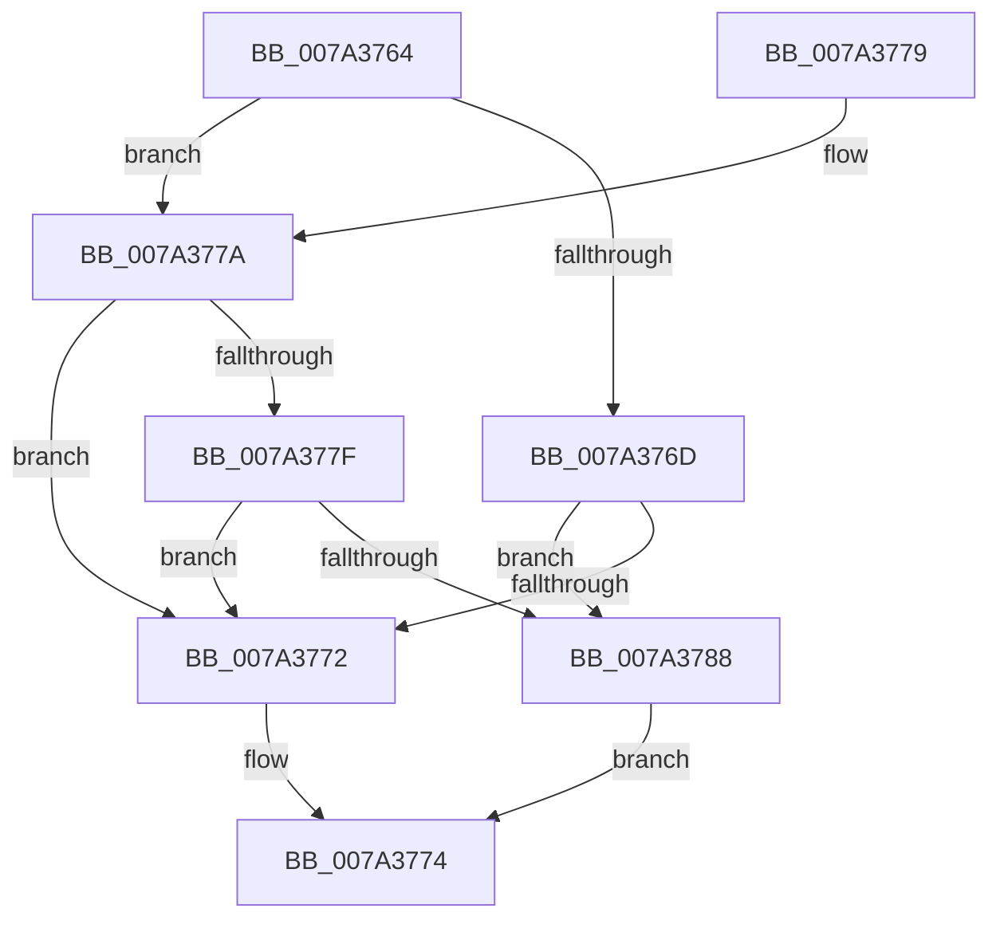

# SepIsSidEqual

- RVA: `0x007A3764`–`0x007A378C` (길이 `40` bytes)
- VA: `0x00000001407A3764`
- 실행 섹션: `PAGE`
- PDB 이름 있음: `예`; PDB Function 태그: `아니요`
- unwind 정보 RVA: `0x0007A1AC`
- 디코드: `16`개 명령, `40/40` bytes 표시
- 미해석 바이트: `0` (있으면 어셈블리에 `.byte`로 보존)

> 이 문서는 커널 이미지의 기계어와 PDB 기호를 분석해 생성했습니다. 4번과 5번은 함수 원형과 자료형을 바이너리 사용 방식에서 추정한 C 해석이며 원본 소스 복구 결과는 아닙니다.

## 1. Dependencies

- 직접 호출 지점: **1**; 고유 호출 대상: **1**
- 직접 호출자로 확인된 함수: **1**
- RIP 상대 이미지 참조: **0**

### Outgoing calls
- `0x007A377F` → [RtlEqualSid](../../text/40/RtlEqualSid_function_00400AD0.md) (function, `0x00400AD0`)

### Direct callers
- [sub_00B222A0](../B2/Unknown_function_00B222A0.md) at `0x00B224D2`
- [sub_00B222A0](../B2/Unknown_function_00B222A0.md) at `0x00B22523`

### Static image references
- 디코드된 RIP-relative 메모리 참조가 없습니다.

## 2. Other-region calls and transfers

- 다른 실행 섹션으로 향하는 call: **1**
  - `0x007A377F` → [RtlEqualSid](../../text/40/RtlEqualSid_function_00400AD0.md) (`PAGE` → `.text`)
- 별도 외부 분기/꼬리 이동을 확인하지 못했습니다.

## 3. Assembly (complete function range)

```asm
007A3764  48 83 EC 28                     sub rsp, 0x28
007A3768  48 85 C9                        test rcx, rcx
007A376B  75 0D                           jne 0x1407a377a
007A376D  48 85 D2                        test rdx, rdx
007A3770  74 16                           je 0x1407a3788
007A3772  32 C0                           xor al, al
007A3774  48 83 C4 28                     add rsp, 0x28
007A3778  C3                              ret
007A3779  CC                              int3
007A377A  48 85 D2                        test rdx, rdx
007A377D  74 F3                           je 0x1407a3772
007A377F  E8 4C D3 C5 FF                  call 0x140400ad0
007A3784  84 C0                           test al, al
007A3786  74 EA                           je 0x1407a3772
007A3788  B0 01                           mov al, 1
007A378A  EB E8                           jmp 0x1407a3774
```

## 4. C-style interpretation (structured pseudocode)

```c
__int64 __fastcall SepIsSidEqual(__int64 a1, __int64 a2)
{
    __int64 result;
    __int64 v_rsp;

    v_rsp = (v_rsp) - (40);
    if (a1 != 0) goto loc_007A377A;
    if (a2 == 0) goto loc_007A3788;
loc_007A3772:
    result = 0;
loc_007A3774:
    v_rsp = (v_rsp) + (40);
    return result;
loc_007A377A:
    if (a2 == 0) goto loc_007A3772;
    result = RtlEqualSid(a1, a2, a3, a4);
    if ((unsigned __int8)(result) == 0) goto loc_007A3772;
loc_007A3788:
    goto loc_007A3774;
}
```

## 5. (Beta) C Style

```c
int64_t SepIsSidEqual(int64_t Arg1, int64_t Arg2)
{
    int64_t result;
    int64_t local_rsp;

    local_rsp = (local_rsp) - (40);
    if (Arg1 != 0) goto loc_007A377A;
    if (Arg2 == 0) goto loc_007A3788;
loc_007A3772:
    result = 0;
loc_007A3774:
    local_rsp = (local_rsp) + (40);
    return result;
loc_007A377A:
    if (Arg2 == 0) goto loc_007A3772;
    result = RtlEqualSid(Arg1, Arg2, a3, a4);
    if ((uint8_t)(result) == 0) goto loc_007A3772;
loc_007A3788:
    goto loc_007A3774;
}
```

## 6. Execution-region graph

[열기: 2D/3D 그래프와 함수 탐색 컨트롤 패널](../../../control-panel.html?section=page&rva=0x007A3764&view=graph)

- 2D 그래프는 위에서 아래로 흐르고, 3D 그래프는 빈 공간을 드래그해 회전합니다. Shift+드래그는 이동, 휠은 확대·축소, 함수 노드 선택은 대상 보고서 이동입니다.

### Static fallback


