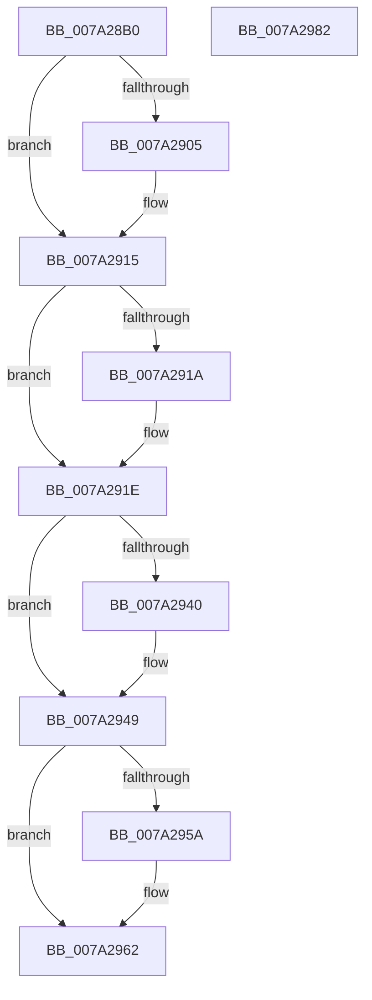

# SepIsValidProcUniqueLuid

- RVA: `0x007A28B0`–`0x007A2983` (길이 `211` bytes)
- VA: `0x00000001407A28B0`
- 실행 섹션: `PAGE`
- PDB 이름 있음: `예`; PDB Function 태그: `아니요`
- unwind 정보 RVA: `0x0007A168`
- 디코드: `63`개 명령, `211/211` bytes 표시
- 미해석 바이트: `0` (있으면 어셈블리에 `.byte`로 보존)

> 이 문서는 커널 이미지의 기계어와 PDB 기호를 분석해 생성했습니다. 4번과 5번은 함수 원형과 자료형을 바이너리 사용 방식에서 추정한 C 해석이며 원본 소스 복구 결과는 아닙니다.

## 1. Dependencies

- 직접 호출 지점: **6**; 고유 호출 대상: **6**
- 직접 호출자로 확인된 함수: **1**
- RIP 상대 이미지 참조: **1**

### Outgoing calls
- `0x007A28F0` → [KeAbPreAcquire](../../text/21/KeAbPreAcquire_function_00210230.md) (function, `0x00210230`)
- `0x007A2910` → [ExfAcquirePushLockSharedEx](../../text/21/ExfAcquirePushLockSharedEx_function_0021044C.md) (function, `0x0021044C`)
- `0x007A2931` → [SepFindMatchingLuidEntry](SepFindMatchingLuidEntry_function_007A2814.md) (function, `0x007A2814`)
- `0x007A295D` → [ExfReleasePushLockShared](../../text/26/ExfReleasePushLockShared_function_00263440.md) (function, `0x00263440`)
- `0x007A2965` → [KeAbPostRelease](../../text/2E/KeAbPostRelease_function_002E1600.md) (function, `0x002E1600`)
- `0x007A296A` → [KeLeaveCriticalRegion](../../text/25/KeLeaveCriticalRegion_function_0025D8B0.md) (function, `0x0025D8B0`)

### Direct callers
- [SepRmValidateProcUniqueLuidWrkr](SepRmValidateProcUniqueLuidWrkr_function_007A1BB0.md) at `0x007A1BC7`

### Static image references
- `0x007A28E6` → RVA `0x00FD8068` (`PAGEDATA`; read)

## 2. Other-region calls and transfers

- 다른 실행 섹션으로 향하는 call: **5**
  - `0x007A28F0` → [KeAbPreAcquire](../../text/21/KeAbPreAcquire_function_00210230.md) (`PAGE` → `.text`)
  - `0x007A2910` → [ExfAcquirePushLockSharedEx](../../text/21/ExfAcquirePushLockSharedEx_function_0021044C.md) (`PAGE` → `.text`)
  - `0x007A295D` → [ExfReleasePushLockShared](../../text/26/ExfReleasePushLockShared_function_00263440.md) (`PAGE` → `.text`)
  - `0x007A2965` → [KeAbPostRelease](../../text/2E/KeAbPostRelease_function_002E1600.md) (`PAGE` → `.text`)
  - `0x007A296A` → [KeLeaveCriticalRegion](../../text/25/KeLeaveCriticalRegion_function_0025D8B0.md) (`PAGE` → `.text`)
- 별도 외부 분기/꼬리 이동을 확인하지 못했습니다.

## 3. Assembly (complete function range)

```asm
007A28B0  48 89 5C 24 08                  mov qword ptr [rsp + 8], rbx
007A28B5  55                              push rbp
007A28B6  56                              push rsi
007A28B7  57                              push rdi
007A28B8  41 56                           push r14
007A28BA  41 57                           push r15
007A28BC  48 83 EC 20                     sub rsp, 0x20
007A28C0  65 48 8B 04 25 88 01 00 00      mov rax, qword ptr gs:[0x188]
007A28C9  48 8B E9                        mov rbp, rcx
007A28CC  45 33 F6                        xor r14d, r14d
007A28CF  45 33 C0                        xor r8d, r8d
007A28D2  33 D2                           xor edx, edx
007A28D4  4C 89 74 24 58                  mov qword ptr [rsp + 0x58], r14
007A28D9  BF 25 02 00 C0                  mov edi, 0xc0000225
007A28DE  66 FF 88 E4 01 00 00            dec word ptr [rax + 0x1e4]
007A28E5  90                              nop
007A28E6  48 8B 35 7B 57 83 00            mov rsi, qword ptr [rip + 0x83577b]
007A28ED  48 8B CE                        mov rcx, rsi
007A28F0  E8 3B D9 A6 FF                  call 0x140210230
007A28F5  48 8B D8                        mov rbx, rax
007A28F8  45 8D 7E 11                     lea r15d, [r14 + 0x11]
007A28FC  33 C0                           xor eax, eax
007A28FE  F0 4C 0F B1 3E                  lock cmpxchg qword ptr [rsi], r15
007A2903  74 10                           je 0x1407a2915
007A2905  4C 8B CE                        mov r9, rsi
007A2908  4C 8B C3                        mov r8, rbx
007A290B  33 D2                           xor edx, edx
007A290D  48 8B CE                        mov rcx, rsi
007A2910  E8 37 DB A6 FF                  call 0x14021044c
007A2915  48 85 DB                        test rbx, rbx
007A2918  74 04                           je 0x1407a291e
007A291A  C6 43 0A 01                     mov byte ptr [rbx + 0xa], 1
007A291E  48 8B 0D 43 57 83 00            mov rcx, qword ptr [rip + 0x835743]
007A2925  4C 8D 44 24 58                  lea r8, [rsp + 0x58]
007A292A  48 8B D5                        mov rdx, rbp
007A292D  48 8B 49 08                     mov rcx, qword ptr [rcx + 8]
007A2931  E8 DE FE FF FF                  call 0x1407a2814
007A2936  48 8B 44 24 58                  mov rax, qword ptr [rsp + 0x58]
007A293B  48 85 C0                        test rax, rax
007A293E  74 09                           je 0x1407a2949
007A2940  8A 40 30                        mov al, byte ptr [rax + 0x30]
007A2943  F6 D8                           neg al
007A2945  1B C9                           sbb ecx, ecx
007A2947  23 F9                           and edi, ecx
007A2949  48 8B 1D 18 57 83 00            mov rbx, qword ptr [rip + 0x835718]
007A2950  49 8B C7                        mov rax, r15
007A2953  F0 4C 0F B1 33                  lock cmpxchg qword ptr [rbx], r14
007A2958  74 08                           je 0x1407a2962
007A295A  48 8B CB                        mov rcx, rbx
007A295D  E8 DE 0A AC FF                  call 0x140263440
007A2962  48 8B CB                        mov rcx, rbx
007A2965  E8 96 EC B3 FF                  call 0x1402e1600
007A296A  E8 41 AF AB FF                  call 0x14025d8b0
007A296F  48 8B 5C 24 50                  mov rbx, qword ptr [rsp + 0x50]
007A2974  8B C7                           mov eax, edi
007A2976  48 83 C4 20                     add rsp, 0x20
007A297A  41 5F                           pop r15
007A297C  41 5E                           pop r14
007A297E  5F                              pop rdi
007A297F  5E                              pop rsi
007A2980  5D                              pop rbp
007A2981  C3                              ret
007A2982  CC                              int3
```

## 4. C-style interpretation (structured pseudocode)

```c
__int64 __fastcall SepIsValidProcUniqueLuid(__int64 a1, int a2, int a3)
{
    __int64 result;
    __int64 v_r14;
    __int64 v_rdi;
    __int64 v_rsp;
    unsigned __int64 v_stack_p10;
    unsigned __int64 v_stack_p8;

    v_stack_p8 = v_rbx;
    v_rsp = (v_rsp) - (32);
    v_r14 = 0;
    a3 = 0;
    a2 = 0;
    v_stack_p10 = 0;
    result = KeAbPreAcquire(*(unsigned __int64 *)(v_rip + 8607611), a2, a3, a4);
    result = 0;
    if (!(condition_is_equal)) {
        a4 = *(unsigned __int64 *)(v_rip + 8607611);
        a3 = 0;
        a2 = 0;
        a1 = *(unsigned __int64 *)(v_rip + 8607611);
        result = ExfAcquirePushLockSharedEx(a1, a2, a3, a4);
    }
    if (result != 0) {
        *(unsigned __int8 *)(result + 10) = 1;
    }
    result = SepFindMatchingLuidEntry(*(unsigned __int64 *)(*(unsigned __int64 *)(v_rip + 8607555) + 8), a1, v_stack_p10, a4);
    result = v_stack_p10;
    v_rdi = (unsigned int)(0xC0000225ULL);
    if (v_stack_p10 != 0) {
        result = *(unsigned __int8 *)(v_stack_p10 + 48);
        result = (unsigned __int8)(-(result));
        v_rdi = (unsigned int)(((unsigned int)(0xC0000225ULL)) & ((unsigned int)(*(unsigned __int64 *)(*(unsigned __int64 *)(v_rip + 8607555) + 8))));
    }
    result = v_r14 + 17;
    if (!(condition_is_equal)) {
        a1 = *(unsigned __int64 *)(v_rip + 8607512);
        result = ExfReleasePushLockShared(a1, a1, v_stack_p10, a4);
    }
    result = KeAbPostRelease(*(unsigned __int64 *)(v_rip + 8607512), a1, v_stack_p10, a4);
    result = KeLeaveCriticalRegion(*(unsigned __int64 *)(v_rip + 8607512), a1, v_stack_p10, a4);
    v_rsp = (v_rsp) + (32);
    return (unsigned int)((unsigned int)(v_rdi));
}
```

## 5. (Beta) C Style

```c
int64_t SepIsValidProcUniqueLuid(int64_t Arg1, int32_t Arg2, int32_t Arg3)
{
    int64_t result;
    int64_t local_r14;
    int64_t local_rdi;
    int64_t local_rsp;
    uint64_t v_stack_p10;
    uint64_t v_stack_p8;

    v_stack_p8 = local_rbx;
    local_rsp = (local_rsp) - (32);
    local_r14 = 0;
    Arg3 = 0;
    Arg2 = 0;
    v_stack_p10 = 0;
    result = KeAbPreAcquire(*(uint64_t *)(v_rip + 0x83577B), Arg2, Arg3, a4);
    result = 0;
    if (!(condition_is_equal)) {
        a4 = *(uint64_t *)(v_rip + 0x83577B);
        Arg3 = 0;
        Arg2 = 0;
        Arg1 = *(uint64_t *)(v_rip + 0x83577B);
        result = ExfAcquirePushLockSharedEx(Arg1, Arg2, Arg3, a4);
    }
    if (result != 0) {
        *(uint8_t *)(result + 0xA) = 1;
    }
    result = SepFindMatchingLuidEntry(*(uint64_t *)(*(uint64_t *)(v_rip + 0x835743) + 0x8), Arg1, v_stack_p10, a4);
    result = v_stack_p10;
    local_rdi = (uint32_t)(0xC0000225ULL);
    if (v_stack_p10 != 0) {
        result = *(uint8_t *)(v_stack_p10 + 0x30);
        result = (uint8_t)(-(result));
        local_rdi = (uint32_t)(((uint32_t)(0xC0000225ULL)) & ((uint32_t)(*(uint64_t *)(*(uint64_t *)(v_rip + 0x835743) + 0x8))));
    }
    result = local_r14 + 17;
    if (!(condition_is_equal)) {
        Arg1 = *(uint64_t *)(v_rip + 0x835718);
        result = ExfReleasePushLockShared(Arg1, Arg1, v_stack_p10, a4);
    }
    result = KeAbPostRelease(*(uint64_t *)(v_rip + 0x835718), Arg1, v_stack_p10, a4);
    result = KeLeaveCriticalRegion(*(uint64_t *)(v_rip + 0x835718), Arg1, v_stack_p10, a4);
    local_rsp = (local_rsp) + (32);
    return (uint32_t)((uint32_t)(local_rdi));
}
```

## 6. Execution-region graph

[열기: 2D/3D 그래프와 함수 탐색 컨트롤 패널](../../../control-panel.html?section=page&rva=0x007A28B0&view=graph)

- 2D 그래프는 위에서 아래로 흐르고, 3D 그래프는 빈 공간을 드래그해 회전합니다. Shift+드래그는 이동, 휠은 확대·축소, 함수 노드 선택은 대상 보고서 이동입니다.

### Static fallback


