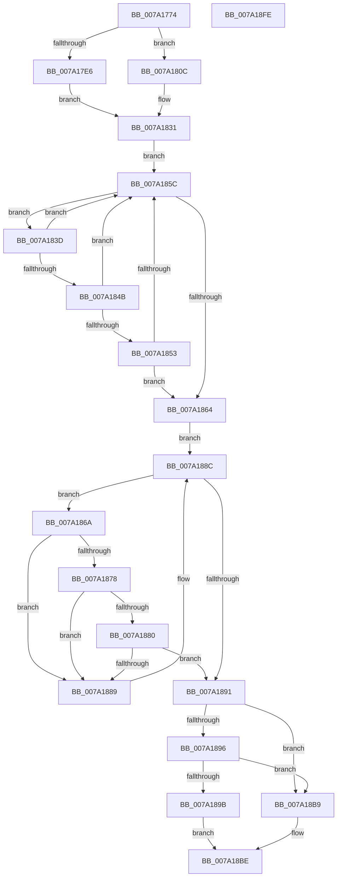

# SepMakeLogonSessionsSiblings

- RVA: `0x007A1774`–`0x007A18FF` (길이 `395` bytes)
- VA: `0x00000001407A1774`
- 실행 섹션: `PAGE`
- PDB 이름 있음: `예`; PDB Function 태그: `아니요`
- unwind 정보 RVA: `0x00075C18`
- 디코드: `109`개 명령, `395/395` bytes 표시
- 미해석 바이트: `0` (있으면 어셈블리에 `.byte`로 보존)

> 이 문서는 커널 이미지의 기계어와 PDB 기호를 분석해 생성했습니다. 4번과 5번은 함수 원형과 자료형을 바이너리 사용 방식에서 추정한 C 해석이며 원본 소스 복구 결과는 아닙니다.

## 1. Dependencies

- 직접 호출 지점: **9**; 고유 호출 대상: **4**
- 직접 호출자로 확인된 함수: **1**
- RIP 상대 이미지 참조: **2**

### Outgoing calls
- `0x007A17E9` → [ExAcquireResourceExclusiveLite](../../text/21/ExAcquireResourceExclusiveLite_function_00214E20.md) (function, `0x00214E20`)
- `0x007A1819` → [ExAcquireResourceExclusiveLite](../../text/21/ExAcquireResourceExclusiveLite_function_00214E20.md) (function, `0x00214E20`)
- `0x007A1834` → [ExAcquireResourceExclusiveLite](../../text/21/ExAcquireResourceExclusiveLite_function_00214E20.md) (function, `0x00214E20`)
- `0x007A183D` → [PsGetCurrentServerSilo](../../text/22/PsGetCurrentServerSilo_function_00225710.md) (function, `0x00225710`)
- `0x007A186A` → [PsGetCurrentServerSilo](../../text/22/PsGetCurrentServerSilo_function_00225710.md) (function, `0x00225710`)
- `0x007A18C1` → [ExReleaseResourceLite](../../text/25/ExReleaseResourceLite_function_0025FA10.md) (function, `0x0025FA10`)
- `0x007A18C6` → [KeLeaveCriticalRegion](../../text/25/KeLeaveCriticalRegion_function_0025D8B0.md) (function, `0x0025D8B0`)
- `0x007A18D5` → [ExReleaseResourceLite](../../text/25/ExReleaseResourceLite_function_0025FA10.md) (function, `0x0025FA10`)
- `0x007A18DA` → [KeLeaveCriticalRegion](../../text/25/KeLeaveCriticalRegion_function_0025D8B0.md) (function, `0x0025D8B0`)

### Direct callers
- [SepRmMakeLogonSessionsSiblingsWrkr](SepRmMakeLogonSessionsSiblingsWrkr_function_007A1B40.md) at `0x007A1B63`

### Static image references
- `0x007A1797` → RVA `0x00E67F20` (`.data`; read)
- `0x007A17B4` → RVA `0x00FD9AF0` (`PAGEDATA`; read)

## 2. Other-region calls and transfers

- 다른 실행 섹션으로 향하는 call: **9**
  - `0x007A17E9` → [ExAcquireResourceExclusiveLite](../../text/21/ExAcquireResourceExclusiveLite_function_00214E20.md) (`PAGE` → `.text`)
  - `0x007A1819` → [ExAcquireResourceExclusiveLite](../../text/21/ExAcquireResourceExclusiveLite_function_00214E20.md) (`PAGE` → `.text`)
  - `0x007A1834` → [ExAcquireResourceExclusiveLite](../../text/21/ExAcquireResourceExclusiveLite_function_00214E20.md) (`PAGE` → `.text`)
  - `0x007A183D` → [PsGetCurrentServerSilo](../../text/22/PsGetCurrentServerSilo_function_00225710.md) (`PAGE` → `.text`)
  - `0x007A186A` → [PsGetCurrentServerSilo](../../text/22/PsGetCurrentServerSilo_function_00225710.md) (`PAGE` → `.text`)
  - `0x007A18C1` → [ExReleaseResourceLite](../../text/25/ExReleaseResourceLite_function_0025FA10.md) (`PAGE` → `.text`)
  - `0x007A18C6` → [KeLeaveCriticalRegion](../../text/25/KeLeaveCriticalRegion_function_0025D8B0.md) (`PAGE` → `.text`)
  - `0x007A18D5` → [ExReleaseResourceLite](../../text/25/ExReleaseResourceLite_function_0025FA10.md) (`PAGE` → `.text`)
  - `0x007A18DA` → [KeLeaveCriticalRegion](../../text/25/KeLeaveCriticalRegion_function_0025D8B0.md) (`PAGE` → `.text`)
- 별도 외부 분기/꼬리 이동을 확인하지 못했습니다.

## 3. Assembly (complete function range)

```asm
007A1774  48 89 5C 24 08                  mov qword ptr [rsp + 8], rbx
007A1779  48 89 6C 24 10                  mov qword ptr [rsp + 0x10], rbp
007A177E  48 89 74 24 18                  mov qword ptr [rsp + 0x18], rsi
007A1783  57                              push rdi
007A1784  41 54                           push r12
007A1786  41 55                           push r13
007A1788  41 56                           push r14
007A178A  41 57                           push r15
007A178C  48 83 EC 20                     sub rsp, 0x20
007A1790  44 69 09 24 0A 25 5B            imul r9d, dword ptr [rcx], 0x5b250a24
007A1797  4C 8D 2D 82 67 6C 00            lea r13, [rip + 0x6c6782]
007A179E  44 69 02 24 0A 25 5B            imul r8d, dword ptr [rdx], 0x5b250a24
007A17A5  4C 8B F9                        mov r15, rcx
007A17A8  65 48 8B 0C 25 88 01 00 00      mov rcx, qword ptr gs:[0x188]
007A17B1  4C 8B F2                        mov r14, rdx
007A17B4  48 8B 1D 35 83 83 00            mov rbx, qword ptr [rip + 0x838335]
007A17BB  B2 01                           mov dl, 1
007A17BD  41 C1 E9 1C                     shr r9d, 0x1c
007A17C1  66 FF 89 E4 01 00 00            dec word ptr [rcx + 0x1e4]
007A17C8  90                              nop
007A17C9  41 8B C1                        mov eax, r9d
007A17CC  83 E0 03                        and eax, 3
007A17CF  41 C1 E8 1C                     shr r8d, 0x1c
007A17D3  4C 6B E0 68                     imul r12, rax, 0x68
007A17D7  4A 8D 3C CB                     lea rdi, [rbx + r9*8]
007A17DB  41 8B E8                        mov ebp, r8d
007A17DE  4D 03 E5                        add r12, r13
007A17E1  45 3B C8                        cmp r9d, r8d
007A17E4  73 26                           jae 0x1407a180c
007A17E6  49 8B CC                        mov rcx, r12
007A17E9  E8 32 36 A7 FF                  call 0x140214e20
007A17EE  65 48 8B 04 25 88 01 00 00      mov rax, qword ptr gs:[0x188]
007A17F7  66 FF 88 E4 01 00 00            dec word ptr [rax + 0x1e4]
007A17FE  8B C5                           mov eax, ebp
007A1800  83 E0 03                        and eax, 3
007A1803  48 6B C8 68                     imul rcx, rax, 0x68
007A1807  49 03 CD                        add rcx, r13
007A180A  EB 25                           jmp 0x1407a1831
007A180C  48 8B C5                        mov rax, rbp
007A180F  83 E0 03                        and eax, 3
007A1812  48 6B C8 68                     imul rcx, rax, 0x68
007A1816  49 03 CD                        add rcx, r13
007A1819  E8 02 36 A7 FF                  call 0x140214e20
007A181E  65 48 8B 04 25 88 01 00 00      mov rax, qword ptr gs:[0x188]
007A1827  49 8B CC                        mov rcx, r12
007A182A  66 FF 88 E4 01 00 00            dec word ptr [rax + 0x1e4]
007A1831  B2 01                           mov dl, 1
007A1833  90                              nop
007A1834  E8 E7 35 A7 FF                  call 0x140214e20
007A1839  33 F6                           xor esi, esi
007A183B  EB 1F                           jmp 0x1407a185c
007A183D  E8 CE 3E A8 FF                  call 0x140225710
007A1842  48 39 87 A8 00 00 00            cmp qword ptr [rdi + 0xa8], rax
007A1849  75 11                           jne 0x1407a185c
007A184B  8B 47 08                        mov eax, dword ptr [rdi + 8]
007A184E  41 39 07                        cmp dword ptr [r15], eax
007A1851  75 09                           jne 0x1407a185c
007A1853  8B 47 0C                        mov eax, dword ptr [rdi + 0xc]
007A1856  41 39 47 04                     cmp dword ptr [r15 + 4], eax
007A185A  74 08                           je 0x1407a1864
007A185C  48 8B 3F                        mov rdi, qword ptr [rdi]
007A185F  48 85 FF                        test rdi, rdi
007A1862  75 D9                           jne 0x1407a183d
007A1864  48 8B 1C EB                     mov rbx, qword ptr [rbx + rbp*8]
007A1868  EB 22                           jmp 0x1407a188c
007A186A  E8 A1 3E A8 FF                  call 0x140225710
007A186F  48 39 83 A8 00 00 00            cmp qword ptr [rbx + 0xa8], rax
007A1876  75 11                           jne 0x1407a1889
007A1878  8B 43 08                        mov eax, dword ptr [rbx + 8]
007A187B  41 39 06                        cmp dword ptr [r14], eax
007A187E  75 09                           jne 0x1407a1889
007A1880  8B 43 0C                        mov eax, dword ptr [rbx + 0xc]
007A1883  41 39 46 04                     cmp dword ptr [r14 + 4], eax
007A1887  74 08                           je 0x1407a1891
007A1889  48 8B 1B                        mov rbx, qword ptr [rbx]
007A188C  48 85 DB                        test rbx, rbx
007A188F  75 D9                           jne 0x1407a186a
007A1891  48 85 FF                        test rdi, rdi
007A1894  74 23                           je 0x1407a18b9
007A1896  48 85 DB                        test rbx, rbx
007A1899  74 1E                           je 0x1407a18b9
007A189B  49 8B 06                        mov rax, qword ptr [r14]
007A189E  83 4F 28 40                     or dword ptr [rdi + 0x28], 0x40
007A18A2  48 89 87 B0 00 00 00            mov qword ptr [rdi + 0xb0], rax
007A18A9  49 8B 07                        mov rax, qword ptr [r15]
007A18AC  83 4B 28 40                     or dword ptr [rbx + 0x28], 0x40
007A18B0  48 89 83 B0 00 00 00            mov qword ptr [rbx + 0xb0], rax
007A18B7  EB 05                           jmp 0x1407a18be
007A18B9  BE 5F 00 00 C0                  mov esi, 0xc000005f
007A18BE  49 8B CC                        mov rcx, r12
007A18C1  E8 4A E1 AB FF                  call 0x14025fa10
007A18C6  E8 E5 BF AB FF                  call 0x14025d8b0
007A18CB  83 E5 03                        and ebp, 3
007A18CE  48 6B CD 68                     imul rcx, rbp, 0x68
007A18D2  49 03 CD                        add rcx, r13
007A18D5  E8 36 E1 AB FF                  call 0x14025fa10
007A18DA  E8 D1 BF AB FF                  call 0x14025d8b0
007A18DF  48 8B 5C 24 50                  mov rbx, qword ptr [rsp + 0x50]
007A18E4  8B C6                           mov eax, esi
007A18E6  48 8B 74 24 60                  mov rsi, qword ptr [rsp + 0x60]
007A18EB  48 8B 6C 24 58                  mov rbp, qword ptr [rsp + 0x58]
007A18F0  48 83 C4 20                     add rsp, 0x20
007A18F4  41 5F                           pop r15
007A18F6  41 5E                           pop r14
007A18F8  41 5D                           pop r13
007A18FA  41 5C                           pop r12
007A18FC  5F                              pop rdi
007A18FD  C3                              ret
007A18FE  CC                              int3
```

## 4. C-style interpretation (structured pseudocode)

```c
__int64 __fastcall SepMakeLogonSessionsSiblings(__int64 a1, __int64 a2)
{
    __int64 result;
    __int64 v_r12;
    __int64 v_rbp;
    __int64 v_rsi;
    __int64 v_rsp;
    unsigned __int64 v_stack_p10;
    unsigned __int64 v_stack_p18;
    unsigned __int64 v_stack_p8;

    v_stack_p8 = v_rbx;
    v_stack_p10 = v_rbp;
    v_stack_p18 = v_rsi;
    v_rsp = (v_rsp) - (32);
    a4 = (unsigned int)((a4) * (*(unsigned int *)(a1)));
    a3 = (unsigned int)((a3) * (*(unsigned int *)(a2)));
    a4 = (unsigned int)((a4) >> (28));
    result = (unsigned int)(((unsigned int)((unsigned int)(a4))) & (3));
    a3 = (unsigned int)((a3) >> (28));
    v_r12 = (v_r12) * (result);
    v_r12 = (v_r12) + (v_rip + 7104386);
    if (((unsigned int)(a4)) >= ((unsigned int)(a3))) goto loc_007A180C;
    result = ExAcquireResourceExclusiveLite(v_r12, 1, a3, a4);
    result = (unsigned int)(((unsigned int)((unsigned int)((unsigned int)((unsigned int)(a3))))) & (3));
    a1 = (v_r12) * (result);
    a1 = (a1) + (v_rip + 7104386);
    goto loc_007A1831;
loc_007A180C:
    result = (unsigned int)(((unsigned int)((unsigned int)(a3))) & (3));
    a1 = (a1) * (result);
    a1 = (a1) + (v_rip + 7104386);
    result = ExAcquireResourceExclusiveLite(a1, 1, a3, a4);
loc_007A1831:
    result = ExAcquireResourceExclusiveLite(v_r12, 1, a3, a4);
    v_rsi = 0;
    goto loc_007A185C;
loc_007A183D:
    result = PsGetCurrentServerSilo(v_r12, 1, a3, a4);
    if ((*(unsigned __int64 *)(*(unsigned __int64 *)(v_rip + 8618805) + a4 * 8 + 168)) != result) goto loc_007A185C;
    if ((*(unsigned int *)(a1)) != ((unsigned int)((unsigned int)(*(unsigned int *)(*(unsigned __int64 *)(v_rip + 8618805) + a4 * 8 + 8))))) goto loc_007A185C;
    if ((*(unsigned int *)(a1 + 4)) == ((unsigned int)((unsigned int)(*(unsigned int *)(*(unsigned __int64 *)(v_rip + 8618805) + a4 * 8 + 12))))) goto loc_007A1864;
loc_007A185C:
    if (*(unsigned __int64 *)(*(unsigned __int64 *)(v_rip + 8618805) + a4 * 8) != 0) goto loc_007A183D;
loc_007A1864:
    goto loc_007A188C;
loc_007A186A:
    result = PsGetCurrentServerSilo(v_r12, 1, a3, a4);
    if ((*(unsigned __int64 *)(*(unsigned __int64 *)(*(unsigned __int64 *)(v_rip + 8618805) + (unsigned int)((unsigned int)(a3)) * 8) + 168)) != result) goto loc_007A1889;
    if ((*(unsigned int *)(a2)) != ((unsigned int)((unsigned int)(*(unsigned int *)(*(unsigned __int64 *)(*(unsigned __int64 *)(v_rip + 8618805) + (unsigned int)((unsigned int)(a3)) * 8) + 8))))) goto loc_007A1889;
    if ((*(unsigned int *)(a2 + 4)) == ((unsigned int)((unsigned int)(*(unsigned int *)(*(unsigned __int64 *)(*(unsigned __int64 *)(v_rip + 8618805) + (unsigned int)((unsigned int)(a3)) * 8) + 12))))) goto loc_007A1891;
loc_007A1889:
loc_007A188C:
    if (*(unsigned __int64 *)(*(unsigned __int64 *)(*(unsigned __int64 *)(v_rip + 8618805) + (unsigned int)((unsigned int)(a3)) * 8)) != 0) goto loc_007A186A;
loc_007A1891:
    if (*(unsigned __int64 *)(*(unsigned __int64 *)(v_rip + 8618805) + a4 * 8) == 0) goto loc_007A18B9;
    if (*(unsigned __int64 *)(*(unsigned __int64 *)(*(unsigned __int64 *)(v_rip + 8618805) + (unsigned int)((unsigned int)(a3)) * 8)) == 0) goto loc_007A18B9;
    *(unsigned __int64 *)(*(unsigned __int64 *)(*(unsigned __int64 *)(v_rip + 8618805) + a4 * 8) + 176) = *(unsigned __int64 *)(a2);
    *(unsigned __int64 *)(*(unsigned __int64 *)(*(unsigned __int64 *)(*(unsigned __int64 *)(v_rip + 8618805) + (unsigned int)((unsigned int)(a3)) * 8)) + 176) = *(unsigned __int64 *)(a1);
    goto loc_007A18BE;
loc_007A18B9:
loc_007A18BE:
    result = ExReleaseResourceLite(v_r12, 1, a3, a4);
    result = KeLeaveCriticalRegion(v_r12, 1, a3, a4);
    v_rbp = (unsigned int)(((unsigned int)((unsigned int)(a3))) & (3));
    a1 = (v_r12) * (v_rbp);
    a1 = (a1) + (v_rip + 7104386);
    result = ExReleaseResourceLite(a1, 1, a3, a4);
    result = KeLeaveCriticalRegion(a1, 1, a3, a4);
    v_rsp = (v_rsp) + (32);
    return (unsigned int)((unsigned int)((unsigned int)(0xC000005FULL)));
}
```

## 5. (Beta) C Style

```c
int64_t SepMakeLogonSessionsSiblings(void *Arg1, void *Arg2)
{
    uint8_t *arg1 = (uint8_t *)Arg1;
    uint8_t *arg2 = (uint8_t *)Arg2;

    int64_t result;
    int64_t local_r12;
    int64_t local_rbp;
    int64_t local_rsi;
    int64_t local_rsp;
    uint64_t v_stack_p10;
    uint64_t v_stack_p18;
    uint64_t v_stack_p8;

    v_stack_p8 = local_rbx;
    v_stack_p10 = local_rbp;
    v_stack_p18 = local_rsi;
    local_rsp = (local_rsp) - (32);
    a4 = (uint32_t)((a4) * (*(uint32_t *)(arg1)));
    a3 = (uint32_t)((a3) * (*(uint32_t *)(arg2)));
    a4 = (uint32_t)((a4) >> (28));
    result = (uint32_t)(((uint32_t)((uint32_t)(a4))) & (3));
    a3 = (uint32_t)((a3) >> (28));
    local_r12 = (local_r12) * (result);
    local_r12 = (local_r12) + (v_rip + 7104386);
    if (((uint32_t)(a4)) >= ((uint32_t)(a3))) goto loc_007A180C;
    result = ExAcquireResourceExclusiveLite(local_r12, 1, a3, a4);
    result = (uint32_t)(((uint32_t)((uint32_t)((uint32_t)((uint32_t)(a3))))) & (3));
    Arg1 = (local_r12) * (result);
    Arg1 = (Arg1) + (v_rip + 7104386);
    goto loc_007A1831;
loc_007A180C:
    result = (uint32_t)(((uint32_t)((uint32_t)(a3))) & (3));
    Arg1 = (Arg1) * (result);
    Arg1 = (Arg1) + (v_rip + 7104386);
    result = ExAcquireResourceExclusiveLite(Arg1, 1, a3, a4);
loc_007A1831:
    result = ExAcquireResourceExclusiveLite(local_r12, 1, a3, a4);
    local_rsi = 0;
    goto loc_007A185C;
loc_007A183D:
    result = PsGetCurrentServerSilo(local_r12, 1, a3, a4);
    if ((*(uint64_t *)(*(uint64_t *)(v_rip + 0x838335) + a4 * 8 + 0xA8)) != result) goto loc_007A185C;
    if ((*(uint32_t *)(arg1)) != ((uint32_t)((uint32_t)(*(uint32_t *)(*(uint64_t *)(v_rip + 0x838335) + a4 * 8 + 0x8))))) goto loc_007A185C;
    if ((*(uint32_t *)(arg1 + 0x4)) == ((uint32_t)((uint32_t)(*(uint32_t *)(*(uint64_t *)(v_rip + 0x838335) + a4 * 8 + 0xC))))) goto loc_007A1864;
loc_007A185C:
    if (*(uint64_t *)(*(uint64_t *)(v_rip + 0x838335) + a4 * 8) != 0) goto loc_007A183D;
loc_007A1864:
    goto loc_007A188C;
loc_007A186A:
    result = PsGetCurrentServerSilo(local_r12, 1, a3, a4);
    if ((*(uint64_t *)(*(uint64_t *)(*(uint64_t *)(v_rip + 0x838335) + (uint32_t)((uint32_t)(a3)) * 8) + 0xA8)) != result) goto loc_007A1889;
    if ((*(uint32_t *)(arg2)) != ((uint32_t)((uint32_t)(*(uint32_t *)(*(uint64_t *)(*(uint64_t *)(v_rip + 0x838335) + (uint32_t)((uint32_t)(a3)) * 8) + 0x8))))) goto loc_007A1889;
    if ((*(uint32_t *)(arg2 + 0x4)) == ((uint32_t)((uint32_t)(*(uint32_t *)(*(uint64_t *)(*(uint64_t *)(v_rip + 0x838335) + (uint32_t)((uint32_t)(a3)) * 8) + 0xC))))) goto loc_007A1891;
loc_007A1889:
loc_007A188C:
    if (*(uint64_t *)(*(uint64_t *)(*(uint64_t *)(v_rip + 0x838335) + (uint32_t)((uint32_t)(a3)) * 8)) != 0) goto loc_007A186A;
loc_007A1891:
    if (*(uint64_t *)(*(uint64_t *)(v_rip + 0x838335) + a4 * 8) == 0) goto loc_007A18B9;
    if (*(uint64_t *)(*(uint64_t *)(*(uint64_t *)(v_rip + 0x838335) + (uint32_t)((uint32_t)(a3)) * 8)) == 0) goto loc_007A18B9;
    *(uint64_t *)(*(uint64_t *)(*(uint64_t *)(v_rip + 0x838335) + a4 * 8) + 0xB0) = *(uint64_t *)(arg2);
    *(uint64_t *)(*(uint64_t *)(*(uint64_t *)(*(uint64_t *)(v_rip + 0x838335) + (uint32_t)((uint32_t)(a3)) * 8)) + 0xB0) = *(uint64_t *)(arg1);
    goto loc_007A18BE;
loc_007A18B9:
loc_007A18BE:
    result = ExReleaseResourceLite(local_r12, 1, a3, a4);
    result = KeLeaveCriticalRegion(local_r12, 1, a3, a4);
    local_rbp = (uint32_t)(((uint32_t)((uint32_t)(a3))) & (3));
    Arg1 = (local_r12) * (local_rbp);
    Arg1 = (Arg1) + (v_rip + 7104386);
    result = ExReleaseResourceLite(Arg1, 1, a3, a4);
    result = KeLeaveCriticalRegion(Arg1, 1, a3, a4);
    local_rsp = (local_rsp) + (32);
    return (uint32_t)((uint32_t)((uint32_t)(0xC000005FULL)));
}
```

### 관측된 메모리 오프셋

구조체 형식이 확인되지 않은 접근은 인자 기준의 오프셋으로만 기록했습니다.

| 기준 인자 | 오프셋 표현 | 폭 (bit) | 접근 |
|---|---:|---:|---|
| `Arg1` | `+ 0x0` | `32` | `R` |
| `Arg1` | `+ 0x0` | `64` | `R` |
| `Arg1` | `+ 0x4` | `32` | `R` |
| `Arg2` | `+ 0x0` | `32` | `R` |
| `Arg2` | `+ 0x0` | `64` | `R` |
| `Arg2` | `+ 0x4` | `32` | `R` |

## 6. Execution-region graph

[열기: 2D/3D 그래프와 함수 탐색 컨트롤 패널](../../../control-panel.html?section=page&rva=0x007A1774&view=graph)

- 2D 그래프는 위에서 아래로 흐르고, 3D 그래프는 빈 공간을 드래그해 회전합니다. Shift+드래그는 이동, 휠은 확대·축소, 함수 노드 선택은 대상 보고서 이동입니다.

### Static fallback


