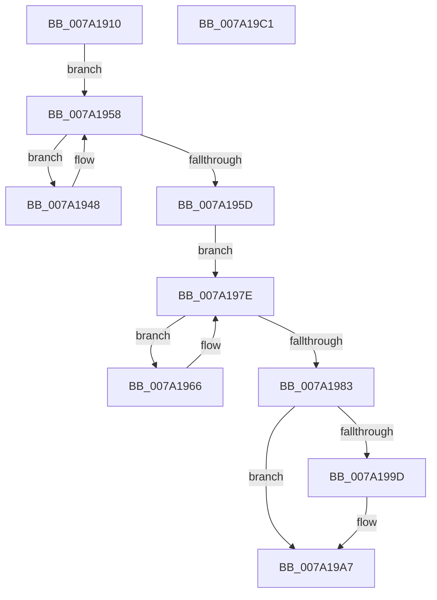

# SepNotifyFileSystems

- RVA: `0x007A1910`–`0x007A19C2` (길이 `178` bytes)
- VA: `0x00000001407A1910`
- 실행 섹션: `PAGE`
- PDB 이름 있음: `예`; PDB Function 태그: `아니요`
- unwind 정보 RVA: `0x00060BC4`
- 디코드: `45`개 명령, `178/178` bytes 표시
- 미해석 바이트: `0` (있으면 어셈블리에 `.byte`로 보존)

> 이 문서는 커널 이미지의 기계어와 PDB 기호를 분석해 생성했습니다. 4번과 5번은 함수 원형과 자료형을 바이너리 사용 방식에서 추정한 C 해석이며 원본 소스 복구 결과는 아닙니다.

## 1. Dependencies

- 직접 호출 지점: **7**; 고유 호출 대상: **6**
- 직접 호출자로 확인된 함수: **0**
- RIP 상대 이미지 참조: **3**

### Outgoing calls
- `0x007A193A` → [ExAcquireFastMutexUnsafe](../../text/3F/ExAcquireFastMutexUnsafe_function_003F3720.md) (function, `0x003F3720`)
- `0x007A1950` → [guard_dispatch_icall](../../text/6B/guard_dispatch_icall_function_006BAAD0.md) (function, `0x006BAAD0`)
- `0x007A1976` → [guard_dispatch_icall](../../text/6B/guard_dispatch_icall_function_006BAAD0.md) (function, `0x006BAAD0`)
- `0x007A198A` → [ExReleaseFastMutexUnsafe](../../text/25/ExReleaseFastMutexUnsafe_function_002503A0.md) (function, `0x002503A0`)
- `0x007A198F` → [KeLeaveCriticalRegion](../../text/25/KeLeaveCriticalRegion_function_0025D8B0.md) (function, `0x0025D8B0`)
- `0x007A19A2` → [ObfDereferenceObjectWithTag](../../text/2F/ObfDereferenceObjectWithTag_function_002F78E0.md) (function, `0x002F78E0`)
- `0x007A19AC` → [ExFreePoolWithTag](../../poolcode/B8/ExFreePoolWithTag_function_00B82870.md) (function, `0x00B82870`)

### Direct callers
- 이 함수 시작 RVA로 연결되는 직접 call은 확인되지 않았습니다. 간접 호출은 완전히 역산할 수 없습니다.

### Static image references
- `0x007A192B` → RVA `0x00E680C0` (`.data`; read)
- `0x007A193F` → RVA `0x00FD8268` (`PAGEDATA`; read)
- `0x007A195D` → RVA `0x00FD82F8` (`PAGEDATA`; read)

## 2. Other-region calls and transfers

- 다른 실행 섹션으로 향하는 call: **7**
  - `0x007A193A` → [ExAcquireFastMutexUnsafe](../../text/3F/ExAcquireFastMutexUnsafe_function_003F3720.md) (`PAGE` → `.text`)
  - `0x007A1950` → [guard_dispatch_icall](../../text/6B/guard_dispatch_icall_function_006BAAD0.md) (`PAGE` → `.text`)
  - `0x007A1976` → [guard_dispatch_icall](../../text/6B/guard_dispatch_icall_function_006BAAD0.md) (`PAGE` → `.text`)
  - `0x007A198A` → [ExReleaseFastMutexUnsafe](../../text/25/ExReleaseFastMutexUnsafe_function_002503A0.md) (`PAGE` → `.text`)
  - `0x007A198F` → [KeLeaveCriticalRegion](../../text/25/KeLeaveCriticalRegion_function_0025D8B0.md) (`PAGE` → `.text`)
  - `0x007A19A2` → [ObfDereferenceObjectWithTag](../../text/2F/ObfDereferenceObjectWithTag_function_002F78E0.md) (`PAGE` → `.text`)
  - `0x007A19AC` → [ExFreePoolWithTag](../../poolcode/B8/ExFreePoolWithTag_function_00B82870.md) (`PAGE` → `POOLCODE`)
- 별도 외부 분기/꼬리 이동을 확인하지 못했습니다.

## 3. Assembly (complete function range)

```asm
007A1910  48 89 5C 24 08                  mov qword ptr [rsp + 8], rbx
007A1915  48 89 74 24 10                  mov qword ptr [rsp + 0x10], rsi
007A191A  57                              push rdi
007A191B  48 83 EC 20                     sub rsp, 0x20
007A191F  65 48 8B 04 25 88 01 00 00      mov rax, qword ptr gs:[0x188]
007A1928  48 8B F1                        mov rsi, rcx
007A192B  48 8D 0D 8E 67 6C 00            lea rcx, [rip + 0x6c678e]
007A1932  66 FF 88 E4 01 00 00            dec word ptr [rax + 0x1e4]
007A1939  90                              nop
007A193A  E8 E1 1D C5 FF                  call 0x1403f3720
007A193F  48 8B 1D 22 69 83 00            mov rbx, qword ptr [rip + 0x836922]
007A1946  EB 10                           jmp 0x1407a1958
007A1948  48 8B 43 08                     mov rax, qword ptr [rbx + 8]
007A194C  48 8D 4E 20                     lea rcx, [rsi + 0x20]
007A1950  E8 7B 91 F1 FF                  call 0x1406baad0
007A1955  48 8B 1B                        mov rbx, qword ptr [rbx]
007A1958  48 85 DB                        test rbx, rbx
007A195B  75 EB                           jne 0x1407a1948
007A195D  48 8B 1D 94 69 83 00            mov rbx, qword ptr [rip + 0x836994]
007A1964  EB 18                           jmp 0x1407a197e
007A1966  48 8B 43 08                     mov rax, qword ptr [rbx + 8]
007A196A  48 8D 4E 20                     lea rcx, [rsi + 0x20]
007A196E  4C 8B 43 10                     mov r8, qword ptr [rbx + 0x10]
007A1972  48 8B 56 28                     mov rdx, qword ptr [rsi + 0x28]
007A1976  E8 55 91 F1 FF                  call 0x1406baad0
007A197B  48 8B 1B                        mov rbx, qword ptr [rbx]
007A197E  48 85 DB                        test rbx, rbx
007A1981  75 E3                           jne 0x1407a1966
007A1983  48 8D 0D 36 67 6C 00            lea rcx, [rip + 0x6c6736]
007A198A  E8 11 EA AA FF                  call 0x1402503a0
007A198F  E8 1C BF AB FF                  call 0x14025d8b0
007A1994  48 8B 4E 28                     mov rcx, qword ptr [rsi + 0x28]
007A1998  48 85 C9                        test rcx, rcx
007A199B  74 0A                           je 0x1407a19a7
007A199D  BA 53 65 46 53                  mov edx, 0x53466553
007A19A2  E8 39 5F B5 FF                  call 0x1402f78e0
007A19A7  33 D2                           xor edx, edx
007A19A9  48 8B CE                        mov rcx, rsi
007A19AC  E8 BF 0E 3E 00                  call 0x140b82870
007A19B1  48 8B 5C 24 30                  mov rbx, qword ptr [rsp + 0x30]
007A19B6  48 8B 74 24 38                  mov rsi, qword ptr [rsp + 0x38]
007A19BB  48 83 C4 20                     add rsp, 0x20
007A19BF  5F                              pop rdi
007A19C0  C3                              ret
007A19C1  CC                              int3
```

## 4. C-style interpretation (structured pseudocode)

```c
__int64 __fastcall SepNotifyFileSystems(__int64 a1)
{
    __int64 result;
    __int64 v_rsp;
    unsigned __int64 v_stack_p10;
    unsigned __int64 v_stack_p8;

    v_stack_p8 = v_rbx;
    v_stack_p10 = v_rsi;
    v_rsp = (v_rsp) - (32);
    result = ExAcquireFastMutexUnsafe(v_rip + 7104398, a2, a3, a4);
    goto loc_007A1958;
loc_007A1948:
    result = guard_dispatch_icall(a1 + 32, a2, a3, a4);
loc_007A1958:
    if (*(unsigned __int64 *)(*(unsigned __int64 *)(v_rip + 8612130)) != 0) goto loc_007A1948;
    goto loc_007A197E;
loc_007A1966:
    result = guard_dispatch_icall(a1 + 32, *(unsigned __int64 *)(a1 + 40), *(unsigned __int64 *)(*(unsigned __int64 *)(v_rip + 8612244) + 16), a4);
loc_007A197E:
    if (*(unsigned __int64 *)(*(unsigned __int64 *)(v_rip + 8612244)) != 0) goto loc_007A1966;
    result = ExReleaseFastMutexUnsafe(v_rip + 7104310, *(unsigned __int64 *)(a1 + 40), *(unsigned __int64 *)(*(unsigned __int64 *)(v_rip + 8612244) + 16), a4);
    result = KeLeaveCriticalRegion(v_rip + 7104310, *(unsigned __int64 *)(a1 + 40), *(unsigned __int64 *)(*(unsigned __int64 *)(v_rip + 8612244) + 16), a4);
    if (*(unsigned __int64 *)(a1 + 40) != 0) {
        a2 = 0x53466553ULL;
        result = ObfDereferenceObjectWithTag(*(unsigned __int64 *)(a1 + 40), a2, *(unsigned __int64 *)(*(unsigned __int64 *)(v_rip + 8612244) + 16), a4);
    }
    a2 = 0;
    result = ExFreePoolWithTag(a1, a2, *(unsigned __int64 *)(*(unsigned __int64 *)(v_rip + 8612244) + 16), a4);
    v_rsp = (v_rsp) + (32);
    return result;
}
```

## 5. (Beta) C Style

```c
int64_t SepNotifyFileSystems(void *Arg1)
{
    uint8_t *arg1 = (uint8_t *)Arg1;

    int64_t result;
    int64_t local_rsp;
    uint64_t v_stack_p10;
    uint64_t v_stack_p8;

    v_stack_p8 = local_rbx;
    v_stack_p10 = local_rsi;
    local_rsp = (local_rsp) - (32);
    result = ExAcquireFastMutexUnsafe(v_rip + 7104398, a2, a3, a4);
    goto loc_007A1958;
loc_007A1948:
    result = guard_dispatch_icall(Arg1 + 32, a2, a3, a4);
loc_007A1958:
    if (*(uint64_t *)(*(uint64_t *)(v_rip + 0x836922)) != 0) goto loc_007A1948;
    goto loc_007A197E;
loc_007A1966:
    result = guard_dispatch_icall(Arg1 + 32, *(uint64_t *)(arg1 + 0x28), *(uint64_t *)(*(uint64_t *)(v_rip + 0x836994) + 0x10), a4);
loc_007A197E:
    if (*(uint64_t *)(*(uint64_t *)(v_rip + 0x836994)) != 0) goto loc_007A1966;
    result = ExReleaseFastMutexUnsafe(v_rip + 7104310, *(uint64_t *)(arg1 + 0x28), *(uint64_t *)(*(uint64_t *)(v_rip + 0x836994) + 0x10), a4);
    result = KeLeaveCriticalRegion(v_rip + 7104310, *(uint64_t *)(arg1 + 0x28), *(uint64_t *)(*(uint64_t *)(v_rip + 0x836994) + 0x10), a4);
    if (*(uint64_t *)(arg1 + 0x28) != 0) {
        a2 = 0x53466553ULL;
        result = ObfDereferenceObjectWithTag(*(uint64_t *)(arg1 + 0x28), a2, *(uint64_t *)(*(uint64_t *)(v_rip + 0x836994) + 0x10), a4);
    }
    a2 = 0;
    result = ExFreePoolWithTag(Arg1, a2, *(uint64_t *)(*(uint64_t *)(v_rip + 0x836994) + 0x10), a4);
    local_rsp = (local_rsp) + (32);
    return result;
}
```

### 관측된 메모리 오프셋

구조체 형식이 확인되지 않은 접근은 인자 기준의 오프셋으로만 기록했습니다.

| 기준 인자 | 오프셋 표현 | 폭 (bit) | 접근 |
|---|---:|---:|---|
| `Arg1` | `+ 0x20` | `64` | `R` |
| `Arg1` | `+ 0x28` | `64` | `R` |

## 6. Execution-region graph

[열기: 2D/3D 그래프와 함수 탐색 컨트롤 패널](../../../control-panel.html?section=page&rva=0x007A1910&view=graph)

- 2D 그래프는 위에서 아래로 흐르고, 3D 그래프는 빈 공간을 드래그해 회전합니다. Shift+드래그는 이동, 휠은 확대·축소, 함수 노드 선택은 대상 보고서 이동입니다.

### Static fallback


