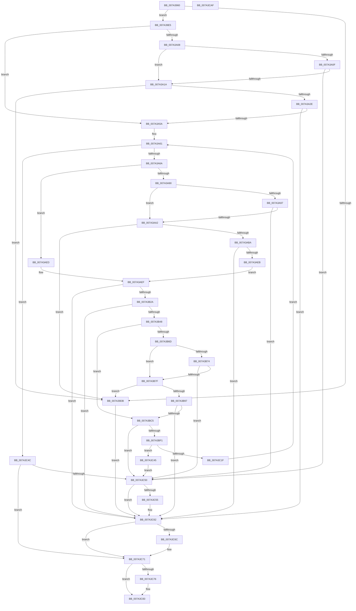

# SepReadAndInsertCaps

- RVA: `0x007A3960`–`0x007A3CB0` (길이 `848` bytes)
- VA: `0x00000001407A3960`
- 실행 섹션: `PAGE`
- PDB 이름 있음: `예`; PDB Function 태그: `아니요`
- unwind 정보 RVA: `0x000D1720`
- 디코드: `224`개 명령, `848/848` bytes 표시
- 미해석 바이트: `0` (있으면 어셈블리에 `.byte`로 보존)

> 이 문서는 커널 이미지의 기계어와 PDB 기호를 분석해 생성했습니다. 4번과 5번은 함수 원형과 자료형을 바이너리 사용 방식에서 추정한 C 해석이며 원본 소스 복구 결과는 아닙니다.

## 1. Dependencies

- 직접 호출 지점: **19**; 고유 호출 대상: **11**
- 직접 호출자로 확인된 함수: **1**
- RIP 상대 이미지 참조: **3**

### Outgoing calls
- `0x007A39CE` → [ExAllocatePool2](../../poolcode/B8/ExAllocatePool2_function_00B820F0.md) (function, `0x00B820F0`)
- `0x007A39FD` → [ZwQueryKey](../../text/6A/ZwQueryKey_function_006AD390.md) (function, `0x006AD390`)
- `0x007A3A21` → [SepRmCapPoolExpand](../../text/60/SepRmCapPoolExpand_function_0060BAE8.md) (function, `0x0060BAE8`)
- `0x007A3A4B` → [ZwQueryKey](../../text/6A/ZwQueryKey_function_006AD390.md) (function, `0x006AD390`)
- `0x007A3A85` → [ZwEnumerateKey](../../text/6A/ZwEnumerateKey_function_006AD710.md) (function, `0x006AD710`)
- `0x007A3AA9` → [SepRmCapPoolExpand](../../text/60/SepRmCapPoolExpand_function_0060BAE8.md) (function, `0x0060BAE8`)
- `0x007A3ADA` → [ZwEnumerateKey](../../text/6A/ZwEnumerateKey_function_006AD710.md) (function, `0x006AD710`)
- `0x007A3B1B` → [RtlStringCchPrintfW](../../text/48/RtlStringCchPrintfW_function_00482D5C.md) (function, `0x00482D5C`)
- `0x007A3B39` → [SepRegOpenKey](../A3/SepRegOpenKey_function_00A3A6B4.md) (function, `0x00A3A6B4`)
- `0x007A3B62` → [ZwQueryKey](../../text/6A/ZwQueryKey_function_006AD390.md) (function, `0x006AD390`)
- `0x007A3B86` → [SepRmCapPoolExpand](../../text/60/SepRmCapPoolExpand_function_0060BAE8.md) (function, `0x0060BAE8`)
- `0x007A3BB6` → [ZwQueryKey](../../text/6A/ZwQueryKey_function_006AD390.md) (function, `0x006AD390`)
- `0x007A3BE1` → [SepReadSingleCap](SepReadSingleCap_function_007A43E4.md) (function, `0x007A43E4`)
- `0x007A3C16` → [RtlInsertEntryHashTable](../../text/43/RtlInsertEntryHashTable_function_00437660.md) (function, `0x00437660`)
- `0x007A3C2D` → [ZwClose](../../text/6A/ZwClose_function_006AD2B0.md) (function, `0x006AD2B0`)
- `0x007A3C5D` → [ExFreePoolWithTag](../../poolcode/B8/ExFreePoolWithTag_function_00B82870.md) (function, `0x00B82870`)
- `0x007A3C6C` → [ZwClose](../../text/6A/ZwClose_function_006AD2B0.md) (function, `0x006AD2B0`)
- `0x007A3C7E` → [ExFreePoolWithTag](../../poolcode/B8/ExFreePoolWithTag_function_00B82870.md) (function, `0x00B82870`)
- `0x007A3C8F` → [_security_check_cookie](../../text/6A/_security_check_cookie_function_006AC640.md) (function, `0x006AC640`)

### Direct callers
- [SepBuildCapPolicyTable](../../text/60/SepBuildCapPolicyTable_function_0060B8F0.md) at `0x0060BA58`

### Static image references
- `0x007A397F` → RVA `0x00E0A740` (`.data`; read)
- `0x007A3AF2` → RVA `0x00B061C0` (` ?? ::NNGAKEGL::`string'`; read)
- `0x007A3AFC` → RVA `0x00AFD430` (` ?? ::NNGAKEGL::`string'`; read)

## 2. Other-region calls and transfers

- 다른 실행 섹션으로 향하는 call: **17**
  - `0x007A39CE` → [ExAllocatePool2](../../poolcode/B8/ExAllocatePool2_function_00B820F0.md) (`PAGE` → `POOLCODE`)
  - `0x007A39FD` → [ZwQueryKey](../../text/6A/ZwQueryKey_function_006AD390.md) (`PAGE` → `.text`)
  - `0x007A3A21` → [SepRmCapPoolExpand](../../text/60/SepRmCapPoolExpand_function_0060BAE8.md) (`PAGE` → `.text`)
  - `0x007A3A4B` → [ZwQueryKey](../../text/6A/ZwQueryKey_function_006AD390.md) (`PAGE` → `.text`)
  - `0x007A3A85` → [ZwEnumerateKey](../../text/6A/ZwEnumerateKey_function_006AD710.md) (`PAGE` → `.text`)
  - `0x007A3AA9` → [SepRmCapPoolExpand](../../text/60/SepRmCapPoolExpand_function_0060BAE8.md) (`PAGE` → `.text`)
  - `0x007A3ADA` → [ZwEnumerateKey](../../text/6A/ZwEnumerateKey_function_006AD710.md) (`PAGE` → `.text`)
  - `0x007A3B1B` → [RtlStringCchPrintfW](../../text/48/RtlStringCchPrintfW_function_00482D5C.md) (`PAGE` → `.text`)
  - `0x007A3B62` → [ZwQueryKey](../../text/6A/ZwQueryKey_function_006AD390.md) (`PAGE` → `.text`)
  - `0x007A3B86` → [SepRmCapPoolExpand](../../text/60/SepRmCapPoolExpand_function_0060BAE8.md) (`PAGE` → `.text`)
  - `0x007A3BB6` → [ZwQueryKey](../../text/6A/ZwQueryKey_function_006AD390.md) (`PAGE` → `.text`)
  - `0x007A3C16` → [RtlInsertEntryHashTable](../../text/43/RtlInsertEntryHashTable_function_00437660.md) (`PAGE` → `.text`)
  - `0x007A3C2D` → [ZwClose](../../text/6A/ZwClose_function_006AD2B0.md) (`PAGE` → `.text`)
  - `0x007A3C5D` → [ExFreePoolWithTag](../../poolcode/B8/ExFreePoolWithTag_function_00B82870.md) (`PAGE` → `POOLCODE`)
  - `0x007A3C6C` → [ZwClose](../../text/6A/ZwClose_function_006AD2B0.md) (`PAGE` → `.text`)
  - `0x007A3C7E` → [ExFreePoolWithTag](../../poolcode/B8/ExFreePoolWithTag_function_00B82870.md) (`PAGE` → `POOLCODE`)
  - `0x007A3C8F` → [_security_check_cookie](../../text/6A/_security_check_cookie_function_006AC640.md) (`PAGE` → `.text`)
- 별도 외부 분기/꼬리 이동을 확인하지 못했습니다.

## 3. Assembly (complete function range)

```asm
007A3960  48 89 5C 24 20                  mov qword ptr [rsp + 0x20], rbx
007A3965  55                              push rbp
007A3966  56                              push rsi
007A3967  57                              push rdi
007A3968  41 54                           push r12
007A396A  41 55                           push r13
007A396C  41 56                           push r14
007A396E  41 57                           push r15
007A3970  48 8D AC 24 E0 FD FF FF         lea rbp, [rsp - 0x220]
007A3978  48 81 EC 20 03 00 00            sub rsp, 0x320
007A397F  48 8B 05 BA 6D 66 00            mov rax, qword ptr [rip + 0x666dba]
007A3986  48 33 C4                        xor rax, rsp
007A3989  48 89 85 10 02 00 00            mov qword ptr [rbp + 0x210], rax
007A3990  49 8B 40 38                     mov rax, qword ptr [r8 + 0x38]
007A3994  44 8D 72 32                     lea r14d, [rdx + 0x32]
007A3998  45 33 FF                        xor r15d, r15d
007A399B  48 89 44 24 58                  mov qword ptr [rsp + 0x58], rax
007A39A0  41 8B 40 30                     mov eax, dword ptr [r8 + 0x30]
007A39A4  4D 8B E8                        mov r13, r8
007A39A7  4C 8B E1                        mov r12, rcx
007A39AA  41 8B D6                        mov edx, r14d
007A39AD  41 B8 53 65 53 70               mov r8d, 0x70536553
007A39B3  4C 89 7C 24 48                  mov qword ptr [rsp + 0x48], r15
007A39B8  B9 00 01 00 00                  mov ecx, 0x100
007A39BD  4C 89 7C 24 38                  mov qword ptr [rsp + 0x38], r15
007A39C2  41 8B F7                        mov esi, r15d
007A39C5  44 89 7C 24 30                  mov dword ptr [rsp + 0x30], r15d
007A39CA  89 44 24 50                     mov dword ptr [rsp + 0x50], eax
007A39CE  E8 1D E7 3D 00                  call 0x140b820f0
007A39D3  48 8B F8                        mov rdi, rax
007A39D6  48 85 C0                        test rax, rax
007A39D9  75 0A                           jne 0x1407a39e5
007A39DB  BB 9A 00 00 C0                  mov ebx, 0xc000009a
007A39E0  E9 7D 02 00 00                  jmp 0x1407a3c62
007A39E5  48 8D 44 24 30                  lea rax, [rsp + 0x30]
007A39EA  45 8B CE                        mov r9d, r14d
007A39ED  4C 8B C7                        mov r8, rdi
007A39F0  48 89 44 24 20                  mov qword ptr [rsp + 0x20], rax
007A39F5  BA 02 00 00 00                  mov edx, 2
007A39FA  49 8B CC                        mov rcx, r12
007A39FD  E8 8E 99 F0 FF                  call 0x1406ad390
007A3A02  8B D8                           mov ebx, eax
007A3A04  85 C0                           test eax, eax
007A3A06  79 52                           jns 0x1407a3a5a
007A3A08  3D 05 00 00 80                  cmp eax, 0x80000005
007A3A0D  74 0B                           je 0x1407a3a1a
007A3A0F  3D 23 00 00 C0                  cmp eax, 0xc0000023
007A3A14  0F 85 36 02 00 00               jne 0x1407a3c50
007A3A1A  8B 54 24 30                     mov edx, dword ptr [rsp + 0x30]
007A3A1E  48 8B CF                        mov rcx, rdi
007A3A21  E8 C2 80 E6 FF                  call 0x14060bae8
007A3A26  48 8B F8                        mov rdi, rax
007A3A29  48 85 C0                        test rax, rax
007A3A2C  74 AD                           je 0x1407a39db
007A3A2E  44 8B 74 24 30                  mov r14d, dword ptr [rsp + 0x30]
007A3A33  48 8D 44 24 30                  lea rax, [rsp + 0x30]
007A3A38  45 8B CE                        mov r9d, r14d
007A3A3B  48 89 44 24 20                  mov qword ptr [rsp + 0x20], rax
007A3A40  4C 8B C7                        mov r8, rdi
007A3A43  BA 02 00 00 00                  mov edx, 2
007A3A48  49 8B CC                        mov rcx, r12
007A3A4B  E8 40 99 F0 FF                  call 0x1406ad390
007A3A50  8B D8                           mov ebx, eax
007A3A52  85 C0                           test eax, eax
007A3A54  0F 88 08 02 00 00               js 0x1407a3c62
007A3A5A  8B 47 14                        mov eax, dword ptr [rdi + 0x14]
007A3A5D  89 44 24 40                     mov dword ptr [rsp + 0x40], eax
007A3A61  44 3B F8                        cmp r15d, eax
007A3A64  0F 83 E2 01 00 00               jae 0x1407a3c4c
007A3A6A  48 8D 44 24 30                  lea rax, [rsp + 0x30]
007A3A6F  4C 8B CF                        mov r9, rdi
007A3A72  48 89 44 24 28                  mov qword ptr [rsp + 0x28], rax
007A3A77  45 33 C0                        xor r8d, r8d
007A3A7A  41 8B D7                        mov edx, r15d
007A3A7D  44 89 74 24 20                  mov dword ptr [rsp + 0x20], r14d
007A3A82  49 8B CC                        mov rcx, r12
007A3A85  E8 86 9C F0 FF                  call 0x1406ad710
007A3A8A  8B D8                           mov ebx, eax
007A3A8C  85 C0                           test eax, eax
007A3A8E  79 5D                           jns 0x1407a3aed
007A3A90  3D 05 00 00 80                  cmp eax, 0x80000005
007A3A95  74 0B                           je 0x1407a3aa2
007A3A97  3D 23 00 00 C0                  cmp eax, 0xc0000023
007A3A9C  0F 85 AE 01 00 00               jne 0x1407a3c50
007A3AA2  8B 54 24 30                     mov edx, dword ptr [rsp + 0x30]
007A3AA6  48 8B CF                        mov rcx, rdi
007A3AA9  E8 3A 80 E6 FF                  call 0x14060bae8
007A3AAE  48 8B F8                        mov rdi, rax
007A3AB1  48 85 C0                        test rax, rax
007A3AB4  0F 84 21 FF FF FF               je 0x1407a39db
007A3ABA  44 8B 74 24 30                  mov r14d, dword ptr [rsp + 0x30]
007A3ABF  48 8D 44 24 30                  lea rax, [rsp + 0x30]
007A3AC4  48 89 44 24 28                  mov qword ptr [rsp + 0x28], rax
007A3AC9  4C 8B CF                        mov r9, rdi
007A3ACC  45 33 C0                        xor r8d, r8d
007A3ACF  44 89 74 24 20                  mov dword ptr [rsp + 0x20], r14d
007A3AD4  41 8B D7                        mov edx, r15d
007A3AD7  49 8B CC                        mov rcx, r12
007A3ADA  E8 31 9C F0 FF                  call 0x1406ad710
007A3ADF  33 C9                           xor ecx, ecx
007A3AE1  8B D8                           mov ebx, eax
007A3AE3  85 C0                           test eax, eax
007A3AE5  0F 88 77 01 00 00               js 0x1407a3c62
007A3AEB  EB 02                           jmp 0x1407a3aef
007A3AED  33 C9                           xor ecx, ecx
007A3AEF  8B 47 0C                        mov eax, dword ptr [rdi + 0xc]
007A3AF2  4C 8D 0D C7 26 36 00            lea r9, [rip + 0x3626c7]
007A3AF9  48 D1 E8                        shr rax, 1
007A3AFC  4C 8D 05 2D 99 35 00            lea r8, [rip + 0x35992d]
007A3B03  BA 56 01 00 00                  mov edx, 0x156
007A3B08  66 89 4C 47 10                  mov word ptr [rdi + rax*2 + 0x10], cx
007A3B0D  48 8D 47 10                     lea rax, [rdi + 0x10]
007A3B11  48 8D 4C 24 60                  lea rcx, [rsp + 0x60]
007A3B16  48 89 44 24 20                  mov qword ptr [rsp + 0x20], rax
007A3B1B  E8 3C F2 CD FF                  call 0x140482d5c
007A3B20  8B D8                           mov ebx, eax
007A3B22  85 C0                           test eax, eax
007A3B24  0F 88 38 01 00 00               js 0x1407a3c62
007A3B2A  4C 8D 44 24 38                  lea r8, [rsp + 0x38]
007A3B2F  BA 01 02 00 00                  mov edx, 0x201
007A3B34  48 8D 4C 24 60                  lea rcx, [rsp + 0x60]
007A3B39  E8 76 6B 29 00                  call 0x140a3a6b4
007A3B3E  8B D8                           mov ebx, eax
007A3B40  85 C0                           test eax, eax
007A3B42  0F 88 1A 01 00 00               js 0x1407a3c62
007A3B48  48 8B 4C 24 38                  mov rcx, qword ptr [rsp + 0x38]
007A3B4D  48 8D 44 24 30                  lea rax, [rsp + 0x30]
007A3B52  45 8B CE                        mov r9d, r14d
007A3B55  48 89 44 24 20                  mov qword ptr [rsp + 0x20], rax
007A3B5A  4C 8B C7                        mov r8, rdi
007A3B5D  BA 02 00 00 00                  mov edx, 2
007A3B62  E8 29 98 F0 FF                  call 0x1406ad390
007A3B67  8B D8                           mov ebx, eax
007A3B69  85 C0                           test eax, eax
007A3B6B  79 58                           jns 0x1407a3bc5
007A3B6D  3D 05 00 00 80                  cmp eax, 0x80000005
007A3B72  74 0B                           je 0x1407a3b7f
007A3B74  3D 23 00 00 C0                  cmp eax, 0xc0000023
007A3B79  0F 85 D1 00 00 00               jne 0x1407a3c50
007A3B7F  8B 54 24 30                     mov edx, dword ptr [rsp + 0x30]
007A3B83  48 8B CF                        mov rcx, rdi
007A3B86  E8 5D 7F E6 FF                  call 0x14060bae8
007A3B8B  48 8B F8                        mov rdi, rax
007A3B8E  48 85 C0                        test rax, rax
007A3B91  0F 84 44 FE FF FF               je 0x1407a39db
007A3B97  44 8B 74 24 30                  mov r14d, dword ptr [rsp + 0x30]
007A3B9C  48 8D 44 24 30                  lea rax, [rsp + 0x30]
007A3BA1  48 8B 4C 24 38                  mov rcx, qword ptr [rsp + 0x38]
007A3BA6  45 8B CE                        mov r9d, r14d
007A3BA9  4C 8B C7                        mov r8, rdi
007A3BAC  48 89 44 24 20                  mov qword ptr [rsp + 0x20], rax
007A3BB1  BA 02 00 00 00                  mov edx, 2
007A3BB6  E8 D5 97 F0 FF                  call 0x1406ad390
007A3BBB  8B D8                           mov ebx, eax
007A3BBD  85 C0                           test eax, eax
007A3BBF  0F 88 9D 00 00 00               js 0x1407a3c62
007A3BC5  8B 57 28                        mov edx, dword ptr [rdi + 0x28]
007A3BC8  48 8D 44 24 48                  lea rax, [rsp + 0x48]
007A3BCD  4C 8B 4C 24 58                  mov r9, qword ptr [rsp + 0x58]
007A3BD2  44 8B 44 24 50                  mov r8d, dword ptr [rsp + 0x50]
007A3BD7  48 8B 4C 24 38                  mov rcx, qword ptr [rsp + 0x38]
007A3BDC  48 89 44 24 20                  mov qword ptr [rsp + 0x20], rax
007A3BE1  E8 FE 07 00 00                  call 0x1407a43e4
007A3BE6  48 8B 74 24 48                  mov rsi, qword ptr [rsp + 0x48]
007A3BEB  8B D8                           mov ebx, eax
007A3BED  85 C0                           test eax, eax
007A3BEF  78 5F                           js 0x1407a3c50
007A3BF1  4C 89 6E 20                     mov qword ptr [rsi + 0x20], r13
007A3BF5  48 8B 4E 18                     mov rcx, qword ptr [rsi + 0x18]
007A3BF9  0F B6 41 01                     movzx eax, byte ptr [rcx + 1]
007A3BFD  FF C8                           dec eax
007A3BFF  8B 54 81 08                     mov edx, dword ptr [rcx + rax*4 + 8]
007A3C03  49 8B CD                        mov rcx, r13
007A3C06  85 D2                           test edx, edx
007A3C08  4C 8D 42 01                     lea r8, [rdx + 1]
007A3C0C  4C 0F 45 C2                     cmovne r8, rdx
007A3C10  45 33 C9                        xor r9d, r9d
007A3C13  48 8B D6                        mov rdx, rsi
007A3C16  E8 45 3A C9 FF                  call 0x140437660
007A3C1B  84 C0                           test al, al
007A3C1D  74 26                           je 0x1407a3c45
007A3C1F  48 8B 4C 24 38                  mov rcx, qword ptr [rsp + 0x38]
007A3C24  33 C0                           xor eax, eax
007A3C26  8B F0                           mov esi, eax
007A3C28  48 89 44 24 48                  mov qword ptr [rsp + 0x48], rax
007A3C2D  E8 7E 96 F0 FF                  call 0x1406ad2b0
007A3C32  33 C0                           xor eax, eax
007A3C34  48 89 44 24 38                  mov qword ptr [rsp + 0x38], rax
007A3C39  41 FF C7                        inc r15d
007A3C3C  8B 44 24 40                     mov eax, dword ptr [rsp + 0x40]
007A3C40  E9 1C FE FF FF                  jmp 0x1407a3a61
007A3C45  BB 9A 00 00 C0                  mov ebx, 0xc000009a
007A3C4A  EB 04                           jmp 0x1407a3c50
007A3C4C  85 DB                           test ebx, ebx
007A3C4E  79 21                           jns 0x1407a3c71
007A3C50  48 85 F6                        test rsi, rsi
007A3C53  74 0D                           je 0x1407a3c62
007A3C55  BA 53 65 53 70                  mov edx, 0x70536553
007A3C5A  48 8B CE                        mov rcx, rsi
007A3C5D  E8 0E EC 3D 00                  call 0x140b82870
007A3C62  48 8B 4C 24 38                  mov rcx, qword ptr [rsp + 0x38]
007A3C67  48 85 C9                        test rcx, rcx
007A3C6A  74 05                           je 0x1407a3c71
007A3C6C  E8 3F 96 F0 FF                  call 0x1406ad2b0
007A3C71  48 85 FF                        test rdi, rdi
007A3C74  74 0D                           je 0x1407a3c83
007A3C76  BA 53 65 53 70                  mov edx, 0x70536553
007A3C7B  48 8B CF                        mov rcx, rdi
007A3C7E  E8 ED EB 3D 00                  call 0x140b82870
007A3C83  8B C3                           mov eax, ebx
007A3C85  48 8B 8D 10 02 00 00            mov rcx, qword ptr [rbp + 0x210]
007A3C8C  48 33 CC                        xor rcx, rsp
007A3C8F  E8 AC 89 F0 FF                  call 0x1406ac640
007A3C94  48 8B 9C 24 78 03 00 00         mov rbx, qword ptr [rsp + 0x378]
007A3C9C  48 81 C4 20 03 00 00            add rsp, 0x320
007A3CA3  41 5F                           pop r15
007A3CA5  41 5E                           pop r14
007A3CA7  41 5D                           pop r13
007A3CA9  41 5C                           pop r12
007A3CAB  5F                              pop rdi
007A3CAC  5E                              pop rsi
007A3CAD  5D                              pop rbp
007A3CAE  C3                              ret
007A3CAF  CC                              int3
```

## 4. C-style interpretation (structured pseudocode)

```c
__int64 __fastcall SepReadAndInsertCaps(__int64 a1, __int64 a2, __int64 a3)
{
    __int64 result;
    __int64 v_r15;
    __int64 v_rsp;
    unsigned __int64 v_stack_m258;
    unsigned __int64 v_stack_m2F8;
    unsigned __int64 v_stack_m300;
    unsigned int v_stack_m308;
    unsigned __int64 v_stack_m310;
    unsigned int v_stack_m318;
    unsigned __int64 v_stack_m320;
    unsigned int v_stack_m328;
    unsigned __int64 v_stack_m330;
    unsigned __int64 v_stack_m338;
    unsigned __int64 v_stack_m48;
    unsigned __int64 v_stack_p20;

    v_stack_p20 = v_rbx;
    v_rsp = (v_rsp) - (800);
    result = (*(unsigned __int64 *)(v_rip + 6712762)) ^ (v_rsp);
    v_stack_m48 = result;
    v_r15 = 0;
    v_stack_m300 = *(unsigned __int64 *)(a3 + 56);
    v_stack_m310 = 0;
    v_stack_m320 = 0;
    v_stack_m328 = 0;
    v_stack_m308 = (unsigned int)((unsigned int)(*(unsigned int *)(a3 + 48)));
    result = ExAllocatePool2(256, (unsigned int)((unsigned int)(a2 + 50)), (unsigned int)(0x70536553ULL), a4);
    if (result != 0) goto loc_007A39E5;
loc_007A39DB:
    goto loc_007A3C62;
loc_007A39E5:
    v_stack_m338 = v_stack_m328;
    result = ZwQueryKey(a1, 2, result, (unsigned int)((unsigned int)(a2 + 50)));
    if (!sign_flag) goto loc_007A3A5A;
    if (((unsigned int)(result)) == 0x80000005ULL) goto loc_007A3A1A;
    if (((unsigned int)(result)) != 0xC0000023ULL) goto loc_007A3C50;
loc_007A3A1A:
    result = SepRmCapPoolExpand(result, (unsigned int)(v_stack_m328), result, (unsigned int)((unsigned int)(a2 + 50)));
    if (result == 0) goto loc_007A39DB;
    v_stack_m338 = v_stack_m328;
    result = ZwQueryKey(a1, 2, result, (unsigned int)((unsigned int)((unsigned int)(v_stack_m328))));
    if (sign_flag) goto loc_007A3C62;
loc_007A3A5A:
    v_stack_m318 = (unsigned int)((unsigned int)(*(unsigned int *)(result + 20)));
loc_007A3A61:
    if (0 >= ((unsigned int)((unsigned int)(*(unsigned int *)(result + 20))))) goto loc_007A3C4C;
    v_stack_m330 = v_stack_m328;
    a3 = 0;
    v_stack_m338 = (unsigned int)((unsigned int)(v_stack_m328));
    result = ZwEnumerateKey(a1, 0, a3, result);
    if (!sign_flag) goto loc_007A3AED;
    if (((unsigned int)(result)) == 0x80000005ULL) goto loc_007A3AA2;
    if (((unsigned int)(result)) != 0xC0000023ULL) goto loc_007A3C50;
loc_007A3AA2:
    result = SepRmCapPoolExpand(result, (unsigned int)(v_stack_m328), a3, result);
    if (result == 0) goto loc_007A39DB;
    v_stack_m330 = v_stack_m328;
    a3 = 0;
    v_stack_m338 = (unsigned int)((unsigned int)(v_stack_m328));
    result = ZwEnumerateKey(a1, 0, a3, result);
    a1 = 0;
    if (sign_flag) goto loc_007A3C62;
    goto loc_007A3AEF;
loc_007A3AED:
    a1 = 0;
loc_007A3AEF:
    result = ((unsigned int)(*(unsigned int *)(result + 12))) >> (1);
    *(unsigned __int16 *)(result + result * 2 + 16) = 0;
    v_stack_m338 = result + 16;
    result = RtlStringCchPrintfW(v_stack_m2F8, 342, v_rip + 3512621, v_rip + 3548871);
    if (sign_flag) goto loc_007A3C62;
    result = SepRegOpenKey(v_stack_m2F8, 513, v_stack_m320, v_rip + 3548871);
    if (sign_flag) goto loc_007A3C62;
    v_stack_m338 = v_stack_m328;
    result = ZwQueryKey(v_stack_m320, 2, result, (unsigned int)((unsigned int)((unsigned int)(v_stack_m328))));
    if (!sign_flag) goto loc_007A3BC5;
    if (((unsigned int)(result)) == 0x80000005ULL) goto loc_007A3B7F;
    if (((unsigned int)(result)) != 0xC0000023ULL) goto loc_007A3C50;
loc_007A3B7F:
    result = SepRmCapPoolExpand(result, (unsigned int)(v_stack_m328), result, (unsigned int)((unsigned int)((unsigned int)(v_stack_m328))));
    if (result == 0) goto loc_007A39DB;
    v_stack_m338 = v_stack_m328;
    result = ZwQueryKey(v_stack_m320, 2, result, (unsigned int)((unsigned int)((unsigned int)(v_stack_m328))));
    if (sign_flag) goto loc_007A3C62;
loc_007A3BC5:
    v_stack_m338 = v_stack_m310;
    result = SepReadSingleCap(v_stack_m320, (unsigned int)(*(unsigned int *)(result + 40)), (unsigned int)(v_stack_m308), v_stack_m300);
    if (sign_flag) goto loc_007A3C50;
    *(unsigned __int64 *)(v_stack_m310 + 32) = 0;
    result = (unsigned int)((*(unsigned __int8 *)(*(unsigned __int64 *)(v_stack_m310 + 24) + 1)) - 1);
    a3 = (unsigned int)(*(unsigned int *)(*(unsigned __int64 *)(v_stack_m310 + 24) + result * 4 + 8)) + 1;
    if ((unsigned int)((unsigned int)(*(unsigned int *)(*(unsigned __int64 *)(v_stack_m310 + 24) + result * 4 + 8))) != 0) { a3 = (unsigned int)(*(unsigned int *)(*(unsigned __int64 *)(v_stack_m310 + 24) + result * 4 + 8)); }
    a4 = 0;
    result = RtlInsertEntryHashTable(0, v_stack_m310, a3, a4);
    if ((unsigned __int8)(result) == 0) goto loc_007A3C45;
    result = 0;
    v_stack_m310 = 0;
    result = ZwClose(v_stack_m320, v_stack_m310, a3, a4);
    result = 0;
    v_stack_m320 = 0;
    v_r15 = (unsigned int)((v_r15) + 1);
    goto loc_007A3A61;
loc_007A3C45:
    goto loc_007A3C50;
loc_007A3C4C:
    if (!sign_flag) goto loc_007A3C71;
loc_007A3C50:
    result = (unsigned int)(v_stack_m318);
    if (0 != 0) {
        a2 = 0x70536553ULL;
        a1 = 0;
        result = ExFreePoolWithTag(a1, a2, a3, a4);
    }
    if (v_stack_m320 != 0) {
        result = ZwClose(v_stack_m320, a2, a3, a4);
    }
    if (result != 0) {
        a2 = 0x70536553ULL;
        a1 = result;
        result = ExFreePoolWithTag(a1, a2, a3, a4);
    }
    a1 = (v_stack_m48) ^ (v_rsp);
    result = _security_check_cookie(a1, a2, a3, a4);
    v_rsp = (v_rsp) + (800);
    return result;
}
```

## 5. (Beta) C Style

```c
int64_t SepReadAndInsertCaps(int64_t Arg1, void *Arg2, void *Arg3)
{
    uint8_t *arg2 = (uint8_t *)Arg2;
    uint8_t *arg3 = (uint8_t *)Arg3;

    int64_t result;
    int64_t local_r15;
    int64_t local_rsp;
    uint64_t v_stack_m258;
    uint64_t v_stack_m2F8;
    uint64_t v_stack_m300;
    uint32_t v_stack_m308;
    uint64_t v_stack_m310;
    uint32_t v_stack_m318;
    uint64_t v_stack_m320;
    uint32_t v_stack_m328;
    uint64_t v_stack_m330;
    uint64_t v_stack_m338;
    uint64_t v_stack_m48;
    uint64_t v_stack_p20;

    v_stack_p20 = local_rbx;
    local_rsp = (local_rsp) - (800);
    result = (*(uint64_t *)(v_rip + 0x666DBA)) ^ (local_rsp);
    v_stack_m48 = result;
    local_r15 = 0;
    v_stack_m300 = *(uint64_t *)(arg3 + 0x38);
    v_stack_m310 = 0;
    v_stack_m320 = 0;
    v_stack_m328 = 0;
    v_stack_m308 = (uint32_t)((uint32_t)(*(uint32_t *)(arg3 + 0x30)));
    result = ExAllocatePool2(256, (uint32_t)((uint32_t)(Arg2 + 50)), (uint32_t)(0x70536553ULL), a4);
    if (result != 0) goto loc_007A39E5;
loc_007A39DB:
    goto loc_007A3C62;
loc_007A39E5:
    v_stack_m338 = v_stack_m328;
    result = ZwQueryKey(Arg1, 2, result, (uint32_t)((uint32_t)(Arg2 + 50)));
    if (!sign_flag) goto loc_007A3A5A;
    if (((uint32_t)(result)) == 0x80000005ULL) goto loc_007A3A1A;
    if (((uint32_t)(result)) != 0xC0000023ULL) goto loc_007A3C50;
loc_007A3A1A:
    result = SepRmCapPoolExpand(result, (uint32_t)(v_stack_m328), result, (uint32_t)((uint32_t)(Arg2 + 50)));
    if (result == 0) goto loc_007A39DB;
    v_stack_m338 = v_stack_m328;
    result = ZwQueryKey(Arg1, 2, result, (uint32_t)((uint32_t)((uint32_t)(v_stack_m328))));
    if (sign_flag) goto loc_007A3C62;
loc_007A3A5A:
    v_stack_m318 = (uint32_t)((uint32_t)(*(uint32_t *)(result + 0x14)));
loc_007A3A61:
    if (0 >= ((uint32_t)((uint32_t)(*(uint32_t *)(result + 0x14))))) goto loc_007A3C4C;
    v_stack_m330 = v_stack_m328;
    Arg3 = 0;
    v_stack_m338 = (uint32_t)((uint32_t)(v_stack_m328));
    result = ZwEnumerateKey(Arg1, 0, Arg3, result);
    if (!sign_flag) goto loc_007A3AED;
    if (((uint32_t)(result)) == 0x80000005ULL) goto loc_007A3AA2;
    if (((uint32_t)(result)) != 0xC0000023ULL) goto loc_007A3C50;
loc_007A3AA2:
    result = SepRmCapPoolExpand(result, (uint32_t)(v_stack_m328), Arg3, result);
    if (result == 0) goto loc_007A39DB;
    v_stack_m330 = v_stack_m328;
    Arg3 = 0;
    v_stack_m338 = (uint32_t)((uint32_t)(v_stack_m328));
    result = ZwEnumerateKey(Arg1, 0, Arg3, result);
    Arg1 = 0;
    if (sign_flag) goto loc_007A3C62;
    goto loc_007A3AEF;
loc_007A3AED:
    Arg1 = 0;
loc_007A3AEF:
    result = ((uint32_t)(*(uint32_t *)(result + 0xC))) >> (1);
    *(uint16_t *)(result + result * 2 + 0x10) = 0;
    v_stack_m338 = result + 16;
    result = RtlStringCchPrintfW(v_stack_m2F8, 342, v_rip + 3512621, v_rip + 3548871);
    if (sign_flag) goto loc_007A3C62;
    result = SepRegOpenKey(v_stack_m2F8, 513, v_stack_m320, v_rip + 3548871);
    if (sign_flag) goto loc_007A3C62;
    v_stack_m338 = v_stack_m328;
    result = ZwQueryKey(v_stack_m320, 2, result, (uint32_t)((uint32_t)((uint32_t)(v_stack_m328))));
    if (!sign_flag) goto loc_007A3BC5;
    if (((uint32_t)(result)) == 0x80000005ULL) goto loc_007A3B7F;
    if (((uint32_t)(result)) != 0xC0000023ULL) goto loc_007A3C50;
loc_007A3B7F:
    result = SepRmCapPoolExpand(result, (uint32_t)(v_stack_m328), result, (uint32_t)((uint32_t)((uint32_t)(v_stack_m328))));
    if (result == 0) goto loc_007A39DB;
    v_stack_m338 = v_stack_m328;
    result = ZwQueryKey(v_stack_m320, 2, result, (uint32_t)((uint32_t)((uint32_t)(v_stack_m328))));
    if (sign_flag) goto loc_007A3C62;
loc_007A3BC5:
    v_stack_m338 = v_stack_m310;
    result = SepReadSingleCap(v_stack_m320, (uint32_t)(*(uint32_t *)(result + 0x28)), (uint32_t)(v_stack_m308), v_stack_m300);
    if (sign_flag) goto loc_007A3C50;
    *(uint64_t *)(v_stack_m310 + 0x20) = 0;
    result = (uint32_t)((*(uint8_t *)(*(uint64_t *)(v_stack_m310 + 0x18) + 0x1)) - 1);
    Arg3 = (uint32_t)(*(uint32_t *)(*(uint64_t *)(v_stack_m310 + 0x18) + result * 4 + 0x8)) + 1;
    if ((uint32_t)((uint32_t)(*(uint32_t *)(*(uint64_t *)(v_stack_m310 + 0x18) + result * 4 + 0x8))) != 0) { Arg3 = (uint32_t)(*(uint32_t *)(*(uint64_t *)(v_stack_m310 + 0x18) + result * 4 + 0x8)); }
    a4 = 0;
    result = RtlInsertEntryHashTable(0, v_stack_m310, Arg3, a4);
    if ((uint8_t)(result) == 0) goto loc_007A3C45;
    result = 0;
    v_stack_m310 = 0;
    result = ZwClose(v_stack_m320, v_stack_m310, Arg3, a4);
    result = 0;
    v_stack_m320 = 0;
    local_r15 = (uint32_t)((local_r15) + 1);
    goto loc_007A3A61;
loc_007A3C45:
    goto loc_007A3C50;
loc_007A3C4C:
    if (!sign_flag) goto loc_007A3C71;
loc_007A3C50:
    result = (uint32_t)(v_stack_m318);
    if (0 != 0) {
        Arg2 = 0x70536553ULL;
        Arg1 = 0;
        result = ExFreePoolWithTag(Arg1, Arg2, Arg3, a4);
    }
    if (v_stack_m320 != 0) {
        result = ZwClose(v_stack_m320, Arg2, Arg3, a4);
    }
    if (result != 0) {
        Arg2 = 0x70536553ULL;
        Arg1 = result;
        result = ExFreePoolWithTag(Arg1, Arg2, Arg3, a4);
    }
    Arg1 = (v_stack_m48) ^ (local_rsp);
    result = _security_check_cookie(Arg1, Arg2, Arg3, a4);
    local_rsp = (local_rsp) + (800);
    return result;
}
```

### 관측된 메모리 오프셋

구조체 형식이 확인되지 않은 접근은 인자 기준의 오프셋으로만 기록했습니다.

| 기준 인자 | 오프셋 표현 | 폭 (bit) | 접근 |
|---|---:|---:|---|
| `Arg2` | `+ 0x32` | `32` | `R` |
| `Arg3` | `+ 0x30` | `32` | `R` |
| `Arg3` | `+ 0x38` | `64` | `R` |

## 6. Execution-region graph

[열기: 2D/3D 그래프와 함수 탐색 컨트롤 패널](../../../control-panel.html?section=page&rva=0x007A3960&view=graph)

- 2D 그래프는 위에서 아래로 흐르고, 3D 그래프는 빈 공간을 드래그해 회전합니다. Shift+드래그는 이동, 휠은 확대·축소, 함수 노드 선택은 대상 보고서 이동입니다.

### Static fallback


