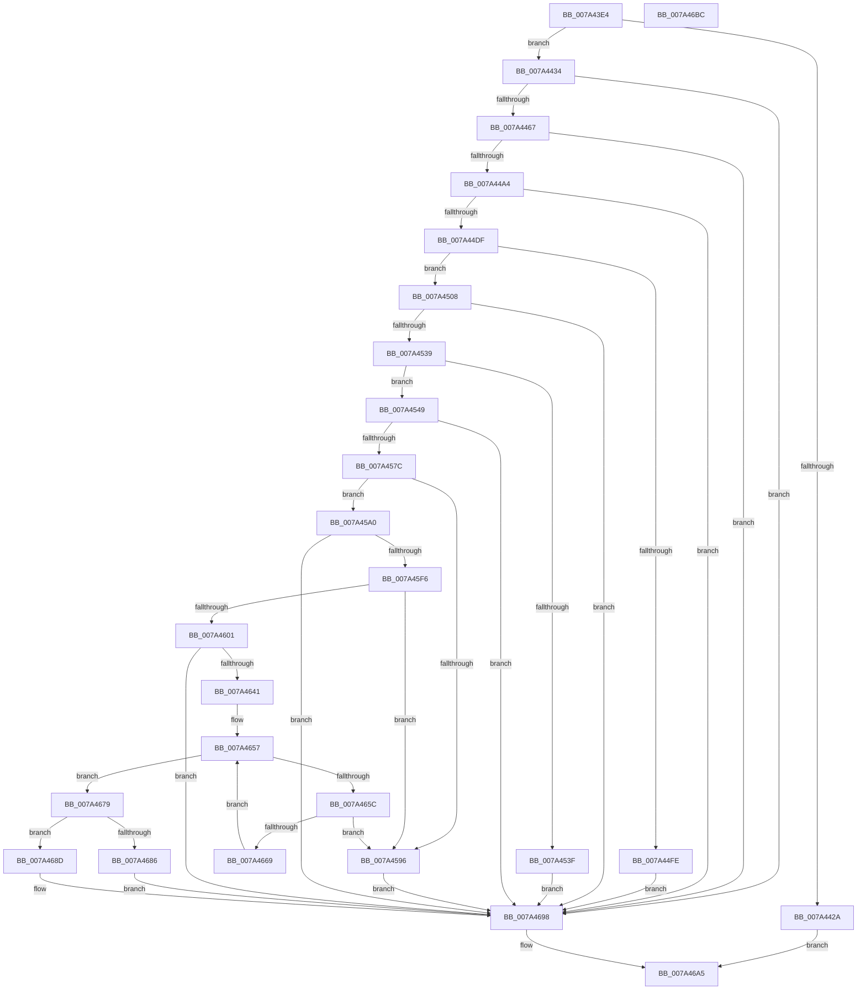

# SepReadSingleCap

- RVA: `0x007A43E4`–`0x007A46BD` (길이 `729` bytes)
- VA: `0x00000001407A43E4`
- 실행 섹션: `PAGE`
- PDB 이름 있음: `예`; PDB Function 태그: `아니요`
- unwind 정보 RVA: `0x00095AEC`
- 디코드: `196`개 명령, `729/729` bytes 표시
- 미해석 바이트: `0` (있으면 어셈블리에 `.byte`로 보존)

> 이 문서는 커널 이미지의 기계어와 PDB 기호를 분석해 생성했습니다. 4번과 5번은 함수 원형과 자료형을 바이너리 사용 방식에서 추정한 C 해석이며 원본 소스 복구 결과는 아닙니다.

## 1. Dependencies

- 직접 호출 지점: **13**; 고유 호출 대상: **5**
- 직접 호출자로 확인된 함수: **1**
- RIP 상대 이미지 참조: **4**

### Outgoing calls
- `0x007A441D` → [ExAllocatePool2](../../poolcode/B8/ExAllocatePool2_function_00B820F0.md) (function, `0x00B820F0`)
- `0x007A4458` → [ZwQueryValueKey](../../text/6A/ZwQueryValueKey_function_006AD3B0.md) (function, `0x006AD3B0`)
- `0x007A4495` → [ZwQueryValueKey](../../text/6A/ZwQueryValueKey_function_006AD3B0.md) (function, `0x006AD3B0`)
- `0x007A44D0` → [ZwQueryValueKey](../../text/6A/ZwQueryValueKey_function_006AD3B0.md) (function, `0x006AD3B0`)
- `0x007A44F1` → [ExAllocatePool2](../../poolcode/B8/ExAllocatePool2_function_00B820F0.md) (function, `0x00B820F0`)
- `0x007A452A` → [ZwQueryValueKey](../../text/6A/ZwQueryValueKey_function_006AD3B0.md) (function, `0x006AD3B0`)
- `0x007A456D` → [ZwQueryValueKey](../../text/6A/ZwQueryValueKey_function_006AD3B0.md) (function, `0x006AD3B0`)
- `0x007A45BB` → [memcpy](../../text/6C/memcpy_function_006C6840.md) (function, `0x006C6840`)
- `0x007A45E7` → [ZwQueryValueKey](../../text/6A/ZwQueryValueKey_function_006AD3B0.md) (function, `0x006AD3B0`)
- `0x007A4610` → [memcpy](../../text/6C/memcpy_function_006C6840.md) (function, `0x006C6840`)
- `0x007A4636` → [ZwQueryValueKey](../../text/6A/ZwQueryValueKey_function_006AD3B0.md) (function, `0x006AD3B0`)
- `0x007A467D` → [RtlValidSid](../92/RtlValidSid_function_00929710.md) (function, `0x00929710`)
- `0x007A46A0` → [ExFreePoolWithTag](../../poolcode/B8/ExFreePoolWithTag_function_00B82870.md) (function, `0x00B82870`)

### Direct callers
- [SepReadAndInsertCaps](SepReadAndInsertCaps_function_007A3960.md) at `0x007A3BE1`

### Static image references
- `0x007A4444` → RVA `0x00FD8668` (`PAGEDATA`; read)
- `0x007A446A` → RVA `0x00FD82C0` (`PAGEDATA`; read)
- `0x007A44C3` → RVA `0x00FD8658` (`PAGEDATA`; read)
- `0x007A451C` → RVA `0x00FD8618` (`PAGEDATA`; read)

## 2. Other-region calls and transfers

- 다른 실행 섹션으로 향하는 call: **12**
  - `0x007A441D` → [ExAllocatePool2](../../poolcode/B8/ExAllocatePool2_function_00B820F0.md) (`PAGE` → `POOLCODE`)
  - `0x007A4458` → [ZwQueryValueKey](../../text/6A/ZwQueryValueKey_function_006AD3B0.md) (`PAGE` → `.text`)
  - `0x007A4495` → [ZwQueryValueKey](../../text/6A/ZwQueryValueKey_function_006AD3B0.md) (`PAGE` → `.text`)
  - `0x007A44D0` → [ZwQueryValueKey](../../text/6A/ZwQueryValueKey_function_006AD3B0.md) (`PAGE` → `.text`)
  - `0x007A44F1` → [ExAllocatePool2](../../poolcode/B8/ExAllocatePool2_function_00B820F0.md) (`PAGE` → `POOLCODE`)
  - `0x007A452A` → [ZwQueryValueKey](../../text/6A/ZwQueryValueKey_function_006AD3B0.md) (`PAGE` → `.text`)
  - `0x007A456D` → [ZwQueryValueKey](../../text/6A/ZwQueryValueKey_function_006AD3B0.md) (`PAGE` → `.text`)
  - `0x007A45BB` → [memcpy](../../text/6C/memcpy_function_006C6840.md) (`PAGE` → `.text`)
  - `0x007A45E7` → [ZwQueryValueKey](../../text/6A/ZwQueryValueKey_function_006AD3B0.md) (`PAGE` → `.text`)
  - `0x007A4610` → [memcpy](../../text/6C/memcpy_function_006C6840.md) (`PAGE` → `.text`)
  - `0x007A4636` → [ZwQueryValueKey](../../text/6A/ZwQueryValueKey_function_006AD3B0.md) (`PAGE` → `.text`)
  - `0x007A46A0` → [ExFreePoolWithTag](../../poolcode/B8/ExFreePoolWithTag_function_00B82870.md) (`PAGE` → `POOLCODE`)
- 별도 외부 분기/꼬리 이동을 확인하지 못했습니다.

## 3. Assembly (complete function range)

```asm
007A43E4  48 8B C4                        mov rax, rsp
007A43E7  48 89 58 08                     mov qword ptr [rax + 8], rbx
007A43EB  4C 89 48 20                     mov qword ptr [rax + 0x20], r9
007A43EF  44 89 40 18                     mov dword ptr [rax + 0x18], r8d
007A43F3  55                              push rbp
007A43F4  56                              push rsi
007A43F5  57                              push rdi
007A43F6  41 54                           push r12
007A43F8  41 55                           push r13
007A43FA  41 56                           push r14
007A43FC  41 57                           push r15
007A43FE  48 83 EC 30                     sub rsp, 0x30
007A4402  83 60 10 00                     and dword ptr [rax + 0x10], 0
007A4406  8D 6A 12                        lea ebp, [rdx + 0x12]
007A4409  4C 8B F9                        mov r15, rcx
007A440C  8B D5                           mov edx, ebp
007A440E  41 BD 00 01 00 00               mov r13d, 0x100
007A4414  41 B8 53 65 53 70               mov r8d, 0x70536553
007A441A  41 8B CD                        mov ecx, r13d
007A441D  E8 CE DC 3D 00                  call 0x140b820f0
007A4422  48 8B F8                        mov rdi, rax
007A4425  48 85 C0                        test rax, rax
007A4428  75 0A                           jne 0x1407a4434
007A442A  BB 9A 00 00 C0                  mov ebx, 0xc000009a
007A442F  E9 71 02 00 00                  jmp 0x1407a46a5
007A4434  48 8D 44 24 78                  lea rax, [rsp + 0x78]
007A4439  41 BE 02 00 00 00               mov r14d, 2
007A443F  48 89 44 24 28                  mov qword ptr [rsp + 0x28], rax
007A4444  48 8D 15 1D 42 83 00            lea rdx, [rip + 0x83421d]
007A444B  45 8B C6                        mov r8d, r14d
007A444E  89 6C 24 20                     mov dword ptr [rsp + 0x20], ebp
007A4452  4C 8B CF                        mov r9, rdi
007A4455  49 8B CF                        mov rcx, r15
007A4458  E8 53 8F F0 FF                  call 0x1406ad3b0
007A445D  8B D8                           mov ebx, eax
007A445F  85 C0                           test eax, eax
007A4461  0F 88 31 02 00 00               js 0x1407a4698
007A4467  8B 47 08                        mov eax, dword ptr [rdi + 8]
007A446A  48 8D 15 4F 3E 83 00            lea rdx, [rip + 0x833e4f]
007A4471  8B C8                           mov ecx, eax
007A4473  4C 8B CF                        mov r9, rdi
007A4476  C1 E9 02                        shr ecx, 2
007A4479  45 8B C6                        mov r8d, r14d
007A447C  F7 D8                           neg eax
007A447E  48 8D 44 24 78                  lea rax, [rsp + 0x78]
007A4483  45 1B E4                        sbb r12d, r12d
007A4486  48 89 44 24 28                  mov qword ptr [rsp + 0x28], rax
007A448B  44 23 E1                        and r12d, ecx
007A448E  89 6C 24 20                     mov dword ptr [rsp + 0x20], ebp
007A4492  49 8B CF                        mov rcx, r15
007A4495  E8 16 8F F0 FF                  call 0x1406ad3b0
007A449A  8B D8                           mov ebx, eax
007A449C  85 C0                           test eax, eax
007A449E  0F 88 F4 01 00 00               js 0x1407a4698
007A44A4  48 8D 44 24 78                  lea rax, [rsp + 0x78]
007A44A9  4C 8B CF                        mov r9, rdi
007A44AC  48 89 44 24 28                  mov qword ptr [rsp + 0x28], rax
007A44B1  42 8D 34 E5 49 00 00 00         lea esi, [r12*8 + 0x49]
007A44B9  83 E6 FE                        and esi, 0xfffffffe
007A44BC  89 6C 24 20                     mov dword ptr [rsp + 0x20], ebp
007A44C0  03 77 08                        add esi, dword ptr [rdi + 8]
007A44C3  48 8D 15 8E 41 83 00            lea rdx, [rip + 0x83418e]
007A44CA  45 8B C6                        mov r8d, r14d
007A44CD  49 8B CF                        mov rcx, r15
007A44D0  E8 DB 8E F0 FF                  call 0x1406ad3b0
007A44D5  8B D8                           mov ebx, eax
007A44D7  85 C0                           test eax, eax
007A44D9  0F 88 B9 01 00 00               js 0x1407a4698
007A44DF  8B 47 08                        mov eax, dword ptr [rdi + 8]
007A44E2  41 B8 53 65 53 70               mov r8d, 0x70536553
007A44E8  03 C6                           add eax, esi
007A44EA  49 8B CD                        mov rcx, r13
007A44ED  8B D0                           mov edx, eax
007A44EF  8B D8                           mov ebx, eax
007A44F1  E8 FA DB 3D 00                  call 0x140b820f0
007A44F6  48 8B F0                        mov rsi, rax
007A44F9  48 85 C0                        test rax, rax
007A44FC  75 0A                           jne 0x1407a4508
007A44FE  BB 9A 00 00 C0                  mov ebx, 0xc000009a
007A4503  E9 90 01 00 00                  jmp 0x1407a4698
007A4508  4C 8D 2C 03                     lea r13, [rbx + rax]
007A450C  4C 8B CF                        mov r9, rdi
007A450F  48 8D 44 24 78                  lea rax, [rsp + 0x78]
007A4514  45 8B C6                        mov r8d, r14d
007A4517  48 89 44 24 28                  mov qword ptr [rsp + 0x28], rax
007A451C  48 8D 15 F5 40 83 00            lea rdx, [rip + 0x8340f5]
007A4523  49 8B CF                        mov rcx, r15
007A4526  89 6C 24 20                     mov dword ptr [rsp + 0x20], ebp
007A452A  E8 81 8E F0 FF                  call 0x1406ad3b0
007A452F  8B D8                           mov ebx, eax
007A4531  85 C0                           test eax, eax
007A4533  0F 88 5F 01 00 00               js 0x1407a4698
007A4539  83 7F 08 04                     cmp dword ptr [rdi + 8], 4
007A453D  74 0A                           je 0x1407a4549
007A453F  BB 0D 00 00 C0                  mov ebx, 0xc000000d
007A4544  E9 4F 01 00 00                  jmp 0x1407a4698
007A4549  8B 47 0C                        mov eax, dword ptr [rdi + 0xc]
007A454C  48 8D 15 6D 3D 83 00            lea rdx, [rip + 0x833d6d]
007A4553  89 46 38                        mov dword ptr [rsi + 0x38], eax
007A4556  4C 8B CF                        mov r9, rdi
007A4559  48 8D 44 24 78                  lea rax, [rsp + 0x78]
007A455E  45 8B C6                        mov r8d, r14d
007A4561  48 89 44 24 28                  mov qword ptr [rsp + 0x28], rax
007A4566  49 8B CF                        mov rcx, r15
007A4569  89 6C 24 20                     mov dword ptr [rsp + 0x20], ebp
007A456D  E8 3E 8E F0 FF                  call 0x1406ad3b0
007A4572  8B D8                           mov ebx, eax
007A4574  85 C0                           test eax, eax
007A4576  0F 88 1C 01 00 00               js 0x1407a4698
007A457C  8B 47 08                        mov eax, dword ptr [rdi + 8]
007A457F  4E 8D 34 E5 49 00 00 00         lea r14, [r12*8 + 0x49]
007A4587  4C 03 F6                        add r14, rsi
007A458A  49 83 E6 FE                     and r14, 0xfffffffffffffffe
007A458E  49 03 C6                        add rax, r14
007A4591  49 3B C5                        cmp rax, r13
007A4594  76 0A                           jbe 0x1407a45a0
007A4596  BB 23 00 00 C0                  mov ebx, 0xc0000023
007A459B  E9 F8 00 00 00                  jmp 0x1407a4698
007A45A0  0F B7 47 08                     movzx eax, word ptr [rdi + 8]
007A45A4  48 8D 57 0C                     lea rdx, [rdi + 0xc]
007A45A8  66 89 46 2A                     mov word ptr [rsi + 0x2a], ax
007A45AC  49 8B CE                        mov rcx, r14
007A45AF  66 89 46 28                     mov word ptr [rsi + 0x28], ax
007A45B3  4C 89 76 30                     mov qword ptr [rsi + 0x30], r14
007A45B7  44 8B 47 08                     mov r8d, dword ptr [rdi + 8]
007A45BB  E8 80 22 F2 FF                  call 0x1406c6840
007A45C0  8B 47 08                        mov eax, dword ptr [rdi + 8]
007A45C3  48 8D 15 8E 40 83 00            lea rdx, [rip + 0x83408e]
007A45CA  4C 03 F0                        add r14, rax
007A45CD  4C 8B CF                        mov r9, rdi
007A45D0  48 8D 44 24 78                  lea rax, [rsp + 0x78]
007A45D5  41 B8 02 00 00 00               mov r8d, 2
007A45DB  48 89 44 24 28                  mov qword ptr [rsp + 0x28], rax
007A45E0  49 8B CF                        mov rcx, r15
007A45E3  89 6C 24 20                     mov dword ptr [rsp + 0x20], ebp
007A45E7  E8 C4 8D F0 FF                  call 0x1406ad3b0
007A45EC  8B D8                           mov ebx, eax
007A45EE  85 C0                           test eax, eax
007A45F0  0F 88 A2 00 00 00               js 0x1407a4698
007A45F6  8B 47 08                        mov eax, dword ptr [rdi + 8]
007A45F9  49 03 C6                        add rax, r14
007A45FC  49 3B C5                        cmp rax, r13
007A45FF  77 95                           ja 0x1407a4596
007A4601  4C 89 76 18                     mov qword ptr [rsi + 0x18], r14
007A4605  48 8D 57 0C                     lea rdx, [rdi + 0xc]
007A4609  44 8B 47 08                     mov r8d, dword ptr [rdi + 8]
007A460D  49 8B CE                        mov rcx, r14
007A4610  E8 2B 22 F2 FF                  call 0x1406c6840
007A4615  48 8D 44 24 78                  lea rax, [rsp + 0x78]
007A461A  4C 8B CF                        mov r9, rdi
007A461D  48 89 44 24 28                  mov qword ptr [rsp + 0x28], rax
007A4622  48 8D 15 3F 40 83 00            lea rdx, [rip + 0x83403f]
007A4629  41 B8 02 00 00 00               mov r8d, 2
007A462F  89 6C 24 20                     mov dword ptr [rsp + 0x20], ebp
007A4633  49 8B CF                        mov rcx, r15
007A4636  E8 75 8D F0 FF                  call 0x1406ad3b0
007A463B  8B D8                           mov ebx, eax
007A463D  85 C0                           test eax, eax
007A463F  78 57                           js 0x1407a4698
007A4641  44 8B 8C 24 80 00 00 00         mov r9d, dword ptr [rsp + 0x80]
007A4649  33 D2                           xor edx, edx
007A464B  4C 8B 94 24 88 00 00 00         mov r10, qword ptr [rsp + 0x88]
007A4653  44 89 66 3C                     mov dword ptr [rsi + 0x3c], r12d
007A4657  41 3B D4                        cmp edx, r12d
007A465A  73 1D                           jae 0x1407a4679
007A465C  8B 44 97 0C                     mov eax, dword ptr [rdi + rdx*4 + 0xc]
007A4660  41 3B C1                        cmp eax, r9d
007A4663  0F 83 2D FF FF FF               jae 0x1407a4596
007A4669  48 6B C8 38                     imul rcx, rax, 0x38
007A466D  49 03 CA                        add rcx, r10
007A4670  48 89 4C D6 40                  mov qword ptr [rsi + rdx*8 + 0x40], rcx
007A4675  FF C2                           inc edx
007A4677  EB DE                           jmp 0x1407a4657
007A4679  48 8B 4E 18                     mov rcx, qword ptr [rsi + 0x18]
007A467D  E8 8E 50 18 00                  call 0x140929710
007A4682  84 C0                           test al, al
007A4684  75 07                           jne 0x1407a468d
007A4686  BB 78 00 00 C0                  mov ebx, 0xc0000078
007A468B  EB 0B                           jmp 0x1407a4698
007A468D  48 8B 84 24 90 00 00 00         mov rax, qword ptr [rsp + 0x90]
007A4695  48 89 30                        mov qword ptr [rax], rsi
007A4698  BA 53 65 53 70                  mov edx, 0x70536553
007A469D  48 8B CF                        mov rcx, rdi
007A46A0  E8 CB E1 3D 00                  call 0x140b82870
007A46A5  8B C3                           mov eax, ebx
007A46A7  48 8B 5C 24 70                  mov rbx, qword ptr [rsp + 0x70]
007A46AC  48 83 C4 30                     add rsp, 0x30
007A46B0  41 5F                           pop r15
007A46B2  41 5E                           pop r14
007A46B4  41 5D                           pop r13
007A46B6  41 5C                           pop r12
007A46B8  5F                              pop rdi
007A46B9  5E                              pop rsi
007A46BA  5D                              pop rbp
007A46BB  C3                              ret
007A46BC  CC                              int3
```

## 4. C-style interpretation (structured pseudocode)

```c
__int64 __fastcall SepReadSingleCap(__int64 a1, __int64 a2, int a3, __int64 a4, __int64 a5)
{
    __int64 result;
    __int64 v_r12;
    __int64 v_r14;
    __int64 v_rsi;
    __int64 v_rsp;
    unsigned __int64 v_stack_m40;
    unsigned int v_stack_m48;
    unsigned __int64 v_stack_p10;
    unsigned int v_stack_p18;
    unsigned __int64 v_stack_p20;
    unsigned __int64 v_stack_p8;

    *(unsigned __int64 *)(v_rsp + 8) = v_rbx;
    *(unsigned __int64 *)(v_rsp + 32) = a4;
    *(unsigned int *)(v_rsp + 24) = a3;
    v_rsp = (v_rsp) - (48);
    result = ExAllocatePool2(256, (unsigned int)((unsigned int)(a2 + 18)), (unsigned int)(0x70536553ULL), a4);
    if (result != 0) goto loc_007A4434;
    goto loc_007A46A5;
loc_007A4434:
    v_stack_m40 = v_stack_p10;
    v_stack_m48 = (unsigned int)(a2 + 18);
    result = ZwQueryValueKey(a1, v_rip + 8602141, 2, result);
    if (sign_flag) goto loc_007A4698;
    a1 = (unsigned int)(((unsigned int)((unsigned int)((unsigned int)(*(unsigned int *)(result + 8))))) >> (2));
    result = (unsigned int)(-((unsigned int)(*(unsigned int *)(result + 8))));
    v_stack_m40 = v_stack_p10;
    v_r12 = (unsigned int)((v_r12) & ((unsigned int)(a1)));
    v_stack_m48 = (unsigned int)(a2 + 18);
    result = ZwQueryValueKey(a1, v_rip + 8601167, 2, result);
    if (sign_flag) goto loc_007A4698;
    v_stack_m40 = v_stack_p10;
    v_rsi = (unsigned int)((v_r12 * 8 + 73) & (0xFFFFFFFEULL));
    v_stack_m48 = (unsigned int)(a2 + 18);
    v_rsi = (unsigned int)((v_rsi) + (*(unsigned int *)(result + 8)));
    result = ZwQueryValueKey(a1, v_rip + 8601998, 2, result);
    if (sign_flag) goto loc_007A4698;
    result = (unsigned int)(((unsigned int)(*(unsigned int *)(result + 8))) + ((unsigned int)(v_rsi)));
    result = ExAllocatePool2(256, (unsigned int)((unsigned int)(result)), (unsigned int)(0x70536553ULL), result);
    if (result != 0) goto loc_007A4508;
    goto loc_007A4698;
loc_007A4508:
    v_stack_m40 = v_stack_p10;
    v_stack_m48 = (unsigned int)(a2 + 18);
    result = ZwQueryValueKey(a1, v_rip + 8601845, 2, result);
    if (sign_flag) goto loc_007A4698;
    if ((*(unsigned int *)(result + 8)) == 4) goto loc_007A4549;
    goto loc_007A4698;
loc_007A4549:
    *(unsigned int *)(result + 56) = (unsigned int)((unsigned int)(*(unsigned int *)(result + 12)));
    v_stack_m40 = v_stack_p10;
    v_stack_m48 = (unsigned int)(a2 + 18);
    result = ZwQueryValueKey(a1, v_rip + 8600941, 2, result);
    if (sign_flag) goto loc_007A4698;
    v_r14 = (v_r12 * 8 + 73) + (result);
    v_r14 = (v_r14) & (-2);
    result = ((unsigned int)(*(unsigned int *)(result + 8))) + (v_r14);
    if (result <= ((unsigned int)(0xC000009AULL) + result * 1)) goto loc_007A45A0;
loc_007A4596:
    goto loc_007A4698;
loc_007A45A0:
    *(unsigned __int16 *)(result + 42) = (unsigned __int16)(*(unsigned __int16 *)(result + 8));
    *(unsigned __int16 *)(result + 40) = (unsigned __int16)(*(unsigned __int16 *)(result + 8));
    *(unsigned __int64 *)(result + 48) = v_r14;
    result = memcpy(v_r14, result + 12, (unsigned int)(*(unsigned int *)(result + 8)), result);
    v_r14 = (v_r14) + ((unsigned int)(*(unsigned int *)(result + 8)));
    v_stack_m40 = v_stack_p10;
    v_stack_m48 = (unsigned int)(a2 + 18);
    result = ZwQueryValueKey(a1, v_rip + 8601742, 2, result);
    if (sign_flag) goto loc_007A4698;
    result = ((unsigned int)(*(unsigned int *)(result + 8))) + (v_r14);
    if (result > ((unsigned int)(0xC000009AULL) + result * 1)) goto loc_007A4596;
    *(unsigned __int64 *)(result + 24) = v_r14;
    result = memcpy(v_r14, result + 12, (unsigned int)(*(unsigned int *)(result + 8)), result);
    v_stack_m40 = v_stack_p10;
    v_stack_m48 = (unsigned int)(a2 + 18);
    result = ZwQueryValueKey(a1, v_rip + 8601663, 2, result);
    if (sign_flag) goto loc_007A4698;
    a2 = 0;
    *(unsigned int *)(result + 60) = (unsigned int)(v_r12);
loc_007A4657:
    if (0 >= ((unsigned int)(v_r12))) goto loc_007A4679;
    if (((unsigned int)((unsigned int)(*(unsigned int *)(result + a2 * 4 + 12)))) >= ((unsigned int)((unsigned int)(v_stack_p18)))) goto loc_007A4596;
    a1 = (a1) * ((unsigned int)(*(unsigned int *)(result + a2 * 4 + 12)));
    a1 = (a1) + (v_stack_p20);
    *(unsigned __int64 *)(result + a2 * 8 + 64) = a1;
    a2 = (unsigned int)((a2) + 1);
    goto loc_007A4657;
loc_007A4679:
    result = RtlValidSid(*(unsigned __int64 *)(result + 24), a2, 2, (unsigned int)(v_stack_p18));
    if ((unsigned __int8)(result) != 0) goto loc_007A468D;
    goto loc_007A4698;
loc_007A468D:
    *(unsigned __int64 *)(a5) = result;
loc_007A4698:
    result = ExFreePoolWithTag(result, (unsigned int)(0x70536553ULL), 2, (unsigned int)(v_stack_p18));
loc_007A46A5:
    v_rsp = (v_rsp) + (48);
    return (unsigned int)((unsigned int)((unsigned int)(0xC0000078ULL)));
}
```

## 5. (Beta) C Style

```c
int64_t SepReadSingleCap(int64_t Arg1, void *Arg2, int32_t Arg3, int64_t Arg4, void *Arg5)
{
    uint8_t *arg2 = (uint8_t *)Arg2;
    uint8_t *arg5 = (uint8_t *)Arg5;

    int64_t result;
    int64_t local_r12;
    int64_t local_r14;
    int64_t local_rsi;
    int64_t local_rsp;
    uint64_t v_stack_m40;
    uint32_t v_stack_m48;
    uint64_t v_stack_p10;
    uint32_t v_stack_p18;
    uint64_t v_stack_p20;
    uint64_t v_stack_p8;

    *(uint64_t *)(local_rsp + 0x8) = local_rbx;
    *(uint64_t *)(local_rsp + 0x20) = Arg4;
    *(uint32_t *)(local_rsp + 0x18) = Arg3;
    local_rsp = (local_rsp) - (48);
    result = ExAllocatePool2(256, (uint32_t)((uint32_t)(Arg2 + 18)), (uint32_t)(0x70536553ULL), Arg4);
    if (result != 0) goto loc_007A4434;
    goto loc_007A46A5;
loc_007A4434:
    v_stack_m40 = v_stack_p10;
    v_stack_m48 = (uint32_t)(Arg2 + 18);
    result = ZwQueryValueKey(Arg1, v_rip + 8602141, 2, result);
    if (sign_flag) goto loc_007A4698;
    Arg1 = (uint32_t)(((uint32_t)((uint32_t)((uint32_t)(*(uint32_t *)(result + 0x8))))) >> (2));
    result = (uint32_t)(-((uint32_t)(*(uint32_t *)(result + 0x8))));
    v_stack_m40 = v_stack_p10;
    local_r12 = (uint32_t)((local_r12) & ((uint32_t)(Arg1)));
    v_stack_m48 = (uint32_t)(Arg2 + 18);
    result = ZwQueryValueKey(Arg1, v_rip + 8601167, 2, result);
    if (sign_flag) goto loc_007A4698;
    v_stack_m40 = v_stack_p10;
    local_rsi = (uint32_t)((local_r12 * 8 + 73) & (0xFFFFFFFEULL));
    v_stack_m48 = (uint32_t)(Arg2 + 18);
    local_rsi = (uint32_t)((local_rsi) + (*(uint32_t *)(result + 0x8)));
    result = ZwQueryValueKey(Arg1, v_rip + 8601998, 2, result);
    if (sign_flag) goto loc_007A4698;
    result = (uint32_t)(((uint32_t)(*(uint32_t *)(result + 0x8))) + ((uint32_t)(local_rsi)));
    result = ExAllocatePool2(256, (uint32_t)((uint32_t)(result)), (uint32_t)(0x70536553ULL), result);
    if (result != 0) goto loc_007A4508;
    goto loc_007A4698;
loc_007A4508:
    v_stack_m40 = v_stack_p10;
    v_stack_m48 = (uint32_t)(Arg2 + 18);
    result = ZwQueryValueKey(Arg1, v_rip + 8601845, 2, result);
    if (sign_flag) goto loc_007A4698;
    if ((*(uint32_t *)(result + 0x8)) == 4) goto loc_007A4549;
    goto loc_007A4698;
loc_007A4549:
    *(uint32_t *)(result + 0x38) = (uint32_t)((uint32_t)(*(uint32_t *)(result + 0xC)));
    v_stack_m40 = v_stack_p10;
    v_stack_m48 = (uint32_t)(Arg2 + 18);
    result = ZwQueryValueKey(Arg1, v_rip + 8600941, 2, result);
    if (sign_flag) goto loc_007A4698;
    local_r14 = (local_r12 * 8 + 73) + (result);
    local_r14 = (local_r14) & (-2);
    result = ((uint32_t)(*(uint32_t *)(result + 0x8))) + (local_r14);
    if (result <= ((uint32_t)(0xC000009AULL) + result * 1)) goto loc_007A45A0;
loc_007A4596:
    goto loc_007A4698;
loc_007A45A0:
    *(uint16_t *)(result + 0x2A) = (uint16_t)(*(uint16_t *)(result + 0x8));
    *(uint16_t *)(result + 0x28) = (uint16_t)(*(uint16_t *)(result + 0x8));
    *(uint64_t *)(result + 0x30) = local_r14;
    result = memcpy(local_r14, result + 12, (uint32_t)(*(uint32_t *)(result + 0x8)), result);
    local_r14 = (local_r14) + ((uint32_t)(*(uint32_t *)(result + 0x8)));
    v_stack_m40 = v_stack_p10;
    v_stack_m48 = (uint32_t)(Arg2 + 18);
    result = ZwQueryValueKey(Arg1, v_rip + 8601742, 2, result);
    if (sign_flag) goto loc_007A4698;
    result = ((uint32_t)(*(uint32_t *)(result + 0x8))) + (local_r14);
    if (result > ((uint32_t)(0xC000009AULL) + result * 1)) goto loc_007A4596;
    *(uint64_t *)(result + 0x18) = local_r14;
    result = memcpy(local_r14, result + 12, (uint32_t)(*(uint32_t *)(result + 0x8)), result);
    v_stack_m40 = v_stack_p10;
    v_stack_m48 = (uint32_t)(Arg2 + 18);
    result = ZwQueryValueKey(Arg1, v_rip + 8601663, 2, result);
    if (sign_flag) goto loc_007A4698;
    Arg2 = 0;
    *(uint32_t *)(result + 0x3C) = (uint32_t)(local_r12);
loc_007A4657:
    if (0 >= ((uint32_t)(local_r12))) goto loc_007A4679;
    if (((uint32_t)((uint32_t)(*(uint32_t *)(result + arg2 * 4 + 0xC)))) >= ((uint32_t)((uint32_t)(v_stack_p18)))) goto loc_007A4596;
    Arg1 = (Arg1) * ((uint32_t)(*(uint32_t *)(result + arg2 * 4 + 0xC)));
    Arg1 = (Arg1) + (v_stack_p20);
    *(uint64_t *)(result + arg2 * 8 + 0x40) = Arg1;
    Arg2 = (uint32_t)((Arg2) + 1);
    goto loc_007A4657;
loc_007A4679:
    result = RtlValidSid(*(uint64_t *)(result + 0x18), Arg2, 2, (uint32_t)(v_stack_p18));
    if ((uint8_t)(result) != 0) goto loc_007A468D;
    goto loc_007A4698;
loc_007A468D:
    *(uint64_t *)(arg5) = result;
loc_007A4698:
    result = ExFreePoolWithTag(result, (uint32_t)(0x70536553ULL), 2, (uint32_t)(v_stack_p18));
loc_007A46A5:
    local_rsp = (local_rsp) + (48);
    return (uint32_t)((uint32_t)((uint32_t)(0xC0000078ULL)));
}
```

### 관측된 메모리 오프셋

구조체 형식이 확인되지 않은 접근은 인자 기준의 오프셋으로만 기록했습니다.

| 기준 인자 | 오프셋 표현 | 폭 (bit) | 접근 |
|---|---:|---:|---|
| `Arg2` | `+ 0x12` | `32` | `R` |
| `Arg5` | `+ 0x0` | `64` | `W` |

## 6. Execution-region graph

[열기: 2D/3D 그래프와 함수 탐색 컨트롤 패널](../../../control-panel.html?section=page&rva=0x007A43E4&view=graph)

- 2D 그래프는 위에서 아래로 흐르고, 3D 그래프는 빈 공간을 드래그해 회전합니다. Shift+드래그는 이동, 휠은 확대·축소, 함수 노드 선택은 대상 보고서 이동입니다.

### Static fallback


