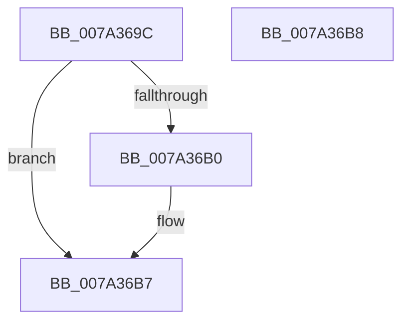

# SepReferenceAntiTamperEntry

- RVA: `0x007A369C`–`0x007A36B9` (길이 `29` bytes)
- VA: `0x00000001407A369C`
- 실행 섹션: `PAGE`
- PDB 이름 있음: `예`; PDB Function 태그: `아니요`
- unwind 정보 RVA: `0x000DB714`
- 디코드: `9`개 명령, `29/29` bytes 표시
- 미해석 바이트: `0` (있으면 어셈블리에 `.byte`로 보존)

> 이 문서는 커널 이미지의 기계어와 PDB 기호를 분석해 생성했습니다. 4번과 5번은 함수 원형과 자료형을 바이너리 사용 방식에서 추정한 C 해석이며 원본 소스 복구 결과는 아닙니다.

## 1. Dependencies

- 직접 호출 지점: **0**; 고유 호출 대상: **0**
- 직접 호출자로 확인된 함수: **1**
- RIP 상대 이미지 참조: **0**

### Outgoing calls
- 직접 디코드된 call 명령이 없습니다.

### Direct callers
- [SepGetAntiTamperEntry](../../text/60/SepGetAntiTamperEntry_function_0060AEE4.md) at `0x0060AF2F`

### Static image references
- 디코드된 RIP-relative 메모리 참조가 없습니다.

## 2. Other-region calls and transfers

- 다른 실행 섹션으로 향하는 call: **0**
- 별도 외부 분기/꼬리 이동을 확인하지 못했습니다.

## 3. Assembly (complete function range)

```asm
007A369C  B8 01 00 00 00                  mov eax, 1
007A36A1  F0 48 0F C1 41 18               lock xadd qword ptr [rcx + 0x18], rax
007A36A7  48 FF C0                        inc rax
007A36AA  48 83 F8 01                     cmp rax, 1
007A36AE  7F 07                           jg 0x1407a36b7
007A36B0  B9 0E 00 00 00                  mov ecx, 0xe
007A36B5  CD 29                           int 0x29
007A36B7  C3                              ret
007A36B8  CC                              int3
```

## 4. C-style interpretation (structured pseudocode)

```c
__int64 __fastcall SepReferenceAntiTamperEntry(__int64 a1)
{
    __int64 result;

    result = (1) + 1;
    if (result <= 1) {
        a1 = 14;
    }
    return result;
}
```

## 5. (Beta) C Style

```c
int64_t SepReferenceAntiTamperEntry(void *Arg1)
{
    uint8_t *arg1 = (uint8_t *)Arg1;

    int64_t result;

    result = (1) + 1;
    if (result <= 1) {
        Arg1 = 14;
    }
    return result;
}
```

### 관측된 메모리 오프셋

구조체 형식이 확인되지 않은 접근은 인자 기준의 오프셋으로만 기록했습니다.

| 기준 인자 | 오프셋 표현 | 폭 (bit) | 접근 |
|---|---:|---:|---|
| `Arg1` | `+ 0x18` | `64` | `R/W` |

## 6. Execution-region graph

[열기: 2D/3D 그래프와 함수 탐색 컨트롤 패널](../../../control-panel.html?section=page&rva=0x007A369C&view=graph)

- 2D 그래프는 위에서 아래로 흐르고, 3D 그래프는 빈 공간을 드래그해 회전합니다. Shift+드래그는 이동, 휠은 확대·축소, 함수 노드 선택은 대상 보고서 이동입니다.

### Static fallback


