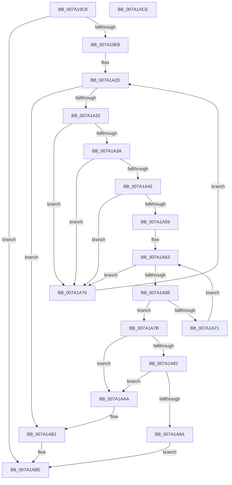

# SepRemoveTokenLogonSession

- RVA: `0x007A19C8`–`0x007A1ACF` (길이 `263` bytes)
- VA: `0x00000001407A19C8`
- 실행 섹션: `PAGE`
- PDB 이름 있음: `예`; PDB Function 태그: `아니요`
- unwind 정보 RVA: `0x00060BC4`
- 디코드: `72`개 명령, `263/263` bytes 표시
- 미해석 바이트: `0` (있으면 어셈블리에 `.byte`로 보존)

> 이 문서는 커널 이미지의 기계어와 PDB 기호를 분석해 생성했습니다. 4번과 5번은 함수 원형과 자료형을 바이너리 사용 방식에서 추정한 C 해석이며 원본 소스 복구 결과는 아닙니다.

## 1. Dependencies

- 직접 호출 지점: **6**; 고유 호출 대상: **4**
- 직접 호출자로 확인된 함수: **5**
- RIP 상대 이미지 참조: **2**

### Outgoing calls
- `0x007A1A1D` → [ExAcquireResourceExclusiveLite](../../text/21/ExAcquireResourceExclusiveLite_function_00214E20.md) (function, `0x00214E20`)
- `0x007A1A94` → [ExReleaseResourceLite](../../text/25/ExReleaseResourceLite_function_0025FA10.md) (function, `0x0025FA10`)
- `0x007A1A99` → [KeLeaveCriticalRegion](../../text/25/KeLeaveCriticalRegion_function_0025D8B0.md) (function, `0x0025D8B0`)
- `0x007A1AA3` → [ExFreePoolWithTag](../../poolcode/B8/ExFreePoolWithTag_function_00B82870.md) (function, `0x00B82870`)
- `0x007A1AB4` → [ExReleaseResourceLite](../../text/25/ExReleaseResourceLite_function_0025FA10.md) (function, `0x0025FA10`)
- `0x007A1AB9` → [KeLeaveCriticalRegion](../../text/25/KeLeaveCriticalRegion_function_0025D8B0.md) (function, `0x0025D8B0`)

### Direct callers
- [SepLinkLogonSessions](../../text/4A/SepLinkLogonSessions_function_004AAE78.md) at `0x004AB117`
- [SepLinkLogonSessions](../../text/4A/SepLinkLogonSessions_function_004AAE78.md) at `0x004AB120`
- [SepOneWayLinkLogonSessions](../../text/60/SepOneWayLinkLogonSessions_function_006068D8.md) at `0x00606B5E`
- [SepOneWayLinkLogonSessions](../../text/60/SepOneWayLinkLogonSessions_function_006068D8.md) at `0x00606B75`
- [SepSetServerSiloToken](../79/SepSetServerSiloToken_function_0079D2A8.md) at `0x0079D30C`
- [NtSetInformationToken](../AF/NtSetInformationToken_function_00AF0530.md) at `0x00AF0D75`
- [SepTokenDeleteMethod](../AF/SepTokenDeleteMethod_function_00AF23D0.md) at `0x00AF23E6`

### Static image references
- `0x007A19EF` → RVA `0x00E67F20` (`.data`; read)
- `0x007A1A22` → RVA `0x00FD9AF0` (`PAGEDATA`; read)

## 2. Other-region calls and transfers

- 다른 실행 섹션으로 향하는 call: **6**
  - `0x007A1A1D` → [ExAcquireResourceExclusiveLite](../../text/21/ExAcquireResourceExclusiveLite_function_00214E20.md) (`PAGE` → `.text`)
  - `0x007A1A94` → [ExReleaseResourceLite](../../text/25/ExReleaseResourceLite_function_0025FA10.md) (`PAGE` → `.text`)
  - `0x007A1A99` → [KeLeaveCriticalRegion](../../text/25/KeLeaveCriticalRegion_function_0025D8B0.md) (`PAGE` → `.text`)
  - `0x007A1AA3` → [ExFreePoolWithTag](../../poolcode/B8/ExFreePoolWithTag_function_00B82870.md) (`PAGE` → `POOLCODE`)
  - `0x007A1AB4` → [ExReleaseResourceLite](../../text/25/ExReleaseResourceLite_function_0025FA10.md) (`PAGE` → `.text`)
  - `0x007A1AB9` → [KeLeaveCriticalRegion](../../text/25/KeLeaveCriticalRegion_function_0025D8B0.md) (`PAGE` → `.text`)
- 별도 외부 분기/꼬리 이동을 확인하지 못했습니다.

## 3. Assembly (complete function range)

```asm
007A19C8  48 89 5C 24 08                  mov qword ptr [rsp + 8], rbx
007A19CD  48 89 74 24 10                  mov qword ptr [rsp + 0x10], rsi
007A19D2  57                              push rdi
007A19D3  48 83 EC 20                     sub rsp, 0x20
007A19D7  8B 81 C8 00 00 00               mov eax, dword ptr [rcx + 0xc8]
007A19DD  48 8B F9                        mov rdi, rcx
007A19E0  A8 20                           test al, 0x20
007A19E2  0F 85 D6 00 00 00               jne 0x1407a1abe
007A19E8  69 51 18 24 0A 25 5B            imul edx, dword ptr [rcx + 0x18], 0x5b250a24
007A19EF  48 8D 0D 2A 65 6C 00            lea rcx, [rip + 0x6c652a]
007A19F6  65 48 8B 04 25 88 01 00 00      mov rax, qword ptr gs:[0x188]
007A19FF  66 FF 88 E4 01 00 00            dec word ptr [rax + 0x1e4]
007A1A06  90                              nop
007A1A07  C1 EA 1C                        shr edx, 0x1c
007A1A0A  8B C2                           mov eax, edx
007A1A0C  83 E0 03                        and eax, 3
007A1A0F  8B DA                           mov ebx, edx
007A1A11  48 6B F0 68                     imul rsi, rax, 0x68
007A1A15  B2 01                           mov dl, 1
007A1A17  48 03 F1                        add rsi, rcx
007A1A1A  48 8B CE                        mov rcx, rsi
007A1A1D  E8 FE 33 A7 FF                  call 0x140214e20
007A1A22  48 8B 05 C7 80 83 00            mov rax, qword ptr [rip + 0x8380c7]
007A1A29  48 8B 14 D8                     mov rdx, qword ptr [rax + rbx*8]
007A1A2D  48 85 D2                        test rdx, rdx
007A1A30  74 7F                           je 0x1407a1ab1
007A1A32  8B 42 08                        mov eax, dword ptr [rdx + 8]
007A1A35  39 47 18                        cmp dword ptr [rdi + 0x18], eax
007A1A38  75 3C                           jne 0x1407a1a76
007A1A3A  8B 42 0C                        mov eax, dword ptr [rdx + 0xc]
007A1A3D  39 47 1C                        cmp dword ptr [rdi + 0x1c], eax
007A1A40  75 34                           jne 0x1407a1a76
007A1A42  48 8B 8F D8 00 00 00            mov rcx, qword ptr [rdi + 0xd8]
007A1A49  48 8B 82 A8 00 00 00            mov rax, qword ptr [rdx + 0xa8]
007A1A50  48 39 81 A8 00 00 00            cmp qword ptr [rcx + 0xa8], rax
007A1A57  75 1D                           jne 0x1407a1a76
007A1A59  48 8D 8A B8 00 00 00            lea rcx, [rdx + 0xb8]
007A1A60  48 8B 19                        mov rbx, qword ptr [rcx]
007A1A63  48 3B D9                        cmp rbx, rcx
007A1A66  74 0E                           je 0x1407a1a76
007A1A68  48 8B 03                        mov rax, qword ptr [rbx]
007A1A6B  48 39 7B 10                     cmp qword ptr [rbx + 0x10], rdi
007A1A6F  74 0A                           je 0x1407a1a7b
007A1A71  48 8B D8                        mov rbx, rax
007A1A74  EB ED                           jmp 0x1407a1a63
007A1A76  48 8B 12                        mov rdx, qword ptr [rdx]
007A1A79  EB B2                           jmp 0x1407a1a2d
007A1A7B  48 39 58 08                     cmp qword ptr [rax + 8], rbx
007A1A7F  75 29                           jne 0x1407a1aaa
007A1A81  48 8B 53 08                     mov rdx, qword ptr [rbx + 8]
007A1A85  48 39 1A                        cmp qword ptr [rdx], rbx
007A1A88  75 20                           jne 0x1407a1aaa
007A1A8A  48 89 02                        mov qword ptr [rdx], rax
007A1A8D  48 8B CE                        mov rcx, rsi
007A1A90  48 89 50 08                     mov qword ptr [rax + 8], rdx
007A1A94  E8 77 DF AB FF                  call 0x14025fa10
007A1A99  E8 12 BE AB FF                  call 0x14025d8b0
007A1A9E  33 D2                           xor edx, edx
007A1AA0  48 8B CB                        mov rcx, rbx
007A1AA3  E8 C8 0D 3E 00                  call 0x140b82870
007A1AA8  EB 14                           jmp 0x1407a1abe
007A1AAA  B9 03 00 00 00                  mov ecx, 3
007A1AAF  CD 29                           int 0x29
007A1AB1  48 8B CE                        mov rcx, rsi
007A1AB4  E8 57 DF AB FF                  call 0x14025fa10
007A1AB9  E8 F2 BD AB FF                  call 0x14025d8b0
007A1ABE  48 8B 5C 24 30                  mov rbx, qword ptr [rsp + 0x30]
007A1AC3  48 8B 74 24 38                  mov rsi, qword ptr [rsp + 0x38]
007A1AC8  48 83 C4 20                     add rsp, 0x20
007A1ACC  5F                              pop rdi
007A1ACD  C3                              ret
007A1ACE  CC                              int3
```

## 4. C-style interpretation (structured pseudocode)

```c
__int64 __fastcall SepRemoveTokenLogonSession(__int64 a1)
{
    __int64 result;
    __int64 v_rsi;
    __int64 v_rsp;
    unsigned __int64 v_stack_p10;
    unsigned __int64 v_stack_p8;

    v_stack_p8 = v_rbx;
    v_stack_p10 = v_rsi;
    v_rsp = (v_rsp) - (32);
    if ((((unsigned __int8)((unsigned int)(*(unsigned int *)(a1 + 200)))) & (32)) != 0) goto loc_007A1ABE;
    a2 = (unsigned int)((a2) * (*(unsigned int *)(a1 + 24)));
    a2 = (unsigned int)((a2) >> (28));
    result = (unsigned int)(((unsigned int)((unsigned int)(a2))) & (3));
    v_rsi = (v_rsi) * (result);
    v_rsi = (v_rsi) + (v_rip + 7103786);
    result = ExAcquireResourceExclusiveLite(v_rsi, 1, a3, a4);
loc_007A1A2D:
    if (*(unsigned __int64 *)(*(unsigned __int64 *)(v_rip + 8618183) + (unsigned int)((unsigned int)(a2)) * 8) == 0) goto loc_007A1AB1;
    if ((*(unsigned int *)(a1 + 24)) != ((unsigned int)((unsigned int)(*(unsigned int *)(*(unsigned __int64 *)(*(unsigned __int64 *)(v_rip + 8618183) + (unsigned int)((unsigned int)(a2)) * 8) + 8))))) goto loc_007A1A76;
    if ((*(unsigned int *)(a1 + 28)) != ((unsigned int)((unsigned int)(*(unsigned int *)(*(unsigned __int64 *)(*(unsigned __int64 *)(v_rip + 8618183) + (unsigned int)((unsigned int)(a2)) * 8) + 12))))) goto loc_007A1A76;
    if ((*(unsigned __int64 *)(*(unsigned __int64 *)(a1 + 216) + 168)) != (*(unsigned __int64 *)(*(unsigned __int64 *)(*(unsigned __int64 *)(v_rip + 8618183) + (unsigned int)((unsigned int)(a2)) * 8) + 168))) goto loc_007A1A76;
loc_007A1A63:
    if ((*(unsigned __int64 *)(*(unsigned __int64 *)(*(unsigned __int64 *)(v_rip + 8618183) + (unsigned int)((unsigned int)(a2)) * 8) + 184)) == (*(unsigned __int64 *)(*(unsigned __int64 *)(v_rip + 8618183) + (unsigned int)((unsigned int)(a2)) * 8) + 184)) goto loc_007A1A76;
    if ((*(unsigned __int64 *)(*(unsigned __int64 *)(*(unsigned __int64 *)(*(unsigned __int64 *)(v_rip + 8618183) + (unsigned int)((unsigned int)(a2)) * 8) + 184) + 16)) == a1) goto loc_007A1A7B;
    goto loc_007A1A63;
loc_007A1A76:
    goto loc_007A1A2D;
loc_007A1A7B:
    if ((*(unsigned __int64 *)(*(unsigned __int64 *)(*(unsigned __int64 *)(*(unsigned __int64 *)(*(unsigned __int64 *)(v_rip + 8618183) + (unsigned int)((unsigned int)(a2)) * 8) + 184)) + 8)) != (*(unsigned __int64 *)(*(unsigned __int64 *)(*(unsigned __int64 *)(*(unsigned __int64 *)(v_rip + 8618183) + (unsigned int)((unsigned int)(a2)) * 8) + 184)))) goto loc_007A1AAA;
    if ((*(unsigned __int64 *)(*(unsigned __int64 *)(*(unsigned __int64 *)(*(unsigned __int64 *)(*(unsigned __int64 *)(*(unsigned __int64 *)(v_rip + 8618183) + (unsigned int)((unsigned int)(a2)) * 8) + 184)) + 8))) != (*(unsigned __int64 *)(*(unsigned __int64 *)(*(unsigned __int64 *)(*(unsigned __int64 *)(v_rip + 8618183) + (unsigned int)((unsigned int)(a2)) * 8) + 184)))) goto loc_007A1AAA;
    *(unsigned __int64 *)(*(unsigned __int64 *)(*(unsigned __int64 *)(*(unsigned __int64 *)(*(unsigned __int64 *)(*(unsigned __int64 *)(v_rip + 8618183) + (unsigned int)((unsigned int)(a2)) * 8) + 184)) + 8)) = *(unsigned __int64 *)(*(unsigned __int64 *)(*(unsigned __int64 *)(*(unsigned __int64 *)(v_rip + 8618183) + (unsigned int)((unsigned int)(a2)) * 8) + 184));
    *(unsigned __int64 *)(*(unsigned __int64 *)(*(unsigned __int64 *)(*(unsigned __int64 *)(*(unsigned __int64 *)(v_rip + 8618183) + (unsigned int)((unsigned int)(a2)) * 8) + 184)) + 8) = *(unsigned __int64 *)(*(unsigned __int64 *)(*(unsigned __int64 *)(*(unsigned __int64 *)(*(unsigned __int64 *)(v_rip + 8618183) + (unsigned int)((unsigned int)(a2)) * 8) + 184)) + 8);
    result = ExReleaseResourceLite(v_rsi, *(unsigned __int64 *)(*(unsigned __int64 *)(*(unsigned __int64 *)(*(unsigned __int64 *)(*(unsigned __int64 *)(v_rip + 8618183) + (unsigned int)((unsigned int)(a2)) * 8) + 184)) + 8), a3, a4);
    result = KeLeaveCriticalRegion(v_rsi, *(unsigned __int64 *)(*(unsigned __int64 *)(*(unsigned __int64 *)(*(unsigned __int64 *)(*(unsigned __int64 *)(v_rip + 8618183) + (unsigned int)((unsigned int)(a2)) * 8) + 184)) + 8), a3, a4);
    a2 = 0;
    result = ExFreePoolWithTag(*(unsigned __int64 *)(*(unsigned __int64 *)(*(unsigned __int64 *)(*(unsigned __int64 *)(v_rip + 8618183) + (unsigned int)((unsigned int)(a2)) * 8) + 184)), a2, a3, a4);
    goto loc_007A1ABE;
loc_007A1AAA:
loc_007A1AB1:
    result = ExReleaseResourceLite(v_rsi, a2, a3, a4);
    result = KeLeaveCriticalRegion(v_rsi, a2, a3, a4);
loc_007A1ABE:
    v_rsp = (v_rsp) + (32);
    return result;
}
```

## 5. (Beta) C Style

```c
int64_t SepRemoveTokenLogonSession(void *Arg1)
{
    uint8_t *arg1 = (uint8_t *)Arg1;

    int64_t result;
    int64_t local_rsi;
    int64_t local_rsp;
    uint64_t v_stack_p10;
    uint64_t v_stack_p8;

    v_stack_p8 = local_rbx;
    v_stack_p10 = local_rsi;
    local_rsp = (local_rsp) - (32);
    if ((((uint8_t)((uint32_t)(*(uint32_t *)(arg1 + 0xC8)))) & (32)) != 0) goto loc_007A1ABE;
    a2 = (uint32_t)((a2) * (*(uint32_t *)(arg1 + 0x18)));
    a2 = (uint32_t)((a2) >> (28));
    result = (uint32_t)(((uint32_t)((uint32_t)(a2))) & (3));
    local_rsi = (local_rsi) * (result);
    local_rsi = (local_rsi) + (v_rip + 7103786);
    result = ExAcquireResourceExclusiveLite(local_rsi, 1, a3, a4);
loc_007A1A2D:
    if (*(uint64_t *)(*(uint64_t *)(v_rip + 0x8380C7) + (uint32_t)((uint32_t)(a2)) * 8) == 0) goto loc_007A1AB1;
    if ((*(uint32_t *)(arg1 + 0x18)) != ((uint32_t)((uint32_t)(*(uint32_t *)(*(uint64_t *)(*(uint64_t *)(v_rip + 0x8380C7) + (uint32_t)((uint32_t)(a2)) * 8) + 0x8))))) goto loc_007A1A76;
    if ((*(uint32_t *)(arg1 + 0x1C)) != ((uint32_t)((uint32_t)(*(uint32_t *)(*(uint64_t *)(*(uint64_t *)(v_rip + 0x8380C7) + (uint32_t)((uint32_t)(a2)) * 8) + 0xC))))) goto loc_007A1A76;
    if ((*(uint64_t *)(*(uint64_t *)(arg1 + 0xD8) + 0xA8)) != (*(uint64_t *)(*(uint64_t *)(*(uint64_t *)(v_rip + 0x8380C7) + (uint32_t)((uint32_t)(a2)) * 8) + 0xA8))) goto loc_007A1A76;
loc_007A1A63:
    if ((*(uint64_t *)(*(uint64_t *)(*(uint64_t *)(v_rip + 0x8380C7) + (uint32_t)((uint32_t)(a2)) * 8) + 0xB8)) == (*(uint64_t *)(*(uint64_t *)(v_rip + 0x8380C7) + (uint32_t)((uint32_t)(a2)) * 8) + 184)) goto loc_007A1A76;
    if ((*(uint64_t *)(*(uint64_t *)(*(uint64_t *)(*(uint64_t *)(v_rip + 0x8380C7) + (uint32_t)((uint32_t)(a2)) * 8) + 0xB8) + 0x10)) == Arg1) goto loc_007A1A7B;
    goto loc_007A1A63;
loc_007A1A76:
    goto loc_007A1A2D;
loc_007A1A7B:
    if ((*(uint64_t *)(*(uint64_t *)(*(uint64_t *)(*(uint64_t *)(*(uint64_t *)(v_rip + 0x8380C7) + (uint32_t)((uint32_t)(a2)) * 8) + 0xB8)) + 0x8)) != (*(uint64_t *)(*(uint64_t *)(*(uint64_t *)(*(uint64_t *)(v_rip + 0x8380C7) + (uint32_t)((uint32_t)(a2)) * 8) + 0xB8)))) goto loc_007A1AAA;
    if ((*(uint64_t *)(*(uint64_t *)(*(uint64_t *)(*(uint64_t *)(*(uint64_t *)(*(uint64_t *)(v_rip + 0x8380C7) + (uint32_t)((uint32_t)(a2)) * 8) + 0xB8)) + 0x8))) != (*(uint64_t *)(*(uint64_t *)(*(uint64_t *)(*(uint64_t *)(v_rip + 0x8380C7) + (uint32_t)((uint32_t)(a2)) * 8) + 0xB8)))) goto loc_007A1AAA;
    *(uint64_t *)(*(uint64_t *)(*(uint64_t *)(*(uint64_t *)(*(uint64_t *)(*(uint64_t *)(v_rip + 0x8380C7) + (uint32_t)((uint32_t)(a2)) * 8) + 0xB8)) + 0x8)) = *(uint64_t *)(*(uint64_t *)(*(uint64_t *)(*(uint64_t *)(v_rip + 0x8380C7) + (uint32_t)((uint32_t)(a2)) * 8) + 0xB8));
    *(uint64_t *)(*(uint64_t *)(*(uint64_t *)(*(uint64_t *)(*(uint64_t *)(v_rip + 0x8380C7) + (uint32_t)((uint32_t)(a2)) * 8) + 0xB8)) + 0x8) = *(uint64_t *)(*(uint64_t *)(*(uint64_t *)(*(uint64_t *)(*(uint64_t *)(v_rip + 0x8380C7) + (uint32_t)((uint32_t)(a2)) * 8) + 0xB8)) + 0x8);
    result = ExReleaseResourceLite(local_rsi, *(uint64_t *)(*(uint64_t *)(*(uint64_t *)(*(uint64_t *)(*(uint64_t *)(v_rip + 0x8380C7) + (uint32_t)((uint32_t)(a2)) * 8) + 0xB8)) + 0x8), a3, a4);
    result = KeLeaveCriticalRegion(local_rsi, *(uint64_t *)(*(uint64_t *)(*(uint64_t *)(*(uint64_t *)(*(uint64_t *)(v_rip + 0x8380C7) + (uint32_t)((uint32_t)(a2)) * 8) + 0xB8)) + 0x8), a3, a4);
    a2 = 0;
    result = ExFreePoolWithTag(*(uint64_t *)(*(uint64_t *)(*(uint64_t *)(*(uint64_t *)(v_rip + 0x8380C7) + (uint32_t)((uint32_t)(a2)) * 8) + 0xB8)), a2, a3, a4);
    goto loc_007A1ABE;
loc_007A1AAA:
loc_007A1AB1:
    result = ExReleaseResourceLite(local_rsi, a2, a3, a4);
    result = KeLeaveCriticalRegion(local_rsi, a2, a3, a4);
loc_007A1ABE:
    local_rsp = (local_rsp) + (32);
    return result;
}
```

### 관측된 메모리 오프셋

구조체 형식이 확인되지 않은 접근은 인자 기준의 오프셋으로만 기록했습니다.

| 기준 인자 | 오프셋 표현 | 폭 (bit) | 접근 |
|---|---:|---:|---|
| `Arg1` | `+ 0x18` | `32` | `R` |
| `Arg1` | `+ 0x1C` | `32` | `R` |
| `Arg1` | `+ 0xC8` | `32` | `R` |
| `Arg1` | `+ 0xD8` | `64` | `R` |

## 6. Execution-region graph

[열기: 2D/3D 그래프와 함수 탐색 컨트롤 패널](../../../control-panel.html?section=page&rva=0x007A19C8&view=graph)

- 2D 그래프는 위에서 아래로 흐르고, 3D 그래프는 빈 공간을 드래그해 회전합니다. Shift+드래그는 이동, 휠은 확대·축소, 함수 노드 선택은 대상 보고서 이동입니다.

### Static fallback


