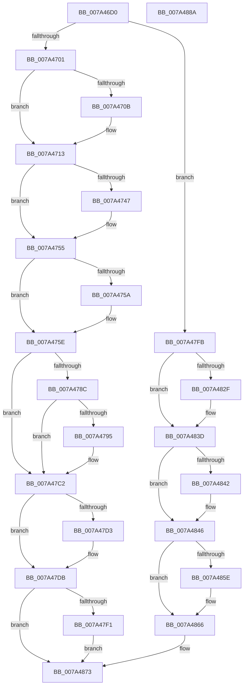

# SepRmCapUpdateWrkr

- RVA: `0x007A46D0`–`0x007A488B` (길이 `443` bytes)
- VA: `0x00000001407A46D0`
- 실행 섹션: `PAGE`
- PDB 이름 있음: `예`; PDB Function 태그: `아니요`
- unwind 정보 RVA: `0x000BF954`
- 디코드: `108`개 명령, `443/443` bytes 표시
- 미해석 바이트: `0` (있으면 어셈블리에 `.byte`로 보존)

> 이 문서는 커널 이미지의 기계어와 PDB 기호를 분석해 생성했습니다. 4번과 5번은 함수 원형과 자료형을 바이너리 사용 방식에서 추정한 C 해석이며 원본 소스 복구 결과는 아닙니다.

## 1. Dependencies

- 직접 호출 지점: **13**; 고유 호출 대상: **7**
- 직접 호출자로 확인된 함수: **0**
- RIP 상대 이미지 참조: **9**

### Outgoing calls
- `0x007A46F2` → [SepBuildCapPolicyTable](../../text/60/SepBuildCapPolicyTable_function_0060B8F0.md) (function, `0x0060B8F0`)
- `0x007A4737` → [KeAbPreAcquire](../../text/21/KeAbPreAcquire_function_00210230.md) (function, `0x00210230`)
- `0x007A4750` → [ExfAcquirePushLockExclusiveEx](../../text/20/ExfAcquirePushLockExclusiveEx_function_0020FC90.md) (function, `0x0020FC90`)
- `0x007A479C` → [SepRmDereferenceCapTable](../../text/4F/SepRmDereferenceCapTable_function_004F61A0.md) (function, `0x004F61A0`)
- `0x007A47D6` → [ExfTryToWakePushLock](../../text/26/ExfTryToWakePushLock_function_00265DD0.md) (function, `0x00265DD0`)
- `0x007A47DE` → [KeAbPostRelease](../../text/2E/KeAbPostRelease_function_002E1600.md) (function, `0x002E1600`)
- `0x007A47E3` → [KeLeaveCriticalRegion](../../text/25/KeLeaveCriticalRegion_function_0025D8B0.md) (function, `0x0025D8B0`)
- `0x007A47F4` → [SepRmDereferenceCapTable](../../text/4F/SepRmDereferenceCapTable_function_004F61A0.md) (function, `0x004F61A0`)
- `0x007A481F` → [KeAbPreAcquire](../../text/21/KeAbPreAcquire_function_00210230.md) (function, `0x00210230`)
- `0x007A4838` → [ExfAcquirePushLockExclusiveEx](../../text/20/ExfAcquirePushLockExclusiveEx_function_0020FC90.md) (function, `0x0020FC90`)
- `0x007A4861` → [ExfTryToWakePushLock](../../text/26/ExfTryToWakePushLock_function_00265DD0.md) (function, `0x00265DD0`)
- `0x007A4869` → [KeAbPostRelease](../../text/2E/KeAbPostRelease_function_002E1600.md) (function, `0x002E1600`)
- `0x007A486E` → [KeLeaveCriticalRegion](../../text/25/KeLeaveCriticalRegion_function_0025D8B0.md) (function, `0x0025D8B0`)

### Direct callers
- 이 함수 시작 RVA로 연결되는 직접 call은 확인되지 않았습니다. 간접 호출은 완전히 역산할 수 없습니다.

### Static image references
- `0x007A471C` → RVA `0x00F04AD0` (`.data`; read)
- `0x007A475E` → RVA `0x00FD80F8` (`PAGEDATA`; read)
- `0x007A476A` → RVA `0x00FD80F8` (`PAGEDATA`; write)
- `0x007A477B` → RVA `0x00F04AC5` (`.data`; write)
- `0x007A4782` → RVA `0x00F04AC5` (`.data`; read)
- `0x007A478C` → RVA `0x00FC41C4` (`.data`; read)
- `0x007A47A1` → RVA `0x00FD80F0` (`PAGEDATA`; read)
- `0x007A47B7` → RVA `0x00FD9CC0` (`PAGEDATA`; read)
- `0x007A47C2` → RVA `0x00F04AD0` (`.data`; read/write)

## 2. Other-region calls and transfers

- 다른 실행 섹션으로 향하는 call: **13**
  - `0x007A46F2` → [SepBuildCapPolicyTable](../../text/60/SepBuildCapPolicyTable_function_0060B8F0.md) (`PAGE` → `.text`)
  - `0x007A4737` → [KeAbPreAcquire](../../text/21/KeAbPreAcquire_function_00210230.md) (`PAGE` → `.text`)
  - `0x007A4750` → [ExfAcquirePushLockExclusiveEx](../../text/20/ExfAcquirePushLockExclusiveEx_function_0020FC90.md) (`PAGE` → `.text`)
  - `0x007A479C` → [SepRmDereferenceCapTable](../../text/4F/SepRmDereferenceCapTable_function_004F61A0.md) (`PAGE` → `.text`)
  - `0x007A47D6` → [ExfTryToWakePushLock](../../text/26/ExfTryToWakePushLock_function_00265DD0.md) (`PAGE` → `.text`)
  - `0x007A47DE` → [KeAbPostRelease](../../text/2E/KeAbPostRelease_function_002E1600.md) (`PAGE` → `.text`)
  - `0x007A47E3` → [KeLeaveCriticalRegion](../../text/25/KeLeaveCriticalRegion_function_0025D8B0.md) (`PAGE` → `.text`)
  - `0x007A47F4` → [SepRmDereferenceCapTable](../../text/4F/SepRmDereferenceCapTable_function_004F61A0.md) (`PAGE` → `.text`)
  - `0x007A481F` → [KeAbPreAcquire](../../text/21/KeAbPreAcquire_function_00210230.md) (`PAGE` → `.text`)
  - `0x007A4838` → [ExfAcquirePushLockExclusiveEx](../../text/20/ExfAcquirePushLockExclusiveEx_function_0020FC90.md) (`PAGE` → `.text`)
  - `0x007A4861` → [ExfTryToWakePushLock](../../text/26/ExfTryToWakePushLock_function_00265DD0.md) (`PAGE` → `.text`)
  - `0x007A4869` → [KeAbPostRelease](../../text/2E/KeAbPostRelease_function_002E1600.md) (`PAGE` → `.text`)
  - `0x007A486E` → [KeLeaveCriticalRegion](../../text/25/KeLeaveCriticalRegion_function_0025D8B0.md) (`PAGE` → `.text`)
- 별도 외부 분기/꼬리 이동을 확인하지 못했습니다.

## 3. Assembly (complete function range)

```asm
007A46D0  48 8B C4                        mov rax, rsp
007A46D3  48 89 58 10                     mov qword ptr [rax + 0x10], rbx
007A46D7  48 89 68 18                     mov qword ptr [rax + 0x18], rbp
007A46DB  56                              push rsi
007A46DC  57                              push rdi
007A46DD  41 56                           push r14
007A46DF  48 83 EC 20                     sub rsp, 0x20
007A46E3  8B 49 2C                        mov ecx, dword ptr [rcx + 0x2c]
007A46E6  4C 8B F2                        mov r14, rdx
007A46E9  48 83 60 08 00                  and qword ptr [rax + 8], 0
007A46EE  48 8D 50 08                     lea rdx, [rax + 8]
007A46F2  E8 F9 71 E6 FF                  call 0x14060b8f0
007A46F7  8B E8                           mov ebp, eax
007A46F9  85 C0                           test eax, eax
007A46FB  0F 88 FA 00 00 00               js 0x1407a47fb
007A4701  48 8B 4C 24 40                  mov rcx, qword ptr [rsp + 0x40]
007A4706  48 85 C9                        test rcx, rcx
007A4709  74 08                           je 0x1407a4713
007A470B  48 C7 41 28 01 00 00 00         mov qword ptr [rcx + 0x28], 1
007A4713  65 48 8B 0C 25 88 01 00 00      mov rcx, qword ptr gs:[0x188]
007A471C  48 8D 3D AD 03 76 00            lea rdi, [rip + 0x7603ad]
007A4723  48 83 CB FF                     or rbx, 0xffffffffffffffff
007A4727  45 33 C0                        xor r8d, r8d
007A472A  33 D2                           xor edx, edx
007A472C  66 01 99 E4 01 00 00            add word ptr [rcx + 0x1e4], bx
007A4733  48 8B CF                        mov rcx, rdi
007A4736  90                              nop
007A4737  E8 F4 BA A6 FF                  call 0x140210230
007A473C  F0 48 0F BA 2F 00               lock bts qword ptr [rdi], 0
007A4742  48 8B F0                        mov rsi, rax
007A4745  73 0E                           jae 0x1407a4755
007A4747  4C 8B C7                        mov r8, rdi
007A474A  48 8B D0                        mov rdx, rax
007A474D  48 8B CF                        mov rcx, rdi
007A4750  E8 3B B5 A6 FF                  call 0x14020fc90
007A4755  48 85 F6                        test rsi, rsi
007A4758  74 04                           je 0x1407a475e
007A475A  C6 46 0A 01                     mov byte ptr [rsi + 0xa], 1
007A475E  48 8B 35 93 39 83 00            mov rsi, qword ptr [rip + 0x833993]
007A4765  48 8B 44 24 40                  mov rax, qword ptr [rsp + 0x40]
007A476A  48 89 05 87 39 83 00            mov qword ptr [rip + 0x833987], rax
007A4771  48 8B 05 80 39 83 00            mov rax, qword ptr [rip + 0x833980]
007A4778  48 85 C0                        test rax, rax
007A477B  0F 95 05 43 03 76 00            setne byte ptr [rip + 0x760343]
007A4782  8A 05 3D 03 76 00               mov al, byte ptr [rip + 0x76033d]
007A4788  84 C0                           test al, al
007A478A  74 36                           je 0x1407a47c2
007A478C  83 3D 31 FA 81 00 01            cmp dword ptr [rip + 0x81fa31], 1
007A4793  75 2D                           jne 0x1407a47c2
007A4795  48 8B 0D 5C 39 83 00            mov rcx, qword ptr [rip + 0x83395c]
007A479C  E8 FF 19 D5 FF                  call 0x1404f61a0
007A47A1  48 8B 05 48 39 83 00            mov rax, qword ptr [rip + 0x833948]
007A47A8  48 C7 05 45 39 83 00 00 00 00 00  mov qword ptr [rip + 0x833945], 0
007A47B3  48 8B 48 40                     mov rcx, qword ptr [rax + 0x40]
007A47B7  48 8B 05 02 55 83 00            mov rax, qword ptr [rip + 0x835502]
007A47BE  48 89 41 20                     mov qword ptr [rcx + 0x20], rax
007A47C2  F0 48 0F C1 1D 05 03 76 00      lock xadd qword ptr [rip + 0x760305], rbx
007A47CB  80 E3 06                        and bl, 6
007A47CE  80 FB 02                        cmp bl, 2
007A47D1  75 08                           jne 0x1407a47db
007A47D3  48 8B CF                        mov rcx, rdi
007A47D6  E8 F5 15 AC FF                  call 0x140265dd0
007A47DB  48 8B CF                        mov rcx, rdi
007A47DE  E8 1D CE B3 FF                  call 0x1402e1600
007A47E3  E8 C8 90 AB FF                  call 0x14025d8b0
007A47E8  48 85 F6                        test rsi, rsi
007A47EB  0F 84 82 00 00 00               je 0x1407a4873
007A47F1  48 8B CE                        mov rcx, rsi
007A47F4  E8 A7 19 D5 FF                  call 0x1404f61a0
007A47F9  EB 78                           jmp 0x1407a4873
007A47FB  65 48 8B 04 25 88 01 00 00      mov rax, qword ptr gs:[0x188]
007A4804  48 8D 3D C5 02 76 00            lea rdi, [rip + 0x7602c5]
007A480B  48 83 CB FF                     or rbx, 0xffffffffffffffff
007A480F  45 33 C0                        xor r8d, r8d
007A4812  33 D2                           xor edx, edx
007A4814  48 8B CF                        mov rcx, rdi
007A4817  66 01 98 E4 01 00 00            add word ptr [rax + 0x1e4], bx
007A481E  90                              nop
007A481F  E8 0C BA A6 FF                  call 0x140210230
007A4824  F0 48 0F BA 2F 00               lock bts qword ptr [rdi], 0
007A482A  48 8B F0                        mov rsi, rax
007A482D  73 0E                           jae 0x1407a483d
007A482F  4C 8B C7                        mov r8, rdi
007A4832  48 8B D0                        mov rdx, rax
007A4835  48 8B CF                        mov rcx, rdi
007A4838  E8 53 B4 A6 FF                  call 0x14020fc90
007A483D  48 85 F6                        test rsi, rsi
007A4840  74 04                           je 0x1407a4846
007A4842  C6 46 0A 01                     mov byte ptr [rsi + 0xa], 1
007A4846  C6 05 78 02 76 00 01            mov byte ptr [rip + 0x760278], 1
007A484D  F0 48 0F C1 1D 7A 02 76 00      lock xadd qword ptr [rip + 0x76027a], rbx
007A4856  80 E3 06                        and bl, 6
007A4859  80 FB 02                        cmp bl, 2
007A485C  75 08                           jne 0x1407a4866
007A485E  48 8B CF                        mov rcx, rdi
007A4861  E8 6A 15 AC FF                  call 0x140265dd0
007A4866  48 8B CF                        mov rcx, rdi
007A4869  E8 92 CD B3 FF                  call 0x1402e1600
007A486E  E8 3D 90 AB FF                  call 0x14025d8b0
007A4873  48 8B 5C 24 48                  mov rbx, qword ptr [rsp + 0x48]
007A4878  41 89 6E 28                     mov dword ptr [r14 + 0x28], ebp
007A487C  48 8B 6C 24 50                  mov rbp, qword ptr [rsp + 0x50]
007A4881  48 83 C4 20                     add rsp, 0x20
007A4885  41 5E                           pop r14
007A4887  5F                              pop rdi
007A4888  5E                              pop rsi
007A4889  C3                              ret
007A488A  CC                              int3
```

## 4. C-style interpretation (structured pseudocode)

```c
__int64 __fastcall SepRmCapUpdateWrkr(__int64 a1, __int64 a2, int a3)
{
    __int64 result;
    __int64 v_rbx;
    __int64 v_rsp;
    unsigned __int64 v_stack_p10;
    unsigned __int64 v_stack_p18;
    unsigned __int64 v_stack_p8;

    *(unsigned __int64 *)(v_rsp + 16) = v_rbx;
    *(unsigned __int64 *)(v_rsp + 24) = v_rbp;
    v_rsp = (v_rsp) - (32);
    result = SepBuildCapPolicyTable((unsigned int)(*(unsigned int *)(a1 + 44)), v_rsp + 8, a3, a4);
    if (sign_flag) goto loc_007A47FB;
    if (v_stack_p8 != 0) {
        *(unsigned __int64 *)(v_stack_p8 + 40) = 1;
    }
    v_rbx = (v_rbx) | (-1);
    a3 = 0;
    a2 = 0;
    result = KeAbPreAcquire(v_rip + 7734189, a2, a3, a4);
    if (!(condition_is_above_or_equal)) {
        a3 = v_rip + 7734189;
        a2 = result;
        a1 = v_rip + 7734189;
        result = ExfAcquirePushLockExclusiveEx(a1, a2, a3, a4);
    }
    if (result != 0) {
        *(unsigned __int8 *)(result + 10) = 1;
    }
    *(unsigned __int64 *)(v_rip + 8599943) = v_stack_p8;
    if ((unsigned __int8)(*(unsigned __int8 *)(v_rip + 7734077)) == 0) goto loc_007A47C2;
    result = *(unsigned __int8 *)(v_rip + 7734077);
    if ((*(unsigned int *)(v_rip + 8518193)) == 1) {
        a1 = *(unsigned __int64 *)(v_rip + 8599900);
        result = SepRmDereferenceCapTable(a1, a2, a3, a4);
        result = *(unsigned __int64 *)(v_rip + 8599880);
        *(unsigned __int64 *)(v_rip + 8599877) = 0;
        a1 = *(unsigned __int64 *)(result + 64);
        result = *(unsigned __int64 *)(v_rip + 8606978);
        *(unsigned __int64 *)(a1 + 32) = result;
    }
    v_rbx = (unsigned __int8)((v_rbx) & (6));
    if (((unsigned __int8)(v_rbx)) == 2) {
        a1 = v_rip + 7734189;
        result = ExfTryToWakePushLock(a1, a2, a3, a4);
    }
    result = KeAbPostRelease(v_rip + 7734189, a2, a3, a4);
    result = KeLeaveCriticalRegion(v_rip + 7734189, a2, a3, a4);
    if (*(unsigned __int64 *)(v_rip + 8599955) == 0) goto loc_007A4873;
    result = SepRmDereferenceCapTable(*(unsigned __int64 *)(v_rip + 8599955), a2, a3, a4);
    goto loc_007A4873;
loc_007A47FB:
    v_rbx = (v_rbx) | (-1);
    a3 = 0;
    a2 = 0;
    result = KeAbPreAcquire(v_rip + 7733957, a2, a3, a4);
    if (!(condition_is_above_or_equal)) {
        a3 = v_rip + 7733957;
        a2 = result;
        a1 = v_rip + 7733957;
        result = ExfAcquirePushLockExclusiveEx(a1, a2, a3, a4);
    }
    if (result != 0) {
        *(unsigned __int8 *)(result + 10) = 1;
    }
    *(unsigned __int8 *)(v_rip + 7733880) = 1;
    v_rbx = (unsigned __int8)((v_rbx) & (6));
    if (((unsigned __int8)(v_rbx)) == 2) {
        a1 = v_rip + 7733957;
        result = ExfTryToWakePushLock(a1, a2, a3, a4);
    }
    result = KeAbPostRelease(v_rip + 7733957, a2, a3, a4);
    result = KeLeaveCriticalRegion(v_rip + 7733957, a2, a3, a4);
loc_007A4873:
    *(unsigned int *)(a2 + 40) = (unsigned int)((unsigned int)((unsigned int)(result)));
    v_rsp = (v_rsp) + (32);
    return result;
}
```

## 5. (Beta) C Style

```c
int64_t SepRmCapUpdateWrkr(void *Arg1, void *Arg2, int32_t Arg3)
{
    uint8_t *arg1 = (uint8_t *)Arg1;
    uint8_t *arg2 = (uint8_t *)Arg2;

    int64_t result;
    int64_t local_rbx;
    int64_t local_rsp;
    uint64_t v_stack_p10;
    uint64_t v_stack_p18;
    uint64_t v_stack_p8;

    *(uint64_t *)(local_rsp + 0x10) = local_rbx;
    *(uint64_t *)(local_rsp + 0x18) = local_rbp;
    local_rsp = (local_rsp) - (32);
    result = SepBuildCapPolicyTable((uint32_t)(*(uint32_t *)(arg1 + 0x2C)), local_rsp + 8, Arg3, a4);
    if (sign_flag) goto loc_007A47FB;
    if (v_stack_p8 != 0) {
        *(uint64_t *)(v_stack_p8 + 0x28) = 1;
    }
    local_rbx = (local_rbx) | (-1);
    Arg3 = 0;
    Arg2 = 0;
    result = KeAbPreAcquire(v_rip + 7734189, Arg2, Arg3, a4);
    if (!(condition_is_above_or_equal)) {
        Arg3 = v_rip + 7734189;
        Arg2 = result;
        Arg1 = v_rip + 7734189;
        result = ExfAcquirePushLockExclusiveEx(Arg1, Arg2, Arg3, a4);
    }
    if (result != 0) {
        *(uint8_t *)(result + 0xA) = 1;
    }
    *(uint64_t *)(v_rip + 0x833987) = v_stack_p8;
    if ((uint8_t)(*(uint8_t *)(v_rip + 0x76033D)) == 0) goto loc_007A47C2;
    result = *(uint8_t *)(v_rip + 0x76033D);
    if ((*(uint32_t *)(v_rip + 0x81FA31)) == 1) {
        Arg1 = *(uint64_t *)(v_rip + 0x83395C);
        result = SepRmDereferenceCapTable(Arg1, Arg2, Arg3, a4);
        result = *(uint64_t *)(v_rip + 0x833948);
        *(uint64_t *)(v_rip + 0x833945) = 0;
        Arg1 = *(uint64_t *)(result + 0x40);
        result = *(uint64_t *)(v_rip + 0x835502);
        *(uint64_t *)(arg1 + 0x20) = result;
    }
    local_rbx = (uint8_t)((local_rbx) & (6));
    if (((uint8_t)(local_rbx)) == 2) {
        Arg1 = v_rip + 7734189;
        result = ExfTryToWakePushLock(Arg1, Arg2, Arg3, a4);
    }
    result = KeAbPostRelease(v_rip + 7734189, Arg2, Arg3, a4);
    result = KeLeaveCriticalRegion(v_rip + 7734189, Arg2, Arg3, a4);
    if (*(uint64_t *)(v_rip + 0x833993) == 0) goto loc_007A4873;
    result = SepRmDereferenceCapTable(*(uint64_t *)(v_rip + 0x833993), Arg2, Arg3, a4);
    goto loc_007A4873;
loc_007A47FB:
    local_rbx = (local_rbx) | (-1);
    Arg3 = 0;
    Arg2 = 0;
    result = KeAbPreAcquire(v_rip + 7733957, Arg2, Arg3, a4);
    if (!(condition_is_above_or_equal)) {
        Arg3 = v_rip + 7733957;
        Arg2 = result;
        Arg1 = v_rip + 7733957;
        result = ExfAcquirePushLockExclusiveEx(Arg1, Arg2, Arg3, a4);
    }
    if (result != 0) {
        *(uint8_t *)(result + 0xA) = 1;
    }
    *(uint8_t *)(v_rip + 0x760278) = 1;
    local_rbx = (uint8_t)((local_rbx) & (6));
    if (((uint8_t)(local_rbx)) == 2) {
        Arg1 = v_rip + 7733957;
        result = ExfTryToWakePushLock(Arg1, Arg2, Arg3, a4);
    }
    result = KeAbPostRelease(v_rip + 7733957, Arg2, Arg3, a4);
    result = KeLeaveCriticalRegion(v_rip + 7733957, Arg2, Arg3, a4);
loc_007A4873:
    *(uint32_t *)(arg2 + 0x28) = (uint32_t)((uint32_t)((uint32_t)(result)));
    local_rsp = (local_rsp) + (32);
    return result;
}
```

### 관측된 메모리 오프셋

구조체 형식이 확인되지 않은 접근은 인자 기준의 오프셋으로만 기록했습니다.

| 기준 인자 | 오프셋 표현 | 폭 (bit) | 접근 |
|---|---:|---:|---|
| `Arg1` | `+ 0x2C` | `32` | `R` |
| `Arg2` | `+ 0x28` | `32` | `W` |

## 6. Execution-region graph

[열기: 2D/3D 그래프와 함수 탐색 컨트롤 패널](../../../control-panel.html?section=page&rva=0x007A46D0&view=graph)

- 2D 그래프는 위에서 아래로 흐르고, 3D 그래프는 빈 공간을 드래그해 회전합니다. Shift+드래그는 이동, 휠은 확대·축소, 함수 노드 선택은 대상 보고서 이동입니다.

### Static fallback


