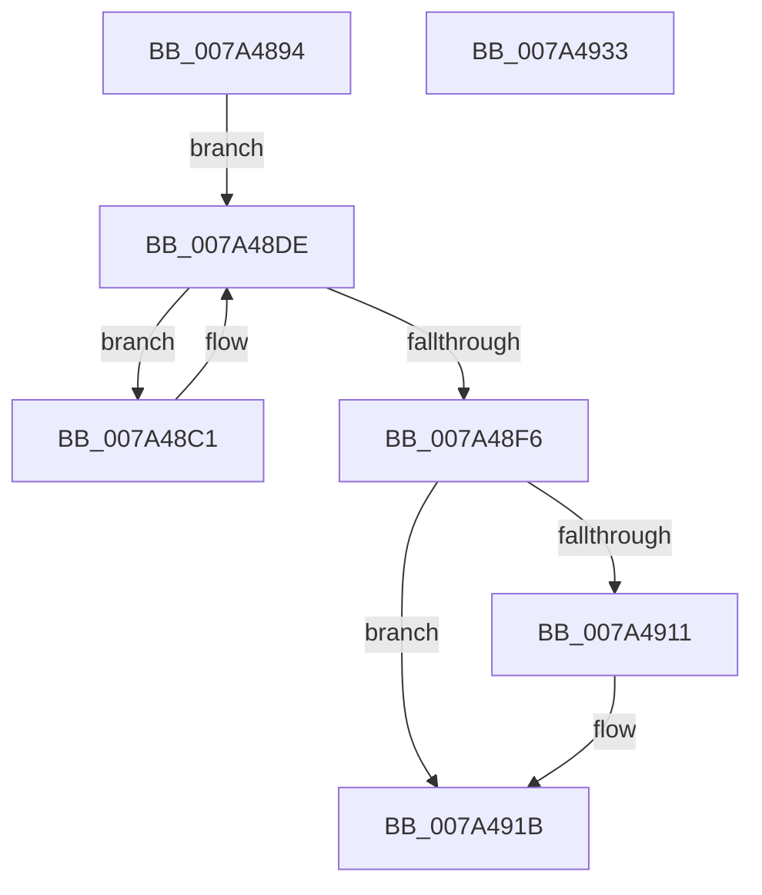

# SepRmDestroyCapTable

- RVA: `0x007A4894`–`0x007A4934` (길이 `160` bytes)
- VA: `0x00000001407A4894`
- 실행 섹션: `PAGE`
- PDB 이름 있음: `예`; PDB Function 태그: `아니요`
- unwind 정보 RVA: `0x0008A2AC`
- 디코드: `43`개 명령, `160/160` bytes 표시
- 미해석 바이트: `0` (있으면 어셈블리에 `.byte`로 보존)

> 이 문서는 커널 이미지의 기계어와 PDB 기호를 분석해 생성했습니다. 4번과 5번은 함수 원형과 자료형을 바이너리 사용 방식에서 추정한 C 해석이며 원본 소스 복구 결과는 아닙니다.

## 1. Dependencies

- 직접 호출 지점: **8**; 고유 호출 대상: **6**
- 직접 호출자로 확인된 함수: **2**
- RIP 상대 이미지 참조: **0**

### Outgoing calls
- `0x007A48BA` → [RtlInitEnumerationHashTable](../../text/2E/RtlInitEnumerationHashTable_function_002ED0C0.md) (function, `0x002ED0C0`)
- `0x007A48C7` → [RtlRemoveEntryHashTable](../../text/2E/RtlRemoveEntryHashTable_function_002EEF00.md) (function, `0x002EEF00`)
- `0x007A48D9` → [ExFreePoolWithTag](../../poolcode/B8/ExFreePoolWithTag_function_00B82870.md) (function, `0x00B82870`)
- `0x007A48E6` → [RtlEnumerateEntryHashTable](../../text/2E/RtlEnumerateEntryHashTable_function_002EEDE0.md) (function, `0x002EEDE0`)
- `0x007A48FB` → [RtlEndEnumerationHashTable](../../text/44/RtlEndEnumerationHashTable_function_00444700.md) (function, `0x00444700`)
- `0x007A4903` → [RtlDeleteHashTable](../../text/48/RtlDeleteHashTable_function_0048C570.md) (function, `0x0048C570`)
- `0x007A4916` → [ExFreePoolWithTag](../../poolcode/B8/ExFreePoolWithTag_function_00B82870.md) (function, `0x00B82870`)
- `0x007A4923` → [ExFreePoolWithTag](../../poolcode/B8/ExFreePoolWithTag_function_00B82870.md) (function, `0x00B82870`)

### Direct callers
- [SepRmDereferenceCapTable](../../text/4F/SepRmDereferenceCapTable_function_004F61A0.md) at `0x004F61C2`
- [SepBuildCapPolicyTable](../../text/60/SepBuildCapPolicyTable_function_0060B8F0.md) at `0x0060B9BE`

### Static image references
- 디코드된 RIP-relative 메모리 참조가 없습니다.

## 2. Other-region calls and transfers

- 다른 실행 섹션으로 향하는 call: **8**
  - `0x007A48BA` → [RtlInitEnumerationHashTable](../../text/2E/RtlInitEnumerationHashTable_function_002ED0C0.md) (`PAGE` → `.text`)
  - `0x007A48C7` → [RtlRemoveEntryHashTable](../../text/2E/RtlRemoveEntryHashTable_function_002EEF00.md) (`PAGE` → `.text`)
  - `0x007A48D9` → [ExFreePoolWithTag](../../poolcode/B8/ExFreePoolWithTag_function_00B82870.md) (`PAGE` → `POOLCODE`)
  - `0x007A48E6` → [RtlEnumerateEntryHashTable](../../text/2E/RtlEnumerateEntryHashTable_function_002EEDE0.md) (`PAGE` → `.text`)
  - `0x007A48FB` → [RtlEndEnumerationHashTable](../../text/44/RtlEndEnumerationHashTable_function_00444700.md) (`PAGE` → `.text`)
  - `0x007A4903` → [RtlDeleteHashTable](../../text/48/RtlDeleteHashTable_function_0048C570.md) (`PAGE` → `.text`)
  - `0x007A4916` → [ExFreePoolWithTag](../../poolcode/B8/ExFreePoolWithTag_function_00B82870.md) (`PAGE` → `POOLCODE`)
  - `0x007A4923` → [ExFreePoolWithTag](../../poolcode/B8/ExFreePoolWithTag_function_00B82870.md) (`PAGE` → `POOLCODE`)
- 별도 외부 분기/꼬리 이동을 확인하지 못했습니다.

## 3. Assembly (complete function range)

```asm
007A4894  48 89 5C 24 08                  mov qword ptr [rsp + 8], rbx
007A4899  57                              push rdi
007A489A  48 83 EC 50                     sub rsp, 0x50
007A489E  0F 57 C0                        xorps xmm0, xmm0
007A48A1  48 8D 54 24 20                  lea rdx, [rsp + 0x20]
007A48A6  33 C0                           xor eax, eax
007A48A8  48 8B D9                        mov rbx, rcx
007A48AB  0F 11 44 24 20                  movups xmmword ptr [rsp + 0x20], xmm0
007A48B0  48 89 44 24 40                  mov qword ptr [rsp + 0x40], rax
007A48B5  0F 11 44 24 30                  movups xmmword ptr [rsp + 0x30], xmm0
007A48BA  E8 01 88 B4 FF                  call 0x1402ed0c0
007A48BF  EB 1D                           jmp 0x1407a48de
007A48C1  45 33 C0                        xor r8d, r8d
007A48C4  48 8B D7                        mov rdx, rdi
007A48C7  E8 34 A6 B4 FF                  call 0x1402eef00
007A48CC  48 83 67 20 00                  and qword ptr [rdi + 0x20], 0
007A48D1  BA 53 65 53 70                  mov edx, 0x70536553
007A48D6  48 8B CF                        mov rcx, rdi
007A48D9  E8 92 DF 3D 00                  call 0x140b82870
007A48DE  48 8D 54 24 20                  lea rdx, [rsp + 0x20]
007A48E3  48 8B CB                        mov rcx, rbx
007A48E6  E8 F5 A4 B4 FF                  call 0x1402eede0
007A48EB  48 8B F8                        mov rdi, rax
007A48EE  48 8B CB                        mov rcx, rbx
007A48F1  48 85 C0                        test rax, rax
007A48F4  75 CB                           jne 0x1407a48c1
007A48F6  48 8D 54 24 20                  lea rdx, [rsp + 0x20]
007A48FB  E8 00 FE C9 FF                  call 0x140444700
007A4900  48 8B CB                        mov rcx, rbx
007A4903  E8 68 7C CE FF                  call 0x14048c570
007A4908  48 8B 4B 38                     mov rcx, qword ptr [rbx + 0x38]
007A490C  48 85 C9                        test rcx, rcx
007A490F  74 0A                           je 0x1407a491b
007A4911  BA 53 65 53 70                  mov edx, 0x70536553
007A4916  E8 55 DF 3D 00                  call 0x140b82870
007A491B  BA 53 65 53 70                  mov edx, 0x70536553
007A4920  48 8B CB                        mov rcx, rbx
007A4923  E8 48 DF 3D 00                  call 0x140b82870
007A4928  48 8B 5C 24 60                  mov rbx, qword ptr [rsp + 0x60]
007A492D  48 83 C4 50                     add rsp, 0x50
007A4931  5F                              pop rdi
007A4932  C3                              ret
007A4933  CC                              int3
```

## 4. C-style interpretation (structured pseudocode)

```c
__int64 __fastcall SepRmDestroyCapTable(__int64 a1, __int64 a2, int a3)
{
    __int64 result;
    __int64 v_rsp;
    unsigned __int64 v_stack_m18;
    unsigned __int64 v_stack_m28;
    unsigned __int64 v_stack_m38;
    unsigned __int64 v_stack_p8;

    v_stack_p8 = v_rbx;
    v_rsp = (v_rsp) - (80);
    result = 0;
    v_stack_m38 = v_xmm0;
    v_stack_m18 = 0;
    v_stack_m28 = v_xmm0;
    result = RtlInitEnumerationHashTable(a1, v_stack_m38, a3, a4);
    goto loc_007A48DE;
loc_007A48C1:
    a3 = 0;
    result = RtlRemoveEntryHashTable(a1, v_rdi, a3, a4);
    result = ExFreePoolWithTag(v_rdi, (unsigned int)(0x70536553ULL), a3, a4);
loc_007A48DE:
    result = RtlEnumerateEntryHashTable(a1, v_stack_m38, a3, a4);
    if (result != 0) goto loc_007A48C1;
    result = RtlEndEnumerationHashTable(a1, v_stack_m38, a3, a4);
    result = RtlDeleteHashTable(a1, v_stack_m38, a3, a4);
    if (*(unsigned __int64 *)(a1 + 56) != 0) {
        a2 = 0x70536553ULL;
        result = ExFreePoolWithTag(*(unsigned __int64 *)(a1 + 56), a2, a3, a4);
    }
    result = ExFreePoolWithTag(a1, (unsigned int)(0x70536553ULL), a3, a4);
    v_rsp = (v_rsp) + (80);
    return result;
}
```

## 5. (Beta) C Style

```c
int64_t SepRmDestroyCapTable(void *Arg1, int64_t Arg2, int32_t Arg3)
{
    uint8_t *arg1 = (uint8_t *)Arg1;

    int64_t result;
    int64_t local_rsp;
    uint64_t v_stack_m18;
    uint64_t v_stack_m28;
    uint64_t v_stack_m38;
    uint64_t v_stack_p8;

    v_stack_p8 = local_rbx;
    local_rsp = (local_rsp) - (80);
    result = 0;
    v_stack_m38 = v_xmm0;
    v_stack_m18 = 0;
    v_stack_m28 = v_xmm0;
    result = RtlInitEnumerationHashTable(Arg1, v_stack_m38, Arg3, a4);
    goto loc_007A48DE;
loc_007A48C1:
    Arg3 = 0;
    result = RtlRemoveEntryHashTable(Arg1, local_rdi, Arg3, a4);
    result = ExFreePoolWithTag(local_rdi, (uint32_t)(0x70536553ULL), Arg3, a4);
loc_007A48DE:
    result = RtlEnumerateEntryHashTable(Arg1, v_stack_m38, Arg3, a4);
    if (result != 0) goto loc_007A48C1;
    result = RtlEndEnumerationHashTable(Arg1, v_stack_m38, Arg3, a4);
    result = RtlDeleteHashTable(Arg1, v_stack_m38, Arg3, a4);
    if (*(uint64_t *)(arg1 + 0x38) != 0) {
        Arg2 = 0x70536553ULL;
        result = ExFreePoolWithTag(*(uint64_t *)(arg1 + 0x38), Arg2, Arg3, a4);
    }
    result = ExFreePoolWithTag(Arg1, (uint32_t)(0x70536553ULL), Arg3, a4);
    local_rsp = (local_rsp) + (80);
    return result;
}
```

### 관측된 메모리 오프셋

구조체 형식이 확인되지 않은 접근은 인자 기준의 오프셋으로만 기록했습니다.

| 기준 인자 | 오프셋 표현 | 폭 (bit) | 접근 |
|---|---:|---:|---|
| `Arg1` | `+ 0x38` | `64` | `R` |

## 6. Execution-region graph

[열기: 2D/3D 그래프와 함수 탐색 컨트롤 패널](../../../control-panel.html?section=page&rva=0x007A4894&view=graph)

- 2D 그래프는 위에서 아래로 흐르고, 3D 그래프는 빈 공간을 드래그해 회전합니다. Shift+드래그는 이동, 휠은 확대·축소, 함수 노드 선택은 대상 보고서 이동입니다.

### Static fallback


