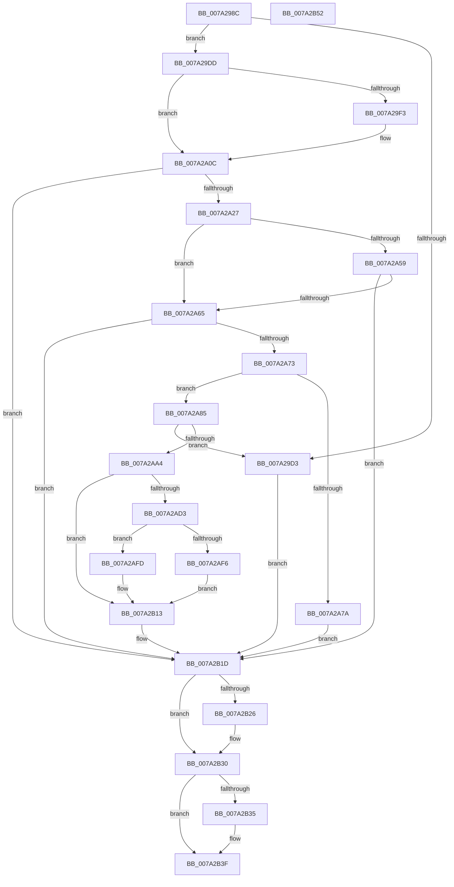

# SepRmFetchGlobalSacl

- RVA: `0x007A298C`–`0x007A2B53` (길이 `455` bytes)
- VA: `0x00000001407A298C`
- 실행 섹션: `PAGE`
- PDB 이름 있음: `예`; PDB Function 태그: `아니요`
- unwind 정보 RVA: `0x000D161C`
- 디코드: `128`개 명령, `455/455` bytes 표시
- 미해석 바이트: `0` (있으면 어셈블리에 `.byte`로 보존)

> 이 문서는 커널 이미지의 기계어와 PDB 기호를 분석해 생성했습니다. 4번과 5번은 함수 원형과 자료형을 바이너리 사용 방식에서 추정한 C 해석이며 원본 소스 복구 결과는 아닙니다.

## 1. Dependencies

- 직접 호출 지점: **12**; 고유 호출 대상: **8**
- 직접 호출자로 확인된 함수: **1**
- RIP 상대 이미지 참조: **2**

### Outgoing calls
- `0x007A29C6` → [ExAllocatePool2](../../poolcode/B8/ExAllocatePool2_function_00B820F0.md) (function, `0x00B820F0`)
- `0x007A29EA` → [RtlStringCbCopyW](../../text/43/RtlStringCbCopyW_function_0043B910.md) (function, `0x0043B910`)
- `0x007A2A07` → [RtlStringCchCatNW](../../text/60/RtlStringCchCatNW_function_00609E78.md) (function, `0x00609E78`)
- `0x007A2A18` → [SepRegOpenKey](../A3/SepRegOpenKey_function_00A3A6B4.md) (function, `0x00A3A6B4`)
- `0x007A2A47` → [ZwQueryValueKey](../../text/6A/ZwQueryValueKey_function_006AD3B0.md) (function, `0x006AD3B0`)
- `0x007A2A93` → [ExAllocatePool2](../../poolcode/B8/ExAllocatePool2_function_00B820F0.md) (function, `0x00B820F0`)
- `0x007A2AC8` → [ZwQueryValueKey](../../text/6A/ZwQueryValueKey_function_006AD3B0.md) (function, `0x006AD3B0`)
- `0x007A2AE9` → [ExAllocatePool2](../../poolcode/B8/ExAllocatePool2_function_00B820F0.md) (function, `0x00B820F0`)
- `0x007A2B08` → [memcpy](../../text/6C/memcpy_function_006C6840.md) (function, `0x006C6840`)
- `0x007A2B18` → [ExFreePoolWithTag](../../poolcode/B8/ExFreePoolWithTag_function_00B82870.md) (function, `0x00B82870`)
- `0x007A2B26` → [ZwClose](../../text/6A/ZwClose_function_006AD2B0.md) (function, `0x006AD2B0`)
- `0x007A2B3A` → [ExFreePoolWithTag](../../poolcode/B8/ExFreePoolWithTag_function_00B82870.md) (function, `0x00B82870`)

### Direct callers
- [SepRmGlobalSaclSetWrkr](SepRmGlobalSaclSetWrkr_function_007A2B60.md) at `0x007A2BB4`

### Static image references
- `0x007A29DD` → RVA `0x00037BE0` (`.rdata`; read)
- `0x007A2A3C` → RVA `0x00E08978` (`.data`; read)

## 2. Other-region calls and transfers

- 다른 실행 섹션으로 향하는 call: **11**
  - `0x007A29C6` → [ExAllocatePool2](../../poolcode/B8/ExAllocatePool2_function_00B820F0.md) (`PAGE` → `POOLCODE`)
  - `0x007A29EA` → [RtlStringCbCopyW](../../text/43/RtlStringCbCopyW_function_0043B910.md) (`PAGE` → `.text`)
  - `0x007A2A07` → [RtlStringCchCatNW](../../text/60/RtlStringCchCatNW_function_00609E78.md) (`PAGE` → `.text`)
  - `0x007A2A47` → [ZwQueryValueKey](../../text/6A/ZwQueryValueKey_function_006AD3B0.md) (`PAGE` → `.text`)
  - `0x007A2A93` → [ExAllocatePool2](../../poolcode/B8/ExAllocatePool2_function_00B820F0.md) (`PAGE` → `POOLCODE`)
  - `0x007A2AC8` → [ZwQueryValueKey](../../text/6A/ZwQueryValueKey_function_006AD3B0.md) (`PAGE` → `.text`)
  - `0x007A2AE9` → [ExAllocatePool2](../../poolcode/B8/ExAllocatePool2_function_00B820F0.md) (`PAGE` → `POOLCODE`)
  - `0x007A2B08` → [memcpy](../../text/6C/memcpy_function_006C6840.md) (`PAGE` → `.text`)
  - `0x007A2B18` → [ExFreePoolWithTag](../../poolcode/B8/ExFreePoolWithTag_function_00B82870.md) (`PAGE` → `POOLCODE`)
  - `0x007A2B26` → [ZwClose](../../text/6A/ZwClose_function_006AD2B0.md) (`PAGE` → `.text`)
  - `0x007A2B3A` → [ExFreePoolWithTag](../../poolcode/B8/ExFreePoolWithTag_function_00B82870.md) (`PAGE` → `POOLCODE`)
- 별도 외부 분기/꼬리 이동을 확인하지 못했습니다.

## 3. Assembly (complete function range)

```asm
007A298C  48 89 5C 24 10                  mov qword ptr [rsp + 0x10], rbx
007A2991  55                              push rbp
007A2992  56                              push rsi
007A2993  57                              push rdi
007A2994  41 56                           push r14
007A2996  41 57                           push r15
007A2998  48 8B EC                        mov rbp, rsp
007A299B  48 83 EC 30                     sub rsp, 0x30
007A299F  0F B7 19                        movzx ebx, word ptr [rcx]
007A29A2  4D 8B F8                        mov r15, r8
007A29A5  48 83 65 48 00                  and qword ptr [rbp + 0x48], 0
007A29AA  4C 8B F2                        mov r14, rdx
007A29AD  83 65 30 00                     and dword ptr [rbp + 0x30], 0
007A29B1  48 8B F1                        mov rsi, rcx
007A29B4  48 83 C3 62                     add rbx, 0x62
007A29B8  41 B8 47 53 63 6C               mov r8d, 0x6c635347
007A29BE  48 8B D3                        mov rdx, rbx
007A29C1  B9 00 01 00 00                  mov ecx, 0x100
007A29C6  E8 25 F7 3D 00                  call 0x140b820f0
007A29CB  48 8B F8                        mov rdi, rax
007A29CE  48 85 C0                        test rax, rax
007A29D1  75 0A                           jne 0x1407a29dd
007A29D3  BB 17 00 00 C0                  mov ebx, 0xc0000017
007A29D8  E9 40 01 00 00                  jmp 0x1407a2b1d
007A29DD  4C 8D 05 FC 51 89 FF            lea r8, [rip - 0x76ae04]
007A29E4  48 8B D3                        mov rdx, rbx
007A29E7  48 8B CF                        mov rcx, rdi
007A29EA  E8 21 8F C9 FF                  call 0x14043b910
007A29EF  85 C0                           test eax, eax
007A29F1  78 19                           js 0x1407a2a0c
007A29F3  44 0F B7 0E                     movzx r9d, word ptr [rsi]
007A29F7  48 8B CF                        mov rcx, rdi
007A29FA  4C 8B 46 08                     mov r8, qword ptr [rsi + 8]
007A29FE  48 D1 EB                        shr rbx, 1
007A2A01  49 D1 E9                        shr r9, 1
007A2A04  48 8B D3                        mov rdx, rbx
007A2A07  E8 6C 74 E6 FF                  call 0x140609e78
007A2A0C  4C 8D 45 48                     lea r8, [rbp + 0x48]
007A2A10  BA 01 02 00 00                  mov edx, 0x201
007A2A15  48 8B CF                        mov rcx, rdi
007A2A18  E8 97 7C 29 00                  call 0x140a3a6b4
007A2A1D  8B D8                           mov ebx, eax
007A2A1F  85 C0                           test eax, eax
007A2A21  0F 88 F6 00 00 00               js 0x1407a2b1d
007A2A27  48 8B 4D 48                     mov rcx, qword ptr [rbp + 0x48]
007A2A2B  48 8D 45 30                     lea rax, [rbp + 0x30]
007A2A2F  45 33 C9                        xor r9d, r9d
007A2A32  48 89 44 24 28                  mov qword ptr [rsp + 0x28], rax
007A2A37  83 64 24 20 00                  and dword ptr [rsp + 0x20], 0
007A2A3C  48 8D 15 35 5F 66 00            lea rdx, [rip + 0x665f35]
007A2A43  45 8D 41 02                     lea r8d, [r9 + 2]
007A2A47  E8 64 A9 F0 FF                  call 0x1406ad3b0
007A2A4C  B9 00 00 00 80                  mov ecx, 0x80000000
007A2A51  8B D8                           mov ebx, eax
007A2A53  03 C1                           add eax, ecx
007A2A55  85 C1                           test ecx, eax
007A2A57  75 0C                           jne 0x1407a2a65
007A2A59  81 FB 23 00 00 C0               cmp ebx, 0xc0000023
007A2A5F  0F 85 B8 00 00 00               jne 0x1407a2b1d
007A2A65  8B 45 30                        mov eax, dword ptr [rbp + 0x30]
007A2A68  3D 0B 00 01 00                  cmp eax, 0x1000b
007A2A6D  0F 87 AA 00 00 00               ja 0x1407a2b1d
007A2A73  33 DB                           xor ebx, ebx
007A2A75  83 F8 0C                        cmp eax, 0xc
007A2A78  77 0B                           ja 0x1407a2a85
007A2A7A  41 21 1E                        and dword ptr [r14], ebx
007A2A7D  49 21 1F                        and qword ptr [r15], rbx
007A2A80  E9 98 00 00 00                  jmp 0x1407a2b1d
007A2A85  48 8B D0                        mov rdx, rax
007A2A88  B9 00 01 00 00                  mov ecx, 0x100
007A2A8D  41 B8 47 53 63 6C               mov r8d, 0x6c635347
007A2A93  E8 58 F6 3D 00                  call 0x140b820f0
007A2A98  48 8B F0                        mov rsi, rax
007A2A9B  48 85 C0                        test rax, rax
007A2A9E  0F 84 2F FF FF FF               je 0x1407a29d3
007A2AA4  48 8B 4D 48                     mov rcx, qword ptr [rbp + 0x48]
007A2AA8  48 8D 45 30                     lea rax, [rbp + 0x30]
007A2AAC  48 89 44 24 28                  mov qword ptr [rsp + 0x28], rax
007A2AB1  48 8D 15 C0 5E 66 00            lea rdx, [rip + 0x665ec0]
007A2AB8  8B 45 30                        mov eax, dword ptr [rbp + 0x30]
007A2ABB  4C 8B CE                        mov r9, rsi
007A2ABE  41 B8 02 00 00 00               mov r8d, 2
007A2AC4  89 44 24 20                     mov dword ptr [rsp + 0x20], eax
007A2AC8  E8 E3 A8 F0 FF                  call 0x1406ad3b0
007A2ACD  8B D8                           mov ebx, eax
007A2ACF  85 C0                           test eax, eax
007A2AD1  78 40                           js 0x1407a2b13
007A2AD3  8B 45 30                        mov eax, dword ptr [rbp + 0x30]
007A2AD6  B9 00 01 00 00                  mov ecx, 0x100
007A2ADB  83 C0 F4                        add eax, -0xc
007A2ADE  41 B8 47 53 63 6C               mov r8d, 0x6c635347
007A2AE4  8B D0                           mov edx, eax
007A2AE6  89 45 30                        mov dword ptr [rbp + 0x30], eax
007A2AE9  E8 02 F6 3D 00                  call 0x140b820f0
007A2AEE  49 89 07                        mov qword ptr [r15], rax
007A2AF1  48 85 C0                        test rax, rax
007A2AF4  75 07                           jne 0x1407a2afd
007A2AF6  BB 17 00 00 C0                  mov ebx, 0xc0000017
007A2AFB  EB 16                           jmp 0x1407a2b13
007A2AFD  44 8B 45 30                     mov r8d, dword ptr [rbp + 0x30]
007A2B01  48 8D 56 0C                     lea rdx, [rsi + 0xc]
007A2B05  48 8B C8                        mov rcx, rax
007A2B08  E8 33 3D F2 FF                  call 0x1406c6840
007A2B0D  8B 45 30                        mov eax, dword ptr [rbp + 0x30]
007A2B10  41 89 06                        mov dword ptr [r14], eax
007A2B13  33 D2                           xor edx, edx
007A2B15  48 8B CE                        mov rcx, rsi
007A2B18  E8 53 FD 3D 00                  call 0x140b82870
007A2B1D  48 8B 4D 48                     mov rcx, qword ptr [rbp + 0x48]
007A2B21  48 85 C9                        test rcx, rcx
007A2B24  74 0A                           je 0x1407a2b30
007A2B26  E8 85 A7 F0 FF                  call 0x1406ad2b0
007A2B2B  48 83 65 48 00                  and qword ptr [rbp + 0x48], 0
007A2B30  48 85 FF                        test rdi, rdi
007A2B33  74 0A                           je 0x1407a2b3f
007A2B35  33 D2                           xor edx, edx
007A2B37  48 8B CF                        mov rcx, rdi
007A2B3A  E8 31 FD 3D 00                  call 0x140b82870
007A2B3F  8B C3                           mov eax, ebx
007A2B41  48 8B 5C 24 68                  mov rbx, qword ptr [rsp + 0x68]
007A2B46  48 83 C4 30                     add rsp, 0x30
007A2B4A  41 5F                           pop r15
007A2B4C  41 5E                           pop r14
007A2B4E  5F                              pop rdi
007A2B4F  5E                              pop rsi
007A2B50  5D                              pop rbp
007A2B51  C3                              ret
007A2B52  CC                              int3
```

## 4. C-style interpretation (structured pseudocode)

```c
__int64 __fastcall SepRmFetchGlobalSacl(__int64 a1, __int64 a2, __int64 a3)
{
    __int64 result;
    __int64 v_rbx;
    __int64 v_rsp;
    unsigned __int64 v_stack_m30;
    unsigned int v_stack_m38;
    unsigned __int64 v_stack_p10;
    unsigned __int64 v_stack_p20;
    unsigned int v_stack_p8;

    v_stack_p10 = v_rbx;
    v_rsp = (v_rsp) - (48);
    v_rbx = (*(unsigned __int16 *)(a1)) + (98);
    result = ExAllocatePool2(256, v_rbx, (unsigned int)(0x6C635347ULL), a4);
    if (result != 0) goto loc_007A29DD;
loc_007A29D3:
    goto loc_007A2B1D;
loc_007A29DD:
    result = RtlStringCbCopyW(result, (unsigned int)(0xC0000017ULL), v_rip - 7777796, a4);
    v_rbx = (unsigned int)(0xC0000017ULL);
    if (!(sign_flag)) {
        a4 = *(unsigned __int16 *)(a1);
        a1 = result;
        a3 = *(unsigned __int64 *)(a1 + 8);
        v_rbx = ((unsigned int)(0xC0000017ULL)) >> (1);
        a4 = (a4) >> (1);
        a2 = v_rbx;
        result = RtlStringCchCatNW(a1, a2, a3, a4);
    }
    result = SepRegOpenKey(result, 513, v_stack_p20, a4);
    if (sign_flag) goto loc_007A2B1D;
    a4 = 0;
    v_stack_m30 = v_stack_p8;
    result = ZwQueryValueKey(v_stack_p20, v_rip + 6709045, a4 + 2, a4);
    result = (unsigned int)((result) + ((unsigned int)((unsigned int)(0x80000000ULL))));
    if ((((unsigned int)((unsigned int)(0x80000000ULL))) & ((unsigned int)(result))) != 0) goto loc_007A2A65;
    if (((unsigned int)((unsigned int)((unsigned int)(result)))) != 0xC0000023ULL) goto loc_007A2B1D;
loc_007A2A65:
    if (((unsigned int)((unsigned int)(v_stack_p8))) > 0x1000BULL) goto loc_007A2B1D;
    v_rbx = 0;
    if (((unsigned int)((unsigned int)(v_stack_p8))) > 12) goto loc_007A2A85;
    goto loc_007A2B1D;
loc_007A2A85:
    result = ExAllocatePool2(256, (unsigned int)(v_stack_p8), (unsigned int)(0x6C635347ULL), a4);
    if (result == 0) goto loc_007A29D3;
    v_stack_m30 = v_stack_p8;
    v_stack_m38 = (unsigned int)((unsigned int)(v_stack_p8));
    result = ZwQueryValueKey(v_stack_p20, v_rip + 6708928, 2, result);
    if (sign_flag) goto loc_007A2B13;
    result = (unsigned int)(((unsigned int)(v_stack_p8)) + (-12));
    v_stack_p8 = (unsigned int)(result);
    result = ExAllocatePool2(256, (unsigned int)((unsigned int)(result)), (unsigned int)(0x6C635347ULL), result);
    *(unsigned __int64 *)(a3) = result;
    if (result != 0) goto loc_007A2AFD;
    goto loc_007A2B13;
loc_007A2AFD:
    result = memcpy(result, result + 12, (unsigned int)(v_stack_p8), result);
    *(unsigned int *)(a2) = (unsigned int)((unsigned int)(v_stack_p8));
loc_007A2B13:
    a2 = 0;
    result = ExFreePoolWithTag(result, a2, (unsigned int)(v_stack_p8), result);
loc_007A2B1D:
    if (v_stack_p20 != 0) {
        result = ZwClose(v_stack_p20, a2, (unsigned int)(v_stack_p8), result);
    }
    if (result != 0) {
        a2 = 0;
        a1 = result;
        result = ExFreePoolWithTag(a1, a2, (unsigned int)(v_stack_p8), result);
    }
    v_rsp = (v_rsp) + (48);
    return (unsigned int)((unsigned int)((unsigned int)(0xC0000017ULL)));
}
```

## 5. (Beta) C Style

```c
int64_t SepRmFetchGlobalSacl(void *Arg1, void *Arg2, void *Arg3)
{
    uint8_t *arg1 = (uint8_t *)Arg1;
    uint8_t *arg2 = (uint8_t *)Arg2;
    uint8_t *arg3 = (uint8_t *)Arg3;

    int64_t result;
    int64_t local_rbx;
    int64_t local_rsp;
    uint64_t v_stack_m30;
    uint32_t v_stack_m38;
    uint64_t v_stack_p10;
    uint64_t v_stack_p20;
    uint32_t v_stack_p8;

    v_stack_p10 = local_rbx;
    local_rsp = (local_rsp) - (48);
    local_rbx = (*(uint16_t *)(arg1)) + (98);
    result = ExAllocatePool2(256, local_rbx, (uint32_t)(0x6C635347ULL), a4);
    if (result != 0) goto loc_007A29DD;
loc_007A29D3:
    goto loc_007A2B1D;
loc_007A29DD:
    result = RtlStringCbCopyW(result, (uint32_t)(0xC0000017ULL), v_rip - 7777796, a4);
    local_rbx = (uint32_t)(0xC0000017ULL);
    if (!(sign_flag)) {
        a4 = *(uint16_t *)(arg1);
        Arg1 = result;
        Arg3 = *(uint64_t *)(arg1 + 0x8);
        local_rbx = ((uint32_t)(0xC0000017ULL)) >> (1);
        a4 = (a4) >> (1);
        Arg2 = local_rbx;
        result = RtlStringCchCatNW(Arg1, Arg2, Arg3, a4);
    }
    result = SepRegOpenKey(result, 513, v_stack_p20, a4);
    if (sign_flag) goto loc_007A2B1D;
    a4 = 0;
    v_stack_m30 = v_stack_p8;
    result = ZwQueryValueKey(v_stack_p20, v_rip + 6709045, a4 + 2, a4);
    result = (uint32_t)((result) + ((uint32_t)((uint32_t)(0x80000000ULL))));
    if ((((uint32_t)((uint32_t)(0x80000000ULL))) & ((uint32_t)(result))) != 0) goto loc_007A2A65;
    if (((uint32_t)((uint32_t)((uint32_t)(result)))) != 0xC0000023ULL) goto loc_007A2B1D;
loc_007A2A65:
    if (((uint32_t)((uint32_t)(v_stack_p8))) > 0x1000BULL) goto loc_007A2B1D;
    local_rbx = 0;
    if (((uint32_t)((uint32_t)(v_stack_p8))) > 12) goto loc_007A2A85;
    goto loc_007A2B1D;
loc_007A2A85:
    result = ExAllocatePool2(256, (uint32_t)(v_stack_p8), (uint32_t)(0x6C635347ULL), a4);
    if (result == 0) goto loc_007A29D3;
    v_stack_m30 = v_stack_p8;
    v_stack_m38 = (uint32_t)((uint32_t)(v_stack_p8));
    result = ZwQueryValueKey(v_stack_p20, v_rip + 6708928, 2, result);
    if (sign_flag) goto loc_007A2B13;
    result = (uint32_t)(((uint32_t)(v_stack_p8)) + (-12));
    v_stack_p8 = (uint32_t)(result);
    result = ExAllocatePool2(256, (uint32_t)((uint32_t)(result)), (uint32_t)(0x6C635347ULL), result);
    *(uint64_t *)(arg3) = result;
    if (result != 0) goto loc_007A2AFD;
    goto loc_007A2B13;
loc_007A2AFD:
    result = memcpy(result, result + 12, (uint32_t)(v_stack_p8), result);
    *(uint32_t *)(arg2) = (uint32_t)((uint32_t)(v_stack_p8));
loc_007A2B13:
    Arg2 = 0;
    result = ExFreePoolWithTag(result, Arg2, (uint32_t)(v_stack_p8), result);
loc_007A2B1D:
    if (v_stack_p20 != 0) {
        result = ZwClose(v_stack_p20, Arg2, (uint32_t)(v_stack_p8), result);
    }
    if (result != 0) {
        Arg2 = 0;
        Arg1 = result;
        result = ExFreePoolWithTag(Arg1, Arg2, (uint32_t)(v_stack_p8), result);
    }
    local_rsp = (local_rsp) + (48);
    return (uint32_t)((uint32_t)((uint32_t)(0xC0000017ULL)));
}
```

### 관측된 메모리 오프셋

구조체 형식이 확인되지 않은 접근은 인자 기준의 오프셋으로만 기록했습니다.

| 기준 인자 | 오프셋 표현 | 폭 (bit) | 접근 |
|---|---:|---:|---|
| `Arg1` | `+ 0x0` | `16` | `R` |
| `Arg1` | `+ 0x8` | `64` | `R` |
| `Arg2` | `+ 0x0` | `32` | `R/W` |
| `Arg2` | `+ 0x0` | `32` | `W` |
| `Arg3` | `+ 0x0` | `64` | `R/W` |
| `Arg3` | `+ 0x0` | `64` | `W` |

## 6. Execution-region graph

[열기: 2D/3D 그래프와 함수 탐색 컨트롤 패널](../../../control-panel.html?section=page&rva=0x007A298C&view=graph)

- 2D 그래프는 위에서 아래로 흐르고, 3D 그래프는 빈 공간을 드래그해 회전합니다. Shift+드래그는 이동, 휠은 확대·축소, 함수 노드 선택은 대상 보고서 이동입니다.

### Static fallback


