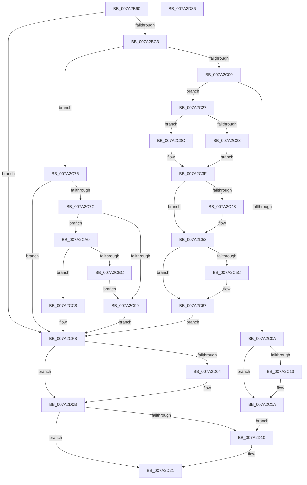

# SepRmGlobalSaclSetWrkr

- RVA: `0x007A2B60`–`0x007A2D37` (길이 `471` bytes)
- VA: `0x00000001407A2B60`
- 실행 섹션: `PAGE`
- PDB 이름 있음: `예`; PDB Function 태그: `아니요`
- unwind 정보 RVA: `0x000D1634`
- 디코드: `136`개 명령, `471/471` bytes 표시
- 미해석 바이트: `0` (있으면 어셈블리에 `.byte`로 보존)

> 이 문서는 커널 이미지의 기계어와 PDB 기호를 분석해 생성했습니다. 4번과 5번은 함수 원형과 자료형을 바이너리 사용 방식에서 추정한 C 해석이며 원본 소스 복구 결과는 아닙니다.

## 1. Dependencies

- 직접 호출 지점: **14**; 고유 호출 대상: **8**
- 직접 호출자로 확인된 함수: **0**
- RIP 상대 이미지 참조: **3**

### Outgoing calls
- `0x007A2BB4` → [SepRmFetchGlobalSacl](SepRmFetchGlobalSacl_function_007A298C.md) (function, `0x007A298C`)
- `0x007A2BE1` → [ExAcquireResourceExclusiveLite](../../text/21/ExAcquireResourceExclusiveLite_function_00214E20.md) (function, `0x00214E20`)
- `0x007A2BF5` → [SepRmGlobalSaclFind](../97/SepRmGlobalSaclFind_function_00973DD4.md) (function, `0x00973DD4`)
- `0x007A2C15` → [ExFreePoolWithTag](../../poolcode/B8/ExFreePoolWithTag_function_00B82870.md) (function, `0x00B82870`)
- `0x007A2C4A` → [ExFreePoolWithTag](../../poolcode/B8/ExFreePoolWithTag_function_00B82870.md) (function, `0x00B82870`)
- `0x007A2C5E` → [ExFreePoolWithTag](../../poolcode/B8/ExFreePoolWithTag_function_00B82870.md) (function, `0x00B82870`)
- `0x007A2C6C` → [ExFreePoolWithTag](../../poolcode/B8/ExFreePoolWithTag_function_00B82870.md) (function, `0x00B82870`)
- `0x007A2C8C` → [ExAllocatePool2](../../poolcode/B8/ExAllocatePool2_function_00B820F0.md) (function, `0x00B820F0`)
- `0x007A2CAE` → [ExAllocatePool2](../../poolcode/B8/ExAllocatePool2_function_00B820F0.md) (function, `0x00B820F0`)
- `0x007A2CC1` → [ExFreePoolWithTag](../../poolcode/B8/ExFreePoolWithTag_function_00B82870.md) (function, `0x00B82870`)
- `0x007A2CD9` → [memcpy](../../text/6C/memcpy_function_006C6840.md) (function, `0x006C6840`)
- `0x007A2D06` → [ExFreePoolWithTag](../../poolcode/B8/ExFreePoolWithTag_function_00B82870.md) (function, `0x00B82870`)
- `0x007A2D17` → [ExReleaseResourceLite](../../text/25/ExReleaseResourceLite_function_0025FA10.md) (function, `0x0025FA10`)
- `0x007A2D1C` → [KeLeaveCriticalRegion](../../text/25/KeLeaveCriticalRegion_function_0025D8B0.md) (function, `0x0025D8B0`)

### Direct callers
- 이 함수 시작 RVA로 연결되는 직접 call은 확인되지 않았습니다. 간접 호출은 완전히 역산할 수 없습니다.

### Static image references
- `0x007A2BCC` → RVA `0x00E68100` (`.data`; read)
- `0x007A2C33` → RVA `0x00E680F8` (`.data`; write)
- `0x007A2CE6` → RVA `0x00E680F8` (`.data`; read)

## 2. Other-region calls and transfers

- 다른 실행 섹션으로 향하는 call: **12**
  - `0x007A2BE1` → [ExAcquireResourceExclusiveLite](../../text/21/ExAcquireResourceExclusiveLite_function_00214E20.md) (`PAGE` → `.text`)
  - `0x007A2C15` → [ExFreePoolWithTag](../../poolcode/B8/ExFreePoolWithTag_function_00B82870.md) (`PAGE` → `POOLCODE`)
  - `0x007A2C4A` → [ExFreePoolWithTag](../../poolcode/B8/ExFreePoolWithTag_function_00B82870.md) (`PAGE` → `POOLCODE`)
  - `0x007A2C5E` → [ExFreePoolWithTag](../../poolcode/B8/ExFreePoolWithTag_function_00B82870.md) (`PAGE` → `POOLCODE`)
  - `0x007A2C6C` → [ExFreePoolWithTag](../../poolcode/B8/ExFreePoolWithTag_function_00B82870.md) (`PAGE` → `POOLCODE`)
  - `0x007A2C8C` → [ExAllocatePool2](../../poolcode/B8/ExAllocatePool2_function_00B820F0.md) (`PAGE` → `POOLCODE`)
  - `0x007A2CAE` → [ExAllocatePool2](../../poolcode/B8/ExAllocatePool2_function_00B820F0.md) (`PAGE` → `POOLCODE`)
  - `0x007A2CC1` → [ExFreePoolWithTag](../../poolcode/B8/ExFreePoolWithTag_function_00B82870.md) (`PAGE` → `POOLCODE`)
  - `0x007A2CD9` → [memcpy](../../text/6C/memcpy_function_006C6840.md) (`PAGE` → `.text`)
  - `0x007A2D06` → [ExFreePoolWithTag](../../poolcode/B8/ExFreePoolWithTag_function_00B82870.md) (`PAGE` → `POOLCODE`)
  - `0x007A2D17` → [ExReleaseResourceLite](../../text/25/ExReleaseResourceLite_function_0025FA10.md) (`PAGE` → `.text`)
  - `0x007A2D1C` → [KeLeaveCriticalRegion](../../text/25/KeLeaveCriticalRegion_function_0025D8B0.md) (`PAGE` → `.text`)
- 별도 외부 분기/꼬리 이동을 확인하지 못했습니다.

## 3. Assembly (complete function range)

```asm
007A2B60  40 55                           push rbp
007A2B62  53                              push rbx
007A2B63  56                              push rsi
007A2B64  57                              push rdi
007A2B65  41 54                           push r12
007A2B67  41 55                           push r13
007A2B69  41 56                           push r14
007A2B6B  41 57                           push r15
007A2B6D  48 8B EC                        mov rbp, rsp
007A2B70  48 83 EC 38                     sub rsp, 0x38
007A2B74  0F B7 71 2C                     movzx esi, word ptr [rcx + 0x2c]
007A2B78  4C 8D 61 2E                     lea r12, [rcx + 0x2e]
007A2B7C  45 33 F6                        xor r14d, r14d
007A2B7F  4C 8D 45 50                     lea r8, [rbp + 0x50]
007A2B83  0F 57 C0                        xorps xmm0, xmm0
007A2B86  4C 89 75 58                     mov qword ptr [rbp + 0x58], r14
007A2B8A  0F 11 45 E8                     movups xmmword ptr [rbp - 0x18], xmm0
007A2B8E  4C 8B EA                        mov r13, rdx
007A2B91  66 89 75 EA                     mov word ptr [rbp - 0x16], si
007A2B95  48 8D 55 48                     lea rdx, [rbp + 0x48]
007A2B99  66 89 75 E8                     mov word ptr [rbp - 0x18], si
007A2B9D  48 8D 4D E8                     lea rcx, [rbp - 0x18]
007A2BA1  4C 89 65 F0                     mov qword ptr [rbp - 0x10], r12
007A2BA5  4C 89 75 60                     mov qword ptr [rbp + 0x60], r14
007A2BA9  45 8A FE                        mov r15b, r14b
007A2BAC  44 89 75 48                     mov dword ptr [rbp + 0x48], r14d
007A2BB0  4C 89 75 50                     mov qword ptr [rbp + 0x50], r14
007A2BB4  E8 D3 FD FF FF                  call 0x1407a298c
007A2BB9  8B F8                           mov edi, eax
007A2BBB  85 C0                           test eax, eax
007A2BBD  0F 88 38 01 00 00               js 0x1407a2cfb
007A2BC3  65 48 8B 04 25 88 01 00 00      mov rax, qword ptr gs:[0x188]
007A2BCC  48 8D 0D 2D 55 6C 00            lea rcx, [rip + 0x6c552d]
007A2BD3  41 B7 01                        mov r15b, 1
007A2BD6  41 8A D7                        mov dl, r15b
007A2BD9  66 FF 88 E4 01 00 00            dec word ptr [rax + 0x1e4]
007A2BE0  90                              nop
007A2BE1  E8 3A 22 A7 FF                  call 0x140214e20
007A2BE6  45 33 C9                        xor r9d, r9d
007A2BE9  4C 8D 45 E8                     lea r8, [rbp - 0x18]
007A2BED  48 8D 55 60                     lea rdx, [rbp + 0x60]
007A2BF1  48 8D 4D 58                     lea rcx, [rbp + 0x58]
007A2BF5  E8 DA 11 1D 00                  call 0x140973dd4
007A2BFA  8B F8                           mov edi, eax
007A2BFC  85 C0                           test eax, eax
007A2BFE  78 76                           js 0x1407a2c76
007A2C00  48 8B 5D 58                     mov rbx, qword ptr [rbp + 0x58]
007A2C04  44 39 75 48                     cmp dword ptr [rbp + 0x48], r14d
007A2C08  74 1D                           je 0x1407a2c27
007A2C0A  48 8B 4B 18                     mov rcx, qword ptr [rbx + 0x18]
007A2C0E  48 85 C9                        test rcx, rcx
007A2C11  74 07                           je 0x1407a2c1a
007A2C13  33 D2                           xor edx, edx
007A2C15  E8 56 FC 3D 00                  call 0x140b82870
007A2C1A  48 8B 45 50                     mov rax, qword ptr [rbp + 0x50]
007A2C1E  48 89 43 18                     mov qword ptr [rbx + 0x18], rax
007A2C22  E9 E9 00 00 00                  jmp 0x1407a2d10
007A2C27  48 8B 4D 60                     mov rcx, qword ptr [rbp + 0x60]
007A2C2B  48 8B 03                        mov rax, qword ptr [rbx]
007A2C2E  48 85 C9                        test rcx, rcx
007A2C31  75 09                           jne 0x1407a2c3c
007A2C33  48 89 05 BE 54 6C 00            mov qword ptr [rip + 0x6c54be], rax
007A2C3A  EB 03                           jmp 0x1407a2c3f
007A2C3C  48 89 01                        mov qword ptr [rcx], rax
007A2C3F  48 8B 4B 10                     mov rcx, qword ptr [rbx + 0x10]
007A2C43  48 85 C9                        test rcx, rcx
007A2C46  74 0B                           je 0x1407a2c53
007A2C48  33 D2                           xor edx, edx
007A2C4A  E8 21 FC 3D 00                  call 0x140b82870
007A2C4F  4C 89 73 10                     mov qword ptr [rbx + 0x10], r14
007A2C53  48 8B 4B 18                     mov rcx, qword ptr [rbx + 0x18]
007A2C57  48 85 C9                        test rcx, rcx
007A2C5A  74 0B                           je 0x1407a2c67
007A2C5C  33 D2                           xor edx, edx
007A2C5E  E8 0D FC 3D 00                  call 0x140b82870
007A2C63  4C 89 73 18                     mov qword ptr [rbx + 0x18], r14
007A2C67  33 D2                           xor edx, edx
007A2C69  48 8B CB                        mov rcx, rbx
007A2C6C  E8 FF FB 3D 00                  call 0x140b82870
007A2C71  E9 85 00 00 00                  jmp 0x1407a2cfb
007A2C76  44 39 75 48                     cmp dword ptr [rbp + 0x48], r14d
007A2C7A  74 7F                           je 0x1407a2cfb
007A2C7C  BA 20 00 00 00                  mov edx, 0x20
007A2C81  B9 00 01 00 00                  mov ecx, 0x100
007A2C86  41 B8 47 53 63 6C               mov r8d, 0x6c635347
007A2C8C  E8 5F F4 3D 00                  call 0x140b820f0
007A2C91  48 8B D8                        mov rbx, rax
007A2C94  48 85 C0                        test rax, rax
007A2C97  75 07                           jne 0x1407a2ca0
007A2C99  BF 17 00 00 C0                  mov edi, 0xc0000017
007A2C9E  EB 5B                           jmp 0x1407a2cfb
007A2CA0  41 B8 47 53 63 6C               mov r8d, 0x6c635347
007A2CA6  48 8B D6                        mov rdx, rsi
007A2CA9  B9 00 01 00 00                  mov ecx, 0x100
007A2CAE  E8 3D F4 3D 00                  call 0x140b820f0
007A2CB3  48 89 43 10                     mov qword ptr [rbx + 0x10], rax
007A2CB7  48 85 C0                        test rax, rax
007A2CBA  75 0C                           jne 0x1407a2cc8
007A2CBC  33 D2                           xor edx, edx
007A2CBE  48 8B CB                        mov rcx, rbx
007A2CC1  E8 AA FB 3D 00                  call 0x140b82870
007A2CC6  EB D1                           jmp 0x1407a2c99
007A2CC8  4C 8B C6                        mov r8, rsi
007A2CCB  66 89 73 0A                     mov word ptr [rbx + 0xa], si
007A2CCF  49 8B D4                        mov rdx, r12
007A2CD2  66 89 73 08                     mov word ptr [rbx + 8], si
007A2CD6  48 8B C8                        mov rcx, rax
007A2CD9  E8 62 3B F2 FF                  call 0x1406c6840
007A2CDE  48 8B 45 50                     mov rax, qword ptr [rbp + 0x50]
007A2CE2  48 89 43 18                     mov qword ptr [rbx + 0x18], rax
007A2CE6  48 8B 05 0B 54 6C 00            mov rax, qword ptr [rip + 0x6c540b]
007A2CED  48 89 03                        mov qword ptr [rbx], rax
007A2CF0  4C 89 75 50                     mov qword ptr [rbp + 0x50], r14
007A2CF4  48 89 1D FD 53 6C 00            mov qword ptr [rip + 0x6c53fd], rbx
007A2CFB  48 8B 4D 50                     mov rcx, qword ptr [rbp + 0x50]
007A2CFF  48 85 C9                        test rcx, rcx
007A2D02  74 07                           je 0x1407a2d0b
007A2D04  33 D2                           xor edx, edx
007A2D06  E8 65 FB 3D 00                  call 0x140b82870
007A2D0B  45 84 FF                        test r15b, r15b
007A2D0E  74 11                           je 0x1407a2d21
007A2D10  48 8D 0D E9 53 6C 00            lea rcx, [rip + 0x6c53e9]
007A2D17  E8 F4 CC AB FF                  call 0x14025fa10
007A2D1C  E8 8F AB AB FF                  call 0x14025d8b0
007A2D21  41 89 7D 28                     mov dword ptr [r13 + 0x28], edi
007A2D25  48 83 C4 38                     add rsp, 0x38
007A2D29  41 5F                           pop r15
007A2D2B  41 5E                           pop r14
007A2D2D  41 5D                           pop r13
007A2D2F  41 5C                           pop r12
007A2D31  5F                              pop rdi
007A2D32  5E                              pop rsi
007A2D33  5B                              pop rbx
007A2D34  5D                              pop rbp
007A2D35  C3                              ret
007A2D36  CC                              int3
```

## 4. C-style interpretation (structured pseudocode)

```c
__int64 __fastcall SepRmGlobalSaclSetWrkr(__int64 a1, __int64 a2, __int64 a3, int a4)
{
    __int64 result;
    __int64 v_r14;
    __int64 v_rsp;
    unsigned __int64 v_stack_m50;
    unsigned __int16 v_stack_m56;
    unsigned __int64 v_stack_m58;
    unsigned __int64 v_stack_p10;
    unsigned __int64 v_stack_p18;
    unsigned __int64 v_stack_p20;
    unsigned __int64 v_stack_p8;

    v_rsp = (v_rsp) - (56);
    v_r14 = 0;
    v_stack_p18 = 0;
    v_stack_m58 = v_xmm0;
    v_stack_m56 = (unsigned __int16)(*(unsigned __int16 *)(a1 + 44));
    v_stack_m58 = (unsigned __int16)(*(unsigned __int16 *)(a1 + 44));
    v_stack_m50 = a1 + 46;
    v_stack_p20 = 0;
    v_stack_p8 = 0;
    v_stack_p10 = 0;
    result = SepRmFetchGlobalSacl(v_stack_m58, v_stack_p8, v_stack_p10, a4);
    if (sign_flag) goto loc_007A2CFB;
    result = ExAcquireResourceExclusiveLite(v_rip + 7099693, 1, v_stack_p10, a4);
    a4 = 0;
    result = SepRmGlobalSaclFind(v_stack_p18, v_stack_p20, v_stack_m58, a4);
    if (sign_flag) goto loc_007A2C76;
    if (v_stack_p8 == 0) goto loc_007A2C27;
    if (*(unsigned __int64 *)(v_stack_p18 + 24) != 0) {
        a2 = 0;
        result = ExFreePoolWithTag(*(unsigned __int64 *)(v_stack_p18 + 24), a2, v_stack_m58, a4);
    }
    *(unsigned __int64 *)(v_stack_p18 + 24) = v_stack_p10;
    goto loc_007A2D10;
loc_007A2C27:
    if (v_stack_p20 != 0) goto loc_007A2C3C;
    *(unsigned __int64 *)(v_rip + 7099582) = *(unsigned __int64 *)(v_stack_p18);
    goto loc_007A2C3F;
loc_007A2C3C:
    *(unsigned __int64 *)(v_stack_p20) = *(unsigned __int64 *)(v_stack_p18);
loc_007A2C3F:
    result = *(unsigned __int64 *)(v_stack_p18);
    if (*(unsigned __int64 *)(v_stack_p18 + 16) != 0) {
        a2 = 0;
        result = ExFreePoolWithTag(*(unsigned __int64 *)(v_stack_p18 + 16), a2, v_stack_m58, a4);
        *(unsigned __int64 *)(v_stack_p18 + 16) = 0;
    }
    if (*(unsigned __int64 *)(v_stack_p18 + 24) != 0) {
        a2 = 0;
        result = ExFreePoolWithTag(*(unsigned __int64 *)(v_stack_p18 + 24), a2, v_stack_m58, a4);
        *(unsigned __int64 *)(v_stack_p18 + 24) = 0;
    }
    a2 = 0;
    result = ExFreePoolWithTag(v_stack_p18, a2, v_stack_m58, a4);
    goto loc_007A2CFB;
loc_007A2C76:
    if (v_stack_p8 == 0) goto loc_007A2CFB;
    result = ExAllocatePool2(256, 32, (unsigned int)(0x6C635347ULL), a4);
    if (result != 0) goto loc_007A2CA0;
loc_007A2C99:
    goto loc_007A2CFB;
loc_007A2CA0:
    result = ExAllocatePool2(256, *(unsigned __int16 *)(a1 + 44), (unsigned int)(0x6C635347ULL), a4);
    *(unsigned __int64 *)(result + 16) = result;
    if (result != 0) goto loc_007A2CC8;
    a2 = 0;
    result = ExFreePoolWithTag(result, a2, (unsigned int)(0x6C635347ULL), a4);
    goto loc_007A2C99;
loc_007A2CC8:
    *(unsigned __int16 *)(result + 10) = (unsigned __int16)(*(unsigned __int16 *)(a1 + 44));
    *(unsigned __int16 *)(result + 8) = (unsigned __int16)(*(unsigned __int16 *)(a1 + 44));
    result = memcpy(result, a1 + 46, *(unsigned __int16 *)(a1 + 44), a4);
    *(unsigned __int64 *)(result + 24) = v_stack_p10;
    *(unsigned __int64 *)(result) = *(unsigned __int64 *)(v_rip + 7099403);
    v_stack_p10 = 0;
    *(unsigned __int64 *)(v_rip + 7099389) = result;
loc_007A2CFB:
    result = *(unsigned __int64 *)(v_rip + 7099403);
    if (v_stack_p10 != 0) {
        a2 = 0;
        result = ExFreePoolWithTag(v_stack_p10, a2, *(unsigned __int16 *)(a1 + 44), a4);
    }
    if (1 != 0) {
        a1 = v_rip + 7099369;
        result = ExReleaseResourceLite(a1, a2, *(unsigned __int16 *)(a1 + 44), a4);
        result = KeLeaveCriticalRegion(a1, a2, *(unsigned __int16 *)(a1 + 44), a4);
    }
    *(unsigned int *)(a2 + 40) = (unsigned int)((unsigned int)(0xC0000017ULL));
    v_rsp = (v_rsp) + (56);
    return result;
}
```

## 5. (Beta) C Style

```c
int64_t SepRmGlobalSaclSetWrkr(void *Arg1, void *Arg2, int64_t Arg3, int32_t Arg4)
{
    uint8_t *arg1 = (uint8_t *)Arg1;
    uint8_t *arg2 = (uint8_t *)Arg2;

    int64_t result;
    int64_t local_r14;
    int64_t local_rsp;
    uint64_t v_stack_m50;
    uint16_t v_stack_m56;
    uint64_t v_stack_m58;
    uint64_t v_stack_p10;
    uint64_t v_stack_p18;
    uint64_t v_stack_p20;
    uint64_t v_stack_p8;

    local_rsp = (local_rsp) - (56);
    local_r14 = 0;
    v_stack_p18 = 0;
    v_stack_m58 = v_xmm0;
    v_stack_m56 = (uint16_t)(*(uint16_t *)(arg1 + 0x2C));
    v_stack_m58 = (uint16_t)(*(uint16_t *)(arg1 + 0x2C));
    v_stack_m50 = Arg1 + 46;
    v_stack_p20 = 0;
    v_stack_p8 = 0;
    v_stack_p10 = 0;
    result = SepRmFetchGlobalSacl(v_stack_m58, v_stack_p8, v_stack_p10, Arg4);
    if (sign_flag) goto loc_007A2CFB;
    result = ExAcquireResourceExclusiveLite(v_rip + 7099693, 1, v_stack_p10, Arg4);
    Arg4 = 0;
    result = SepRmGlobalSaclFind(v_stack_p18, v_stack_p20, v_stack_m58, Arg4);
    if (sign_flag) goto loc_007A2C76;
    if (v_stack_p8 == 0) goto loc_007A2C27;
    if (*(uint64_t *)(v_stack_p18 + 0x18) != 0) {
        Arg2 = 0;
        result = ExFreePoolWithTag(*(uint64_t *)(v_stack_p18 + 0x18), Arg2, v_stack_m58, Arg4);
    }
    *(uint64_t *)(v_stack_p18 + 0x18) = v_stack_p10;
    goto loc_007A2D10;
loc_007A2C27:
    if (v_stack_p20 != 0) goto loc_007A2C3C;
    *(uint64_t *)(v_rip + 0x6C54BE) = *(uint64_t *)(v_stack_p18);
    goto loc_007A2C3F;
loc_007A2C3C:
    *(uint64_t *)(v_stack_p20) = *(uint64_t *)(v_stack_p18);
loc_007A2C3F:
    result = *(uint64_t *)(v_stack_p18);
    if (*(uint64_t *)(v_stack_p18 + 0x10) != 0) {
        Arg2 = 0;
        result = ExFreePoolWithTag(*(uint64_t *)(v_stack_p18 + 0x10), Arg2, v_stack_m58, Arg4);
        *(uint64_t *)(v_stack_p18 + 0x10) = 0;
    }
    if (*(uint64_t *)(v_stack_p18 + 0x18) != 0) {
        Arg2 = 0;
        result = ExFreePoolWithTag(*(uint64_t *)(v_stack_p18 + 0x18), Arg2, v_stack_m58, Arg4);
        *(uint64_t *)(v_stack_p18 + 0x18) = 0;
    }
    Arg2 = 0;
    result = ExFreePoolWithTag(v_stack_p18, Arg2, v_stack_m58, Arg4);
    goto loc_007A2CFB;
loc_007A2C76:
    if (v_stack_p8 == 0) goto loc_007A2CFB;
    result = ExAllocatePool2(256, 32, (uint32_t)(0x6C635347ULL), Arg4);
    if (result != 0) goto loc_007A2CA0;
loc_007A2C99:
    goto loc_007A2CFB;
loc_007A2CA0:
    result = ExAllocatePool2(256, *(uint16_t *)(arg1 + 0x2C), (uint32_t)(0x6C635347ULL), Arg4);
    *(uint64_t *)(result + 0x10) = result;
    if (result != 0) goto loc_007A2CC8;
    Arg2 = 0;
    result = ExFreePoolWithTag(result, Arg2, (uint32_t)(0x6C635347ULL), Arg4);
    goto loc_007A2C99;
loc_007A2CC8:
    *(uint16_t *)(result + 0xA) = (uint16_t)(*(uint16_t *)(arg1 + 0x2C));
    *(uint16_t *)(result + 0x8) = (uint16_t)(*(uint16_t *)(arg1 + 0x2C));
    result = memcpy(result, Arg1 + 46, *(uint16_t *)(arg1 + 0x2C), Arg4);
    *(uint64_t *)(result + 0x18) = v_stack_p10;
    *(uint64_t *)(result) = *(uint64_t *)(v_rip + 0x6C540B);
    v_stack_p10 = 0;
    *(uint64_t *)(v_rip + 0x6C53FD) = result;
loc_007A2CFB:
    result = *(uint64_t *)(v_rip + 0x6C540B);
    if (v_stack_p10 != 0) {
        Arg2 = 0;
        result = ExFreePoolWithTag(v_stack_p10, Arg2, *(uint16_t *)(arg1 + 0x2C), Arg4);
    }
    if (1 != 0) {
        Arg1 = v_rip + 7099369;
        result = ExReleaseResourceLite(Arg1, Arg2, *(uint16_t *)(arg1 + 0x2C), Arg4);
        result = KeLeaveCriticalRegion(Arg1, Arg2, *(uint16_t *)(arg1 + 0x2C), Arg4);
    }
    *(uint32_t *)(arg2 + 0x28) = (uint32_t)((uint32_t)(0xC0000017ULL));
    local_rsp = (local_rsp) + (56);
    return result;
}
```

### 관측된 메모리 오프셋

구조체 형식이 확인되지 않은 접근은 인자 기준의 오프셋으로만 기록했습니다.

| 기준 인자 | 오프셋 표현 | 폭 (bit) | 접근 |
|---|---:|---:|---|
| `Arg1` | `+ 0x2C` | `16` | `R` |
| `Arg1` | `+ 0x2E` | `64` | `R` |
| `Arg2` | `+ 0x28` | `32` | `W` |

## 6. Execution-region graph

[열기: 2D/3D 그래프와 함수 탐색 컨트롤 패널](../../../control-panel.html?section=page&rva=0x007A2B60&view=graph)

- 2D 그래프는 위에서 아래로 흐르고, 3D 그래프는 빈 공간을 드래그해 회전합니다. Shift+드래그는 이동, 휠은 확대·축소, 함수 노드 선택은 대상 보고서 이동입니다.

### Static fallback


