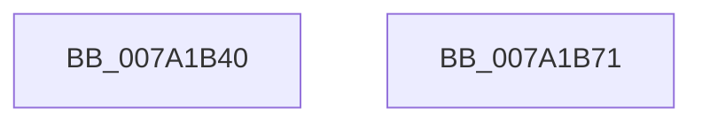

# SepRmMakeLogonSessionsSiblingsWrkr

- RVA: `0x007A1B40`–`0x007A1B72` (길이 `50` bytes)
- VA: `0x00000001407A1B40`
- 실행 섹션: `PAGE`
- PDB 이름 있음: `예`; PDB Function 태그: `아니요`
- unwind 정보 RVA: `0x000BF520`
- 디코드: `16`개 명령, `50/50` bytes 표시
- 미해석 바이트: `0` (있으면 어셈블리에 `.byte`로 보존)

> 이 문서는 커널 이미지의 기계어와 PDB 기호를 분석해 생성했습니다. 4번과 5번은 함수 원형과 자료형을 바이너리 사용 방식에서 추정한 C 해석이며 원본 소스 복구 결과는 아닙니다.

## 1. Dependencies

- 직접 호출 지점: **1**; 고유 호출 대상: **1**
- 직접 호출자로 확인된 함수: **0**
- RIP 상대 이미지 참조: **0**

### Outgoing calls
- `0x007A1B63` → [SepMakeLogonSessionsSiblings](SepMakeLogonSessionsSiblings_function_007A1774.md) (function, `0x007A1774`)

### Direct callers
- 이 함수 시작 RVA로 연결되는 직접 call은 확인되지 않았습니다. 간접 호출은 완전히 역산할 수 없습니다.

### Static image references
- 디코드된 RIP-relative 메모리 참조가 없습니다.

## 2. Other-region calls and transfers

- 다른 실행 섹션으로 향하는 call: **0**
- 별도 외부 분기/꼬리 이동을 확인하지 못했습니다.

## 3. Assembly (complete function range)

```asm
007A1B40  4C 8B DC                        mov r11, rsp
007A1B43  53                              push rbx
007A1B44  48 83 EC 20                     sub rsp, 0x20
007A1B48  48 8B 41 2C                     mov rax, qword ptr [rcx + 0x2c]
007A1B4C  48 8B DA                        mov rbx, rdx
007A1B4F  49 89 43 10                     mov qword ptr [r11 + 0x10], rax
007A1B53  49 8D 53 08                     lea rdx, [r11 + 8]
007A1B57  48 8B 41 34                     mov rax, qword ptr [rcx + 0x34]
007A1B5B  49 8D 4B 10                     lea rcx, [r11 + 0x10]
007A1B5F  49 89 43 08                     mov qword ptr [r11 + 8], rax
007A1B63  E8 0C FC FF FF                  call 0x1407a1774
007A1B68  89 43 28                        mov dword ptr [rbx + 0x28], eax
007A1B6B  48 83 C4 20                     add rsp, 0x20
007A1B6F  5B                              pop rbx
007A1B70  C3                              ret
007A1B71  CC                              int3
```

## 4. C-style interpretation (structured pseudocode)

```c
__int64 __fastcall SepRmMakeLogonSessionsSiblingsWrkr(__int64 a1, __int64 a2)
{
    __int64 result;
    __int64 v_rsp;

    v_rsp = (v_rsp) - (32);
    *(unsigned __int64 *)(v_rsp + 16) = *(unsigned __int64 *)(a1 + 44);
    *(unsigned __int64 *)(v_rsp + 8) = *(unsigned __int64 *)(a1 + 52);
    result = SepMakeLogonSessionsSiblings(v_rsp + 16, v_rsp + 8, a3, a4);
    *(unsigned int *)(a2 + 40) = (unsigned int)(result);
    v_rsp = (v_rsp) + (32);
    return result;
}
```

## 5. (Beta) C Style

```c
int64_t SepRmMakeLogonSessionsSiblingsWrkr(void *Arg1, void *Arg2)
{
    uint8_t *arg1 = (uint8_t *)Arg1;
    uint8_t *arg2 = (uint8_t *)Arg2;

    int64_t result;
    int64_t local_rsp;

    local_rsp = (local_rsp) - (32);
    *(uint64_t *)(local_rsp + 0x10) = *(uint64_t *)(arg1 + 0x2C);
    *(uint64_t *)(local_rsp + 0x8) = *(uint64_t *)(arg1 + 0x34);
    result = SepMakeLogonSessionsSiblings(local_rsp + 16, local_rsp + 8, a3, a4);
    *(uint32_t *)(arg2 + 0x28) = (uint32_t)(result);
    local_rsp = (local_rsp) + (32);
    return result;
}
```

### 관측된 메모리 오프셋

구조체 형식이 확인되지 않은 접근은 인자 기준의 오프셋으로만 기록했습니다.

| 기준 인자 | 오프셋 표현 | 폭 (bit) | 접근 |
|---|---:|---:|---|
| `Arg1` | `+ 0x2C` | `64` | `R` |
| `Arg1` | `+ 0x34` | `64` | `R` |
| `Arg2` | `+ 0x28` | `32` | `W` |

## 6. Execution-region graph

[열기: 2D/3D 그래프와 함수 탐색 컨트롤 패널](../../../control-panel.html?section=page&rva=0x007A1B40&view=graph)

- 2D 그래프는 위에서 아래로 흐르고, 3D 그래프는 빈 공간을 드래그해 회전합니다. Shift+드래그는 이동, 휠은 확대·축소, 함수 노드 선택은 대상 보고서 이동입니다.

### Static fallback


