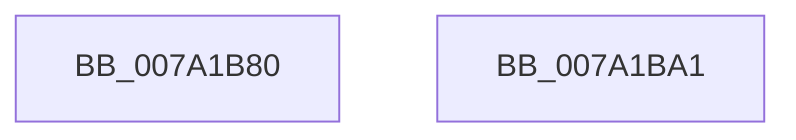

# SepRmSetSharedUserSessionWrkr

- RVA: `0x007A1B80`–`0x007A1BA2` (길이 `34` bytes)
- VA: `0x00000001407A1B80`
- 실행 섹션: `PAGE`
- PDB 이름 있음: `예`; PDB Function 태그: `아니요`
- unwind 정보 RVA: `0x0005C788`
- 디코드: `9`개 명령, `34/34` bytes 표시
- 미해석 바이트: `0` (있으면 어셈블리에 `.byte`로 보존)

> 이 문서는 커널 이미지의 기계어와 PDB 기호를 분석해 생성했습니다. 4번과 5번은 함수 원형과 자료형을 바이너리 사용 방식에서 추정한 C 해석이며 원본 소스 복구 결과는 아닙니다.

## 1. Dependencies

- 직접 호출 지점: **1**; 고유 호출 대상: **1**
- 직접 호출자로 확인된 함수: **0**
- RIP 상대 이미지 참조: **0**

### Outgoing calls
- `0x007A1B88` → [PsGetCurrentServerSiloGlobals](../../text/2F/PsGetCurrentServerSiloGlobals_function_002FE1F0.md) (function, `0x002FE1F0`)

### Direct callers
- 이 함수 시작 RVA로 연결되는 직접 call은 확인되지 않았습니다. 간접 호출은 완전히 역산할 수 없습니다.

### Static image references
- 디코드된 RIP-relative 메모리 참조가 없습니다.

## 2. Other-region calls and transfers

- 다른 실행 섹션으로 향하는 call: **1**
  - `0x007A1B88` → [PsGetCurrentServerSiloGlobals](../../text/2F/PsGetCurrentServerSiloGlobals_function_002FE1F0.md) (`PAGE` → `.text`)
- 별도 외부 분기/꼬리 이동을 확인하지 못했습니다.

## 3. Assembly (complete function range)

```asm
007A1B80  48 83 EC 28                     sub rsp, 0x28
007A1B84  44 8B 41 2C                     mov r8d, dword ptr [rcx + 0x2c]
007A1B88  E8 63 C6 B5 FF                  call 0x1402fe1f0
007A1B8D  48 8B 88 08 05 00 00            mov rcx, qword ptr [rax + 0x508]
007A1B94  44 89 41 18                     mov dword ptr [rcx + 0x18], r8d
007A1B98  83 62 28 00                     and dword ptr [rdx + 0x28], 0
007A1B9C  48 83 C4 28                     add rsp, 0x28
007A1BA0  C3                              ret
007A1BA1  CC                              int3
```

## 4. C-style interpretation (structured pseudocode)

```c
__int64 __fastcall SepRmSetSharedUserSessionWrkr(__int64 a1, __int64 a2)
{
    __int64 result;
    __int64 v_rsp;

    v_rsp = (v_rsp) - (40);
    result = PsGetCurrentServerSiloGlobals(a1, a2, (unsigned int)(*(unsigned int *)(a1 + 44)), a4);
    *(unsigned int *)(*(unsigned __int64 *)(result + 1288) + 24) = (unsigned int)((unsigned int)(*(unsigned int *)(a1 + 44)));
    v_rsp = (v_rsp) + (40);
    return result;
}
```

## 5. (Beta) C Style

```c
int64_t SepRmSetSharedUserSessionWrkr(void *Arg1, int64_t Arg2)
{
    uint8_t *arg1 = (uint8_t *)Arg1;

    int64_t result;
    int64_t local_rsp;

    local_rsp = (local_rsp) - (40);
    result = PsGetCurrentServerSiloGlobals(Arg1, Arg2, (uint32_t)(*(uint32_t *)(arg1 + 0x2C)), a4);
    *(uint32_t *)(*(uint64_t *)(result + 0x508) + 0x18) = (uint32_t)((uint32_t)(*(uint32_t *)(arg1 + 0x2C)));
    local_rsp = (local_rsp) + (40);
    return result;
}
```

### 관측된 메모리 오프셋

구조체 형식이 확인되지 않은 접근은 인자 기준의 오프셋으로만 기록했습니다.

| 기준 인자 | 오프셋 표현 | 폭 (bit) | 접근 |
|---|---:|---:|---|
| `Arg1` | `+ 0x2C` | `32` | `R` |

## 6. Execution-region graph

[열기: 2D/3D 그래프와 함수 탐색 컨트롤 패널](../../../control-panel.html?section=page&rva=0x007A1B80&view=graph)

- 2D 그래프는 위에서 아래로 흐르고, 3D 그래프는 빈 공간을 드래그해 회전합니다. Shift+드래그는 이동, 휠은 확대·축소, 함수 노드 선택은 대상 보고서 이동입니다.

### Static fallback


