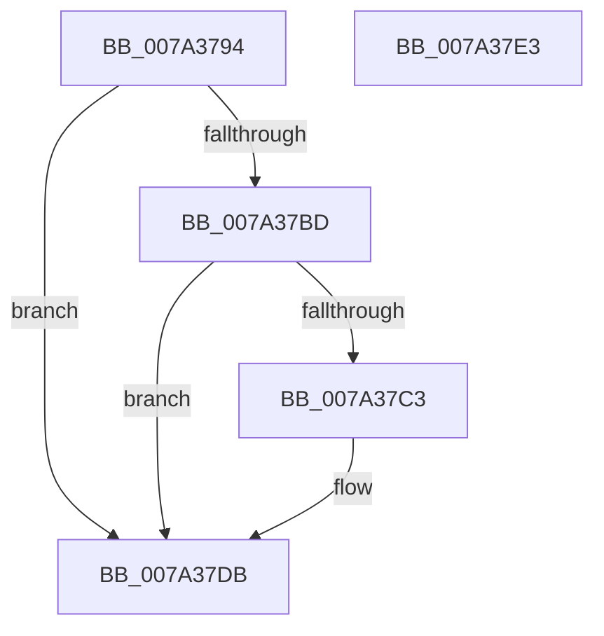

# SepSDContainsAttributeACE

- RVA: `0x007A3794`–`0x007A37E4` (길이 `80` bytes)
- VA: `0x00000001407A3794`
- 실행 섹션: `PAGE`
- PDB 이름 있음: `예`; PDB Function 태그: `아니요`
- unwind 정보 RVA: `0x000AA39C`
- 디코드: `26`개 명령, `80/80` bytes 표시
- 미해석 바이트: `0` (있으면 어셈블리에 `.byte`로 보존)

> 이 문서는 커널 이미지의 기계어와 PDB 기호를 분석해 생성했습니다. 4번과 5번은 함수 원형과 자료형을 바이너리 사용 방식에서 추정한 C 해석이며 원본 소스 복구 결과는 아닙니다.

## 1. Dependencies

- 직접 호출 지점: **2**; 고유 호출 대상: **2**
- 직접 호출자로 확인된 함수: **1**
- RIP 상대 이미지 참조: **0**

### Outgoing calls
- `0x007A37B4` → [RtlGetSaclSecurityDescriptor](../A3/RtlGetSaclSecurityDescriptor_function_00A36710.md) (function, `0x00A36710`)
- `0x007A37D0` → [RtlFindAceByType](../../text/41/RtlFindAceByType_function_00410AF0.md) (function, `0x00410AF0`)

### Direct callers
- [sub_00B21BFA](../B2/Unknown_function_00B21BFA.md) at `0x00B21E1B`

### Static image references
- 디코드된 RIP-relative 메모리 참조가 없습니다.

## 2. Other-region calls and transfers

- 다른 실행 섹션으로 향하는 call: **1**
  - `0x007A37D0` → [RtlFindAceByType](../../text/41/RtlFindAceByType_function_00410AF0.md) (`PAGE` → `.text`)
- 별도 외부 분기/꼬리 이동을 확인하지 못했습니다.

## 3. Assembly (complete function range)

```asm
007A3794  48 8B C4                        mov rax, rsp
007A3797  53                              push rbx
007A3798  48 83 EC 30                     sub rsp, 0x30
007A379C  33 DB                           xor ebx, ebx
007A379E  4C 8D 48 18                     lea r9, [rax + 0x18]
007A37A2  4C 8D 40 E8                     lea r8, [rax - 0x18]
007A37A6  48 89 58 E8                     mov qword ptr [rax - 0x18], rbx
007A37AA  48 8D 50 10                     lea rdx, [rax + 0x10]
007A37AE  88 58 10                        mov byte ptr [rax + 0x10], bl
007A37B1  89 58 20                        mov dword ptr [rax + 0x20], ebx
007A37B4  E8 57 2F 29 00                  call 0x140a36710
007A37B9  85 C0                           test eax, eax
007A37BB  78 1E                           js 0x1407a37db
007A37BD  38 5C 24 48                     cmp byte ptr [rsp + 0x48], bl
007A37C1  74 18                           je 0x1407a37db
007A37C3  48 8B 4C 24 20                  mov rcx, qword ptr [rsp + 0x20]
007A37C8  4C 8D 44 24 58                  lea r8, [rsp + 0x58]
007A37CD  8D 53 12                        lea edx, [rbx + 0x12]
007A37D0  E8 1B D3 C6 FF                  call 0x140410af0
007A37D5  48 85 C0                        test rax, rax
007A37D8  0F 95 C3                        setne bl
007A37DB  8A C3                           mov al, bl
007A37DD  48 83 C4 30                     add rsp, 0x30
007A37E1  5B                              pop rbx
007A37E2  C3                              ret
007A37E3  CC                              int3
```

## 4. C-style interpretation (structured pseudocode)

```c
__int64 __fastcall SepSDContainsAttributeACE(void)
{
    __int64 result;
    __int64 v_rbx;
    __int64 v_rsp;
    unsigned __int64 v_stack_m18;
    unsigned __int8 v_stack_p10;
    unsigned __int64 v_stack_p20;

    v_rsp = (v_rsp) - (48);
    v_rbx = 0;
    *(unsigned __int64 *)(v_rsp - 24) = 0;
    *(unsigned __int8 *)(v_rsp + 16) = 0;
    *(unsigned int *)(v_rsp + 32) = 0;
    result = RtlGetSaclSecurityDescriptor(a1, v_rsp + 16, v_rsp - 24, v_rsp + 24);
    if (sign_flag) goto loc_007A37DB;
    if (v_stack_p10 != 0) {
        a1 = v_stack_m18;
        a3 = v_stack_p20;
        a2 = v_rbx + 18;
        result = RtlFindAceByType(a1, a2, a3, v_rsp + 24);
        v_rbx = (result != 0) ? 1 : 0;
    }
    v_rsp = (v_rsp) + (48);
    return (unsigned __int8)(v_rbx);
}
```

## 5. (Beta) C Style

```c
void SepSDContainsAttributeACE(void)
{
    int64_t result;
    int64_t local_rbx;
    int64_t local_rsp;
    uint64_t v_stack_m18;
    uint8_t v_stack_p10;
    uint64_t v_stack_p20;

    local_rsp = (local_rsp) - (48);
    local_rbx = 0;
    *(uint64_t *)(local_rsp - 0x18) = 0;
    *(uint8_t *)(local_rsp + 0x10) = 0;
    *(uint32_t *)(local_rsp + 0x20) = 0;
    result = RtlGetSaclSecurityDescriptor(a1, local_rsp + 16, local_rsp - 24, local_rsp + 24);
    if (sign_flag) goto loc_007A37DB;
    if (v_stack_p10 != 0) {
        a1 = v_stack_m18;
        a3 = v_stack_p20;
        a2 = local_rbx + 18;
        result = RtlFindAceByType(a1, a2, a3, local_rsp + 24);
        local_rbx = (result != 0) ? 1 : 0;
    }
    local_rsp = (local_rsp) + (48);
    return (uint8_t)(local_rbx);
}
```

## 6. Execution-region graph

[열기: 2D/3D 그래프와 함수 탐색 컨트롤 패널](../../../control-panel.html?section=page&rva=0x007A3794&view=graph)

- 2D 그래프는 위에서 아래로 흐르고, 3D 그래프는 빈 공간을 드래그해 회전합니다. Shift+드래그는 이동, 휠은 확대·축소, 함수 노드 선택은 대상 보고서 이동입니다.

### Static fallback


