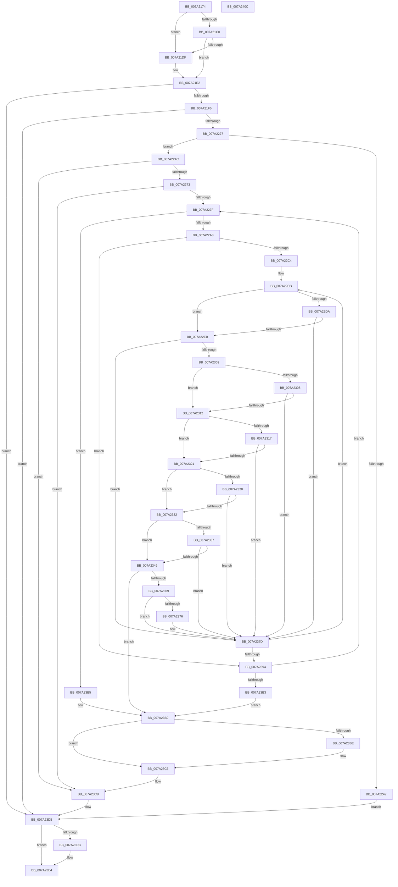

# SepSecureBootCorrectBcd

- RVA: `0x007A2174`–`0x007A240D` (길이 `665` bytes)
- VA: `0x00000001407A2174`
- 실행 섹션: `PAGE`
- PDB 이름 있음: `예`; PDB Function 태그: `아니요`
- unwind 정보 RVA: `0x000D1588`
- 디코드: `181`개 명령, `665/665` bytes 표시
- 미해석 바이트: `0` (있으면 어셈블리에 `.byte`로 보존)

> 이 문서는 커널 이미지의 기계어와 PDB 기호를 분석해 생성했습니다. 4번과 5번은 함수 원형과 자료형을 바이너리 사용 방식에서 추정한 C 해석이며 원본 소스 복구 결과는 아닙니다.

## 1. Dependencies

- 직접 호출 지점: **13**; 고유 호출 대상: **11**
- 직접 호출자로 확인된 함수: **1**
- RIP 상대 이미지 참조: **5**

### Outgoing calls
- `0x007A21B7` → [HviIsAnyHypervisorPresent](../../text/4A/HviIsAnyHypervisorPresent_function_004ADC50.md) (function, `0x004ADC50`)
- `0x007A21CB` → [HviGetHypervisorFeatures](../../text/66/HviGetHypervisorFeatures_function_00666630.md) (function, `0x00666630`)
- `0x007A21E6` → [BcdOpenSystemStore](../82/BcdOpenSystemStore_function_00823428.md) (function, `0x00823428`)
- `0x007A2215` → [BcdEnumerateObjects](../82/BcdEnumerateObjects_function_00823594.md) (function, `0x00823594`)
- `0x007A2235` → [ExAllocatePool2](../../poolcode/B8/ExAllocatePool2_function_00B820F0.md) (function, `0x00B820F0`)
- `0x007A2264` → [BcdEnumerateObjects](../82/BcdEnumerateObjects_function_00823594.md) (function, `0x00823594`)
- `0x007A2299` → [BcdOpenObject](../91/BcdOpenObject_function_00916704.md) (function, `0x00916704`)
- `0x007A235B` → [SepSecureBootUpdateBcdDataForRule](SepSecureBootUpdateBcdDataForRule_function_007A2514.md) (function, `0x007A2514`)
- `0x007A2397` → [BcdCloseObject](../A3/BcdCloseObject_function_00A3FB08.md) (function, `0x00A3FB08`)
- `0x007A23C1` → [BcdCloseObject](../A3/BcdCloseObject_function_00A3FB08.md) (function, `0x00A3FB08`)
- `0x007A23D0` → [ExFreePoolWithTag](../../poolcode/B8/ExFreePoolWithTag_function_00B82870.md) (function, `0x00B82870`)
- `0x007A23DF` → [BcdCloseStore](../A3/BcdCloseStore_function_00A3C68C.md) (function, `0x00A3C68C`)
- `0x007A23ED` → [_security_check_cookie](../../text/6A/_security_check_cookie_function_006AC640.md) (function, `0x006AC640`)

### Direct callers
- [NtFilterBootOption](NtFilterBootOption_function_007A1BE0.md) at `0x007A1F31`

### Static image references
- `0x007A218E` → RVA `0x00E0A740` (`.data`; read)
- `0x007A22A8` → RVA `0x00E67DF0` (`.data`; read)
- `0x007A22C4` → RVA `0x00E67DD0` (`.data`; read)
- `0x007A22F0` → RVA `0x00E67DE0` (`.data`; read)
- `0x007A2308` → RVA `0x00E67E04` (`.data`; read)

## 2. Other-region calls and transfers

- 다른 실행 섹션으로 향하는 call: **5**
  - `0x007A21B7` → [HviIsAnyHypervisorPresent](../../text/4A/HviIsAnyHypervisorPresent_function_004ADC50.md) (`PAGE` → `.text`)
  - `0x007A21CB` → [HviGetHypervisorFeatures](../../text/66/HviGetHypervisorFeatures_function_00666630.md) (`PAGE` → `.text`)
  - `0x007A2235` → [ExAllocatePool2](../../poolcode/B8/ExAllocatePool2_function_00B820F0.md) (`PAGE` → `POOLCODE`)
  - `0x007A23D0` → [ExFreePoolWithTag](../../poolcode/B8/ExFreePoolWithTag_function_00B82870.md) (`PAGE` → `POOLCODE`)
  - `0x007A23ED` → [_security_check_cookie](../../text/6A/_security_check_cookie_function_006AC640.md) (`PAGE` → `.text`)
- 별도 외부 분기/꼬리 이동을 확인하지 못했습니다.

## 3. Assembly (complete function range)

```asm
007A2174  48 89 5C 24 10                  mov qword ptr [rsp + 0x10], rbx
007A2179  48 89 7C 24 18                  mov qword ptr [rsp + 0x18], rdi
007A217E  55                              push rbp
007A217F  41 54                           push r12
007A2181  41 55                           push r13
007A2183  41 56                           push r14
007A2185  41 57                           push r15
007A2187  48 8B EC                        mov rbp, rsp
007A218A  48 83 EC 70                     sub rsp, 0x70
007A218E  48 8B 05 AB 85 66 00            mov rax, qword ptr [rip + 0x6685ab]
007A2195  48 33 C4                        xor rax, rsp
007A2198  48 89 45 F8                     mov qword ptr [rbp - 8], rax
007A219C  33 FF                           xor edi, edi
007A219E  48 89 4D E0                     mov qword ptr [rbp - 0x20], rcx
007A21A2  48 89 7D D8                     mov qword ptr [rbp - 0x28], rdi
007A21A6  89 7D C4                        mov dword ptr [rbp - 0x3c], edi
007A21A9  89 7D C8                        mov dword ptr [rbp - 0x38], edi
007A21AC  48 89 7D D0                     mov qword ptr [rbp - 0x30], rdi
007A21B0  40 88 7D C0                     mov byte ptr [rbp - 0x40], dil
007A21B4  40 88 39                        mov byte ptr [rcx], dil
007A21B7  E8 94 BA D0 FF                  call 0x1404adc50
007A21BC  84 C0                           test al, al
007A21BE  74 1F                           je 0x1407a21df
007A21C0  0F 57 C0                        xorps xmm0, xmm0
007A21C3  48 8D 4D E8                     lea rcx, [rbp - 0x18]
007A21C7  0F 11 45 E8                     movups xmmword ptr [rbp - 0x18], xmm0
007A21CB  E8 60 44 EC FF                  call 0x140666630
007A21D0  48 8B 45 E8                     mov rax, qword ptr [rbp - 0x18]
007A21D4  41 B5 01                        mov r13b, 1
007A21D7  48 C1 E8 2C                     shr rax, 0x2c
007A21DB  A8 01                           test al, 1
007A21DD  74 03                           je 0x1407a21e2
007A21DF  44 8A EF                        mov r13b, dil
007A21E2  48 8D 4D D0                     lea rcx, [rbp - 0x30]
007A21E6  E8 3D 12 08 00                  call 0x140823428
007A21EB  8B D8                           mov ebx, eax
007A21ED  85 C0                           test eax, eax
007A21EF  0F 88 E0 01 00 00               js 0x1407a23d5
007A21F5  48 8B 4D D0                     mov rcx, qword ptr [rbp - 0x30]
007A21F9  48 8D 45 C4                     lea rax, [rbp - 0x3c]
007A21FD  4C 8D 4D C8                     lea r9, [rbp - 0x38]
007A2201  48 89 44 24 20                  mov qword ptr [rsp + 0x20], rax
007A2206  45 33 C0                        xor r8d, r8d
007A2209  48 C7 45 E8 01 00 00 00         mov qword ptr [rbp - 0x18], 1
007A2211  48 8D 55 E8                     lea rdx, [rbp - 0x18]
007A2215  E8 7A 13 08 00                  call 0x140823594
007A221A  8B D8                           mov ebx, eax
007A221C  3D 23 00 00 C0                  cmp eax, 0xc0000023
007A2221  0F 85 AE 01 00 00               jne 0x1407a23d5
007A2227  8B 55 C8                        mov edx, dword ptr [rbp - 0x38]
007A222A  B9 00 01 00 00                  mov ecx, 0x100
007A222F  41 B8 53 65 53 62               mov r8d, 0x62536553
007A2235  E8 B6 FE 3D 00                  call 0x140b820f0
007A223A  4C 8B F8                        mov r15, rax
007A223D  48 85 C0                        test rax, rax
007A2240  75 0A                           jne 0x1407a224c
007A2242  BB 17 00 00 C0                  mov ebx, 0xc0000017
007A2247  E9 89 01 00 00                  jmp 0x1407a23d5
007A224C  48 8B 4D D0                     mov rcx, qword ptr [rbp - 0x30]
007A2250  48 8D 45 C4                     lea rax, [rbp - 0x3c]
007A2254  4C 8D 4D C8                     lea r9, [rbp - 0x38]
007A2258  48 89 44 24 20                  mov qword ptr [rsp + 0x20], rax
007A225D  4D 8B C7                        mov r8, r15
007A2260  48 8D 55 E8                     lea rdx, [rbp - 0x18]
007A2264  E8 2B 13 08 00                  call 0x140823594
007A2269  8B D8                           mov ebx, eax
007A226B  85 C0                           test eax, eax
007A226D  0F 88 55 01 00 00               js 0x1407a23c8
007A2273  44 8B E7                        mov r12d, edi
007A2276  39 7D C4                        cmp dword ptr [rbp - 0x3c], edi
007A2279  0F 86 49 01 00 00               jbe 0x1407a23c8
007A227F  41 8B C4                        mov eax, r12d
007A2282  4C 8D 45 D8                     lea r8, [rbp - 0x28]
007A2286  48 8D 0C 40                     lea rcx, [rax + rax*2]
007A228A  49 8D 04 CF                     lea rax, [r15 + rcx*8]
007A228E  48 8B 4D D0                     mov rcx, qword ptr [rbp - 0x30]
007A2292  48 8B D0                        mov rdx, rax
007A2295  48 89 45 E8                     mov qword ptr [rbp - 0x18], rax
007A2299  E8 66 44 17 00                  call 0x140916704
007A229E  8B D8                           mov ebx, eax
007A22A0  85 C0                           test eax, eax
007A22A2  0F 88 0D 01 00 00               js 0x1407a23b5
007A22A8  48 8B 05 41 5B 6C 00            mov rax, qword ptr [rip + 0x6c5b41]
007A22AF  45 33 C9                        xor r9d, r9d
007A22B2  44 8B F7                        mov r14d, edi
007A22B5  48 8B 7D D8                     mov rdi, qword ptr [rbp - 0x28]
007A22B9  66 44 3B 48 24                  cmp r9w, word ptr [rax + 0x24]
007A22BE  0F 83 D0 00 00 00               jae 0x1407a2394
007A22C4  4C 8B 05 05 5B 6C 00            mov r8, qword ptr [rip + 0x6c5b05]
007A22CB  41 8B C6                        mov eax, r14d
007A22CE  48 8D 14 40                     lea rdx, [rax + rax*2]
007A22D2  41 8B 0C 90                     mov ecx, dword ptr [r8 + rdx*4]
007A22D6  85 C9                           test ecx, ecx
007A22D8  74 11                           je 0x1407a22eb
007A22DA  48 8B 45 E8                     mov rax, qword ptr [rbp - 0x18]
007A22DE  48 8B 40 10                     mov rax, qword ptr [rax + 0x10]
007A22E2  3B 48 04                        cmp ecx, dword ptr [rax + 4]
007A22E5  0F 85 92 00 00 00               jne 0x1407a237d
007A22EB  41 8B 4C 90 08                  mov ecx, dword ptr [r8 + rdx*4 + 8]
007A22F0  48 8B 05 E9 5A 6C 00            mov rax, qword ptr [rip + 0x6c5ae9]
007A22F7  0F B7 14 01                     movzx edx, word ptr [rcx + rax]
007A22FB  F7 C2 00 F0 FF FF               test edx, 0xfffff000
007A2301  75 7A                           jne 0x1407a237d
007A2303  F6 C2 20                        test dl, 0x20
007A2306  74 0A                           je 0x1407a2312
007A2308  8B 05 F6 5A 6C 00               mov eax, dword ptr [rip + 0x6c5af6]
007A230E  A8 04                           test al, 4
007A2310  74 6B                           je 0x1407a237d
007A2312  F6 C2 40                        test dl, 0x40
007A2315  74 0A                           je 0x1407a2321
007A2317  8B 05 E7 5A 6C 00               mov eax, dword ptr [rip + 0x6c5ae7]
007A231D  A8 10                           test al, 0x10
007A231F  74 5C                           je 0x1407a237d
007A2321  66 0F BA E2 0B                  bt dx, 0xb
007A2326  73 0A                           jae 0x1407a2332
007A2328  8B 05 D6 5A 6C 00               mov eax, dword ptr [rip + 0x6c5ad6]
007A232E  A8 40                           test al, 0x40
007A2330  74 4B                           je 0x1407a237d
007A2332  45 84 ED                        test r13b, r13b
007A2335  74 12                           je 0x1407a2349
007A2337  41 8B C6                        mov eax, r14d
007A233A  48 8D 0C 40                     lea rcx, [rax + rax*2]
007A233E  41 81 7C 88 04 31 00 00 25      cmp dword ptr [r8 + rcx*4 + 4], 0x25000031
007A2347  74 34                           je 0x1407a237d
007A2349  41 8B C6                        mov eax, r14d
007A234C  48 8B D7                        mov rdx, rdi
007A234F  48 8D 0C 40                     lea rcx, [rax + rax*2]
007A2353  49 8D 0C 88                     lea rcx, [r8 + rcx*4]
007A2357  4C 8D 45 C0                     lea r8, [rbp - 0x40]
007A235B  E8 B4 01 00 00                  call 0x1407a2514
007A2360  45 33 C9                        xor r9d, r9d
007A2363  8B D8                           mov ebx, eax
007A2365  85 C0                           test eax, eax
007A2367  78 50                           js 0x1407a23b9
007A2369  4C 8B 05 60 5A 6C 00            mov r8, qword ptr [rip + 0x6c5a60]
007A2370  44 38 4D C0                     cmp byte ptr [rbp - 0x40], r9b
007A2374  74 07                           je 0x1407a237d
007A2376  48 8B 45 E0                     mov rax, qword ptr [rbp - 0x20]
007A237A  C6 00 01                        mov byte ptr [rax], 1
007A237D  48 8B 05 6C 5A 6C 00            mov rax, qword ptr [rip + 0x6c5a6c]
007A2384  41 FF C6                        inc r14d
007A2387  0F B7 50 24                     movzx edx, word ptr [rax + 0x24]
007A238B  44 3B F2                        cmp r14d, edx
007A238E  0F 82 37 FF FF FF               jb 0x1407a22cb
007A2394  48 8B CF                        mov rcx, rdi
007A2397  E8 6C D7 29 00                  call 0x140a3fb08
007A239C  45 33 C9                        xor r9d, r9d
007A239F  41 FF C4                        inc r12d
007A23A2  41 8B F9                        mov edi, r9d
007A23A5  4C 89 4D D8                     mov qword ptr [rbp - 0x28], r9
007A23A9  44 3B 65 C4                     cmp r12d, dword ptr [rbp - 0x3c]
007A23AD  0F 82 CC FE FF FF               jb 0x1407a227f
007A23B3  EB 04                           jmp 0x1407a23b9
007A23B5  48 8B 7D D8                     mov rdi, qword ptr [rbp - 0x28]
007A23B9  48 85 FF                        test rdi, rdi
007A23BC  74 08                           je 0x1407a23c6
007A23BE  48 8B CF                        mov rcx, rdi
007A23C1  E8 42 D7 29 00                  call 0x140a3fb08
007A23C6  33 FF                           xor edi, edi
007A23C8  BA 53 65 53 62                  mov edx, 0x62536553
007A23CD  49 8B CF                        mov rcx, r15
007A23D0  E8 9B 04 3E 00                  call 0x140b82870
007A23D5  48 39 7D D0                     cmp qword ptr [rbp - 0x30], rdi
007A23D9  74 09                           je 0x1407a23e4
007A23DB  48 8B 4D D0                     mov rcx, qword ptr [rbp - 0x30]
007A23DF  E8 A8 A2 29 00                  call 0x140a3c68c
007A23E4  8B C3                           mov eax, ebx
007A23E6  48 8B 4D F8                     mov rcx, qword ptr [rbp - 8]
007A23EA  48 33 CC                        xor rcx, rsp
007A23ED  E8 4E A2 F0 FF                  call 0x1406ac640
007A23F2  4C 8D 5C 24 70                  lea r11, [rsp + 0x70]
007A23F7  49 8B 5B 38                     mov rbx, qword ptr [r11 + 0x38]
007A23FB  49 8B 7B 40                     mov rdi, qword ptr [r11 + 0x40]
007A23FF  49 8B E3                        mov rsp, r11
007A2402  41 5F                           pop r15
007A2404  41 5E                           pop r14
007A2406  41 5D                           pop r13
007A2408  41 5C                           pop r12
007A240A  5D                              pop rbp
007A240B  C3                              ret
007A240C  CC                              int3
```

## 4. C-style interpretation (structured pseudocode)

```c
__int64 __fastcall SepSecureBootCorrectBcd(__int64 a1, __int64 a2, int a3)
{
    __int64 result;
    __int64 v_r12;
    __int64 v_r13;
    __int64 v_r14;
    __int64 v_rdi;
    __int64 v_rsp;
    unsigned __int64 v_stack_m28;
    unsigned __int64 v_stack_m30;
    unsigned __int64 v_stack_m40;
    unsigned __int64 v_stack_m48;
    unsigned __int64 v_stack_m50;
    unsigned __int64 v_stack_m58;
    unsigned int v_stack_m60;
    unsigned int v_stack_m64;
    unsigned __int8 v_stack_m68;
    unsigned __int64 v_stack_m78;
    unsigned __int64 v_stack_p10;
    unsigned __int64 v_stack_p18;

    v_stack_p10 = v_rbx;
    v_stack_p18 = v_rdi;
    v_rsp = (v_rsp) - (112);
    result = (*(unsigned __int64 *)(v_rip + 6718891)) ^ (v_rsp);
    v_stack_m30 = result;
    v_rdi = 0;
    v_stack_m48 = a1;
    v_stack_m50 = 0;
    v_stack_m64 = 0;
    v_stack_m60 = 0;
    v_stack_m58 = 0;
    v_stack_m68 = 0;
    *(unsigned __int8 *)(a1) = 0;
    result = HviIsAnyHypervisorPresent(a1, a2, a3, a4);
    if ((unsigned __int8)(result) == 0) goto loc_007A21DF;
    v_stack_m40 = v_xmm0;
    result = HviGetHypervisorFeatures(v_stack_m40, a2, a3, a4);
    result = (v_stack_m40) >> (44);
    v_r13 = 1;
    if ((((unsigned __int8)(result)) & (1)) != 0) {
        v_r13 = 0;
    }
    result = BcdOpenSystemStore(v_stack_m58, a2, a3, a4);
    if (sign_flag) goto loc_007A23D5;
    v_stack_m78 = v_stack_m64;
    a3 = 0;
    v_stack_m40 = 1;
    result = BcdEnumerateObjects(v_stack_m58, v_stack_m40, a3, v_stack_m60);
    if (((unsigned int)(result)) != 0xC0000023ULL) goto loc_007A23D5;
    result = ExAllocatePool2(256, (unsigned int)(v_stack_m60), (unsigned int)(0x62536553ULL), v_stack_m60);
    if (result != 0) goto loc_007A224C;
    goto loc_007A23D5;
loc_007A224C:
    v_stack_m78 = v_stack_m64;
    result = BcdEnumerateObjects(v_stack_m58, v_stack_m40, result, v_stack_m60);
    if (sign_flag) goto loc_007A23C8;
    if (v_stack_m64 <= 0) goto loc_007A23C8;
loc_007A227F:
    v_stack_m40 = result + 0 + 0 * 2 * 8;
    result = BcdOpenObject(v_stack_m58, result + 0 + 0 * 2 * 8, v_stack_m50, v_stack_m60);
    if (sign_flag) goto loc_007A23B5;
    a4 = 0;
    if (0 >= (*(unsigned __int16 *)(*(unsigned __int64 *)(v_rip + 7101249) + 36))) goto loc_007A2394;
loc_007A22CB:
    if ((unsigned int)((unsigned int)(*(unsigned int *)(*(unsigned __int64 *)(v_rip + 7101189) + 0 + 0 * 2 * 4))) == 0) goto loc_007A22EB;
    if (((unsigned int)((unsigned int)(*(unsigned int *)(*(unsigned __int64 *)(v_rip + 7101189) + 0 + 0 * 2 * 4)))) != (*(unsigned int *)(*(unsigned __int64 *)(v_stack_m40 + 16) + 4))) goto loc_007A237D;
loc_007A22EB:
    if ((((unsigned int)(*(unsigned __int16 *)((unsigned int)(*(unsigned int *)(*(unsigned __int64 *)(v_rip + 7101189) + 0 + 0 * 2 * 4 + 8)) + *(unsigned __int64 *)(v_rip + 7101161) * 1))) & (0xFFFFF000ULL)) != 0) goto loc_007A237D;
    if ((((unsigned __int8)(*(unsigned __int16 *)((unsigned int)(*(unsigned int *)(*(unsigned __int64 *)(v_rip + 7101189) + 0 + 0 * 2 * 4 + 8)) + *(unsigned __int64 *)(v_rip + 7101161) * 1))) & (32)) == 0) goto loc_007A2312;
    if ((((unsigned __int8)((unsigned int)(*(unsigned int *)(v_rip + 7101174)))) & (4)) == 0) goto loc_007A237D;
loc_007A2312:
    if ((((unsigned __int8)(*(unsigned __int16 *)((unsigned int)(*(unsigned int *)(*(unsigned __int64 *)(v_rip + 7101189) + 0 + 0 * 2 * 4 + 8)) + *(unsigned __int64 *)(v_rip + 7101161) * 1))) & (64)) == 0) goto loc_007A2321;
    if ((((unsigned __int8)((unsigned int)(*(unsigned int *)(v_rip + 7101159)))) & (16)) == 0) goto loc_007A237D;
loc_007A2321:
    if (condition_is_above_or_equal) goto loc_007A2332;
    if ((((unsigned __int8)((unsigned int)(*(unsigned int *)(v_rip + 7101142)))) & (64)) == 0) goto loc_007A237D;
loc_007A2332:
    if ((unsigned __int8)(v_r13) == 0) goto loc_007A2349;
    if ((*(unsigned int *)(*(unsigned __int64 *)(v_rip + 7101189) + 0 + 0 * 2 * 4 + 4)) == 0x25000031ULL) goto loc_007A237D;
loc_007A2349:
    result = SepSecureBootUpdateBcdDataForRule(*(unsigned __int64 *)(v_rip + 7101189) + 0 + 0 * 2 * 4, v_stack_m50, v_stack_m68, a4);
    a4 = 0;
    if (sign_flag) goto loc_007A23B9;
    if (v_stack_m68 != 0) {
        result = v_stack_m48;
        *(unsigned __int8 *)(result) = 1;
    }
    v_r14 = (unsigned int)((0) + 1);
    if (((unsigned int)(v_r14)) < ((unsigned int)(*(unsigned __int16 *)(*(unsigned __int64 *)(v_rip + 7101036) + 36)))) goto loc_007A22CB;
loc_007A2394:
    result = BcdCloseObject(v_stack_m50, *(unsigned __int16 *)(*(unsigned __int64 *)(v_rip + 7101036) + 36), *(unsigned __int64 *)(v_rip + 7101024), a4);
    a4 = 0;
    v_r12 = (unsigned int)((0) + 1);
    v_stack_m50 = 0;
    if (((unsigned int)(v_r12)) < v_stack_m64) goto loc_007A227F;
    goto loc_007A23B9;
loc_007A23B5:
loc_007A23B9:
    if (v_stack_m50 != 0) {
        a1 = v_stack_m50;
        result = BcdCloseObject(a1, *(unsigned __int16 *)(*(unsigned __int64 *)(v_rip + 7101036) + 36), *(unsigned __int64 *)(v_rip + 7101024), a4);
    }
    v_rdi = 0;
loc_007A23C8:
    result = ExFreePoolWithTag(result, (unsigned int)(0x62536553ULL), *(unsigned __int64 *)(v_rip + 7101024), a4);
loc_007A23D5:
    if (v_stack_m58 != 0) {
        a1 = v_stack_m58;
        result = BcdCloseStore(a1, (unsigned int)(0x62536553ULL), *(unsigned __int64 *)(v_rip + 7101024), a4);
    }
    a1 = (v_stack_m30) ^ (v_rsp);
    result = _security_check_cookie(a1, (unsigned int)(0x62536553ULL), *(unsigned __int64 *)(v_rip + 7101024), a4);
    return result;
}
```

## 5. (Beta) C Style

```c
int64_t SepSecureBootCorrectBcd(void *Arg1, int64_t Arg2, int32_t Arg3)
{
    uint8_t *arg1 = (uint8_t *)Arg1;

    int64_t result;
    int64_t local_r12;
    int64_t local_r13;
    int64_t local_r14;
    int64_t local_rdi;
    int64_t local_rsp;
    uint64_t v_stack_m28;
    uint64_t v_stack_m30;
    uint64_t v_stack_m40;
    uint64_t v_stack_m48;
    uint64_t v_stack_m50;
    uint64_t v_stack_m58;
    uint32_t v_stack_m60;
    uint32_t v_stack_m64;
    uint8_t v_stack_m68;
    uint64_t v_stack_m78;
    uint64_t v_stack_p10;
    uint64_t v_stack_p18;

    v_stack_p10 = local_rbx;
    v_stack_p18 = local_rdi;
    local_rsp = (local_rsp) - (112);
    result = (*(uint64_t *)(v_rip + 0x6685AB)) ^ (local_rsp);
    v_stack_m30 = result;
    local_rdi = 0;
    v_stack_m48 = Arg1;
    v_stack_m50 = 0;
    v_stack_m64 = 0;
    v_stack_m60 = 0;
    v_stack_m58 = 0;
    v_stack_m68 = 0;
    *(uint8_t *)(arg1) = 0;
    result = HviIsAnyHypervisorPresent(Arg1, Arg2, Arg3, a4);
    if ((uint8_t)(result) == 0) goto loc_007A21DF;
    v_stack_m40 = v_xmm0;
    result = HviGetHypervisorFeatures(v_stack_m40, Arg2, Arg3, a4);
    result = (v_stack_m40) >> (44);
    local_r13 = 1;
    if ((((uint8_t)(result)) & (1)) != 0) {
        local_r13 = 0;
    }
    result = BcdOpenSystemStore(v_stack_m58, Arg2, Arg3, a4);
    if (sign_flag) goto loc_007A23D5;
    v_stack_m78 = v_stack_m64;
    Arg3 = 0;
    v_stack_m40 = 1;
    result = BcdEnumerateObjects(v_stack_m58, v_stack_m40, Arg3, v_stack_m60);
    if (((uint32_t)(result)) != 0xC0000023ULL) goto loc_007A23D5;
    result = ExAllocatePool2(256, (uint32_t)(v_stack_m60), (uint32_t)(0x62536553ULL), v_stack_m60);
    if (result != 0) goto loc_007A224C;
    goto loc_007A23D5;
loc_007A224C:
    v_stack_m78 = v_stack_m64;
    result = BcdEnumerateObjects(v_stack_m58, v_stack_m40, result, v_stack_m60);
    if (sign_flag) goto loc_007A23C8;
    if (v_stack_m64 <= 0) goto loc_007A23C8;
loc_007A227F:
    v_stack_m40 = result + 0 + 0 * 2 * 8;
    result = BcdOpenObject(v_stack_m58, result + 0 + 0 * 2 * 8, v_stack_m50, v_stack_m60);
    if (sign_flag) goto loc_007A23B5;
    a4 = 0;
    if (0 >= (*(uint16_t *)(*(uint64_t *)(v_rip + 0x6C5B41) + 0x24))) goto loc_007A2394;
loc_007A22CB:
    if ((uint32_t)((uint32_t)(*(uint32_t *)(*(uint64_t *)(v_rip + 0x6C5B05) + 0x0 + 0x0 * 2 * 4))) == 0) goto loc_007A22EB;
    if (((uint32_t)((uint32_t)(*(uint32_t *)(*(uint64_t *)(v_rip + 0x6C5B05) + 0x0 + 0x0 * 2 * 4)))) != (*(uint32_t *)(*(uint64_t *)(v_stack_m40 + 0x10) + 0x4))) goto loc_007A237D;
loc_007A22EB:
    if ((((uint32_t)(*(uint16_t *)((uint32_t)(*(uint32_t *)(*(uint64_t *)(v_rip + 0x6C5B05) + 0x0 + 0x0 * 2 * 4 + 0x8)) + *(uint64_t *)(v_rip + 0x6C5AE9) * 1))) & (0xFFFFF000ULL)) != 0) goto loc_007A237D;
    if ((((uint8_t)(*(uint16_t *)((uint32_t)(*(uint32_t *)(*(uint64_t *)(v_rip + 0x6C5B05) + 0x0 + 0x0 * 2 * 4 + 0x8)) + *(uint64_t *)(v_rip + 0x6C5AE9) * 1))) & (32)) == 0) goto loc_007A2312;
    if ((((uint8_t)((uint32_t)(*(uint32_t *)(v_rip + 0x6C5AF6)))) & (4)) == 0) goto loc_007A237D;
loc_007A2312:
    if ((((uint8_t)(*(uint16_t *)((uint32_t)(*(uint32_t *)(*(uint64_t *)(v_rip + 0x6C5B05) + 0x0 + 0x0 * 2 * 4 + 0x8)) + *(uint64_t *)(v_rip + 0x6C5AE9) * 1))) & (64)) == 0) goto loc_007A2321;
    if ((((uint8_t)((uint32_t)(*(uint32_t *)(v_rip + 0x6C5AE7)))) & (16)) == 0) goto loc_007A237D;
loc_007A2321:
    if (condition_is_above_or_equal) goto loc_007A2332;
    if ((((uint8_t)((uint32_t)(*(uint32_t *)(v_rip + 0x6C5AD6)))) & (64)) == 0) goto loc_007A237D;
loc_007A2332:
    if ((uint8_t)(local_r13) == 0) goto loc_007A2349;
    if ((*(uint32_t *)(*(uint64_t *)(v_rip + 0x6C5B05) + 0x0 + 0x0 * 2 * 4 + 0x4)) == 0x25000031ULL) goto loc_007A237D;
loc_007A2349:
    result = SepSecureBootUpdateBcdDataForRule(*(uint64_t *)(v_rip + 0x6C5B05) + 0 + 0 * 2 * 4, v_stack_m50, v_stack_m68, a4);
    a4 = 0;
    if (sign_flag) goto loc_007A23B9;
    if (v_stack_m68 != 0) {
        result = v_stack_m48;
        *(uint8_t *)(result) = 1;
    }
    local_r14 = (uint32_t)((0) + 1);
    if (((uint32_t)(local_r14)) < ((uint32_t)(*(uint16_t *)(*(uint64_t *)(v_rip + 0x6C5A6C) + 0x24)))) goto loc_007A22CB;
loc_007A2394:
    result = BcdCloseObject(v_stack_m50, *(uint16_t *)(*(uint64_t *)(v_rip + 0x6C5A6C) + 0x24), *(uint64_t *)(v_rip + 0x6C5A60), a4);
    a4 = 0;
    local_r12 = (uint32_t)((0) + 1);
    v_stack_m50 = 0;
    if (((uint32_t)(local_r12)) < v_stack_m64) goto loc_007A227F;
    goto loc_007A23B9;
loc_007A23B5:
loc_007A23B9:
    if (v_stack_m50 != 0) {
        Arg1 = v_stack_m50;
        result = BcdCloseObject(Arg1, *(uint16_t *)(*(uint64_t *)(v_rip + 0x6C5A6C) + 0x24), *(uint64_t *)(v_rip + 0x6C5A60), a4);
    }
    local_rdi = 0;
loc_007A23C8:
    result = ExFreePoolWithTag(result, (uint32_t)(0x62536553ULL), *(uint64_t *)(v_rip + 0x6C5A60), a4);
loc_007A23D5:
    if (v_stack_m58 != 0) {
        Arg1 = v_stack_m58;
        result = BcdCloseStore(Arg1, (uint32_t)(0x62536553ULL), *(uint64_t *)(v_rip + 0x6C5A60), a4);
    }
    Arg1 = (v_stack_m30) ^ (local_rsp);
    result = _security_check_cookie(Arg1, (uint32_t)(0x62536553ULL), *(uint64_t *)(v_rip + 0x6C5A60), a4);
    return result;
}
```

### 관측된 메모리 오프셋

구조체 형식이 확인되지 않은 접근은 인자 기준의 오프셋으로만 기록했습니다.

| 기준 인자 | 오프셋 표현 | 폭 (bit) | 접근 |
|---|---:|---:|---|
| `Arg1` | `+ 0x0` | `8` | `W` |

## 6. Execution-region graph

[열기: 2D/3D 그래프와 함수 탐색 컨트롤 패널](../../../control-panel.html?section=page&rva=0x007A2174&view=graph)

- 2D 그래프는 위에서 아래로 흐르고, 3D 그래프는 빈 공간을 드래그해 회전합니다. Shift+드래그는 이동, 휠은 확대·축소, 함수 노드 선택은 대상 보고서 이동입니다.

### Static fallback


