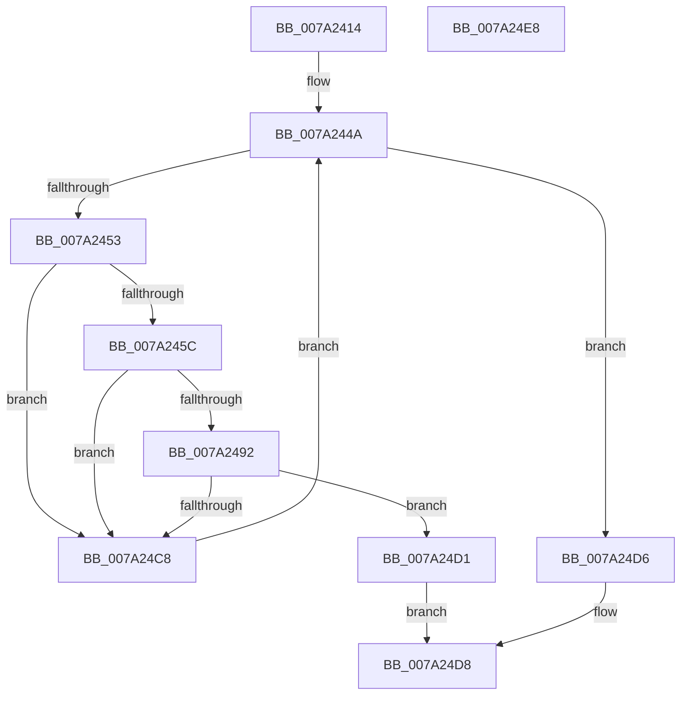

# SepSecureBootFindMatchingRegistryRule

- RVA: `0x007A2414`–`0x007A24E9` (길이 `213` bytes)
- VA: `0x00000001407A2414`
- 실행 섹션: `PAGE`
- PDB 이름 있음: `예`; PDB Function 태그: `아니요`
- unwind 정보 RVA: `0x000B6B54`
- 디코드: `54`개 명령, `213/213` bytes 표시
- 미해석 바이트: `0` (있으면 어셈블리에 `.byte`로 보존)

> 이 문서는 커널 이미지의 기계어와 PDB 기호를 분석해 생성했습니다. 4번과 5번은 함수 원형과 자료형을 바이너리 사용 방식에서 추정한 C 해석이며 원본 소스 복구 결과는 아닙니다.

## 1. Dependencies

- 직접 호출 지점: **2**; 고유 호출 대상: **1**
- 직접 호출자로 확인된 함수: **1**
- RIP 상대 이미지 참조: **3**

### Outgoing calls
- `0x007A2489` → [SepEqualAsciiWideStringCaseInSensitive](SepEqualAsciiWideStringCaseInSensitive_function_007A20F8.md) (function, `0x007A20F8`)
- `0x007A24BF` → [SepEqualAsciiWideStringCaseInSensitive](SepEqualAsciiWideStringCaseInSensitive_function_007A20F8.md) (function, `0x007A20F8`)

### Direct callers
- [SeQuerySecureBootPolicyValue](SeQuerySecureBootPolicyValue_function_007A2020.md) at `0x007A204A`

### Static image references
- `0x007A2423` → RVA `0x00E67DF0` (`.data`; read)
- `0x007A242D` → RVA `0x00E67DE8` (`.data`; read)
- `0x007A2465` → RVA `0x00E67DE0` (`.data`; read)

## 2. Other-region calls and transfers

- 다른 실행 섹션으로 향하는 call: **0**
- 별도 외부 분기/꼬리 이동을 확인하지 못했습니다.

## 3. Assembly (complete function range)

```asm
007A2414  48 89 5C 24 08                  mov qword ptr [rsp + 8], rbx
007A2419  48 89 6C 24 10                  mov qword ptr [rsp + 0x10], rbp
007A241E  56                              push rsi
007A241F  48 83 EC 30                     sub rsp, 0x30
007A2423  48 8B 05 C6 59 6C 00            mov rax, qword ptr [rip + 0x6c59c6]
007A242A  0F 57 C0                        xorps xmm0, xmm0
007A242D  4C 8B 1D B4 59 6C 00            mov r11, qword ptr [rip + 0x6c59b4]
007A2434  49 8B F0                        mov rsi, r8
007A2437  48 8B EA                        mov rbp, rdx
007A243A  0F 11 44 24 20                  movups xmmword ptr [rsp + 0x20], xmm0
007A243F  0F B7 58 26                     movzx ebx, word ptr [rax + 0x26]
007A2443  48 C1 E3 04                     shl rbx, 4
007A2447  49 03 DB                        add rbx, r11
007A244A  4C 3B DB                        cmp r11, rbx
007A244D  0F 83 83 00 00 00               jae 0x1407a24d6
007A2453  41 81 3B 00 00 00 81            cmp dword ptr [r11], 0x81000000
007A245A  75 6C                           jne 0x1407a24c8
007A245C  41 8B 4B 04                     mov ecx, dword ptr [r11 + 4]
007A2460  48 8D 54 24 20                  lea rdx, [rsp + 0x20]
007A2465  48 03 0D 74 59 6C 00            add rcx, qword ptr [rip + 0x6c5974]
007A246C  48 8D 41 02                     lea rax, [rcx + 2]
007A2470  48 89 44 24 28                  mov qword ptr [rsp + 0x28], rax
007A2475  0F B7 01                        movzx eax, word ptr [rcx]
007A2478  48 8B CD                        mov rcx, rbp
007A247B  66 89 44 24 20                  mov word ptr [rsp + 0x20], ax
007A2480  66 83 C0 02                     add ax, 2
007A2484  66 89 44 24 22                  mov word ptr [rsp + 0x22], ax
007A2489  E8 6A FC FF FF                  call 0x1407a20f8
007A248E  84 C0                           test al, al
007A2490  74 36                           je 0x1407a24c8
007A2492  41 8B 4B 08                     mov ecx, dword ptr [r11 + 8]
007A2496  48 8D 54 24 20                  lea rdx, [rsp + 0x20]
007A249B  48 03 0D 3E 59 6C 00            add rcx, qword ptr [rip + 0x6c593e]
007A24A2  48 8D 41 02                     lea rax, [rcx + 2]
007A24A6  48 89 44 24 28                  mov qword ptr [rsp + 0x28], rax
007A24AB  0F B7 01                        movzx eax, word ptr [rcx]
007A24AE  48 8B CE                        mov rcx, rsi
007A24B1  66 89 44 24 20                  mov word ptr [rsp + 0x20], ax
007A24B6  66 83 C0 02                     add ax, 2
007A24BA  66 89 44 24 22                  mov word ptr [rsp + 0x22], ax
007A24BF  E8 34 FC FF FF                  call 0x1407a20f8
007A24C4  84 C0                           test al, al
007A24C6  75 09                           jne 0x1407a24d1
007A24C8  49 83 C3 10                     add r11, 0x10
007A24CC  E9 79 FF FF FF                  jmp 0x1407a244a
007A24D1  49 8B C3                        mov rax, r11
007A24D4  EB 02                           jmp 0x1407a24d8
007A24D6  33 C0                           xor eax, eax
007A24D8  48 8B 5C 24 40                  mov rbx, qword ptr [rsp + 0x40]
007A24DD  48 8B 6C 24 48                  mov rbp, qword ptr [rsp + 0x48]
007A24E2  48 83 C4 30                     add rsp, 0x30
007A24E6  5E                              pop rsi
007A24E7  C3                              ret
007A24E8  CC                              int3
```

## 4. C-style interpretation (structured pseudocode)

```c
__int64 __fastcall SepSecureBootFindMatchingRegistryRule(__int64 a1, __int64 a2, __int64 a3)
{
    __int64 result;
    __int64 v_r11;
    __int64 v_rbx;
    __int64 v_rsp;
    unsigned __int64 v_stack_m10;
    unsigned __int16 v_stack_m16;
    unsigned __int64 v_stack_m18;
    unsigned __int64 v_stack_p10;
    unsigned __int64 v_stack_p8;

    v_stack_p8 = v_rbx;
    v_stack_p10 = v_rbp;
    v_rsp = (v_rsp) - (48);
    v_stack_m18 = v_xmm0;
    v_rbx = (*(unsigned __int16 *)(*(unsigned __int64 *)(v_rip + 7100870) + 38)) << (4);
    v_rbx = (v_rbx) + (*(unsigned __int64 *)(v_rip + 7100852));
loc_007A244A:
    if ((*(unsigned __int64 *)(v_rip + 7100852)) >= v_rbx) goto loc_007A24D6;
    if ((*(unsigned int *)(*(unsigned __int64 *)(v_rip + 7100852))) != 0x81000000ULL) goto loc_007A24C8;
    a1 = ((unsigned int)(*(unsigned int *)(*(unsigned __int64 *)(v_rip + 7100852) + 4))) + (*(unsigned __int64 *)(v_rip + 7100788));
    v_stack_m10 = a1 + 2;
    v_stack_m18 = (unsigned __int16)(*(unsigned __int16 *)(a1));
    result = (unsigned __int16)((*(unsigned __int16 *)(a1)) + (2));
    v_stack_m16 = (unsigned __int16)(result);
    result = SepEqualAsciiWideStringCaseInSensitive(a2, v_stack_m18, a3, a4);
    if ((unsigned __int8)(result) == 0) goto loc_007A24C8;
    a1 = ((unsigned int)(*(unsigned int *)(*(unsigned __int64 *)(v_rip + 7100852) + 8))) + (*(unsigned __int64 *)(v_rip + 7100734));
    v_stack_m10 = a1 + 2;
    v_stack_m18 = (unsigned __int16)(*(unsigned __int16 *)(a1));
    result = (unsigned __int16)((*(unsigned __int16 *)(a1)) + (2));
    v_stack_m16 = (unsigned __int16)(result);
    result = SepEqualAsciiWideStringCaseInSensitive(a3, v_stack_m18, a3, a4);
    if ((unsigned __int8)(result) != 0) goto loc_007A24D1;
loc_007A24C8:
    v_r11 = (*(unsigned __int64 *)(v_rip + 7100852)) + (16);
    goto loc_007A244A;
loc_007A24D1:
    goto loc_007A24D8;
loc_007A24D6:
    result = 0;
loc_007A24D8:
    v_rsp = (v_rsp) + (48);
    return result;
}
```

## 5. (Beta) C Style

```c
int64_t SepSecureBootFindMatchingRegistryRule(int64_t Arg1, int64_t Arg2, int64_t Arg3)
{
    int64_t result;
    int64_t local_r11;
    int64_t local_rbx;
    int64_t local_rsp;
    uint64_t v_stack_m10;
    uint16_t v_stack_m16;
    uint64_t v_stack_m18;
    uint64_t v_stack_p10;
    uint64_t v_stack_p8;

    v_stack_p8 = local_rbx;
    v_stack_p10 = local_rbp;
    local_rsp = (local_rsp) - (48);
    v_stack_m18 = v_xmm0;
    local_rbx = (*(uint16_t *)(*(uint64_t *)(v_rip + 0x6C59C6) + 0x26)) << (4);
    local_rbx = (local_rbx) + (*(uint64_t *)(v_rip + 0x6C59B4));
loc_007A244A:
    if ((*(uint64_t *)(v_rip + 0x6C59B4)) >= local_rbx) goto loc_007A24D6;
    if ((*(uint32_t *)(*(uint64_t *)(v_rip + 0x6C59B4))) != 0x81000000ULL) goto loc_007A24C8;
    Arg1 = ((uint32_t)(*(uint32_t *)(*(uint64_t *)(v_rip + 0x6C59B4) + 0x4))) + (*(uint64_t *)(v_rip + 0x6C5974));
    v_stack_m10 = Arg1 + 2;
    v_stack_m18 = (uint16_t)(*(uint16_t *)(Arg1));
    result = (uint16_t)((*(uint16_t *)(Arg1)) + (2));
    v_stack_m16 = (uint16_t)(result);
    result = SepEqualAsciiWideStringCaseInSensitive(Arg2, v_stack_m18, Arg3, a4);
    if ((uint8_t)(result) == 0) goto loc_007A24C8;
    Arg1 = ((uint32_t)(*(uint32_t *)(*(uint64_t *)(v_rip + 0x6C59B4) + 0x8))) + (*(uint64_t *)(v_rip + 0x6C593E));
    v_stack_m10 = Arg1 + 2;
    v_stack_m18 = (uint16_t)(*(uint16_t *)(Arg1));
    result = (uint16_t)((*(uint16_t *)(Arg1)) + (2));
    v_stack_m16 = (uint16_t)(result);
    result = SepEqualAsciiWideStringCaseInSensitive(Arg3, v_stack_m18, Arg3, a4);
    if ((uint8_t)(result) != 0) goto loc_007A24D1;
loc_007A24C8:
    local_r11 = (*(uint64_t *)(v_rip + 0x6C59B4)) + (16);
    goto loc_007A244A;
loc_007A24D1:
    goto loc_007A24D8;
loc_007A24D6:
    result = 0;
loc_007A24D8:
    local_rsp = (local_rsp) + (48);
    return result;
}
```

## 6. Execution-region graph

[열기: 2D/3D 그래프와 함수 탐색 컨트롤 패널](../../../control-panel.html?section=page&rva=0x007A2414&view=graph)

- 2D 그래프는 위에서 아래로 흐르고, 3D 그래프는 빈 공간을 드래그해 회전합니다. Shift+드래그는 이동, 휠은 확대·축소, 함수 노드 선택은 대상 보고서 이동입니다.

### Static fallback


