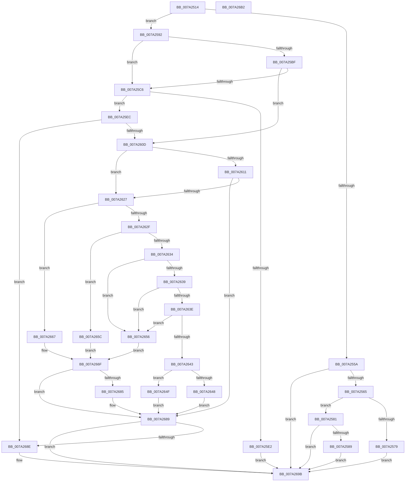

# SepSecureBootUpdateBcdDataForRule

- RVA: `0x007A2514`–`0x007A26B3` (길이 `415` bytes)
- VA: `0x00000001407A2514`
- 실행 섹션: `PAGE`
- PDB 이름 있음: `예`; PDB Function 태그: `아니요`
- unwind 정보 RVA: `0x000D15AC`
- 디코드: `127`개 명령, `415/415` bytes 표시
- 미해석 바이트: `0` (있으면 어셈블리에 `.byte`로 보존)

> 이 문서는 커널 이미지의 기계어와 PDB 기호를 분석해 생성했습니다. 4번과 5번은 함수 원형과 자료형을 바이너리 사용 방식에서 추정한 C 해석이며 원본 소스 복구 결과는 아닙니다.

## 1. Dependencies

- 직접 호출 지점: **7**; 고유 호출 대상: **6**
- 직접 호출자로 확인된 함수: **1**
- RIP 상대 이미지 참조: **1**

### Outgoing calls
- `0x007A256B` → [BiDeleteElement](../A3/BiDeleteElement_function_00A3E0F8.md) (function, `0x00A3E0F8`)
- `0x007A25B1` → [BcdGetElementData](../A3/BcdGetElementData_function_00A3E390.md) (function, `0x00A3E390`)
- `0x007A25D5` → [ExAllocatePool2](../../poolcode/B8/ExAllocatePool2_function_00B820F0.md) (function, `0x00B820F0`)
- `0x007A25FE` → [BcdGetElementData](../A3/BcdGetElementData_function_00A3E390.md) (function, `0x00A3E390`)
- `0x007A261C` → [SepSecureBootValidateBcdDataAgainstBcdRule](SepSecureBootValidateBcdDataAgainstBcdRule_function_007A26BC.md) (function, `0x007A26BC`)
- `0x007A267A` → [BcdSetElementDataWithFlags](../A3/BcdSetElementDataWithFlags_function_00A3F080.md) (function, `0x00A3F080`)
- `0x007A2696` → [ExFreePoolWithTag](../../poolcode/B8/ExFreePoolWithTag_function_00B82870.md) (function, `0x00B82870`)

### Direct callers
- [SepSecureBootCorrectBcd](SepSecureBootCorrectBcd_function_007A2174.md) at `0x007A235B`

### Static image references
- `0x007A2530` → RVA `0x00E67DE0` (`.data`; read)

## 2. Other-region calls and transfers

- 다른 실행 섹션으로 향하는 call: **2**
  - `0x007A25D5` → [ExAllocatePool2](../../poolcode/B8/ExAllocatePool2_function_00B820F0.md) (`PAGE` → `POOLCODE`)
  - `0x007A2696` → [ExFreePoolWithTag](../../poolcode/B8/ExFreePoolWithTag_function_00B82870.md) (`PAGE` → `POOLCODE`)
- 별도 외부 분기/꼬리 이동을 확인하지 못했습니다.

## 3. Assembly (complete function range)

```asm
007A2514  48 8B C4                        mov rax, rsp
007A2517  48 89 58 10                     mov qword ptr [rax + 0x10], rbx
007A251B  55                              push rbp
007A251C  56                              push rsi
007A251D  57                              push rdi
007A251E  41 54                           push r12
007A2520  41 55                           push r13
007A2522  41 56                           push r14
007A2524  41 57                           push r15
007A2526  48 83 EC 30                     sub rsp, 0x30
007A252A  8B 79 08                        mov edi, dword ptr [rcx + 8]
007A252D  45 33 ED                        xor r13d, r13d
007A2530  48 03 3D A9 58 6C 00            add rdi, qword ptr [rip + 0x6c58a9]
007A2537  4D 8B F8                        mov r15, r8
007A253A  4C 89 68 18                     mov qword ptr [rax + 0x18], r13
007A253E  4C 8B E2                        mov r12, rdx
007A2541  4C 8B F1                        mov r14, rcx
007A2544  45 88 28                        mov byte ptr [r8], r13b
007A2547  41 8D 6D 08                     lea ebp, [r13 + 8]
007A254B  41 8B F5                        mov esi, r13d
007A254E  8A 07                           mov al, byte ptr [rdi]
007A2550  41 8B DD                        mov ebx, r13d
007A2553  24 1F                           and al, 0x1f
007A2555  40 3A C5                        cmp al, bpl
007A2558  75 38                           jne 0x1407a2592
007A255A  66 44 39 6F 02                  cmp word ptr [rdi + 2], r13w
007A255F  0F 85 36 01 00 00               jne 0x1407a269b
007A2565  8B 51 04                        mov edx, dword ptr [rcx + 4]
007A2568  49 8B CC                        mov rcx, r12
007A256B  E8 88 BB 29 00                  call 0x140a3e0f8
007A2570  8B D8                           mov ebx, eax
007A2572  3D 25 02 00 C0                  cmp eax, 0xc0000225
007A2577  75 08                           jne 0x1407a2581
007A2579  41 8B DD                        mov ebx, r13d
007A257C  E9 1A 01 00 00                  jmp 0x1407a269b
007A2581  85 C0                           test eax, eax
007A2583  0F 88 12 01 00 00               js 0x1407a269b
007A2589  41 C6 07 01                     mov byte ptr [r15], 1
007A258D  E9 09 01 00 00                  jmp 0x1407a269b
007A2592  8B 51 04                        mov edx, dword ptr [rcx + 4]
007A2595  4C 8D 4C 24 70                  lea r9, [rsp + 0x70]
007A259A  49 8B CC                        mov rcx, r12
007A259D  89 6C 24 70                     mov dword ptr [rsp + 0x70], ebp
007A25A1  4C 8D 84 24 80 00 00 00         lea r8, [rsp + 0x80]
007A25A9  4C 8D AC 24 80 00 00 00         lea r13, [rsp + 0x80]
007A25B1  E8 DA BD 29 00                  call 0x140a3e390
007A25B6  8B D8                           mov ebx, eax
007A25B8  3D 23 00 00 C0                  cmp eax, 0xc0000023
007A25BD  74 07                           je 0x1407a25c6
007A25BF  3D 05 00 00 80                  cmp eax, 0x80000005
007A25C4  75 47                           jne 0x1407a260d
007A25C6  8B 54 24 70                     mov edx, dword ptr [rsp + 0x70]
007A25CA  B9 00 01 00 00                  mov ecx, 0x100
007A25CF  41 B8 53 65 53 62               mov r8d, 0x62536553
007A25D5  E8 16 FB 3D 00                  call 0x140b820f0
007A25DA  48 8B F0                        mov rsi, rax
007A25DD  48 85 C0                        test rax, rax
007A25E0  75 0A                           jne 0x1407a25ec
007A25E2  BB 9A 00 00 C0                  mov ebx, 0xc000009a
007A25E7  E9 AF 00 00 00                  jmp 0x1407a269b
007A25EC  41 8B 56 04                     mov edx, dword ptr [r14 + 4]
007A25F0  4C 8D 4C 24 70                  lea r9, [rsp + 0x70]
007A25F5  4C 8B C0                        mov r8, rax
007A25F8  49 8B CC                        mov rcx, r12
007A25FB  4C 8B E8                        mov r13, rax
007A25FE  E8 8D BD 29 00                  call 0x140a3e390
007A2603  8B D8                           mov ebx, eax
007A2605  85 C0                           test eax, eax
007A2607  0F 88 81 00 00 00               js 0x1407a268e
007A260D  85 DB                           test ebx, ebx
007A260F  78 16                           js 0x1407a2627
007A2611  44 8B 44 24 70                  mov r8d, dword ptr [rsp + 0x70]
007A2616  49 8B D5                        mov rdx, r13
007A2619  49 8B CE                        mov rcx, r14
007A261C  E8 9B 00 00 00                  call 0x1407a26bc
007A2621  8B D8                           mov ebx, eax
007A2623  85 C0                           test eax, eax
007A2625  79 62                           jns 0x1407a2689
007A2627  0F B7 07                        movzx eax, word ptr [rdi]
007A262A  83 E0 1F                        and eax, 0x1f
007A262D  74 38                           je 0x1407a2667
007A262F  83 E8 01                        sub eax, 1
007A2632  74 28                           je 0x1407a265c
007A2634  83 E8 04                        sub eax, 4
007A2637  74 1D                           je 0x1407a2656
007A2639  83 E8 01                        sub eax, 1
007A263C  74 18                           je 0x1407a2656
007A263E  83 E8 01                        sub eax, 1
007A2641  74 13                           je 0x1407a2656
007A2643  83 F8 01                        cmp eax, 1
007A2646  74 07                           je 0x1407a264f
007A2648  BB 03 00 43 C0                  mov ebx, 0xc0430003
007A264D  EB 3A                           jmp 0x1407a2689
007A264F  BB 25 02 00 C0                  mov ebx, 0xc0000225
007A2654  EB 33                           jmp 0x1407a2689
007A2656  4C 8D 4F 02                     lea r9, [rdi + 2]
007A265A  EB 13                           jmp 0x1407a266f
007A265C  4C 8D 4F 02                     lea r9, [rdi + 2]
007A2660  BD 01 00 00 00                  mov ebp, 1
007A2665  EB 08                           jmp 0x1407a266f
007A2667  0F B7 6F 02                     movzx ebp, word ptr [rdi + 2]
007A266B  4C 8D 4F 04                     lea r9, [rdi + 4]
007A266F  41 8B 56 04                     mov edx, dword ptr [r14 + 4]
007A2673  49 8B CC                        mov rcx, r12
007A2676  89 6C 24 20                     mov dword ptr [rsp + 0x20], ebp
007A267A  E8 01 CA 29 00                  call 0x140a3f080
007A267F  8B D8                           mov ebx, eax
007A2681  85 C0                           test eax, eax
007A2683  78 04                           js 0x1407a2689
007A2685  41 C6 07 01                     mov byte ptr [r15], 1
007A2689  48 85 F6                        test rsi, rsi
007A268C  74 0D                           je 0x1407a269b
007A268E  BA 53 65 53 62                  mov edx, 0x62536553
007A2693  48 8B CE                        mov rcx, rsi
007A2696  E8 D5 01 3E 00                  call 0x140b82870
007A269B  8B C3                           mov eax, ebx
007A269D  48 8B 5C 24 78                  mov rbx, qword ptr [rsp + 0x78]
007A26A2  48 83 C4 30                     add rsp, 0x30
007A26A6  41 5F                           pop r15
007A26A8  41 5E                           pop r14
007A26AA  41 5D                           pop r13
007A26AC  41 5C                           pop r12
007A26AE  5F                              pop rdi
007A26AF  5E                              pop rsi
007A26B0  5D                              pop rbp
007A26B1  C3                              ret
007A26B2  CC                              int3
```

## 4. C-style interpretation (structured pseudocode)

```c
__int64 __fastcall SepSecureBootUpdateBcdDataForRule(__int64 a1, __int64 a2, __int64 a3)
{
    __int64 result;
    __int64 v_r13;
    __int64 v_rdi;
    __int64 v_rsp;
    unsigned int v_stack_m48;
    unsigned __int64 v_stack_p10;
    unsigned __int64 v_stack_p18;
    unsigned __int64 v_stack_p8;

    *(unsigned __int64 *)(v_rsp + 16) = v_rbx;
    v_rsp = (v_rsp) - (48);
    v_r13 = 0;
    v_rdi = ((unsigned int)(*(unsigned int *)(a1 + 8))) + (*(unsigned __int64 *)(v_rip + 7100585));
    *(unsigned __int64 *)(v_rsp + 24) = 0;
    *(unsigned __int8 *)(a3) = 0;
    result = (unsigned __int8)((*(unsigned __int8 *)(v_rdi)) & (31));
    if (((unsigned __int8)(result)) != ((unsigned __int8)(v_r13 + 8))) goto loc_007A2592;
    if ((*(unsigned __int16 *)(v_rdi + 2)) != 0) goto loc_007A269B;
    result = BiDeleteElement(a2, (unsigned int)(*(unsigned int *)(a1 + 4)), a3, a4);
    if (((unsigned int)(result)) != 0xC0000225ULL) goto loc_007A2581;
    goto loc_007A269B;
loc_007A2581:
    if (sign_flag) goto loc_007A269B;
    *(unsigned __int8 *)(a3) = 1;
    goto loc_007A269B;
loc_007A2592:
    v_stack_p8 = (unsigned int)(v_r13 + 8);
    result = BcdGetElementData(a2, (unsigned int)(*(unsigned int *)(a2 + 4)), v_stack_p18, v_stack_p8);
    if (((unsigned int)(result)) == 0xC0000023ULL) goto loc_007A25C6;
    if (((unsigned int)(result)) != 0x80000005ULL) goto loc_007A260D;
loc_007A25C6:
    result = ExAllocatePool2(256, (unsigned int)(v_stack_p8), (unsigned int)(0x62536553ULL), v_stack_p8);
    if (result != 0) goto loc_007A25EC;
    goto loc_007A269B;
loc_007A25EC:
    result = BcdGetElementData(a2, (unsigned int)(*(unsigned int *)(a1 + 4)), result, v_stack_p8);
    if (sign_flag) goto loc_007A268E;
loc_007A260D:
    if (sign_flag) goto loc_007A2627;
    result = SepSecureBootValidateBcdDataAgainstBcdRule(a1, result, (unsigned int)(v_stack_p8), v_stack_p8);
    if (!sign_flag) goto loc_007A2689;
loc_007A2627:
    result = (unsigned int)((*(unsigned __int16 *)(v_rdi)) & (31));
    if (condition_is_equal) goto loc_007A2667;
    result = (unsigned int)((result) - (1));
    if (condition_is_equal) goto loc_007A265C;
    result = (unsigned int)((result) - (4));
    if (condition_is_equal) goto loc_007A2656;
    result = (unsigned int)((result) - (1));
    if (condition_is_equal) goto loc_007A2656;
    result = (unsigned int)((result) - (1));
    if (condition_is_equal) goto loc_007A2656;
    if (((unsigned int)(result)) == 1) goto loc_007A264F;
    goto loc_007A2689;
loc_007A264F:
    goto loc_007A2689;
loc_007A2656:
    goto loc_007A266F;
loc_007A265C:
    goto loc_007A266F;
loc_007A2667:
loc_007A266F:
    v_stack_m48 = (unsigned int)(*(unsigned __int16 *)(v_rdi + 2));
    result = BcdSetElementDataWithFlags(a2, (unsigned int)(*(unsigned int *)(a1 + 4)), (unsigned int)(v_stack_p8), v_rdi + 4);
    if (!(sign_flag)) {
        *(unsigned __int8 *)(a3) = 1;
    }
    if (result != 0) {
        a2 = 0x62536553ULL;
        a1 = result;
        result = ExFreePoolWithTag(a1, a2, (unsigned int)(v_stack_p8), v_rdi + 4);
    }
    v_rsp = (v_rsp) + (48);
    return (unsigned int)((unsigned int)((unsigned int)((unsigned int)(result))));
}
```

## 5. (Beta) C Style

```c
int64_t SepSecureBootUpdateBcdDataForRule(void *Arg1, int64_t Arg2, void *Arg3)
{
    uint8_t *arg1 = (uint8_t *)Arg1;
    uint8_t *arg3 = (uint8_t *)Arg3;

    int64_t result;
    int64_t local_r13;
    int64_t local_rdi;
    int64_t local_rsp;
    uint32_t v_stack_m48;
    uint64_t v_stack_p10;
    uint64_t v_stack_p18;
    uint64_t v_stack_p8;

    *(uint64_t *)(local_rsp + 0x10) = local_rbx;
    local_rsp = (local_rsp) - (48);
    local_r13 = 0;
    local_rdi = ((uint32_t)(*(uint32_t *)(arg1 + 0x8))) + (*(uint64_t *)(v_rip + 0x6C58A9));
    *(uint64_t *)(local_rsp + 0x18) = 0;
    *(uint8_t *)(arg3) = 0;
    result = (uint8_t)((*(uint8_t *)(local_rdi)) & (31));
    if (((uint8_t)(result)) != ((uint8_t)(local_r13 + 8))) goto loc_007A2592;
    if ((*(uint16_t *)(local_rdi + 0x2)) != 0) goto loc_007A269B;
    result = BiDeleteElement(Arg2, (uint32_t)(*(uint32_t *)(arg1 + 0x4)), Arg3, a4);
    if (((uint32_t)(result)) != 0xC0000225ULL) goto loc_007A2581;
    goto loc_007A269B;
loc_007A2581:
    if (sign_flag) goto loc_007A269B;
    *(uint8_t *)(arg3) = 1;
    goto loc_007A269B;
loc_007A2592:
    v_stack_p8 = (uint32_t)(local_r13 + 8);
    result = BcdGetElementData(Arg2, (uint32_t)(*(uint32_t *)(Arg2 + 0x4)), v_stack_p18, v_stack_p8);
    if (((uint32_t)(result)) == 0xC0000023ULL) goto loc_007A25C6;
    if (((uint32_t)(result)) != 0x80000005ULL) goto loc_007A260D;
loc_007A25C6:
    result = ExAllocatePool2(256, (uint32_t)(v_stack_p8), (uint32_t)(0x62536553ULL), v_stack_p8);
    if (result != 0) goto loc_007A25EC;
    goto loc_007A269B;
loc_007A25EC:
    result = BcdGetElementData(Arg2, (uint32_t)(*(uint32_t *)(arg1 + 0x4)), result, v_stack_p8);
    if (sign_flag) goto loc_007A268E;
loc_007A260D:
    if (sign_flag) goto loc_007A2627;
    result = SepSecureBootValidateBcdDataAgainstBcdRule(Arg1, result, (uint32_t)(v_stack_p8), v_stack_p8);
    if (!sign_flag) goto loc_007A2689;
loc_007A2627:
    result = (uint32_t)((*(uint16_t *)(local_rdi)) & (31));
    if (condition_is_equal) goto loc_007A2667;
    result = (uint32_t)((result) - (1));
    if (condition_is_equal) goto loc_007A265C;
    result = (uint32_t)((result) - (4));
    if (condition_is_equal) goto loc_007A2656;
    result = (uint32_t)((result) - (1));
    if (condition_is_equal) goto loc_007A2656;
    result = (uint32_t)((result) - (1));
    if (condition_is_equal) goto loc_007A2656;
    if (((uint32_t)(result)) == 1) goto loc_007A264F;
    goto loc_007A2689;
loc_007A264F:
    goto loc_007A2689;
loc_007A2656:
    goto loc_007A266F;
loc_007A265C:
    goto loc_007A266F;
loc_007A2667:
loc_007A266F:
    v_stack_m48 = (uint32_t)(*(uint16_t *)(local_rdi + 0x2));
    result = BcdSetElementDataWithFlags(Arg2, (uint32_t)(*(uint32_t *)(arg1 + 0x4)), (uint32_t)(v_stack_p8), local_rdi + 4);
    if (!(sign_flag)) {
        *(uint8_t *)(arg3) = 1;
    }
    if (result != 0) {
        Arg2 = 0x62536553ULL;
        Arg1 = result;
        result = ExFreePoolWithTag(Arg1, Arg2, (uint32_t)(v_stack_p8), local_rdi + 4);
    }
    local_rsp = (local_rsp) + (48);
    return (uint32_t)((uint32_t)((uint32_t)((uint32_t)(result))));
}
```

### 관측된 메모리 오프셋

구조체 형식이 확인되지 않은 접근은 인자 기준의 오프셋으로만 기록했습니다.

| 기준 인자 | 오프셋 표현 | 폭 (bit) | 접근 |
|---|---:|---:|---|
| `Arg1` | `+ 0x4` | `32` | `R` |
| `Arg1` | `+ 0x8` | `32` | `R` |
| `Arg3` | `+ 0x0` | `8` | `W` |

## 6. Execution-region graph

[열기: 2D/3D 그래프와 함수 탐색 컨트롤 패널](../../../control-panel.html?section=page&rva=0x007A2514&view=graph)

- 2D 그래프는 위에서 아래로 흐르고, 3D 그래프는 빈 공간을 드래그해 회전합니다. Shift+드래그는 이동, 휠은 확대·축소, 함수 노드 선택은 대상 보고서 이동입니다.

### Static fallback


