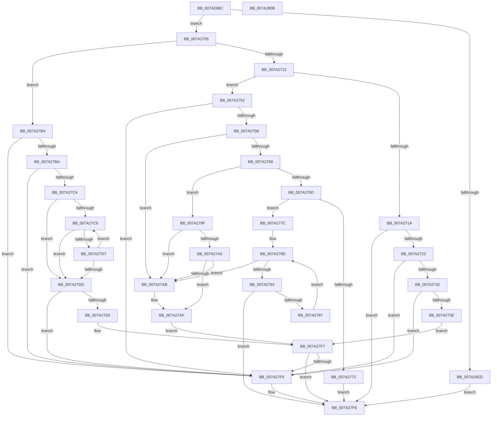

# SepSecureBootValidateBcdDataAgainstBcdRule

- RVA: `0x007A26BC`–`0x007A280C` (길이 `336` bytes)
- VA: `0x00000001407A26BC`
- 실행 섹션: `PAGE`
- PDB 이름 있음: `예`; PDB Function 태그: `아니요`
- unwind 정보 RVA: `0x0005CAAC`
- 디코드: `101`개 명령, `336/336` bytes 표시
- 미해석 바이트: `0` (있으면 어셈블리에 `.byte`로 보존)

> 이 문서는 커널 이미지의 기계어와 PDB 기호를 분석해 생성했습니다. 4번과 5번은 함수 원형과 자료형을 바이너리 사용 방식에서 추정한 C 해석이며 원본 소스 복구 결과는 아닙니다.

## 1. Dependencies

- 직접 호출 지점: **1**; 고유 호출 대상: **1**
- 직접 호출자로 확인된 함수: **2**
- RIP 상대 이미지 참조: **1**

### Outgoing calls
- `0x007A27F0` → [memcmp](../../text/6C/memcmp_function_006C6B10.md) (function, `0x006C6B10`)

### Direct callers
- [NtFilterBootOption](NtFilterBootOption_function_007A1BE0.md) at `0x007A1EDB`
- [SepSecureBootUpdateBcdDataForRule](SepSecureBootUpdateBcdDataForRule_function_007A2514.md) at `0x007A261C`

### Static image references
- `0x007A26CE` → RVA `0x00E67DE0` (`.data`; read)

## 2. Other-region calls and transfers

- 다른 실행 섹션으로 향하는 call: **1**
  - `0x007A27F0` → [memcmp](../../text/6C/memcmp_function_006C6B10.md) (`PAGE` → `.text`)
- 별도 외부 분기/꼬리 이동을 확인하지 못했습니다.

## 3. Assembly (complete function range)

```asm
007A26BC  48 89 5C 24 08                  mov qword ptr [rsp + 8], rbx
007A26C1  57                              push rdi
007A26C2  48 83 EC 20                     sub rsp, 0x20
007A26C6  33 DB                           xor ebx, ebx
007A26C8  4C 8B D2                        mov r10, rdx
007A26CB  8B 51 08                        mov edx, dword ptr [rcx + 8]
007A26CE  48 03 15 0B 57 6C 00            add rdx, qword ptr [rip + 0x6c570b]
007A26D5  8D 7B 1F                        lea edi, [rbx + 0x1f]
007A26D8  44 8D 5B 08                     lea r11d, [rbx + 8]
007A26DC  0F B7 02                        movzx eax, word ptr [rdx]
007A26DF  44 0F B7 C8                     movzx r9d, ax
007A26E3  66 44 23 CF                     and r9w, di
007A26E7  66 45 3B CB                     cmp r9w, r11w
007A26EB  75 18                           jne 0x1407a2705
007A26ED  0F B7 42 02                     movzx eax, word ptr [rdx + 2]
007A26F1  66 F7 D8                        neg ax
007A26F4  1B C9                           sbb ecx, ecx
007A26F6  F7 D1                           not ecx
007A26F8  81 E1 02 00 43 C0               and ecx, 0xc0430002
007A26FE  8B D9                           mov ebx, ecx
007A2700  E9 F9 00 00 00                  jmp 0x1407a27fe
007A2705  0F B6 49 07                     movzx ecx, byte ptr [rcx + 7]
007A2709  83 E1 0F                        and ecx, 0xf
007A270C  83 E9 02                        sub ecx, 2
007A270F  0F 84 9F 00 00 00               je 0x1407a27b4
007A2715  83 E9 03                        sub ecx, 3
007A2718  74 38                           je 0x1407a2752
007A271A  83 F9 01                        cmp ecx, 1
007A271D  0F 85 DB 00 00 00               jne 0x1407a27fe
007A2723  B9 01 00 00 00                  mov ecx, 1
007A2728  66 44 3B C9                     cmp r9w, cx
007A272C  0F 85 C7 00 00 00               jne 0x1407a27f9
007A2732  41 8D 40 FF                     lea eax, [r8 - 1]
007A2736  3B C1                           cmp eax, ecx
007A2738  0F 87 BB 00 00 00               ja 0x1407a27f9
007A273E  66 39 5A 02                     cmp word ptr [rdx + 2], bx
007A2742  0F 95 C1                        setne cl
007A2745  41 38 1A                        cmp byte ptr [r10], bl
007A2748  0F 95 C0                        setne al
007A274B  3A C8                           cmp cl, al
007A274D  E9 A5 00 00 00                  jmp 0x1407a27f7
007A2752  45 3B C3                        cmp r8d, r11d
007A2755  0F 85 9E 00 00 00               jne 0x1407a27f9
007A275B  4D 8B 02                        mov r8, qword ptr [r10]
007A275E  23 C7                           and eax, edi
007A2760  49 8B C8                        mov rcx, r8
007A2763  83 E8 05                        sub eax, 5
007A2766  74 43                           je 0x1407a27ab
007A2768  83 E8 01                        sub eax, 1
007A276B  74 32                           je 0x1407a279f
007A276D  83 F8 01                        cmp eax, 1
007A2770  74 0A                           je 0x1407a277c
007A2772  BB 03 00 43 C0                  mov ebx, 0xc0430003
007A2777  E9 82 00 00 00                  jmp 0x1407a27fe
007A277C  44 0F B7 52 0A                  movzx r10d, word ptr [rdx + 0xa]
007A2781  4C 8D 4A 0C                     lea r9, [rdx + 0xc]
007A2785  48 8B C3                        mov rax, rbx
007A2788  B9 01 00 00 00                  mov ecx, 1
007A278D  49 3B C2                        cmp rax, r10
007A2790  73 19                           jae 0x1407a27ab
007A2792  4D 39 01                        cmp qword ptr [r9], r8
007A2795  74 67                           je 0x1407a27fe
007A2797  48 03 C1                        add rax, rcx
007A279A  4D 03 CB                        add r9, r11
007A279D  EB EE                           jmp 0x1407a278d
007A279F  4C 3B 42 0A                     cmp r8, qword ptr [rdx + 0xa]
007A27A3  72 06                           jb 0x1407a27ab
007A27A5  4C 3B 42 12                     cmp r8, qword ptr [rdx + 0x12]
007A27A9  76 04                           jbe 0x1407a27af
007A27AB  48 8B 4A 02                     mov rcx, qword ptr [rdx + 2]
007A27AF  4C 3B C1                        cmp r8, rcx
007A27B2  EB 43                           jmp 0x1407a27f7
007A27B4  66 45 85 C9                     test r9w, r9w
007A27B8  75 3F                           jne 0x1407a27f9
007A27BA  B9 01 00 00 00                  mov ecx, 1
007A27BF  44 84 C1                        test cl, r8b
007A27C2  75 35                           jne 0x1407a27f9
007A27C4  45 85 C0                        test r8d, r8d
007A27C7  74 14                           je 0x1407a27dd
007A27C9  41 8B C0                        mov eax, r8d
007A27CC  48 D1 E8                        shr rax, 1
007A27CF  66 41 39 5C 42 FE               cmp word ptr [r10 + rax*2 - 2], bx
007A27D5  75 06                           jne 0x1407a27dd
007A27D7  41 83 C0 FE                     add r8d, -2
007A27DB  75 EC                           jne 0x1407a27c9
007A27DD  0F B7 42 02                     movzx eax, word ptr [rdx + 2]
007A27E1  44 3B C0                        cmp r8d, eax
007A27E4  75 13                           jne 0x1407a27f9
007A27E6  45 8B C0                        mov r8d, r8d
007A27E9  48 83 C2 04                     add rdx, 4
007A27ED  49 8B CA                        mov rcx, r10
007A27F0  E8 1B 43 F2 FF                  call 0x1406c6b10
007A27F5  85 C0                           test eax, eax
007A27F7  74 05                           je 0x1407a27fe
007A27F9  BB 02 00 43 C0                  mov ebx, 0xc0430002
007A27FE  8B C3                           mov eax, ebx
007A2800  48 8B 5C 24 30                  mov rbx, qword ptr [rsp + 0x30]
007A2805  48 83 C4 20                     add rsp, 0x20
007A2809  5F                              pop rdi
007A280A  C3                              ret
007A280B  CC                              int3
```

## 4. C-style interpretation (structured pseudocode)

```c
__int64 __fastcall SepSecureBootValidateBcdDataAgainstBcdRule(__int64 a1, __int64 a2, __int64 a3)
{
    __int64 result;
    __int64 v_rbx;
    __int64 v_rsp;
    unsigned __int64 v_stack_p8;

    v_stack_p8 = v_rbx;
    v_rsp = (v_rsp) - (32);
    v_rbx = 0;
    a2 = ((unsigned int)(*(unsigned int *)(a1 + 8))) + (*(unsigned __int64 *)(v_rip + 7100171));
    a4 = (unsigned __int16)(((unsigned __int16)(*(unsigned __int16 *)(a2))) & ((unsigned __int16)(v_rbx + 31)));
    if (((unsigned __int16)(a4)) != ((unsigned __int16)(v_rbx + 8))) goto loc_007A2705;
    result = (unsigned __int16)(-(*(unsigned __int16 *)(a2 + 2)));
    a1 = (unsigned int)(~(a1));
    a1 = (unsigned int)((a1) & (0xC0430002ULL));
    goto loc_007A27FE;
loc_007A2705:
    a1 = (unsigned int)((*(unsigned __int8 *)(a1 + 7)) & (15));
    a1 = (unsigned int)((a1) - (2));
    if (condition_is_equal) goto loc_007A27B4;
    a1 = (unsigned int)((a1) - (3));
    if (condition_is_equal) goto loc_007A2752;
    if (((unsigned int)(a1)) != 1) goto loc_007A27FE;
    if (((unsigned __int16)(a4)) != 1) goto loc_007A27F9;
    if (((unsigned int)(a3 - 1)) > 1) goto loc_007A27F9;
    a1 = ((*(unsigned __int16 *)(a2 + 2)) != ((unsigned __int16)((unsigned int)((unsigned int)(a1))))) ? 1 : 0;
    result = ((*(unsigned __int8 *)(a2)) != ((unsigned __int8)((unsigned int)((unsigned int)(a1))))) ? 1 : 0;
    goto loc_007A27F7;
loc_007A2752:
    if (((unsigned int)(a3)) != ((unsigned int)(v_rbx + 8))) goto loc_007A27F9;
    result = (unsigned int)((result) & ((unsigned int)(v_rbx + 31)));
    result = (unsigned int)((result) - (5));
    if (condition_is_equal) goto loc_007A27AB;
    result = (unsigned int)((result) - (1));
    if (condition_is_equal) goto loc_007A279F;
    if (((unsigned int)(result)) == 1) goto loc_007A277C;
    goto loc_007A27FE;
loc_007A277C:
loc_007A278D:
    if (((unsigned int)(0xC0430003ULL)) >= (*(unsigned __int16 *)(a2 + 10))) goto loc_007A27AB;
    if ((*(unsigned __int64 *)(a2 + 12)) == (*(unsigned __int64 *)(a2))) goto loc_007A27FE;
    result = ((unsigned int)(0xC0430003ULL)) + (1);
    a4 = (a2 + 12) + (v_rbx + 8);
    goto loc_007A278D;
loc_007A279F:
    if ((*(unsigned __int64 *)(a2)) < (*(unsigned __int64 *)(a2 + 10))) goto loc_007A27AB;
    if ((*(unsigned __int64 *)(a2)) >= = (*(unsigned __int64 *)(a2 + 18))) {
        a1 = *(unsigned __int64 *)(a2 + 2);
    }
    goto loc_007A27F7;
loc_007A27B4:
    if ((unsigned __int16)(a4) != 0) goto loc_007A27F9;
    if (((1) & ((unsigned __int8)(*(unsigned __int64 *)(a2)))) != 0) goto loc_007A27F9;
    if ((unsigned int)(*(unsigned __int64 *)(a2)) == 0) goto loc_007A27DD;
loc_007A27C9:
    result = ((unsigned int)((unsigned int)(*(unsigned __int64 *)(a2)))) >> (1);
    if ((*(unsigned __int16 *)(*(unsigned __int16 *)(a2 + 10) + result * 2 - 2)) != ((unsigned __int16)((unsigned int)(0xC0430003ULL)))) goto loc_007A27DD;
    a3 = (unsigned int)((*(unsigned __int64 *)(a2)) + (-2));
    if (condition_is_not_equal) goto loc_007A27C9;
loc_007A27DD:
    if (((unsigned int)(a3)) != ((unsigned int)(*(unsigned __int16 *)(a2 + 2)))) goto loc_007A27F9;
    a2 = (a2) + (4);
    result = memcmp(*(unsigned __int16 *)(a2 + 10), a2, (unsigned int)((unsigned int)(a3)), a4);
loc_007A27F7:
    v_rbx = (unsigned int)(0xC0430003ULL);
    if ((unsigned int)(result) != 0) {
        v_rbx = 0xC0430002ULL;
    }
    v_rsp = (v_rsp) + (32);
    return (unsigned int)((unsigned int)(v_rbx));
}
```

## 5. (Beta) C Style

```c
int64_t SepSecureBootValidateBcdDataAgainstBcdRule(void *Arg1, void *Arg2, void *Arg3)
{
    uint8_t *arg1 = (uint8_t *)Arg1;
    uint8_t *arg2 = (uint8_t *)Arg2;
    uint8_t *arg3 = (uint8_t *)Arg3;

    int64_t result;
    int64_t local_rbx;
    int64_t local_rsp;
    uint64_t v_stack_p8;

    v_stack_p8 = local_rbx;
    local_rsp = (local_rsp) - (32);
    local_rbx = 0;
    Arg2 = ((uint32_t)(*(uint32_t *)(arg1 + 0x8))) + (*(uint64_t *)(v_rip + 0x6C570B));
    a4 = (uint16_t)(((uint16_t)(*(uint16_t *)(arg2))) & ((uint16_t)(local_rbx + 31)));
    if (((uint16_t)(a4)) != ((uint16_t)(local_rbx + 8))) goto loc_007A2705;
    result = (uint16_t)(-(*(uint16_t *)(arg2 + 0x2)));
    Arg1 = (uint32_t)(~(Arg1));
    Arg1 = (uint32_t)((Arg1) & (0xC0430002ULL));
    goto loc_007A27FE;
loc_007A2705:
    Arg1 = (uint32_t)((*(uint8_t *)(arg1 + 0x7)) & (15));
    Arg1 = (uint32_t)((Arg1) - (2));
    if (condition_is_equal) goto loc_007A27B4;
    Arg1 = (uint32_t)((Arg1) - (3));
    if (condition_is_equal) goto loc_007A2752;
    if (((uint32_t)(Arg1)) != 1) goto loc_007A27FE;
    if (((uint16_t)(a4)) != 1) goto loc_007A27F9;
    if (((uint32_t)(Arg3 - 1)) > 1) goto loc_007A27F9;
    Arg1 = ((*(uint16_t *)(arg2 + 0x2)) != ((uint16_t)((uint32_t)((uint32_t)(Arg1))))) ? 1 : 0;
    result = ((*(uint8_t *)(arg2)) != ((uint8_t)((uint32_t)((uint32_t)(Arg1))))) ? 1 : 0;
    goto loc_007A27F7;
loc_007A2752:
    if (((uint32_t)(Arg3)) != ((uint32_t)(local_rbx + 8))) goto loc_007A27F9;
    result = (uint32_t)((result) & ((uint32_t)(local_rbx + 31)));
    result = (uint32_t)((result) - (5));
    if (condition_is_equal) goto loc_007A27AB;
    result = (uint32_t)((result) - (1));
    if (condition_is_equal) goto loc_007A279F;
    if (((uint32_t)(result)) == 1) goto loc_007A277C;
    goto loc_007A27FE;
loc_007A277C:
loc_007A278D:
    if (((uint32_t)(0xC0430003ULL)) >= (*(uint16_t *)(arg2 + 0xA))) goto loc_007A27AB;
    if ((*(uint64_t *)(arg2 + 0xC)) == (*(uint64_t *)(arg2))) goto loc_007A27FE;
    result = ((uint32_t)(0xC0430003ULL)) + (1);
    a4 = (Arg2 + 12) + (local_rbx + 8);
    goto loc_007A278D;
loc_007A279F:
    if ((*(uint64_t *)(arg2)) < (*(uint64_t *)(arg2 + 0xA))) goto loc_007A27AB;
    if ((*(uint64_t *)(arg2)) >= = (*(uint64_t *)(arg2 + 0x12))) {
        Arg1 = *(uint64_t *)(arg2 + 0x2);
    }
    goto loc_007A27F7;
loc_007A27B4:
    if ((uint16_t)(a4) != 0) goto loc_007A27F9;
    if (((1) & ((uint8_t)(*(uint64_t *)(arg2)))) != 0) goto loc_007A27F9;
    if ((uint32_t)(*(uint64_t *)(arg2)) == 0) goto loc_007A27DD;
loc_007A27C9:
    result = ((uint32_t)((uint32_t)(*(uint64_t *)(arg2)))) >> (1);
    if ((*(uint16_t *)(*(uint16_t *)(arg2 + 0xA) + result * 2 - 0x2)) != ((uint16_t)((uint32_t)(0xC0430003ULL)))) goto loc_007A27DD;
    Arg3 = (uint32_t)((*(uint64_t *)(arg2)) + (-2));
    if (condition_is_not_equal) goto loc_007A27C9;
loc_007A27DD:
    if (((uint32_t)(Arg3)) != ((uint32_t)(*(uint16_t *)(arg2 + 0x2)))) goto loc_007A27F9;
    Arg2 = (Arg2) + (4);
    result = memcmp(*(uint16_t *)(arg2 + 0xA), Arg2, (uint32_t)((uint32_t)(Arg3)), a4);
loc_007A27F7:
    local_rbx = (uint32_t)(0xC0430003ULL);
    if ((uint32_t)(result) != 0) {
        local_rbx = 0xC0430002ULL;
    }
    local_rsp = (local_rsp) + (32);
    return (uint32_t)((uint32_t)(local_rbx));
}
```

### 관측된 메모리 오프셋

구조체 형식이 확인되지 않은 접근은 인자 기준의 오프셋으로만 기록했습니다.

| 기준 인자 | 오프셋 표현 | 폭 (bit) | 접근 |
|---|---:|---:|---|
| `Arg1` | `+ 0x7` | `8` | `R` |
| `Arg1` | `+ 0x8` | `32` | `R` |
| `Arg2` | `- 0x2 + rax*2` | `16` | `R` |
| `Arg2` | `+ 0x0` | `8` | `R` |
| `Arg2` | `+ 0x0` | `64` | `R` |
| `Arg3` | `- 0x1` | `32` | `R` |

## 6. Execution-region graph

[열기: 2D/3D 그래프와 함수 탐색 컨트롤 패널](../../../control-panel.html?section=page&rva=0x007A26BC&view=graph)

- 2D 그래프는 위에서 아래로 흐르고, 3D 그래프는 빈 공간을 드래그해 회전합니다. Shift+드래그는 이동, 휠은 확대·축소, 함수 노드 선택은 대상 보고서 이동입니다.

### Static fallback


