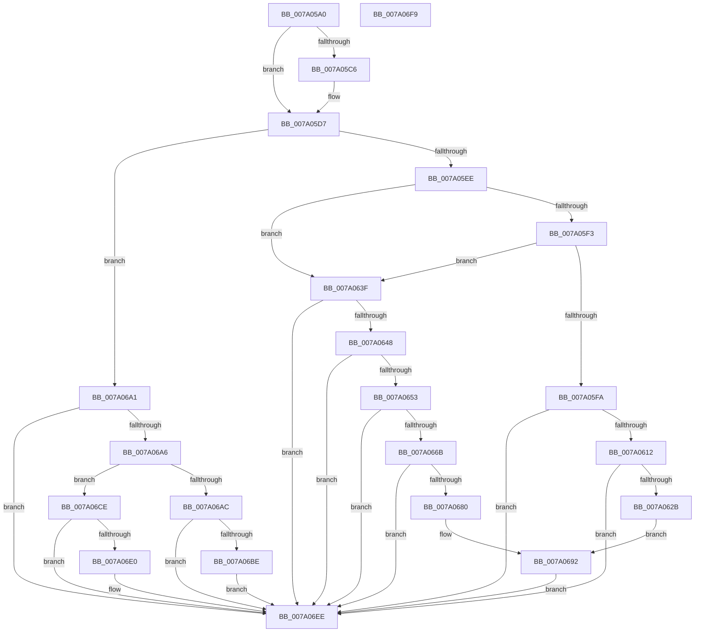

# SepSetAuditInfoForObjectType

- RVA: `0x007A05A0`–`0x007A06FA` (길이 `346` bytes)
- VA: `0x00000001407A05A0`
- 실행 섹션: `PAGE`
- PDB 이름 있음: `예`; PDB Function 태그: `아니요`
- unwind 정보 RVA: `0x000D1388`
- 디코드: `83`개 명령, `346/346` bytes 표시
- 미해석 바이트: `0` (있으면 어셈블리에 `.byte`로 보존)

> 이 문서는 커널 이미지의 기계어와 PDB 기호를 분석해 생성했습니다. 4번과 5번은 함수 원형과 자료형을 바이너리 사용 방식에서 추정한 C 해석이며 원본 소스 복구 결과는 아닙니다.

## 1. Dependencies

- 직접 호출 지점: **1**; 고유 호출 대상: **1**
- 직접 호출자로 확인된 함수: **1**
- RIP 상대 이미지 참조: **0**

### Outgoing calls
- `0x007A069A` → [SepAuditTypeList](SepAuditTypeList_function_007A04F4.md) (function, `0x007A04F4`)

### Direct callers
- [sub_00B397DE](../B3/Unknown_function_00B397DE.md) at `0x00B3981D`
- [sub_00B397DE](../B3/Unknown_function_00B397DE.md) at `0x00B39925`
- [sub_00B397DE](../B3/Unknown_function_00B397DE.md) at `0x00B399D4`
- [sub_00B397DE](../B3/Unknown_function_00B397DE.md) at `0x00B39A52`

### Static image references
- 디코드된 RIP-relative 메모리 참조가 없습니다.

## 2. Other-region calls and transfers

- 다른 실행 섹션으로 향하는 call: **0**
- 별도 외부 분기/꼬리 이동을 확인하지 못했습니다.

## 3. Assembly (complete function range)

```asm
007A05A0  48 89 6C 24 08                  mov qword ptr [rsp + 8], rbp
007A05A5  57                              push rdi
007A05A6  48 83 EC 30                     sub rsp, 0x30
007A05AA  41 8B F8                        mov edi, r8d
007A05AD  4D 8B D1                        mov r10, r9
007A05B0  4C 8B 44 24 78                  mov r8, qword ptr [rsp + 0x78]
007A05B5  45 32 C9                        xor r9b, r9b
007A05B8  44 8A D9                        mov r11b, cl
007A05BB  BD 40 00 00 00                  mov ebp, 0x40
007A05C0  0F BA E7 19                     bt edi, 0x19
007A05C4  73 11                           jae 0x1407a05d7
007A05C6  8B 44 24 70                     mov eax, dword ptr [rsp + 0x70]
007A05CA  44 8D 4D 40                     lea r9d, [rbp + 0x40]
007A05CE  41 83 3C 80 00                  cmp dword ptr [r8 + rax*4], 0
007A05D3  44 0F 4D CD                     cmovge r9d, ebp
007A05D7  8B 4C 24 70                     mov ecx, dword ptr [rsp + 0x70]
007A05DB  48 8B 84 24 80 00 00 00         mov rax, qword ptr [rsp + 0x80]
007A05E3  0B 3C 88                        or edi, dword ptr [rax + rcx*4]
007A05E6  85 FA                           test edx, edi
007A05E8  0F 84 B3 00 00 00               je 0x1407a06a1
007A05EE  44 84 DD                        test bpl, r11b
007A05F1  74 4C                           je 0x1407a063f
007A05F3  41 83 3C 88 00                  cmp dword ptr [r8 + rcx*4], 0
007A05F8  7C 45                           jl 0x1407a063f
007A05FA  4C 8B 9C 24 88 00 00 00         mov r11, qword ptr [rsp + 0x88]
007A0602  8B 54 24 60                     mov edx, dword ptr [rsp + 0x60]
007A0606  41 C6 03 01                     mov byte ptr [r11], 1
007A060A  85 D2                           test edx, edx
007A060C  0F 84 DC 00 00 00               je 0x1407a06ee
007A0612  48 8D 04 49                     lea rax, [rcx + rcx*2]
007A0616  48 03 C0                        add rax, rax
007A0619  66 41 83 4C C2 02 01            or word ptr [r10 + rax*8 + 2], 1
007A0620  80 7C 24 68 00                  cmp byte ptr [rsp + 0x68], 0
007A0625  0F 84 C3 00 00 00               je 0x1407a06ee
007A062B  48 8B 84 24 90 00 00 00         mov rax, qword ptr [rsp + 0x90]
007A0633  48 89 44 24 28                  mov qword ptr [rsp + 0x28], rax
007A0638  4C 89 5C 24 20                  mov qword ptr [rsp + 0x20], r11
007A063D  EB 53                           jmp 0x1407a0692
007A063F  45 84 DB                        test r11b, r11b
007A0642  0F 89 A6 00 00 00               jns 0x1407a06ee
007A0648  41 83 3C 88 00                  cmp dword ptr [r8 + rcx*4], 0
007A064D  0F 8D 9B 00 00 00               jge 0x1407a06ee
007A0653  4C 8B 8C 24 90 00 00 00         mov r9, qword ptr [rsp + 0x90]
007A065B  8B 54 24 60                     mov edx, dword ptr [rsp + 0x60]
007A065F  41 C6 01 01                     mov byte ptr [r9], 1
007A0663  85 D2                           test edx, edx
007A0665  0F 84 83 00 00 00               je 0x1407a06ee
007A066B  48 8D 04 49                     lea rax, [rcx + rcx*2]
007A066F  48 03 C0                        add rax, rax
007A0672  66 41 83 4C C2 02 02            or word ptr [r10 + rax*8 + 2], 2
007A0679  80 7C 24 68 00                  cmp byte ptr [rsp + 0x68], 0
007A067E  74 6E                           je 0x1407a06ee
007A0680  48 8B 84 24 88 00 00 00         mov rax, qword ptr [rsp + 0x88]
007A0688  4C 89 4C 24 28                  mov qword ptr [rsp + 0x28], r9
007A068D  48 89 44 24 20                  mov qword ptr [rsp + 0x20], rax
007A0692  44 8B 4C 24 70                  mov r9d, dword ptr [rsp + 0x70]
007A0697  49 8B CA                        mov rcx, r10
007A069A  E8 55 FE FF FF                  call 0x1407a04f4
007A069F  EB 4D                           jmp 0x1407a06ee
007A06A1  45 84 CB                        test r11b, r9b
007A06A4  74 48                           je 0x1407a06ee
007A06A6  41 80 F9 80                     cmp r9b, 0x80
007A06AA  75 22                           jne 0x1407a06ce
007A06AC  83 7C 24 60 00                  cmp dword ptr [rsp + 0x60], 0
007A06B1  48 8B 84 24 90 00 00 00         mov rax, qword ptr [rsp + 0x90]
007A06B9  C6 00 01                        mov byte ptr [rax], 1
007A06BC  74 30                           je 0x1407a06ee
007A06BE  48 8D 04 49                     lea rax, [rcx + rcx*2]
007A06C2  48 03 C0                        add rax, rax
007A06C5  66 41 83 4C C2 02 02            or word ptr [r10 + rax*8 + 2], 2
007A06CC  EB 20                           jmp 0x1407a06ee
007A06CE  83 7C 24 60 00                  cmp dword ptr [rsp + 0x60], 0
007A06D3  48 8B 84 24 88 00 00 00         mov rax, qword ptr [rsp + 0x88]
007A06DB  C6 00 01                        mov byte ptr [rax], 1
007A06DE  74 0E                           je 0x1407a06ee
007A06E0  48 8D 04 49                     lea rax, [rcx + rcx*2]
007A06E4  48 03 C0                        add rax, rax
007A06E7  66 41 83 4C C2 02 01            or word ptr [r10 + rax*8 + 2], 1
007A06EE  48 8B 6C 24 40                  mov rbp, qword ptr [rsp + 0x40]
007A06F3  48 83 C4 30                     add rsp, 0x30
007A06F7  5F                              pop rdi
007A06F8  C3                              ret
007A06F9  CC                              int3
```

## 4. C-style interpretation (structured pseudocode)

```c
__int64 __fastcall SepSetAuditInfoForObjectType(unsigned __int8 a1, int a2, int a3, __int64 a4, unsigned int a5, unsigned __int8 a6, unsigned int a7, __int64 a8, __int64 a9, __int64 a10, __int64 a11)
{
    __int64 result;
    __int64 v_rdi;
    __int64 v_rsp;
    unsigned __int64 v_stack_m10;
    unsigned __int64 v_stack_m18;
    unsigned __int64 v_stack_p8;

    v_stack_p8 = v_rbp;
    v_rsp = (v_rsp) - (48);
    a4 = 0;
    if (!(condition_is_above_or_equal)) {
        result = a7;
        a4 = 64 + 64;
        if ((*(unsigned int *)(a8 + result * 4)) >= 0) { a4 = 64; }
    }
    v_rdi = (unsigned int)(((unsigned int)(a3)) | (*(unsigned int *)(a9 + (unsigned int)(a7) * 4)));
    if (((a2) & ((unsigned int)(v_rdi))) == 0) goto loc_007A06A1;
    if (((64) & (a1)) == 0) goto loc_007A063F;
    if ((*(unsigned int *)(a8 + (unsigned int)(a7) * 4)) < 0) goto loc_007A063F;
    *(unsigned __int8 *)(a10) = 1;
    if ((unsigned int)((unsigned int)(a5)) == 0) goto loc_007A06EE;
    result = ((unsigned int)(a7) + (unsigned int)(a7) * 2) + ((unsigned int)(a7) + (unsigned int)(a7) * 2);
    if (a6 == 0) goto loc_007A06EE;
    v_stack_m10 = a11;
    v_stack_m18 = a10;
    goto loc_007A0692;
loc_007A063F:
    if (!sign_flag) goto loc_007A06EE;
    if ((*(unsigned int *)(a8 + (unsigned int)(a7) * 4)) >= 0) goto loc_007A06EE;
    *(unsigned __int8 *)(a11) = 1;
    if ((unsigned int)((unsigned int)(a5)) == 0) goto loc_007A06EE;
    result = ((unsigned int)(a7) + (unsigned int)(a7) * 2) + ((unsigned int)(a7) + (unsigned int)(a7) * 2);
    if (a6 == 0) goto loc_007A06EE;
    v_stack_m10 = a11;
    v_stack_m18 = a10;
loc_007A0692:
    result = SepAuditTypeList(a4, (unsigned int)(a5), a8, (unsigned int)(a7));
    goto loc_007A06EE;
loc_007A06A1:
    if ((((unsigned __int8)(a10)) & ((unsigned __int8)((unsigned int)(a7)))) == 0) goto loc_007A06EE;
    if (((unsigned __int8)((unsigned int)(a7))) != 128) goto loc_007A06CE;
    *(unsigned __int8 *)(a11) = 1;
    if (a5 == 0) goto loc_007A06EE;
    result = (a4 + a4 * 2) + (a4 + a4 * 2);
    goto loc_007A06EE;
loc_007A06CE:
    *(unsigned __int8 *)(a10) = 1;
    result = a10;
    if (a5 != 0) {
        result = a4 + a4 * 2;
        result = (result) + (result);
    }
    v_rsp = (v_rsp) + (48);
    return result;
}
```

## 5. (Beta) C Style

```c
int64_t SepSetAuditInfoForObjectType(uint8_t Arg1, int32_t Arg2, int32_t Arg3, void *Arg4, uint32_t Arg5, uint8_t Arg6, void *Arg7, void *Arg8, void *Arg9, void *Arg10, void *Arg11)
{
    uint8_t *arg4 = (uint8_t *)Arg4;
    uint8_t *arg7 = (uint8_t *)Arg7;
    uint8_t *arg8 = (uint8_t *)Arg8;
    uint8_t *arg9 = (uint8_t *)Arg9;
    uint8_t *arg10 = (uint8_t *)Arg10;
    uint8_t *arg11 = (uint8_t *)Arg11;

    int64_t result;
    int64_t local_rdi;
    int64_t local_rsp;
    uint64_t v_stack_m10;
    uint64_t v_stack_m18;
    uint64_t v_stack_p8;

    v_stack_p8 = local_rbp;
    local_rsp = (local_rsp) - (48);
    Arg4 = 0;
    if (!(condition_is_above_or_equal)) {
        result = Arg7;
        Arg4 = 64 + 64;
        if ((*(uint32_t *)(arg8 + result * 4)) >= 0) { Arg4 = 64; }
    }
    local_rdi = (uint32_t)(((uint32_t)(Arg3)) | (*(uint32_t *)(arg9 + (uint32_t)(arg7) * 4)));
    if (((Arg2) & ((uint32_t)(local_rdi))) == 0) goto loc_007A06A1;
    if (((64) & (Arg1)) == 0) goto loc_007A063F;
    if ((*(uint32_t *)(arg8 + (uint32_t)(arg7) * 4)) < 0) goto loc_007A063F;
    *(uint8_t *)(arg10) = 1;
    if ((uint32_t)((uint32_t)(Arg5)) == 0) goto loc_007A06EE;
    result = ((uint32_t)(Arg7) + (uint32_t)(Arg7) * 2) + ((uint32_t)(Arg7) + (uint32_t)(Arg7) * 2);
    if (Arg6 == 0) goto loc_007A06EE;
    v_stack_m10 = Arg11;
    v_stack_m18 = Arg10;
    goto loc_007A0692;
loc_007A063F:
    if (!sign_flag) goto loc_007A06EE;
    if ((*(uint32_t *)(arg8 + (uint32_t)(arg7) * 4)) >= 0) goto loc_007A06EE;
    *(uint8_t *)(arg11) = 1;
    if ((uint32_t)((uint32_t)(Arg5)) == 0) goto loc_007A06EE;
    result = ((uint32_t)(Arg7) + (uint32_t)(Arg7) * 2) + ((uint32_t)(Arg7) + (uint32_t)(Arg7) * 2);
    if (Arg6 == 0) goto loc_007A06EE;
    v_stack_m10 = Arg11;
    v_stack_m18 = Arg10;
loc_007A0692:
    result = SepAuditTypeList(Arg4, (uint32_t)(Arg5), Arg8, (uint32_t)(Arg7));
    goto loc_007A06EE;
loc_007A06A1:
    if ((((uint8_t)(Arg10)) & ((uint8_t)((uint32_t)(Arg7)))) == 0) goto loc_007A06EE;
    if (((uint8_t)((uint32_t)(Arg7))) != 128) goto loc_007A06CE;
    *(uint8_t *)(arg11) = 1;
    if (Arg5 == 0) goto loc_007A06EE;
    result = (Arg4 + Arg4 * 2) + (Arg4 + Arg4 * 2);
    goto loc_007A06EE;
loc_007A06CE:
    *(uint8_t *)(arg10) = 1;
    result = Arg10;
    if (Arg5 != 0) {
        result = Arg4 + Arg4 * 2;
        result = (result) + (result);
    }
    local_rsp = (local_rsp) + (48);
    return result;
}
```

### 관측된 메모리 오프셋

구조체 형식이 확인되지 않은 접근은 인자 기준의 오프셋으로만 기록했습니다.

| 기준 인자 | 오프셋 표현 | 폭 (bit) | 접근 |
|---|---:|---:|---|
| `Arg4` | `+ 0x2 + rax*8` | `16` | `R/W` |
| `Arg7` | `+ 0x0 + rcx*2` | `64` | `R` |
| `Arg8` | `+ 0x0 + rax*4` | `32` | `R` |
| `Arg8` | `+ 0x0 + rcx*4` | `32` | `R` |
| `Arg9` | `+ 0x0 + rcx*4` | `32` | `R` |
| `Arg10` | `+ 0x0` | `8` | `W` |
| `Arg11` | `+ 0x0` | `8` | `W` |

## 6. Execution-region graph

[열기: 2D/3D 그래프와 함수 탐색 컨트롤 패널](../../../control-panel.html?section=page&rva=0x007A05A0&view=graph)

- 2D 그래프는 위에서 아래로 흐르고, 3D 그래프는 빈 공간을 드래그해 회전합니다. Shift+드래그는 이동, 휠은 확대·축소, 함수 노드 선택은 대상 보고서 이동입니다.

### Static fallback


