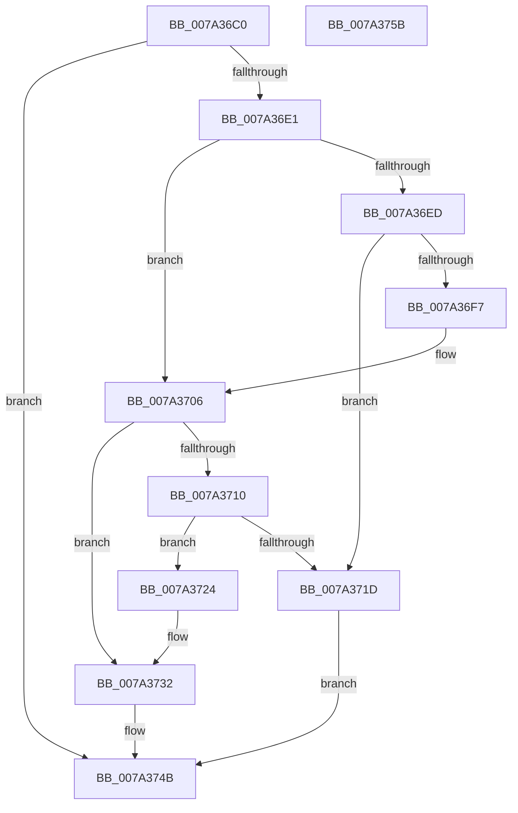

# SepSetUserClaimAttributesToken

- RVA: `0x007A36C0`–`0x007A375C` (길이 `156` bytes)
- VA: `0x00000001407A36C0`
- 실행 섹션: `PAGE`
- PDB 이름 있음: `예`; PDB Function 태그: `아니요`
- unwind 정보 RVA: `0x00060BC4`
- 디코드: `39`개 명령, `156/156` bytes 표시
- 미해석 바이트: `0` (있으면 어셈블리에 `.byte`로 보존)

> 이 문서는 커널 이미지의 기계어와 PDB 기호를 분석해 생성했습니다. 4번과 5번은 함수 원형과 자료형을 바이너리 사용 방식에서 추정한 C 해석이며 원본 소스 복구 결과는 아닙니다.

## 1. Dependencies

- 직접 호출 지점: **4**; 고유 호출 대상: **4**
- 직접 호출자로 확인된 함수: **1**
- RIP 상대 이미지 참조: **0**

### Outgoing calls
- `0x007A36D8` → [SepConvertToOwnTokenClaims](../../text/4B/SepConvertToOwnTokenClaims_function_004B0AA0.md) (function, `0x004B0AA0`)
- `0x007A36ED` → [AuthzBasepAllocateClaimCollectionNoLists](../A7/AuthzBasepAllocateClaimCollectionNoLists_function_00A7648C.md) (function, `0x00A7648C`)
- `0x007A3710` → [AuthzBasepAllocateSecurityAttributesList](../../text/30/AuthzBasepAllocateSecurityAttributesList_function_003013F4.md) (function, `0x003013F4`)
- `0x007A3746` → [AuthzBasepSetSecurityAttributesToken](../../text/3A/AuthzBasepSetSecurityAttributesToken_function_003A8D1C.md) (function, `0x003A8D1C`)

### Direct callers
- [SepAddAgentIdClaimToToken](SepAddAgentIdClaimToToken_function_007A0B30.md) at `0x007A0BBF`

### Static image references
- 디코드된 RIP-relative 메모리 참조가 없습니다.

## 2. Other-region calls and transfers

- 다른 실행 섹션으로 향하는 call: **3**
  - `0x007A36D8` → [SepConvertToOwnTokenClaims](../../text/4B/SepConvertToOwnTokenClaims_function_004B0AA0.md) (`PAGE` → `.text`)
  - `0x007A3710` → [AuthzBasepAllocateSecurityAttributesList](../../text/30/AuthzBasepAllocateSecurityAttributesList_function_003013F4.md) (`PAGE` → `.text`)
  - `0x007A3746` → [AuthzBasepSetSecurityAttributesToken](../../text/3A/AuthzBasepSetSecurityAttributesToken_function_003A8D1C.md) (`PAGE` → `.text`)
- 별도 외부 분기/꼬리 이동을 확인하지 못했습니다.

## 3. Assembly (complete function range)

```asm
007A36C0  48 89 5C 24 08                  mov qword ptr [rsp + 8], rbx
007A36C5  48 89 74 24 10                  mov qword ptr [rsp + 0x10], rsi
007A36CA  57                              push rdi
007A36CB  48 83 EC 20                     sub rsp, 0x20
007A36CF  49 8B F8                        mov rdi, r8
007A36D2  48 8B F2                        mov rsi, rdx
007A36D5  48 8B D9                        mov rbx, rcx
007A36D8  E8 C3 D3 D0 FF                  call 0x1404b0aa0
007A36DD  85 C0                           test eax, eax
007A36DF  78 6A                           js 0x1407a374b
007A36E1  48 8B 83 48 04 00 00            mov rax, qword ptr [rbx + 0x448]
007A36E8  48 85 C0                        test rax, rax
007A36EB  75 19                           jne 0x1407a3706
007A36ED  E8 9A 2D 2D 00                  call 0x140a7648c
007A36F2  48 85 C0                        test rax, rax
007A36F5  74 26                           je 0x1407a371d
007A36F7  0F BA AB C8 00 00 00 0F         bts dword ptr [rbx + 0xc8], 0xf
007A36FF  48 89 83 48 04 00 00            mov qword ptr [rbx + 0x448], rax
007A3706  48 83 B8 40 02 00 00 00         cmp qword ptr [rax + 0x240], 0
007A370E  75 22                           jne 0x1407a3732
007A3710  E8 DF DC B5 FF                  call 0x1403013f4
007A3715  48 8B C8                        mov rcx, rax
007A3718  48 85 C0                        test rax, rax
007A371B  75 07                           jne 0x1407a3724
007A371D  B8 9A 00 00 C0                  mov eax, 0xc000009a
007A3722  EB 27                           jmp 0x1407a374b
007A3724  48 8B 83 48 04 00 00            mov rax, qword ptr [rbx + 0x448]
007A372B  48 89 88 40 02 00 00            mov qword ptr [rax + 0x240], rcx
007A3732  48 8B 8B 48 04 00 00            mov rcx, qword ptr [rbx + 0x448]
007A3739  4C 8B C7                        mov r8, rdi
007A373C  48 8B D6                        mov rdx, rsi
007A373F  48 8B 89 40 02 00 00            mov rcx, qword ptr [rcx + 0x240]
007A3746  E8 D1 55 C0 FF                  call 0x1403a8d1c
007A374B  48 8B 5C 24 30                  mov rbx, qword ptr [rsp + 0x30]
007A3750  48 8B 74 24 38                  mov rsi, qword ptr [rsp + 0x38]
007A3755  48 83 C4 20                     add rsp, 0x20
007A3759  5F                              pop rdi
007A375A  C3                              ret
007A375B  CC                              int3
```

## 4. C-style interpretation (structured pseudocode)

```c
__int64 __fastcall SepSetUserClaimAttributesToken(__int64 a1, __int64 a2, __int64 a3)
{
    __int64 result;
    __int64 v_rsp;
    unsigned __int64 v_stack_p10;
    unsigned __int64 v_stack_p8;

    v_stack_p8 = v_rbx;
    v_stack_p10 = v_rsi;
    v_rsp = (v_rsp) - (32);
    result = SepConvertToOwnTokenClaims(a1, a2, a3, a4);
    if (sign_flag) goto loc_007A374B;
    if (*(unsigned __int64 *)(a1 + 1096) != 0) goto loc_007A3706;
    result = AuthzBasepAllocateClaimCollectionNoLists(a1, a2, a3, a4);
    if (result == 0) goto loc_007A371D;
    *(unsigned __int64 *)(a1 + 1096) = result;
loc_007A3706:
    if ((*(unsigned __int64 *)(result + 576)) != 0) goto loc_007A3732;
    result = AuthzBasepAllocateSecurityAttributesList(a1, a2, a3, a4);
    if (result != 0) goto loc_007A3724;
loc_007A371D:
    goto loc_007A374B;
loc_007A3724:
    *(unsigned __int64 *)(*(unsigned __int64 *)(a1 + 1096) + 576) = result;
loc_007A3732:
    result = AuthzBasepSetSecurityAttributesToken(*(unsigned __int64 *)(*(unsigned __int64 *)(a1 + 1096) + 576), a2, a3, a4);
loc_007A374B:
    v_rsp = (v_rsp) + (32);
    return result;
}
```

## 5. (Beta) C Style

```c
int64_t SepSetUserClaimAttributesToken(void *Arg1, int64_t Arg2, int64_t Arg3)
{
    uint8_t *arg1 = (uint8_t *)Arg1;

    int64_t result;
    int64_t local_rsp;
    uint64_t v_stack_p10;
    uint64_t v_stack_p8;

    v_stack_p8 = local_rbx;
    v_stack_p10 = local_rsi;
    local_rsp = (local_rsp) - (32);
    result = SepConvertToOwnTokenClaims(Arg1, Arg2, Arg3, a4);
    if (sign_flag) goto loc_007A374B;
    if (*(uint64_t *)(arg1 + 0x448) != 0) goto loc_007A3706;
    result = AuthzBasepAllocateClaimCollectionNoLists(Arg1, Arg2, Arg3, a4);
    if (result == 0) goto loc_007A371D;
    *(uint64_t *)(arg1 + 0x448) = result;
loc_007A3706:
    if ((*(uint64_t *)(result + 0x240)) != 0) goto loc_007A3732;
    result = AuthzBasepAllocateSecurityAttributesList(Arg1, Arg2, Arg3, a4);
    if (result != 0) goto loc_007A3724;
loc_007A371D:
    goto loc_007A374B;
loc_007A3724:
    *(uint64_t *)(*(uint64_t *)(arg1 + 0x448) + 0x240) = result;
loc_007A3732:
    result = AuthzBasepSetSecurityAttributesToken(*(uint64_t *)(*(uint64_t *)(arg1 + 0x448) + 0x240), Arg2, Arg3, a4);
loc_007A374B:
    local_rsp = (local_rsp) + (32);
    return result;
}
```

### 관측된 메모리 오프셋

구조체 형식이 확인되지 않은 접근은 인자 기준의 오프셋으로만 기록했습니다.

| 기준 인자 | 오프셋 표현 | 폭 (bit) | 접근 |
|---|---:|---:|---|
| `Arg1` | `+ 0xC8` | `32` | `R/W` |
| `Arg1` | `+ 0x448` | `64` | `R` |
| `Arg1` | `+ 0x448` | `64` | `W` |

## 6. Execution-region graph

[열기: 2D/3D 그래프와 함수 탐색 컨트롤 패널](../../../control-panel.html?section=page&rva=0x007A36C0&view=graph)

- 2D 그래프는 위에서 아래로 흐르고, 3D 그래프는 빈 공간을 드래그해 회전합니다. Shift+드래그는 이동, 휠은 확대·축소, 함수 노드 선택은 대상 보고서 이동입니다.

### Static fallback


