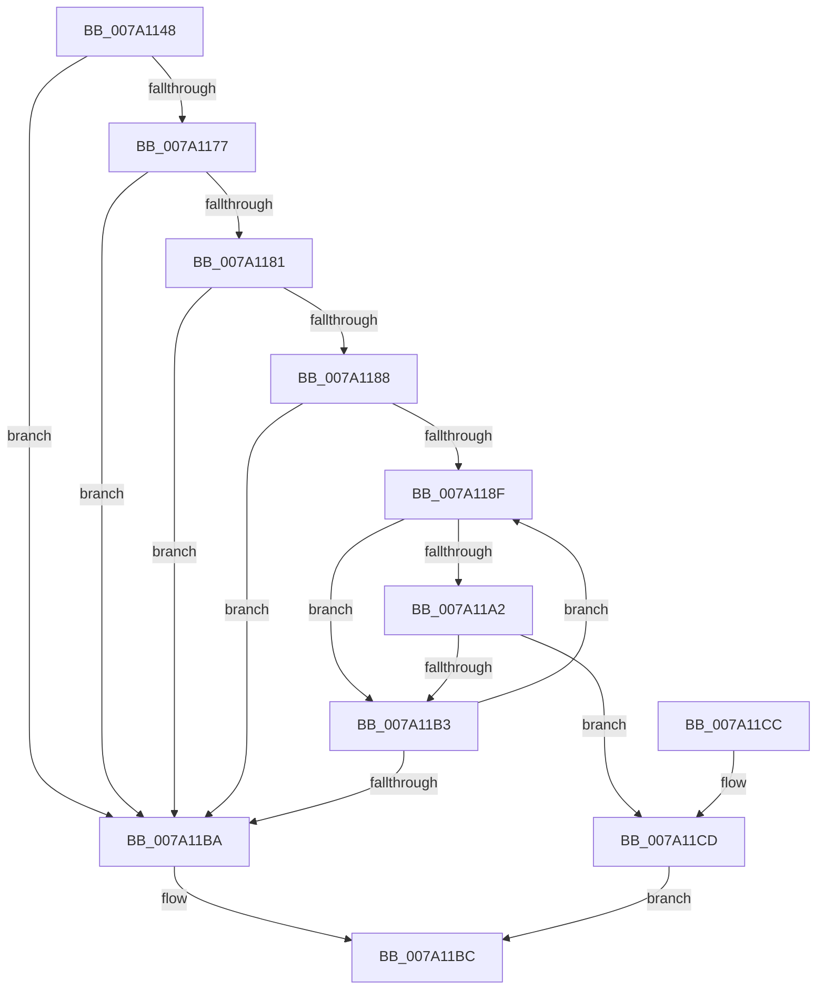

# SepUserClaimsContainAgentId

- RVA: `0x007A1148`–`0x007A11D2` (길이 `138` bytes)
- VA: `0x00000001407A1148`
- 실행 섹션: `PAGE`
- PDB 이름 있음: `예`; PDB Function 태그: `아니요`
- unwind 정보 RVA: `0x000D1418`
- 디코드: `43`개 명령, `138/138` bytes 표시
- 미해석 바이트: `0` (있으면 어셈블리에 `.byte`로 보존)

> 이 문서는 커널 이미지의 기계어와 PDB 기호를 분석해 생성했습니다. 4번과 5번은 함수 원형과 자료형을 바이너리 사용 방식에서 추정한 C 해석이며 원본 소스 복구 결과는 아닙니다.

## 1. Dependencies

- 직접 호출 지점: **2**; 고유 호출 대상: **2**
- 직접 호출자로 확인된 함수: **1**
- RIP 상대 이미지 참조: **1**

### Outgoing calls
- `0x007A116D` → [RtlInitUnicodeString](../../text/42/RtlInitUnicodeString_function_0042A780.md) (function, `0x0042A780`)
- `0x007A11AA` → [RtlEqualUnicodeString](../93/RtlEqualUnicodeString_function_00932A20.md) (function, `0x00932A20`)

### Direct callers
- [SepCreateTokenEx](../../text/4E/SepCreateTokenEx_function_004E9CD0.md) at `0x004EA797`

### Static image references
- `0x007A115B` → RVA `0x00B05EC0` (` ?? ::NNGAKEGL::`string'`; read)

## 2. Other-region calls and transfers

- 다른 실행 섹션으로 향하는 call: **1**
  - `0x007A116D` → [RtlInitUnicodeString](../../text/42/RtlInitUnicodeString_function_0042A780.md) (`PAGE` → `.text`)
- 별도 외부 분기/꼬리 이동을 확인하지 못했습니다.

## 3. Assembly (complete function range)

```asm
007A1148  48 8B C4                        mov rax, rsp
007A114B  48 89 58 08                     mov qword ptr [rax + 8], rbx
007A114F  48 89 70 10                     mov qword ptr [rax + 0x10], rsi
007A1153  57                              push rdi
007A1154  48 83 EC 30                     sub rsp, 0x30
007A1158  48 8B D9                        mov rbx, rcx
007A115B  48 8D 15 5E 4D 36 00            lea rdx, [rip + 0x364d5e]
007A1162  0F 57 C0                        xorps xmm0, xmm0
007A1165  48 8D 48 E8                     lea rcx, [rax - 0x18]
007A1169  0F 11 40 E8                     movups xmmword ptr [rax - 0x18], xmm0
007A116D  E8 0E 96 C8 FF                  call 0x14042a780
007A1172  48 85 DB                        test rbx, rbx
007A1175  74 43                           je 0x1407a11ba
007A1177  BE 01 00 00 00                  mov esi, 1
007A117C  66 39 33                        cmp word ptr [rbx], si
007A117F  75 39                           jne 0x1407a11ba
007A1181  48 83 7B 08 00                  cmp qword ptr [rbx + 8], 0
007A1186  74 32                           je 0x1407a11ba
007A1188  33 FF                           xor edi, edi
007A118A  39 7B 04                        cmp dword ptr [rbx + 4], edi
007A118D  76 2B                           jbe 0x1407a11ba
007A118F  48 8B 43 08                     mov rax, qword ptr [rbx + 8]
007A1193  48 8D 0C BF                     lea rcx, [rdi + rdi*4]
007A1197  48 8D 0C C8                     lea rcx, [rax + rcx*8]
007A119B  66 83 79 10 03                  cmp word ptr [rcx + 0x10], 3
007A11A0  75 11                           jne 0x1407a11b3
007A11A2  44 8A C6                        mov r8b, sil
007A11A5  48 8D 54 24 20                  lea rdx, [rsp + 0x20]
007A11AA  E8 71 18 19 00                  call 0x140932a20
007A11AF  84 C0                           test al, al
007A11B1  75 1A                           jne 0x1407a11cd
007A11B3  03 FE                           add edi, esi
007A11B5  3B 7B 04                        cmp edi, dword ptr [rbx + 4]
007A11B8  72 D5                           jb 0x1407a118f
007A11BA  32 C0                           xor al, al
007A11BC  48 8B 5C 24 40                  mov rbx, qword ptr [rsp + 0x40]
007A11C1  48 8B 74 24 48                  mov rsi, qword ptr [rsp + 0x48]
007A11C6  48 83 C4 30                     add rsp, 0x30
007A11CA  5F                              pop rdi
007A11CB  C3                              ret
007A11CC  CC                              int3
007A11CD  40 8A C6                        mov al, sil
007A11D0  EB EA                           jmp 0x1407a11bc
```

## 4. C-style interpretation (structured pseudocode)

```c
__int64 __fastcall SepUserClaimsContainAgentId(__int64 a1)
{
    __int64 result;
    __int64 v_rdi;
    __int64 v_rsp;
    unsigned __int64 v_stack_m18;
    unsigned __int64 v_stack_p10;
    unsigned __int64 v_stack_p8;

    *(unsigned __int64 *)(v_rsp + 8) = v_rbx;
    *(unsigned __int64 *)(v_rsp + 16) = v_rsi;
    v_rsp = (v_rsp) - (48);
    *(unsigned __int64 *)(v_rsp - 24) = v_xmm0;
    result = RtlInitUnicodeString(v_rsp - 24, v_rip + 3558750, a3, a4);
    if (a1 == 0) goto loc_007A11BA;
    if ((*(unsigned __int16 *)(a1)) != 1) goto loc_007A11BA;
    if ((*(unsigned __int64 *)(a1 + 8)) == 0) goto loc_007A11BA;
    v_rdi = 0;
    if ((*(unsigned int *)(a1 + 4)) <= 0) goto loc_007A11BA;
loc_007A118F:
    if ((*(unsigned __int16 *)(*(unsigned __int64 *)(a1 + 8) + v_rdi + v_rdi * 4 * 8 + 16)) != 3) goto loc_007A11B3;
    result = RtlEqualUnicodeString(*(unsigned __int64 *)(a1 + 8) + v_rdi + v_rdi * 4 * 8, v_stack_m18, 1, a4);
    if ((unsigned __int8)(result) != 0) goto loc_007A11CD;
loc_007A11B3:
    v_rdi = (unsigned int)((v_rdi) + (1));
    if (((unsigned int)(v_rdi)) < (*(unsigned int *)(a1 + 4))) goto loc_007A118F;
loc_007A11BA:
    result = 0;
loc_007A11BC:
    v_rsp = (v_rsp) + (48);
    return result;
loc_007A11CD:
    goto loc_007A11BC;
}
```

## 5. (Beta) C Style

```c
int64_t SepUserClaimsContainAgentId(int64_t Arg1)
{
    int64_t result;
    int64_t local_rdi;
    int64_t local_rsp;
    uint64_t v_stack_m18;
    uint64_t v_stack_p10;
    uint64_t v_stack_p8;

    *(uint64_t *)(local_rsp + 0x8) = local_rbx;
    *(uint64_t *)(local_rsp + 0x10) = local_rsi;
    local_rsp = (local_rsp) - (48);
    *(uint64_t *)(local_rsp - 0x18) = v_xmm0;
    result = RtlInitUnicodeString(local_rsp - 24, v_rip + 3558750, a3, a4);
    if (Arg1 == 0) goto loc_007A11BA;
    if ((*(uint16_t *)(Arg1)) != 1) goto loc_007A11BA;
    if ((*(uint64_t *)(Arg1 + 0x8)) == 0) goto loc_007A11BA;
    local_rdi = 0;
    if ((*(uint32_t *)(Arg1 + 0x4)) <= 0) goto loc_007A11BA;
loc_007A118F:
    if ((*(uint16_t *)(*(uint64_t *)(Arg1 + 0x8) + local_rdi + local_rdi * 4 * 8 + 0x10)) != 3) goto loc_007A11B3;
    result = RtlEqualUnicodeString(*(uint64_t *)(Arg1 + 0x8) + local_rdi + local_rdi * 4 * 8, v_stack_m18, 1, a4);
    if ((uint8_t)(result) != 0) goto loc_007A11CD;
loc_007A11B3:
    local_rdi = (uint32_t)((local_rdi) + (1));
    if (((uint32_t)(local_rdi)) < (*(uint32_t *)(Arg1 + 0x4))) goto loc_007A118F;
loc_007A11BA:
    result = 0;
loc_007A11BC:
    local_rsp = (local_rsp) + (48);
    return result;
loc_007A11CD:
    goto loc_007A11BC;
}
```

## 6. Execution-region graph

[열기: 2D/3D 그래프와 함수 탐색 컨트롤 패널](../../../control-panel.html?section=page&rva=0x007A1148&view=graph)

- 2D 그래프는 위에서 아래로 흐르고, 3D 그래프는 빈 공간을 드래그해 회전합니다. Shift+드래그는 이동, 휠은 확대·축소, 함수 노드 선택은 대상 보고서 이동입니다.

### Static fallback


