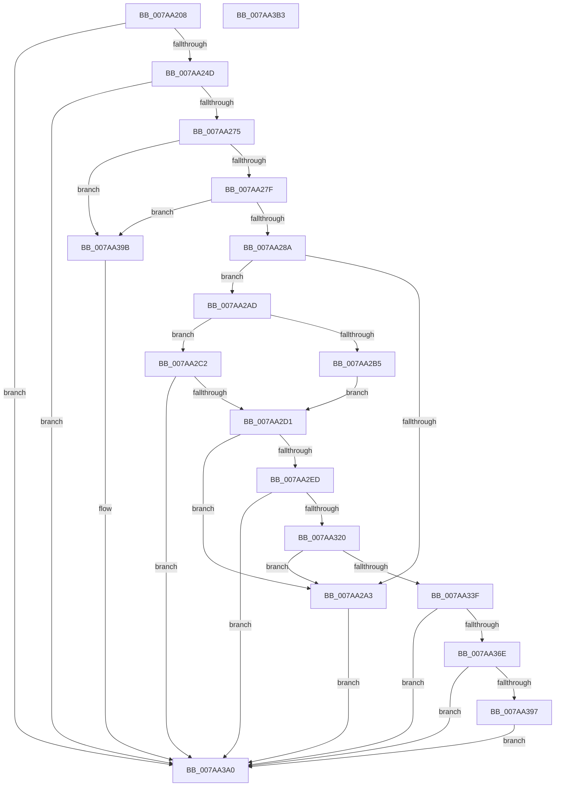

# SmCrEncStart

- RVA: `0x007AA208`–`0x007AA3B4` (길이 `428` bytes)
- VA: `0x00000001407AA208`
- 실행 섹션: `PAGE`
- PDB 이름 있음: `예`; PDB Function 태그: `아니요`
- unwind 정보 RVA: `0x000C6880`
- 디코드: `114`개 명령, `428/428` bytes 표시
- 미해석 바이트: `0` (있으면 어셈블리에 `.byte`로 보존)

> 이 문서는 커널 이미지의 기계어와 PDB 기호를 분석해 생성했습니다. 4번과 5번은 함수 원형과 자료형을 바이너리 사용 방식에서 추정한 C 해석이며 원본 소스 복구 결과는 아닙니다.

## 1. Dependencies

- 직접 호출 지점: **12**; 고유 호출 대상: **8**
- 직접 호출자로 확인된 함수: **1**
- RIP 상대 이미지 참조: **5**

### Outgoing calls
- `0x007AA240` → [BCryptOpenAlgorithmProvider](../AB/BCryptOpenAlgorithmProvider_function_00ABF200.md) (function, `0x00ABF200`)
- `0x007AA268` → [BCryptGetProperty](../A5/BCryptGetProperty_function_00A56158.md) (function, `0x00A56158`)
- `0x007AA295` → [SmAllocEx](../../text/34/SmAllocEx_function_0034C794.md) (function, `0x0034C794`)
- `0x007AA2BB` → [memcpy](../../text/6C/memcpy_function_006C6840.md) (function, `0x006C6840`)
- `0x007AA2C4` → [SmCrGenRandom](../../text/61/SmCrGenRandom_function_006114A4.md) (function, `0x006114A4`)
- `0x007AA2DF` → [SmAllocEx](../../text/34/SmAllocEx_function_0034C794.md) (function, `0x0034C794`)
- `0x007AA2F5` → [memset](../../text/6C/memset_function_006C6C40.md) (function, `0x006C6C40`)
- `0x007AA313` → [BCryptGetProperty](../A5/BCryptGetProperty_function_00A56158.md) (function, `0x00A56158`)
- `0x007AA32D` → [SmAllocEx](../../text/34/SmAllocEx_function_0034C794.md) (function, `0x0034C794`)
- `0x007AA349` → [memset](../../text/6C/memset_function_006C6C40.md) (function, `0x006C6C40`)
- `0x007AA365` → [BCryptSetProperty](../79/BCryptSetProperty_function_0079C950.md) (function, `0x0079C950`)
- `0x007AA38E` → [BCryptGenerateSymmetricKey](../79/BCryptGenerateSymmetricKey_function_0079C828.md) (function, `0x0079C828`)

### Direct callers
- [ST_STORE&lt;SM_TRAITS&gt;::StStart](../../text/3B/ST_STORE_SM_TRAITS_StStart_function_003B1BBC.md) at `0x003B1F4B`

### Static image references
- `0x007AA22A` → RVA `0x00B06500` (` ?? ::NNGAKEGL::`string'`; read)
- `0x007AA261` → RVA `0x00B06510` (` ?? ::NNGAKEGL::`string'`; read)
- `0x007AA30C` → RVA `0x00B05AF0` (` ?? ::NNGAKEGL::`string'`; read)
- `0x007AA351` → RVA `0x00B064E0` (` ?? ::NNGAKEGL::`string'`; read)
- `0x007AA35E` → RVA `0x00B06530` (` ?? ::NNGAKEGL::`string'`; read)

## 2. Other-region calls and transfers

- 다른 실행 섹션으로 향하는 call: **7**
  - `0x007AA295` → [SmAllocEx](../../text/34/SmAllocEx_function_0034C794.md) (`PAGE` → `.text`)
  - `0x007AA2BB` → [memcpy](../../text/6C/memcpy_function_006C6840.md) (`PAGE` → `.text`)
  - `0x007AA2C4` → [SmCrGenRandom](../../text/61/SmCrGenRandom_function_006114A4.md) (`PAGE` → `.text`)
  - `0x007AA2DF` → [SmAllocEx](../../text/34/SmAllocEx_function_0034C794.md) (`PAGE` → `.text`)
  - `0x007AA2F5` → [memset](../../text/6C/memset_function_006C6C40.md) (`PAGE` → `.text`)
  - `0x007AA32D` → [SmAllocEx](../../text/34/SmAllocEx_function_0034C794.md) (`PAGE` → `.text`)
  - `0x007AA349` → [memset](../../text/6C/memset_function_006C6C40.md) (`PAGE` → `.text`)
- 별도 외부 분기/꼬리 이동을 확인하지 못했습니다.

## 3. Assembly (complete function range)

```asm
007AA208  48 8B C4                        mov rax, rsp
007AA20B  48 89 58 10                     mov qword ptr [rax + 0x10], rbx
007AA20F  48 89 68 18                     mov qword ptr [rax + 0x18], rbp
007AA213  44 89 48 20                     mov dword ptr [rax + 0x20], r9d
007AA217  56                              push rsi
007AA218  57                              push rdi
007AA219  41 56                           push r14
007AA21B  48 83 EC 40                     sub rsp, 0x40
007AA21F  83 60 08 00                     and dword ptr [rax + 8], 0
007AA223  48 8B EA                        mov rbp, rdx
007AA226  83 60 20 00                     and dword ptr [rax + 0x20], 0
007AA22A  48 8D 15 CF C2 35 00            lea rdx, [rip + 0x35c2cf]
007AA231  41 8B F0                        mov esi, r8d
007AA234  41 B9 01 00 00 00               mov r9d, 1
007AA23A  45 33 C0                        xor r8d, r8d
007AA23D  48 8B D9                        mov rbx, rcx
007AA240  E8 BB 4F 31 00                  call 0x140abf200
007AA245  85 C0                           test eax, eax
007AA247  0F 88 53 01 00 00               js 0x1407aa3a0
007AA24D  48 8B 0B                        mov rcx, qword ptr [rbx]
007AA250  48 8D 44 24 60                  lea rax, [rsp + 0x60]
007AA255  48 8D 7B 08                     lea rdi, [rbx + 8]
007AA259  48 89 44 24 20                  mov qword ptr [rsp + 0x20], rax
007AA25E  4C 8B C7                        mov r8, rdi
007AA261  48 8D 15 A8 C2 35 00            lea rdx, [rip + 0x35c2a8]
007AA268  E8 EB BE 2A 00                  call 0x140a56158
007AA26D  85 C0                           test eax, eax
007AA26F  0F 88 2B 01 00 00               js 0x1407aa3a0
007AA275  8B 0F                           mov ecx, dword ptr [rdi]
007AA277  85 C9                           test ecx, ecx
007AA279  0F 84 1C 01 00 00               je 0x1407aa39b
007AA27F  8D 41 FF                        lea eax, [rcx - 1]
007AA282  85 C1                           test ecx, eax
007AA284  0F 85 11 01 00 00               jne 0x1407aa39b
007AA28A  41 83 C8 FF                     or r8d, 0xffffffff
007AA28E  BA 73 6D 43 52                  mov edx, 0x52436d73
007AA293  8B CE                           mov ecx, esi
007AA295  E8 FA 24 BA FF                  call 0x14034c794
007AA29A  48 89 43 10                     mov qword ptr [rbx + 0x10], rax
007AA29E  48 85 C0                        test rax, rax
007AA2A1  75 0A                           jne 0x1407aa2ad
007AA2A3  B8 9A 00 00 C0                  mov eax, 0xc000009a
007AA2A8  E9 F3 00 00 00                  jmp 0x1407aa3a0
007AA2AD  48 8B C8                        mov rcx, rax
007AA2B0  48 85 ED                        test rbp, rbp
007AA2B3  74 0D                           je 0x1407aa2c2
007AA2B5  4C 8B C6                        mov r8, rsi
007AA2B8  48 8B D5                        mov rdx, rbp
007AA2BB  E8 80 C5 F1 FF                  call 0x1406c6840
007AA2C0  EB 0F                           jmp 0x1407aa2d1
007AA2C2  8B D6                           mov edx, esi
007AA2C4  E8 DB 71 E6 FF                  call 0x1406114a4
007AA2C9  85 C0                           test eax, eax
007AA2CB  0F 88 CF 00 00 00               js 0x1407aa3a0
007AA2D1  8B 0F                           mov ecx, dword ptr [rdi]
007AA2D3  41 83 C8 FF                     or r8d, 0xffffffff
007AA2D7  BA 73 6D 43 52                  mov edx, 0x52436d73
007AA2DC  89 73 18                        mov dword ptr [rbx + 0x18], esi
007AA2DF  E8 B0 24 BA FF                  call 0x14034c794
007AA2E4  48 89 43 30                     mov qword ptr [rbx + 0x30], rax
007AA2E8  48 85 C0                        test rax, rax
007AA2EB  74 B6                           je 0x1407aa2a3
007AA2ED  44 8B 07                        mov r8d, dword ptr [rdi]
007AA2F0  33 D2                           xor edx, edx
007AA2F2  48 8B C8                        mov rcx, rax
007AA2F5  E8 46 C9 F1 FF                  call 0x1406c6c40
007AA2FA  48 8B 0B                        mov rcx, qword ptr [rbx]
007AA2FD  48 8D 44 24 60                  lea rax, [rsp + 0x60]
007AA302  4C 8D 44 24 78                  lea r8, [rsp + 0x78]
007AA307  48 89 44 24 20                  mov qword ptr [rsp + 0x20], rax
007AA30C  48 8D 15 DD B7 35 00            lea rdx, [rip + 0x35b7dd]
007AA313  E8 40 BE 2A 00                  call 0x140a56158
007AA318  85 C0                           test eax, eax
007AA31A  0F 88 80 00 00 00               js 0x1407aa3a0
007AA320  8B 4C 24 78                     mov ecx, dword ptr [rsp + 0x78]
007AA324  41 83 C8 FF                     or r8d, 0xffffffff
007AA328  BA 73 6D 43 52                  mov edx, 0x52436d73
007AA32D  E8 62 24 BA FF                  call 0x14034c794
007AA332  48 89 43 28                     mov qword ptr [rbx + 0x28], rax
007AA336  48 85 C0                        test rax, rax
007AA339  0F 84 64 FF FF FF               je 0x1407aa2a3
007AA33F  44 8B 44 24 78                  mov r8d, dword ptr [rsp + 0x78]
007AA344  33 D2                           xor edx, edx
007AA346  48 8B C8                        mov rcx, rax
007AA349  E8 F2 C8 F1 FF                  call 0x1406c6c40
007AA34E  48 8B 0B                        mov rcx, qword ptr [rbx]
007AA351  4C 8D 05 88 C1 35 00            lea r8, [rip + 0x35c188]
007AA358  41 B9 20 00 00 00               mov r9d, 0x20
007AA35E  48 8D 15 CB C1 35 00            lea rdx, [rip + 0x35c1cb]
007AA365  E8 E6 25 FF FF                  call 0x14079c950
007AA36A  85 C0                           test eax, eax
007AA36C  78 32                           js 0x1407aa3a0
007AA36E  8B 43 18                        mov eax, dword ptr [rbx + 0x18]
007AA371  48 8D 53 20                     lea rdx, [rbx + 0x20]
007AA375  44 8B 4C 24 78                  mov r9d, dword ptr [rsp + 0x78]
007AA37A  4C 8B 43 28                     mov r8, qword ptr [rbx + 0x28]
007AA37E  48 8B 0B                        mov rcx, qword ptr [rbx]
007AA381  89 44 24 28                     mov dword ptr [rsp + 0x28], eax
007AA385  48 8B 43 10                     mov rax, qword ptr [rbx + 0x10]
007AA389  48 89 44 24 20                  mov qword ptr [rsp + 0x20], rax
007AA38E  E8 95 24 FF FF                  call 0x14079c828
007AA393  85 C0                           test eax, eax
007AA395  78 09                           js 0x1407aa3a0
007AA397  33 C0                           xor eax, eax
007AA399  EB 05                           jmp 0x1407aa3a0
007AA39B  B8 73 01 00 C0                  mov eax, 0xc0000173
007AA3A0  48 8B 5C 24 68                  mov rbx, qword ptr [rsp + 0x68]
007AA3A5  48 8B 6C 24 70                  mov rbp, qword ptr [rsp + 0x70]
007AA3AA  48 83 C4 40                     add rsp, 0x40
007AA3AE  41 5E                           pop r14
007AA3B0  5F                              pop rdi
007AA3B1  5E                              pop rsi
007AA3B2  C3                              ret
007AA3B3  CC                              int3
```

## 4. C-style interpretation (structured pseudocode)

```c
__int64 __fastcall SmCrEncStart(__int64 a1, __int64 a2, int a3, int a4)
{
    __int64 result;
    __int64 v_rsp;
    unsigned int v_stack_m30;
    unsigned __int64 v_stack_m38;
    unsigned __int64 v_stack_p10;
    unsigned __int64 v_stack_p18;
    unsigned __int64 v_stack_p20;
    unsigned __int64 v_stack_p8;

    *(unsigned __int64 *)(v_rsp + 16) = v_rbx;
    *(unsigned __int64 *)(v_rsp + 24) = v_rbp;
    *(unsigned int *)(v_rsp + 32) = a4;
    v_rsp = (v_rsp) - (64);
    a3 = 0;
    result = BCryptOpenAlgorithmProvider(a1, v_rip + 3523279, a3, 1);
    if (sign_flag) goto loc_007AA3A0;
    v_stack_m38 = v_stack_p8;
    result = BCryptGetProperty(*(unsigned __int64 *)(a1), v_rip + 3523240, a1 + 8, 1);
    if (sign_flag) goto loc_007AA3A0;
    if ((unsigned int)((unsigned int)(*(unsigned int *)(a1 + 8))) == 0) goto loc_007AA39B;
    if ((((unsigned int)((unsigned int)(*(unsigned int *)(a1 + 8)))) & ((unsigned int)((unsigned int)(*(unsigned int *)(a1 + 8)) - 1))) != 0) goto loc_007AA39B;
    a3 = (unsigned int)((a1 + 8) | (0xFFFFFFFFULL));
    result = SmAllocEx((unsigned int)((unsigned int)((unsigned int)(a3))), (unsigned int)(0x52436D73ULL), a3, 1);
    *(unsigned __int64 *)(a1 + 16) = result;
    if (result != 0) goto loc_007AA2AD;
loc_007AA2A3:
    goto loc_007AA3A0;
loc_007AA2AD:
    if (a2 == 0) goto loc_007AA2C2;
    result = memcpy((unsigned int)(0xC000009AULL), a2, (unsigned int)(a3), 1);
    goto loc_007AA2D1;
loc_007AA2C2:
    result = SmCrGenRandom((unsigned int)(0xC000009AULL), (unsigned int)((unsigned int)((unsigned int)(a3))), (unsigned int)(a3), 1);
    if (sign_flag) goto loc_007AA3A0;
loc_007AA2D1:
    a3 = (unsigned int)(((unsigned int)(a3)) | (0xFFFFFFFFULL));
    *(unsigned int *)(a1 + 24) = (unsigned int)((unsigned int)(a3));
    result = SmAllocEx((unsigned int)(*(unsigned int *)(a1 + 8)), (unsigned int)(0x52436D73ULL), a3, 1);
    *(unsigned __int64 *)(a1 + 48) = result;
    if (result == 0) goto loc_007AA2A3;
    a2 = 0;
    result = memset(result, a2, (unsigned int)(*(unsigned int *)(a1 + 8)), 1);
    v_stack_m38 = v_stack_p8;
    result = BCryptGetProperty(*(unsigned __int64 *)(a1), v_rip + 3520477, v_stack_p20, 1);
    if (sign_flag) goto loc_007AA3A0;
    a3 = (unsigned int)((v_stack_p20) | (0xFFFFFFFFULL));
    result = SmAllocEx((unsigned int)(v_stack_p20), (unsigned int)(0x52436D73ULL), a3, 1);
    *(unsigned __int64 *)(a1 + 40) = result;
    if (result == 0) goto loc_007AA2A3;
    a2 = 0;
    result = memset(result, a2, (unsigned int)(v_stack_p20), 1);
    result = BCryptSetProperty(*(unsigned __int64 *)(a1), v_rip + 3523019, v_rip + 3522952, 32);
    if (sign_flag) goto loc_007AA3A0;
    v_stack_m30 = (unsigned int)((unsigned int)(*(unsigned int *)(a1 + 24)));
    v_stack_m38 = *(unsigned __int64 *)(a1 + 16);
    result = BCryptGenerateSymmetricKey(*(unsigned __int64 *)(a1), a1 + 32, *(unsigned __int64 *)(a1 + 40), (unsigned int)(v_stack_p20));
    if (sign_flag) goto loc_007AA3A0;
    result = 0;
    goto loc_007AA3A0;
loc_007AA39B:
loc_007AA3A0:
    v_rsp = (v_rsp) + (64);
    return (unsigned int)(0xC0000173ULL);
}
```

## 5. (Beta) C Style

```c
int64_t SmCrEncStart(void *Arg1, int64_t Arg2, int32_t Arg3, int32_t Arg4)
{
    uint8_t *arg1 = (uint8_t *)Arg1;

    int64_t result;
    int64_t local_rsp;
    uint32_t v_stack_m30;
    uint64_t v_stack_m38;
    uint64_t v_stack_p10;
    uint64_t v_stack_p18;
    uint64_t v_stack_p20;
    uint64_t v_stack_p8;

    *(uint64_t *)(local_rsp + 0x10) = local_rbx;
    *(uint64_t *)(local_rsp + 0x18) = local_rbp;
    *(uint32_t *)(local_rsp + 0x20) = Arg4;
    local_rsp = (local_rsp) - (64);
    Arg3 = 0;
    result = BCryptOpenAlgorithmProvider(Arg1, v_rip + 3523279, Arg3, 1);
    if (sign_flag) goto loc_007AA3A0;
    v_stack_m38 = v_stack_p8;
    result = BCryptGetProperty(*(uint64_t *)(arg1), v_rip + 3523240, Arg1 + 8, 1);
    if (sign_flag) goto loc_007AA3A0;
    if ((uint32_t)((uint32_t)(*(uint32_t *)(arg1 + 0x8))) == 0) goto loc_007AA39B;
    if ((((uint32_t)((uint32_t)(*(uint32_t *)(arg1 + 0x8)))) & ((uint32_t)((uint32_t)(*(uint32_t *)(arg1 + 0x8)) - 1))) != 0) goto loc_007AA39B;
    Arg3 = (uint32_t)((Arg1 + 8) | (0xFFFFFFFFULL));
    result = SmAllocEx((uint32_t)((uint32_t)((uint32_t)(Arg3))), (uint32_t)(0x52436D73ULL), Arg3, 1);
    *(uint64_t *)(arg1 + 0x10) = result;
    if (result != 0) goto loc_007AA2AD;
loc_007AA2A3:
    goto loc_007AA3A0;
loc_007AA2AD:
    if (Arg2 == 0) goto loc_007AA2C2;
    result = memcpy((uint32_t)(0xC000009AULL), Arg2, (uint32_t)(Arg3), 1);
    goto loc_007AA2D1;
loc_007AA2C2:
    result = SmCrGenRandom((uint32_t)(0xC000009AULL), (uint32_t)((uint32_t)((uint32_t)(Arg3))), (uint32_t)(Arg3), 1);
    if (sign_flag) goto loc_007AA3A0;
loc_007AA2D1:
    Arg3 = (uint32_t)(((uint32_t)(Arg3)) | (0xFFFFFFFFULL));
    *(uint32_t *)(arg1 + 0x18) = (uint32_t)((uint32_t)(Arg3));
    result = SmAllocEx((uint32_t)(*(uint32_t *)(arg1 + 0x8)), (uint32_t)(0x52436D73ULL), Arg3, 1);
    *(uint64_t *)(arg1 + 0x30) = result;
    if (result == 0) goto loc_007AA2A3;
    Arg2 = 0;
    result = memset(result, Arg2, (uint32_t)(*(uint32_t *)(arg1 + 0x8)), 1);
    v_stack_m38 = v_stack_p8;
    result = BCryptGetProperty(*(uint64_t *)(arg1), v_rip + 3520477, v_stack_p20, 1);
    if (sign_flag) goto loc_007AA3A0;
    Arg3 = (uint32_t)((v_stack_p20) | (0xFFFFFFFFULL));
    result = SmAllocEx((uint32_t)(v_stack_p20), (uint32_t)(0x52436D73ULL), Arg3, 1);
    *(uint64_t *)(arg1 + 0x28) = result;
    if (result == 0) goto loc_007AA2A3;
    Arg2 = 0;
    result = memset(result, Arg2, (uint32_t)(v_stack_p20), 1);
    result = BCryptSetProperty(*(uint64_t *)(arg1), v_rip + 3523019, v_rip + 3522952, 32);
    if (sign_flag) goto loc_007AA3A0;
    v_stack_m30 = (uint32_t)((uint32_t)(*(uint32_t *)(arg1 + 0x18)));
    v_stack_m38 = *(uint64_t *)(arg1 + 0x10);
    result = BCryptGenerateSymmetricKey(*(uint64_t *)(arg1), Arg1 + 32, *(uint64_t *)(arg1 + 0x28), (uint32_t)(v_stack_p20));
    if (sign_flag) goto loc_007AA3A0;
    result = 0;
    goto loc_007AA3A0;
loc_007AA39B:
loc_007AA3A0:
    local_rsp = (local_rsp) + (64);
    return (uint32_t)(0xC0000173ULL);
}
```

### 관측된 메모리 오프셋

구조체 형식이 확인되지 않은 접근은 인자 기준의 오프셋으로만 기록했습니다.

| 기준 인자 | 오프셋 표현 | 폭 (bit) | 접근 |
|---|---:|---:|---|
| `Arg1` | `+ 0x0` | `32` | `R` |
| `Arg1` | `+ 0x0` | `64` | `R` |
| `Arg1` | `+ 0x8` | `64` | `R` |
| `Arg1` | `+ 0x10` | `64` | `R` |
| `Arg1` | `+ 0x10` | `64` | `W` |
| `Arg1` | `+ 0x18` | `32` | `R` |
| `Arg1` | `+ 0x18` | `32` | `W` |
| `Arg1` | `+ 0x20` | `64` | `R` |
| `Arg1` | `+ 0x28` | `64` | `R` |
| `Arg1` | `+ 0x28` | `64` | `W` |
| `Arg1` | `+ 0x30` | `64` | `W` |

## 6. Execution-region graph

[열기: 2D/3D 그래프와 함수 탐색 컨트롤 패널](../../../control-panel.html?section=page&rva=0x007AA208&view=graph)

- 2D 그래프는 위에서 아래로 흐르고, 3D 그래프는 빈 공간을 드래그해 회전합니다. Shift+드래그는 이동, 휠은 확대·축소, 함수 노드 선택은 대상 보고서 이동입니다.

### Static fallback


