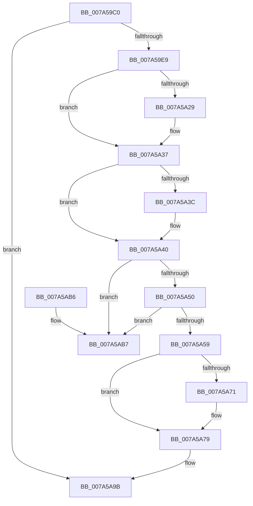

# SmDeletePartition

- RVA: `0x007A59C0`–`0x007A5ABE` (길이 `254` bytes)
- VA: `0x00000001407A59C0`
- 실행 섹션: `PAGE`
- PDB 이름 있음: `예`; PDB Function 태그: `아니요`
- unwind 정보 RVA: `0x0006B020`
- 디코드: `65`개 명령, `254/254` bytes 표시
- 미해석 바이트: `0` (있으면 어셈블리에 `.byte`로 보존)

> 이 문서는 커널 이미지의 기계어와 PDB 기호를 분석해 생성했습니다. 4번과 5번은 함수 원형과 자료형을 바이너리 사용 방식에서 추정한 C 해석이며 원본 소스 복구 결과는 아닙니다.

## 1. Dependencies

- 직접 호출 지점: **8**; 고유 호출 대상: **8**
- 직접 호출자로 확인된 함수: **1**
- RIP 상대 이미지 참조: **2**

### Outgoing calls
- `0x007A59F0` → [ExWaitForRundownProtectionRelease](../../text/2A/ExWaitForRundownProtectionRelease_function_002A4CB0.md) (function, `0x002A4CB0`)
- `0x007A5A19` → [KeAbPreAcquire](../../text/21/KeAbPreAcquire_function_00210230.md) (function, `0x00210230`)
- `0x007A5A32` → [ExfAcquirePushLockExclusiveEx](../../text/20/ExfAcquirePushLockExclusiveEx_function_0020FC90.md) (function, `0x0020FC90`)
- `0x007A5A74` → [ExfTryToWakePushLock](../../text/26/ExfTryToWakePushLock_function_00265DD0.md) (function, `0x00265DD0`)
- `0x007A5A7C` → [KeAbPostRelease](../../text/2E/KeAbPostRelease_function_002E1600.md) (function, `0x002E1600`)
- `0x007A5A81` → [KeLeaveCriticalRegion](../../text/25/KeLeaveCriticalRegion_function_0025D8B0.md) (function, `0x0025D8B0`)
- `0x007A5A89` → [SmPartitionCleanup](SmPartitionCleanup_function_007A5C14.md) (function, `0x007A5C14`)
- `0x007A5A91` → [CmSiFreeMemory](../../text/47/CmSiFreeMemory_function_00475D80.md) (function, `0x00475D80`)

### Direct callers
- [MiDrainCrossPartitionUsage](../../text/69/MiDrainCrossPartitionUsage_function_00690984.md) at `0x00690AFD`

### Static image references
- `0x007A59FE` → RVA `0x00E288C8` (`.data`; read)
- `0x007A5A60` → RVA `0x00E288C8` (`.data`; read/write)

## 2. Other-region calls and transfers

- 다른 실행 섹션으로 향하는 call: **7**
  - `0x007A59F0` → [ExWaitForRundownProtectionRelease](../../text/2A/ExWaitForRundownProtectionRelease_function_002A4CB0.md) (`PAGE` → `.text`)
  - `0x007A5A19` → [KeAbPreAcquire](../../text/21/KeAbPreAcquire_function_00210230.md) (`PAGE` → `.text`)
  - `0x007A5A32` → [ExfAcquirePushLockExclusiveEx](../../text/20/ExfAcquirePushLockExclusiveEx_function_0020FC90.md) (`PAGE` → `.text`)
  - `0x007A5A74` → [ExfTryToWakePushLock](../../text/26/ExfTryToWakePushLock_function_00265DD0.md) (`PAGE` → `.text`)
  - `0x007A5A7C` → [KeAbPostRelease](../../text/2E/KeAbPostRelease_function_002E1600.md) (`PAGE` → `.text`)
  - `0x007A5A81` → [KeLeaveCriticalRegion](../../text/25/KeLeaveCriticalRegion_function_0025D8B0.md) (`PAGE` → `.text`)
  - `0x007A5A91` → [CmSiFreeMemory](../../text/47/CmSiFreeMemory_function_00475D80.md) (`PAGE` → `.text`)
- 별도 외부 분기/꼬리 이동을 확인하지 못했습니다.

## 3. Assembly (complete function range)

```asm
007A59C0  48 8B C4                        mov rax, rsp
007A59C3  48 89 58 08                     mov qword ptr [rax + 8], rbx
007A59C7  48 89 68 10                     mov qword ptr [rax + 0x10], rbp
007A59CB  48 89 70 18                     mov qword ptr [rax + 0x18], rsi
007A59CF  48 89 78 20                     mov qword ptr [rax + 0x20], rdi
007A59D3  41 56                           push r14
007A59D5  48 83 EC 20                     sub rsp, 0x20
007A59D9  48 8B 79 18                     mov rdi, qword ptr [rcx + 0x18]
007A59DD  48 8B E9                        mov rbp, rcx
007A59E0  48 85 FF                        test rdi, rdi
007A59E3  0F 84 B2 00 00 00               je 0x1407a5a9b
007A59E9  48 8D 8F 40 08 00 00            lea rcx, [rdi + 0x840]
007A59F0  E8 BB F2 AF FF                  call 0x1402a4cb0
007A59F5  65 48 8B 04 25 88 01 00 00      mov rax, qword ptr gs:[0x188]
007A59FE  4C 8D 35 C3 2E 68 00            lea r14, [rip + 0x682ec3]
007A5A05  48 83 CB FF                     or rbx, 0xffffffffffffffff
007A5A09  45 33 C0                        xor r8d, r8d
007A5A0C  33 D2                           xor edx, edx
007A5A0E  49 8B CE                        mov rcx, r14
007A5A11  66 01 98 E4 01 00 00            add word ptr [rax + 0x1e4], bx
007A5A18  90                              nop
007A5A19  E8 12 A8 A6 FF                  call 0x140210230
007A5A1E  F0 49 0F BA 2E 00               lock bts qword ptr [r14], 0
007A5A24  48 8B F0                        mov rsi, rax
007A5A27  73 0E                           jae 0x1407a5a37
007A5A29  4D 8B C6                        mov r8, r14
007A5A2C  48 8B D0                        mov rdx, rax
007A5A2F  49 8B CE                        mov rcx, r14
007A5A32  E8 59 A2 A6 FF                  call 0x14020fc90
007A5A37  48 85 F6                        test rsi, rsi
007A5A3A  74 04                           je 0x1407a5a40
007A5A3C  C6 46 0A 01                     mov byte ptr [rsi + 0xa], 1
007A5A40  48 8D 87 48 08 00 00            lea rax, [rdi + 0x848]
007A5A47  4C 8B 00                        mov r8, qword ptr [rax]
007A5A4A  49 39 40 08                     cmp qword ptr [r8 + 8], rax
007A5A4E  75 67                           jne 0x1407a5ab7
007A5A50  48 8B 50 08                     mov rdx, qword ptr [rax + 8]
007A5A54  48 39 02                        cmp qword ptr [rdx], rax
007A5A57  75 5E                           jne 0x1407a5ab7
007A5A59  4C 89 02                        mov qword ptr [rdx], r8
007A5A5C  49 89 50 08                     mov qword ptr [r8 + 8], rdx
007A5A60  F0 48 0F C1 1D 5F 2E 68 00      lock xadd qword ptr [rip + 0x682e5f], rbx
007A5A69  80 E3 06                        and bl, 6
007A5A6C  80 FB 02                        cmp bl, 2
007A5A6F  75 08                           jne 0x1407a5a79
007A5A71  49 8B CE                        mov rcx, r14
007A5A74  E8 57 03 AC FF                  call 0x140265dd0
007A5A79  49 8B CE                        mov rcx, r14
007A5A7C  E8 7F BB B3 FF                  call 0x1402e1600
007A5A81  E8 2A 7E AB FF                  call 0x14025d8b0
007A5A86  48 8B CF                        mov rcx, rdi
007A5A89  E8 86 01 00 00                  call 0x1407a5c14
007A5A8E  48 8B CF                        mov rcx, rdi
007A5A91  E8 EA 02 CD FF                  call 0x140475d80
007A5A96  48 83 65 18 00                  and qword ptr [rbp + 0x18], 0
007A5A9B  48 8B 5C 24 30                  mov rbx, qword ptr [rsp + 0x30]
007A5AA0  48 8B 6C 24 38                  mov rbp, qword ptr [rsp + 0x38]
007A5AA5  48 8B 74 24 40                  mov rsi, qword ptr [rsp + 0x40]
007A5AAA  48 8B 7C 24 48                  mov rdi, qword ptr [rsp + 0x48]
007A5AAF  48 83 C4 20                     add rsp, 0x20
007A5AB3  41 5E                           pop r14
007A5AB5  C3                              ret
007A5AB6  CC                              int3
007A5AB7  B9 03 00 00 00                  mov ecx, 3
007A5ABC  CD 29                           int 0x29
```

## 4. C-style interpretation (structured pseudocode)

```c
__int64 __fastcall SmDeletePartition(__int64 a1, int a2, int a3)
{
    __int64 result;
    __int64 v_rbx;
    __int64 v_rsp;
    unsigned __int64 v_stack_p10;
    unsigned __int64 v_stack_p18;
    unsigned __int64 v_stack_p20;
    unsigned __int64 v_stack_p8;

    *(unsigned __int64 *)(v_rsp + 8) = v_rbx;
    *(unsigned __int64 *)(v_rsp + 16) = v_rbp;
    *(unsigned __int64 *)(v_rsp + 24) = v_rsi;
    *(unsigned __int64 *)(v_rsp + 32) = v_rdi;
    v_rsp = (v_rsp) - (32);
    if (*(unsigned __int64 *)(a1 + 24) == 0) goto loc_007A5A9B;
    result = ExWaitForRundownProtectionRelease(*(unsigned __int64 *)(a1 + 24) + 2112, a2, a3, a4);
    v_rbx = (v_rbx) | (-1);
    a3 = 0;
    a2 = 0;
    result = KeAbPreAcquire(v_rip + 6827715, a2, a3, a4);
    if (!(condition_is_above_or_equal)) {
        a3 = v_rip + 6827715;
        a2 = result;
        a1 = v_rip + 6827715;
        result = ExfAcquirePushLockExclusiveEx(a1, a2, a3, a4);
    }
    if (result != 0) {
        *(unsigned __int8 *)(result + 10) = 1;
    }
    if ((*(unsigned __int64 *)(*(unsigned __int64 *)(*(unsigned __int64 *)(a1 + 24) + 2120) + 8)) != (*(unsigned __int64 *)(a1 + 24) + 2120)) goto loc_007A5AB7;
    if ((*(unsigned __int64 *)(*(unsigned __int64 *)(*(unsigned __int64 *)(a1 + 24) + 2120 + 8))) != (*(unsigned __int64 *)(a1 + 24) + 2120)) goto loc_007A5AB7;
    *(unsigned __int64 *)(*(unsigned __int64 *)(*(unsigned __int64 *)(a1 + 24) + 2120 + 8)) = *(unsigned __int64 *)(*(unsigned __int64 *)(a1 + 24) + 2120);
    *(unsigned __int64 *)(*(unsigned __int64 *)(*(unsigned __int64 *)(a1 + 24) + 2120) + 8) = *(unsigned __int64 *)(*(unsigned __int64 *)(a1 + 24) + 2120 + 8);
    v_rbx = (unsigned __int8)((v_rbx) & (6));
    result = *(unsigned __int64 *)(a1 + 24) + 2120;
    if (((unsigned __int8)(v_rbx)) == 2) {
        a1 = v_rip + 6827715;
        result = ExfTryToWakePushLock(a1, *(unsigned __int64 *)(*(unsigned __int64 *)(a1 + 24) + 2120 + 8), *(unsigned __int64 *)(*(unsigned __int64 *)(a1 + 24) + 2120), a4);
    }
    result = KeAbPostRelease(v_rip + 6827715, *(unsigned __int64 *)(*(unsigned __int64 *)(a1 + 24) + 2120 + 8), *(unsigned __int64 *)(*(unsigned __int64 *)(a1 + 24) + 2120), a4);
    result = KeLeaveCriticalRegion(v_rip + 6827715, *(unsigned __int64 *)(*(unsigned __int64 *)(a1 + 24) + 2120 + 8), *(unsigned __int64 *)(*(unsigned __int64 *)(a1 + 24) + 2120), a4);
    result = SmPartitionCleanup(*(unsigned __int64 *)(a1 + 24), *(unsigned __int64 *)(*(unsigned __int64 *)(a1 + 24) + 2120 + 8), *(unsigned __int64 *)(*(unsigned __int64 *)(a1 + 24) + 2120), a4);
    result = CmSiFreeMemory(*(unsigned __int64 *)(a1 + 24), *(unsigned __int64 *)(*(unsigned __int64 *)(a1 + 24) + 2120 + 8), *(unsigned __int64 *)(*(unsigned __int64 *)(a1 + 24) + 2120), a4);
loc_007A5A9B:
    v_rsp = (v_rsp) + (32);
    return result;
loc_007A5AB7:
    return result;
}
```

## 5. (Beta) C Style

```c
int64_t SmDeletePartition(void *Arg1, int32_t Arg2, int32_t Arg3)
{
    uint8_t *arg1 = (uint8_t *)Arg1;

    int64_t result;
    int64_t local_rbx;
    int64_t local_rsp;
    uint64_t v_stack_p10;
    uint64_t v_stack_p18;
    uint64_t v_stack_p20;
    uint64_t v_stack_p8;

    *(uint64_t *)(local_rsp + 0x8) = local_rbx;
    *(uint64_t *)(local_rsp + 0x10) = local_rbp;
    *(uint64_t *)(local_rsp + 0x18) = local_rsi;
    *(uint64_t *)(local_rsp + 0x20) = local_rdi;
    local_rsp = (local_rsp) - (32);
    if (*(uint64_t *)(arg1 + 0x18) == 0) goto loc_007A5A9B;
    result = ExWaitForRundownProtectionRelease(*(uint64_t *)(arg1 + 0x18) + 2112, Arg2, Arg3, a4);
    local_rbx = (local_rbx) | (-1);
    Arg3 = 0;
    Arg2 = 0;
    result = KeAbPreAcquire(v_rip + 6827715, Arg2, Arg3, a4);
    if (!(condition_is_above_or_equal)) {
        Arg3 = v_rip + 6827715;
        Arg2 = result;
        Arg1 = v_rip + 6827715;
        result = ExfAcquirePushLockExclusiveEx(Arg1, Arg2, Arg3, a4);
    }
    if (result != 0) {
        *(uint8_t *)(result + 0xA) = 1;
    }
    if ((*(uint64_t *)(*(uint64_t *)(*(uint64_t *)(arg1 + 0x18) + 0x848) + 0x8)) != (*(uint64_t *)(arg1 + 0x18) + 2120)) goto loc_007A5AB7;
    if ((*(uint64_t *)(*(uint64_t *)(*(uint64_t *)(arg1 + 0x18) + 0x848 + 0x8))) != (*(uint64_t *)(arg1 + 0x18) + 2120)) goto loc_007A5AB7;
    *(uint64_t *)(*(uint64_t *)(*(uint64_t *)(arg1 + 0x18) + 0x848 + 0x8)) = *(uint64_t *)(*(uint64_t *)(arg1 + 0x18) + 0x848);
    *(uint64_t *)(*(uint64_t *)(*(uint64_t *)(arg1 + 0x18) + 0x848) + 0x8) = *(uint64_t *)(*(uint64_t *)(arg1 + 0x18) + 0x848 + 0x8);
    local_rbx = (uint8_t)((local_rbx) & (6));
    result = *(uint64_t *)(arg1 + 0x18) + 2120;
    if (((uint8_t)(local_rbx)) == 2) {
        Arg1 = v_rip + 6827715;
        result = ExfTryToWakePushLock(Arg1, *(uint64_t *)(*(uint64_t *)(arg1 + 0x18) + 0x848 + 0x8), *(uint64_t *)(*(uint64_t *)(arg1 + 0x18) + 0x848), a4);
    }
    result = KeAbPostRelease(v_rip + 6827715, *(uint64_t *)(*(uint64_t *)(arg1 + 0x18) + 0x848 + 0x8), *(uint64_t *)(*(uint64_t *)(arg1 + 0x18) + 0x848), a4);
    result = KeLeaveCriticalRegion(v_rip + 6827715, *(uint64_t *)(*(uint64_t *)(arg1 + 0x18) + 0x848 + 0x8), *(uint64_t *)(*(uint64_t *)(arg1 + 0x18) + 0x848), a4);
    result = SmPartitionCleanup(*(uint64_t *)(arg1 + 0x18), *(uint64_t *)(*(uint64_t *)(arg1 + 0x18) + 0x848 + 0x8), *(uint64_t *)(*(uint64_t *)(arg1 + 0x18) + 0x848), a4);
    result = CmSiFreeMemory(*(uint64_t *)(arg1 + 0x18), *(uint64_t *)(*(uint64_t *)(arg1 + 0x18) + 0x848 + 0x8), *(uint64_t *)(*(uint64_t *)(arg1 + 0x18) + 0x848), a4);
loc_007A5A9B:
    local_rsp = (local_rsp) + (32);
    return result;
loc_007A5AB7:
    return result;
}
```

### 관측된 메모리 오프셋

구조체 형식이 확인되지 않은 접근은 인자 기준의 오프셋으로만 기록했습니다.

| 기준 인자 | 오프셋 표현 | 폭 (bit) | 접근 |
|---|---:|---:|---|
| `Arg1` | `+ 0x18` | `64` | `R` |
| `Arg1` | `+ 0x18` | `64` | `R/W` |

## 6. Execution-region graph

[열기: 2D/3D 그래프와 함수 탐색 컨트롤 패널](../../../control-panel.html?section=page&rva=0x007A59C0&view=graph)

- 2D 그래프는 위에서 아래로 흐르고, 3D 그래프는 빈 공간을 드래그해 회전합니다. Shift+드래그는 이동, 휠은 확대·축소, 함수 노드 선택은 대상 보고서 이동입니다.

### Static fallback


