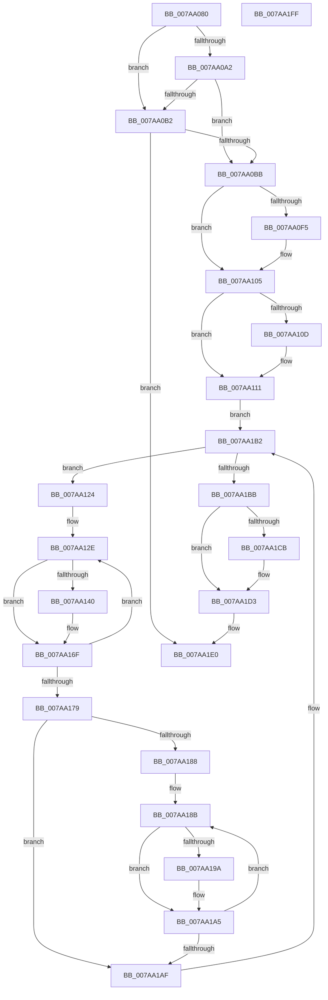

# SmEtwEnableCallback

- RVA: `0x007AA080`–`0x007AA200` (길이 `384` bytes)
- VA: `0x00000001407AA080`
- 실행 섹션: `PAGE`
- PDB 이름 있음: `예`; PDB Function 태그: `아니요`
- unwind 정보 RVA: `0x000847EC`
- 디코드: `100`개 명령, `384/384` bytes 표시
- 미해석 바이트: `0` (있으면 어셈블리에 `.byte`로 보존)

> 이 문서는 커널 이미지의 기계어와 PDB 기호를 분석해 생성했습니다. 4번과 5번은 함수 원형과 자료형을 바이너리 사용 방식에서 추정한 C 해석이며 원본 소스 복구 결과는 아닙니다.

## 1. Dependencies

- 직접 호출 지점: **12**; 고유 호출 대상: **11**
- 직접 호출자로 확인된 함수: **0**
- RIP 상대 이미지 참조: **5**

### Outgoing calls
- `0x007AA0DB` → [KeAbPreAcquire](../../text/21/KeAbPreAcquire_function_00210230.md) (function, `0x00210230`)
- `0x007AA100` → [ExfAcquirePushLockSharedEx](../../text/21/ExfAcquirePushLockSharedEx_function_0021044C.md) (function, `0x0021044C`)
- `0x007AA133` → [SmKmStoreReferenceEx](../../text/34/SmKmStoreReferenceEx_function_0034BDF0.md) (function, `0x0034BDF0`)
- `0x007AA14A` → [SmKmEtwLogStoreStats](SmKmEtwLogStoreStats_function_007A82AC.md) (function, `0x007A82AC`)
- `0x007AA160` → [SmKmEtwLogStoreChange](SmKmEtwLogStoreChange_function_007A8194.md) (function, `0x007A8194`)
- `0x007AA16A` → [SmKmStoreDereference](../../text/20/SmKmStoreDereference_function_00206574.md) (function, `0x00206574`)
- `0x007AA17E` → [SmEtwEnabled](../../text/3A/SmEtwEnabled_function_003AF2D0.md) (function, `0x003AF2D0`)
- `0x007AA190` → [SmKmStoreReferenceEx](../../text/34/SmKmStoreReferenceEx_function_0034BDF0.md) (function, `0x0034BDF0`)
- `0x007AA1A0` → [SMKM_STORE_MGR<SM_TRAITS>::SmStoreContentsRundown](../../text/61/SMKM_STORE_MGR_SM_TRAITS_SmStoreContentsRundown_function_00610ADC.md) (function, `0x00610ADC`)
- `0x007AA1CE` → [ExfReleasePushLockShared](../../text/26/ExfReleasePushLockShared_function_00263440.md) (function, `0x00263440`)
- `0x007AA1D6` → [KeAbPostRelease](../../text/2E/KeAbPostRelease_function_002E1600.md) (function, `0x002E1600`)
- `0x007AA1DB` → [KeLeaveCriticalRegion](../../text/25/KeLeaveCriticalRegion_function_0025D8B0.md) (function, `0x0025D8B0`)

### Direct callers
- 이 함수 시작 RVA로 연결되는 직접 call은 확인되지 않았습니다. 간접 호출은 완전히 역산할 수 없습니다.

### Static image references
- `0x007AA0A6` → RVA `0x00E288DC` (`.data`; write)
- `0x007AA0C4` → RVA `0x00E288C8` (`.data`; read)
- `0x007AA111` → RVA `0x00E288B8` (`.data`; read)
- `0x007AA143` → RVA `0x00E288D0` (`.data`; read)
- `0x007AA14F` → RVA `0x00020C98` (`.rdata`; read)

## 2. Other-region calls and transfers

- 다른 실행 섹션으로 향하는 call: **10**
  - `0x007AA0DB` → [KeAbPreAcquire](../../text/21/KeAbPreAcquire_function_00210230.md) (`PAGE` → `.text`)
  - `0x007AA100` → [ExfAcquirePushLockSharedEx](../../text/21/ExfAcquirePushLockSharedEx_function_0021044C.md) (`PAGE` → `.text`)
  - `0x007AA133` → [SmKmStoreReferenceEx](../../text/34/SmKmStoreReferenceEx_function_0034BDF0.md) (`PAGE` → `.text`)
  - `0x007AA16A` → [SmKmStoreDereference](../../text/20/SmKmStoreDereference_function_00206574.md) (`PAGE` → `.text`)
  - `0x007AA17E` → [SmEtwEnabled](../../text/3A/SmEtwEnabled_function_003AF2D0.md) (`PAGE` → `.text`)
  - `0x007AA190` → [SmKmStoreReferenceEx](../../text/34/SmKmStoreReferenceEx_function_0034BDF0.md) (`PAGE` → `.text`)
  - `0x007AA1A0` → [SMKM_STORE_MGR<SM_TRAITS>::SmStoreContentsRundown](../../text/61/SMKM_STORE_MGR_SM_TRAITS_SmStoreContentsRundown_function_00610ADC.md) (`PAGE` → `.text`)
  - `0x007AA1CE` → [ExfReleasePushLockShared](../../text/26/ExfReleasePushLockShared_function_00263440.md) (`PAGE` → `.text`)
  - `0x007AA1D6` → [KeAbPostRelease](../../text/2E/KeAbPostRelease_function_002E1600.md) (`PAGE` → `.text`)
  - `0x007AA1DB` → [KeLeaveCriticalRegion](../../text/25/KeLeaveCriticalRegion_function_0025D8B0.md) (`PAGE` → `.text`)
- 별도 외부 분기/꼬리 이동을 확인하지 못했습니다.

## 3. Assembly (complete function range)

```asm
007AA080  48 8B C4                        mov rax, rsp
007AA083  48 89 58 08                     mov qword ptr [rax + 8], rbx
007AA087  48 89 68 10                     mov qword ptr [rax + 0x10], rbp
007AA08B  48 89 70 18                     mov qword ptr [rax + 0x18], rsi
007AA08F  48 89 78 20                     mov qword ptr [rax + 0x20], rdi
007AA093  41 54                           push r12
007AA095  41 56                           push r14
007AA097  41 57                           push r15
007AA099  48 83 EC 30                     sub rsp, 0x30
007AA09D  83 FA 01                        cmp edx, 1
007AA0A0  77 10                           ja 0x1407aa0b2
007AA0A2  41 83 C9 40                     or r9d, 0x40
007AA0A6  44 89 0D 2F E8 67 00            mov dword ptr [rip + 0x67e82f], r9d
007AA0AD  83 FA 01                        cmp edx, 1
007AA0B0  74 09                           je 0x1407aa0bb
007AA0B2  83 FA 02                        cmp edx, 2
007AA0B5  0F 85 25 01 00 00               jne 0x1407aa1e0
007AA0BB  65 48 8B 04 25 88 01 00 00      mov rax, qword ptr gs:[0x188]
007AA0C4  4C 8D 3D FD E7 67 00            lea r15, [rip + 0x67e7fd]
007AA0CB  45 33 C0                        xor r8d, r8d
007AA0CE  33 D2                           xor edx, edx
007AA0D0  49 8B CF                        mov rcx, r15
007AA0D3  66 FF 88 E4 01 00 00            dec word ptr [rax + 0x1e4]
007AA0DA  90                              nop
007AA0DB  E8 50 61 A6 FF                  call 0x140210230
007AA0E0  48 8B D8                        mov rbx, rax
007AA0E3  B9 11 00 00 00                  mov ecx, 0x11
007AA0E8  33 C0                           xor eax, eax
007AA0EA  F0 48 0F B1 0D D5 E7 67 00      lock cmpxchg qword ptr [rip + 0x67e7d5], rcx
007AA0F3  74 10                           je 0x1407aa105
007AA0F5  4D 8B CF                        mov r9, r15
007AA0F8  4C 8B C3                        mov r8, rbx
007AA0FB  33 D2                           xor edx, edx
007AA0FD  49 8B CF                        mov rcx, r15
007AA100  E8 47 63 A6 FF                  call 0x14021044c
007AA105  45 33 F6                        xor r14d, r14d
007AA108  48 85 DB                        test rbx, rbx
007AA10B  74 04                           je 0x1407aa111
007AA10D  C6 43 0A 01                     mov byte ptr [rbx + 0xa], 1
007AA111  48 8B 1D A0 E7 67 00            mov rbx, qword ptr [rip + 0x67e7a0]
007AA118  4C 8D 25 99 E7 67 00            lea r12, [rip + 0x67e799]
007AA11F  E9 8E 00 00 00                  jmp 0x1407aa1b2
007AA124  48 8D B3 B8 F7 FF FF            lea rsi, [rbx - 0x848]
007AA12B  41 8B FE                        mov edi, r14d
007AA12E  8B D7                           mov edx, edi
007AA130  48 8B CE                        mov rcx, rsi
007AA133  E8 B8 1C BA FF                  call 0x14034bdf0
007AA138  48 8B E8                        mov rbp, rax
007AA13B  48 85 C0                        test rax, rax
007AA13E  74 2F                           je 0x1407aa16f
007AA140  48 8B D0                        mov rdx, rax
007AA143  48 8D 0D 86 E7 67 00            lea rcx, [rip + 0x67e786]
007AA14A  E8 5D E1 FF FF                  call 0x1407a82ac
007AA14F  4C 8D 05 42 6B 87 FF            lea r8, [rip - 0x7894be]
007AA156  48 8B D5                        mov rdx, rbp
007AA159  48 8D 0D 70 E7 67 00            lea rcx, [rip + 0x67e770]
007AA160  E8 2F E0 FF FF                  call 0x1407a8194
007AA165  8B D7                           mov edx, edi
007AA167  48 8B CE                        mov rcx, rsi
007AA16A  E8 05 C4 A5 FF                  call 0x140206574
007AA16F  FF C7                           inc edi
007AA171  81 FF 00 04 00 00               cmp edi, 0x400
007AA177  72 B5                           jb 0x1407aa12e
007AA179  B9 03 00 00 00                  mov ecx, 3
007AA17E  E8 4D 51 C0 FF                  call 0x1403af2d0
007AA183  48 85 C0                        test rax, rax
007AA186  74 27                           je 0x1407aa1af
007AA188  41 8B FE                        mov edi, r14d
007AA18B  8B D7                           mov edx, edi
007AA18D  48 8B CE                        mov rcx, rsi
007AA190  E8 5B 1C BA FF                  call 0x14034bdf0
007AA195  48 85 C0                        test rax, rax
007AA198  74 0B                           je 0x1407aa1a5
007AA19A  48 8B D0                        mov rdx, rax
007AA19D  48 8B CE                        mov rcx, rsi
007AA1A0  E8 37 69 E6 FF                  call 0x140610adc
007AA1A5  FF C7                           inc edi
007AA1A7  81 FF 00 04 00 00               cmp edi, 0x400
007AA1AD  72 DC                           jb 0x1407aa18b
007AA1AF  48 8B 1B                        mov rbx, qword ptr [rbx]
007AA1B2  49 3B DC                        cmp rbx, r12
007AA1B5  0F 85 69 FF FF FF               jne 0x1407aa124
007AA1BB  B8 11 00 00 00                  mov eax, 0x11
007AA1C0  F0 4C 0F B1 35 FF E6 67 00      lock cmpxchg qword ptr [rip + 0x67e6ff], r14
007AA1C9  74 08                           je 0x1407aa1d3
007AA1CB  49 8B CF                        mov rcx, r15
007AA1CE  E8 6D 92 AB FF                  call 0x140263440
007AA1D3  49 8B CF                        mov rcx, r15
007AA1D6  E8 25 74 B3 FF                  call 0x1402e1600
007AA1DB  E8 D0 36 AB FF                  call 0x14025d8b0
007AA1E0  48 8B 5C 24 50                  mov rbx, qword ptr [rsp + 0x50]
007AA1E5  48 8B 6C 24 58                  mov rbp, qword ptr [rsp + 0x58]
007AA1EA  48 8B 74 24 60                  mov rsi, qword ptr [rsp + 0x60]
007AA1EF  48 8B 7C 24 68                  mov rdi, qword ptr [rsp + 0x68]
007AA1F4  48 83 C4 30                     add rsp, 0x30
007AA1F8  41 5F                           pop r15
007AA1FA  41 5E                           pop r14
007AA1FC  41 5C                           pop r12
007AA1FE  C3                              ret
007AA1FF  CC                              int3
```

## 4. C-style interpretation (structured pseudocode)

```c
__int64 __fastcall SmEtwEnableCallback(__int64 a1, int a2, int a3, int a4)
{
    __int64 result;
    __int64 v_r14;
    __int64 v_rdi;
    __int64 v_rsp;
    unsigned __int64 v_stack_p10;
    unsigned __int64 v_stack_p18;
    unsigned __int64 v_stack_p20;
    unsigned __int64 v_stack_p8;

    *(unsigned __int64 *)(v_rsp + 8) = v_rbx;
    *(unsigned __int64 *)(v_rsp + 16) = v_rbp;
    *(unsigned __int64 *)(v_rsp + 24) = v_rsi;
    *(unsigned __int64 *)(v_rsp + 32) = v_rdi;
    v_rsp = (v_rsp) - (48);
    if (a2 > 1) goto loc_007AA0B2;
    a4 = (unsigned int)((a4) | (64));
    *(unsigned int *)(v_rip + 6809647) = a4;
    if (a2 == 1) goto loc_007AA0BB;
loc_007AA0B2:
    if (a2 != 2) goto loc_007AA1E0;
loc_007AA0BB:
    a3 = 0;
    a2 = 0;
    result = KeAbPreAcquire(v_rip + 6809597, a2, a3, a4);
    result = 0;
    if (!(condition_is_equal)) {
        a4 = v_rip + 6809597;
        a3 = 0;
        a2 = 0;
        a1 = v_rip + 6809597;
        result = ExfAcquirePushLockSharedEx(a1, a2, a3, a4);
    }
    v_r14 = 0;
    if (result != 0) {
        *(unsigned __int8 *)(result + 10) = 1;
    }
    goto loc_007AA1B2;
loc_007AA124:
loc_007AA12E:
    result = SmKmStoreReferenceEx(*(unsigned __int64 *)(v_rip + 6809504) - 2120, 0, a3, a4);
    if (result != 0) {
        a2 = result;
        a1 = v_rip + 6809478;
        result = SmKmEtwLogStoreStats(a1, a2, a3, a4);
        a3 = v_rip - 7902398;
        a2 = result;
        a1 = v_rip + 6809456;
        result = SmKmEtwLogStoreChange(a1, a2, a3, a4);
        a2 = 0;
        a1 = *(unsigned __int64 *)(v_rip + 6809504) - 2120;
        result = SmKmStoreDereference(a1, a2, a3, a4);
    }
    v_rdi = (unsigned int)((0) + 1);
    if (((unsigned int)(v_rdi)) < 0x400ULL) goto loc_007AA12E;
    result = SmEtwEnabled(3, a2, a3, a4);
    if (result == 0) goto loc_007AA1AF;
loc_007AA18B:
    result = SmKmStoreReferenceEx(*(unsigned __int64 *)(v_rip + 6809504) - 2120, 0, a3, a4);
    if (result != 0) {
        a2 = result;
        a1 = *(unsigned __int64 *)(v_rip + 6809504) - 2120;
        result = SMKM_STORE_MGR_SM_TRAITS___SmStoreContentsRundown(a1, a2, a3, a4);
    }
    v_rdi = (unsigned int)((0) + 1);
    if (((unsigned int)(v_rdi)) < 0x400ULL) goto loc_007AA18B;
loc_007AA1AF:
loc_007AA1B2:
    if ((*(unsigned __int64 *)(*(unsigned __int64 *)(v_rip + 6809504))) != (v_rip + 6809497)) goto loc_007AA124;
    result = 17;
    if ((*(unsigned __int64 *)(*(unsigned __int64 *)(v_rip + 6809504))) != (v_rip + 6809497)) {
        a1 = v_rip + 6809597;
        result = ExfReleasePushLockShared(a1, a2, a3, a4);
    }
    result = KeAbPostRelease(v_rip + 6809597, a2, a3, a4);
    result = KeLeaveCriticalRegion(v_rip + 6809597, a2, a3, a4);
loc_007AA1E0:
    v_rsp = (v_rsp) + (48);
    return result;
}
```

## 5. (Beta) C Style

```c
int64_t SmEtwEnableCallback(int64_t Arg1, int32_t Arg2, int32_t Arg3, int32_t Arg4)
{
    int64_t result;
    int64_t local_r14;
    int64_t local_rdi;
    int64_t local_rsp;
    uint64_t v_stack_p10;
    uint64_t v_stack_p18;
    uint64_t v_stack_p20;
    uint64_t v_stack_p8;

    *(uint64_t *)(local_rsp + 0x8) = local_rbx;
    *(uint64_t *)(local_rsp + 0x10) = local_rbp;
    *(uint64_t *)(local_rsp + 0x18) = local_rsi;
    *(uint64_t *)(local_rsp + 0x20) = local_rdi;
    local_rsp = (local_rsp) - (48);
    if (Arg2 > 1) goto loc_007AA0B2;
    Arg4 = (uint32_t)((Arg4) | (64));
    *(uint32_t *)(v_rip + 0x67E82F) = Arg4;
    if (Arg2 == 1) goto loc_007AA0BB;
loc_007AA0B2:
    if (Arg2 != 2) goto loc_007AA1E0;
loc_007AA0BB:
    Arg3 = 0;
    Arg2 = 0;
    result = KeAbPreAcquire(v_rip + 6809597, Arg2, Arg3, Arg4);
    result = 0;
    if (!(condition_is_equal)) {
        Arg4 = v_rip + 6809597;
        Arg3 = 0;
        Arg2 = 0;
        Arg1 = v_rip + 6809597;
        result = ExfAcquirePushLockSharedEx(Arg1, Arg2, Arg3, Arg4);
    }
    local_r14 = 0;
    if (result != 0) {
        *(uint8_t *)(result + 0xA) = 1;
    }
    goto loc_007AA1B2;
loc_007AA124:
loc_007AA12E:
    result = SmKmStoreReferenceEx(*(uint64_t *)(v_rip + 0x67E7A0) - 2120, 0, Arg3, Arg4);
    if (result != 0) {
        Arg2 = result;
        Arg1 = v_rip + 6809478;
        result = SmKmEtwLogStoreStats(Arg1, Arg2, Arg3, Arg4);
        Arg3 = v_rip - 7902398;
        Arg2 = result;
        Arg1 = v_rip + 6809456;
        result = SmKmEtwLogStoreChange(Arg1, Arg2, Arg3, Arg4);
        Arg2 = 0;
        Arg1 = *(uint64_t *)(v_rip + 0x67E7A0) - 2120;
        result = SmKmStoreDereference(Arg1, Arg2, Arg3, Arg4);
    }
    local_rdi = (uint32_t)((0) + 1);
    if (((uint32_t)(local_rdi)) < 0x400ULL) goto loc_007AA12E;
    result = SmEtwEnabled(3, Arg2, Arg3, Arg4);
    if (result == 0) goto loc_007AA1AF;
loc_007AA18B:
    result = SmKmStoreReferenceEx(*(uint64_t *)(v_rip + 0x67E7A0) - 2120, 0, Arg3, Arg4);
    if (result != 0) {
        Arg2 = result;
        Arg1 = *(uint64_t *)(v_rip + 0x67E7A0) - 2120;
        result = SMKM_STORE_MGR_SM_TRAITS___SmStoreContentsRundown(Arg1, Arg2, Arg3, Arg4);
    }
    local_rdi = (uint32_t)((0) + 1);
    if (((uint32_t)(local_rdi)) < 0x400ULL) goto loc_007AA18B;
loc_007AA1AF:
loc_007AA1B2:
    if ((*(uint64_t *)(*(uint64_t *)(v_rip + 0x67E7A0))) != (v_rip + 6809497)) goto loc_007AA124;
    result = 17;
    if ((*(uint64_t *)(*(uint64_t *)(v_rip + 0x67E7A0))) != (v_rip + 6809497)) {
        Arg1 = v_rip + 6809597;
        result = ExfReleasePushLockShared(Arg1, Arg2, Arg3, Arg4);
    }
    result = KeAbPostRelease(v_rip + 6809597, Arg2, Arg3, Arg4);
    result = KeLeaveCriticalRegion(v_rip + 6809597, Arg2, Arg3, Arg4);
loc_007AA1E0:
    local_rsp = (local_rsp) + (48);
    return result;
}
```

## 6. Execution-region graph

[열기: 2D/3D 그래프와 함수 탐색 컨트롤 패널](../../../control-panel.html?section=page&rva=0x007AA080&view=graph)

- 2D 그래프는 위에서 아래로 흐르고, 3D 그래프는 빈 공간을 드래그해 회전합니다. Shift+드래그는 이동, 휠은 확대·축소, 함수 노드 선택은 대상 보고서 이동입니다.

### Static fallback


