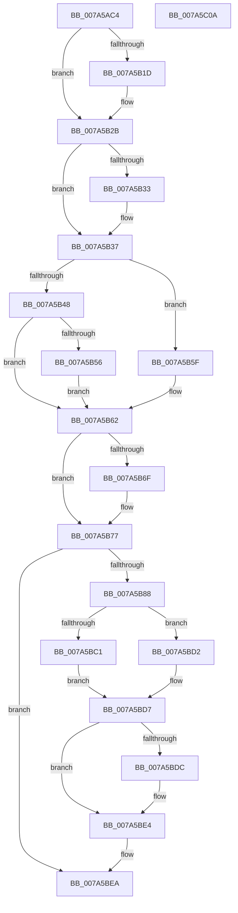

# SmGetRegistrationInfo

- RVA: `0x007A5AC4`–`0x007A5C0B` (길이 `327` bytes)
- VA: `0x00000001407A5AC4`
- 실행 섹션: `PAGE`
- PDB 이름 있음: `예`; PDB Function 태그: `아니요`
- unwind 정보 RVA: `0x0007BBB4`
- 디코드: `94`개 명령, `327/327` bytes 표시
- 미해석 바이트: `0` (있으면 어셈블리에 `.byte`로 보존)

> 이 문서는 커널 이미지의 기계어와 PDB 기호를 분석해 생성했습니다. 4번과 5번은 함수 원형과 자료형을 바이너리 사용 방식에서 추정한 C 해석이며 원본 소스 복구 결과는 아닙니다.

## 1. Dependencies

- 직접 호출 지점: **8**; 고유 호출 대상: **8**
- 직접 호출자로 확인된 함수: **1**
- RIP 상대 이미지 참조: **1**

### Outgoing calls
- `0x007A5B0D` → [KeAbPreAcquire](../../text/21/KeAbPreAcquire_function_00210230.md) (function, `0x00210230`)
- `0x007A5B26` → [ExfAcquirePushLockExclusiveEx](../../text/20/ExfAcquirePushLockExclusiveEx_function_0020FC90.md) (function, `0x0020FC90`)
- `0x007A5B4B` → [SmRegistrationCtxStart](../AC/SmRegistrationCtxStart_function_00ACCA90.md) (function, `0x00ACCA90`)
- `0x007A5B72` → [ExfTryToWakePushLock](../../text/26/ExfTryToWakePushLock_function_00265DD0.md) (function, `0x00265DD0`)
- `0x007A5B7A` → [KeAbPostRelease](../../text/2E/KeAbPostRelease_function_002E1600.md) (function, `0x002E1600`)
- `0x007A5B7F` → [KeLeaveCriticalRegion](../../text/25/KeLeaveCriticalRegion_function_0025D8B0.md) (function, `0x0025D8B0`)
- `0x007A5BB6` → [ObOpenObjectByPointer](../8B/ObOpenObjectByPointer_function_008B7420.md) (function, `0x008B7420`)
- `0x007A5BDF` → [ObCloseHandle](../8A/ObCloseHandle_function_008A1870.md) (function, `0x008A1870`)

### Direct callers
- [SmProcessRegistrationRequest](SmProcessRegistrationRequest_function_007A6C8C.md) at `0x007A6D18`

### Static image references
- `0x007A5B9B` → RVA `0x00FC6B80` (`ALMOSTRO`; read)

## 2. Other-region calls and transfers

- 다른 실행 섹션으로 향하는 call: **5**
  - `0x007A5B0D` → [KeAbPreAcquire](../../text/21/KeAbPreAcquire_function_00210230.md) (`PAGE` → `.text`)
  - `0x007A5B26` → [ExfAcquirePushLockExclusiveEx](../../text/20/ExfAcquirePushLockExclusiveEx_function_0020FC90.md) (`PAGE` → `.text`)
  - `0x007A5B72` → [ExfTryToWakePushLock](../../text/26/ExfTryToWakePushLock_function_00265DD0.md) (`PAGE` → `.text`)
  - `0x007A5B7A` → [KeAbPostRelease](../../text/2E/KeAbPostRelease_function_002E1600.md) (`PAGE` → `.text`)
  - `0x007A5B7F` → [KeLeaveCriticalRegion](../../text/25/KeLeaveCriticalRegion_function_0025D8B0.md) (`PAGE` → `.text`)
- 별도 외부 분기/꼬리 이동을 확인하지 못했습니다.

## 3. Assembly (complete function range)

```asm
007A5AC4  48 89 5C 24 10                  mov qword ptr [rsp + 0x10], rbx
007A5AC9  48 89 6C 24 18                  mov qword ptr [rsp + 0x18], rbp
007A5ACE  48 89 74 24 20                  mov qword ptr [rsp + 0x20], rsi
007A5AD3  57                              push rdi
007A5AD4  41 54                           push r12
007A5AD6  41 55                           push r13
007A5AD8  41 56                           push r14
007A5ADA  41 57                           push r15
007A5ADC  48 83 EC 40                     sub rsp, 0x40
007A5AE0  65 48 8B 04 25 88 01 00 00      mov rax, qword ptr gs:[0x188]
007A5AE9  48 8D B1 68 08 00 00            lea rsi, [rcx + 0x868]
007A5AF0  4D 8B E8                        mov r13, r8
007A5AF3  44 8A FA                        mov r15b, dl
007A5AF6  48 8B E9                        mov rbp, rcx
007A5AF9  48 83 CB FF                     or rbx, 0xffffffffffffffff
007A5AFD  45 33 C0                        xor r8d, r8d
007A5B00  33 D2                           xor edx, edx
007A5B02  66 01 98 E4 01 00 00            add word ptr [rax + 0x1e4], bx
007A5B09  48 8B CE                        mov rcx, rsi
007A5B0C  90                              nop
007A5B0D  E8 1E A7 A6 FF                  call 0x140210230
007A5B12  F0 48 0F BA 2E 00               lock bts qword ptr [rsi], 0
007A5B18  48 8B F8                        mov rdi, rax
007A5B1B  73 0E                           jae 0x1407a5b2b
007A5B1D  4C 8B C6                        mov r8, rsi
007A5B20  48 8B D0                        mov rdx, rax
007A5B23  48 8B CE                        mov rcx, rsi
007A5B26  E8 65 A1 A6 FF                  call 0x14020fc90
007A5B2B  45 33 E4                        xor r12d, r12d
007A5B2E  48 85 FF                        test rdi, rdi
007A5B31  74 04                           je 0x1407a5b37
007A5B33  C6 47 0A 01                     mov byte ptr [rdi + 0xa], 1
007A5B37  8B 85 58 08 00 00               mov eax, dword ptr [rbp + 0x858]
007A5B3D  4C 8D B5 20 0B 00 00            lea r14, [rbp + 0xb20]
007A5B44  A8 08                           test al, 8
007A5B46  75 17                           jne 0x1407a5b5f
007A5B48  49 8B CE                        mov rcx, r14
007A5B4B  E8 40 6F 32 00                  call 0x140acca90
007A5B50  8B F8                           mov edi, eax
007A5B52  85 C0                           test eax, eax
007A5B54  78 0C                           js 0x1407a5b62
007A5B56  83 8D 58 08 00 00 08            or dword ptr [rbp + 0x858], 8
007A5B5D  EB 03                           jmp 0x1407a5b62
007A5B5F  41 8B FC                        mov edi, r12d
007A5B62  F0 48 0F C1 1E                  lock xadd qword ptr [rsi], rbx
007A5B67  80 E3 06                        and bl, 6
007A5B6A  80 FB 02                        cmp bl, 2
007A5B6D  75 08                           jne 0x1407a5b77
007A5B6F  48 8B CE                        mov rcx, rsi
007A5B72  E8 59 02 AC FF                  call 0x140265dd0
007A5B77  48 8B CE                        mov rcx, rsi
007A5B7A  E8 81 BA B3 FF                  call 0x1402e1600
007A5B7F  E8 2C 7D AB FF                  call 0x14025d8b0
007A5B84  85 FF                           test edi, edi
007A5B86  78 62                           js 0x1407a5bea
007A5B88  49 8B 0E                        mov rcx, qword ptr [r14]
007A5B8B  48 8D 44 24 70                  lea rax, [rsp + 0x70]
007A5B90  48 89 44 24 30                  mov qword ptr [rsp + 0x30], rax
007A5B95  41 B9 03 00 1F 00               mov r9d, 0x1f0003
007A5B9B  48 8B 05 DE 0F 82 00            mov rax, qword ptr [rip + 0x820fde]
007A5BA2  45 33 C0                        xor r8d, r8d
007A5BA5  44 88 7C 24 28                  mov byte ptr [rsp + 0x28], r15b
007A5BAA  33 D2                           xor edx, edx
007A5BAC  48 89 44 24 20                  mov qword ptr [rsp + 0x20], rax
007A5BB1  4C 89 64 24 70                  mov qword ptr [rsp + 0x70], r12
007A5BB6  E8 65 18 11 00                  call 0x1408b7420
007A5BBB  8B F8                           mov edi, eax
007A5BBD  85 C0                           test eax, eax
007A5BBF  78 11                           js 0x1407a5bd2
007A5BC1  48 8B 44 24 70                  mov rax, qword ptr [rsp + 0x70]
007A5BC6  49 8B CC                        mov rcx, r12
007A5BC9  49 89 45 08                     mov qword ptr [r13 + 8], rax
007A5BCD  41 8B FC                        mov edi, r12d
007A5BD0  EB 05                           jmp 0x1407a5bd7
007A5BD2  48 8B 4C 24 70                  mov rcx, qword ptr [rsp + 0x70]
007A5BD7  48 85 C9                        test rcx, rcx
007A5BDA  74 08                           je 0x1407a5be4
007A5BDC  41 8A D7                        mov dl, r15b
007A5BDF  E8 8C BC 0F 00                  call 0x1408a1870
007A5BE4  85 FF                           test edi, edi
007A5BE6  41 0F 49 FC                     cmovns edi, r12d
007A5BEA  4C 8D 5C 24 40                  lea r11, [rsp + 0x40]
007A5BEF  8B C7                           mov eax, edi
007A5BF1  49 8B 5B 38                     mov rbx, qword ptr [r11 + 0x38]
007A5BF5  49 8B 6B 40                     mov rbp, qword ptr [r11 + 0x40]
007A5BF9  49 8B 73 48                     mov rsi, qword ptr [r11 + 0x48]
007A5BFD  49 8B E3                        mov rsp, r11
007A5C00  41 5F                           pop r15
007A5C02  41 5E                           pop r14
007A5C04  41 5D                           pop r13
007A5C06  41 5C                           pop r12
007A5C08  5F                              pop rdi
007A5C09  C3                              ret
007A5C0A  CC                              int3
```

## 4. C-style interpretation (structured pseudocode)

```c
__int64 __fastcall SmGetRegistrationInfo(__int64 a1, int a2, __int64 a3)
{
    __int64 result;
    __int64 v_r12;
    __int64 v_rbx;
    __int64 v_rdi;
    __int64 v_rsp;
    unsigned __int64 v_stack_m28;
    unsigned __int64 v_stack_m38;
    unsigned __int8 v_stack_m40;
    unsigned __int64 v_stack_m48;
    unsigned __int64 v_stack_p10;
    unsigned __int64 v_stack_p18;
    unsigned __int64 v_stack_p20;
    unsigned __int64 v_stack_p8;

    v_stack_p10 = v_rbx;
    v_stack_p18 = v_rbp;
    v_stack_p20 = v_rsi;
    v_rsp = (v_rsp) - (64);
    v_rbx = (v_rbx) | (-1);
    a3 = 0;
    a2 = 0;
    result = KeAbPreAcquire(a1 + 2152, a2, a3, a4);
    if (!(condition_is_above_or_equal)) {
        a3 = a1 + 2152;
        a2 = result;
        a1 = a1 + 2152;
        result = ExfAcquirePushLockExclusiveEx(a1, a2, a3, a4);
    }
    v_r12 = 0;
    if (result != 0) {
        *(unsigned __int8 *)(result + 10) = 1;
    }
    if ((((unsigned __int8)((unsigned int)(*(unsigned int *)(a1 + 2136)))) & (8)) != 0) goto loc_007A5B5F;
    result = SmRegistrationCtxStart(a1 + 2848, a2, a3, a4);
    if (sign_flag) goto loc_007A5B62;
    goto loc_007A5B62;
loc_007A5B5F:
loc_007A5B62:
    v_rbx = (unsigned __int8)((v_rbx) & (6));
    if (((unsigned __int8)(v_rbx)) == 2) {
        a1 = a1 + 2152;
        result = ExfTryToWakePushLock(a1, a2, a3, a4);
    }
    result = KeAbPostRelease(a1 + 2152, a2, a3, a4);
    result = KeLeaveCriticalRegion(a1 + 2152, a2, a3, a4);
    if (sign_flag) goto loc_007A5BEA;
    v_stack_m38 = v_stack_p8;
    a3 = 0;
    v_stack_m40 = (unsigned __int8)((unsigned __int8)(a2));
    a2 = 0;
    v_stack_m48 = *(unsigned __int64 *)(v_rip + 8523742);
    v_stack_p8 = 0;
    result = ObOpenObjectByPointer(*(unsigned __int64 *)(a1 + 2848), a2, a3, (unsigned int)(0x1F0003ULL));
    if (sign_flag) goto loc_007A5BD2;
    *(unsigned __int64 *)(a3 + 8) = v_stack_p8;
    goto loc_007A5BD7;
loc_007A5BD2:
loc_007A5BD7:
    result = v_stack_p8;
    if (v_stack_p8 != 0) {
        a2 = (unsigned __int8)((unsigned __int8)(a2));
        result = ObCloseHandle(v_stack_p8, a2, a3, (unsigned int)(0x1F0003ULL));
    }
    v_rdi = 0;
    if (!sign_flag) { v_rdi = 0; }
loc_007A5BEA:
    return (unsigned int)((unsigned int)(v_rdi));
}
```

## 5. (Beta) C Style

```c
int64_t SmGetRegistrationInfo(void *Arg1, int32_t Arg2, void *Arg3)
{
    uint8_t *arg1 = (uint8_t *)Arg1;
    uint8_t *arg3 = (uint8_t *)Arg3;

    int64_t result;
    int64_t local_r12;
    int64_t local_rbx;
    int64_t local_rdi;
    int64_t local_rsp;
    uint64_t v_stack_m28;
    uint64_t v_stack_m38;
    uint8_t v_stack_m40;
    uint64_t v_stack_m48;
    uint64_t v_stack_p10;
    uint64_t v_stack_p18;
    uint64_t v_stack_p20;
    uint64_t v_stack_p8;

    v_stack_p10 = local_rbx;
    v_stack_p18 = local_rbp;
    v_stack_p20 = local_rsi;
    local_rsp = (local_rsp) - (64);
    local_rbx = (local_rbx) | (-1);
    Arg3 = 0;
    Arg2 = 0;
    result = KeAbPreAcquire(Arg1 + 2152, Arg2, Arg3, a4);
    if (!(condition_is_above_or_equal)) {
        Arg3 = Arg1 + 2152;
        Arg2 = result;
        Arg1 = Arg1 + 2152;
        result = ExfAcquirePushLockExclusiveEx(Arg1, Arg2, Arg3, a4);
    }
    local_r12 = 0;
    if (result != 0) {
        *(uint8_t *)(result + 0xA) = 1;
    }
    if ((((uint8_t)((uint32_t)(*(uint32_t *)(arg1 + 0x858)))) & (8)) != 0) goto loc_007A5B5F;
    result = SmRegistrationCtxStart(Arg1 + 2848, Arg2, Arg3, a4);
    if (sign_flag) goto loc_007A5B62;
    goto loc_007A5B62;
loc_007A5B5F:
loc_007A5B62:
    local_rbx = (uint8_t)((local_rbx) & (6));
    if (((uint8_t)(local_rbx)) == 2) {
        Arg1 = Arg1 + 2152;
        result = ExfTryToWakePushLock(Arg1, Arg2, Arg3, a4);
    }
    result = KeAbPostRelease(Arg1 + 2152, Arg2, Arg3, a4);
    result = KeLeaveCriticalRegion(Arg1 + 2152, Arg2, Arg3, a4);
    if (sign_flag) goto loc_007A5BEA;
    v_stack_m38 = v_stack_p8;
    Arg3 = 0;
    v_stack_m40 = (uint8_t)((uint8_t)(Arg2));
    Arg2 = 0;
    v_stack_m48 = *(uint64_t *)(v_rip + 0x820FDE);
    v_stack_p8 = 0;
    result = ObOpenObjectByPointer(*(uint64_t *)(arg1 + 0xB20), Arg2, Arg3, (uint32_t)(0x1F0003ULL));
    if (sign_flag) goto loc_007A5BD2;
    *(uint64_t *)(arg3 + 0x8) = v_stack_p8;
    goto loc_007A5BD7;
loc_007A5BD2:
loc_007A5BD7:
    result = v_stack_p8;
    if (v_stack_p8 != 0) {
        Arg2 = (uint8_t)((uint8_t)(Arg2));
        result = ObCloseHandle(v_stack_p8, Arg2, Arg3, (uint32_t)(0x1F0003ULL));
    }
    local_rdi = 0;
    if (!sign_flag) { local_rdi = 0; }
loc_007A5BEA:
    return (uint32_t)((uint32_t)(local_rdi));
}
```

### 관측된 메모리 오프셋

구조체 형식이 확인되지 않은 접근은 인자 기준의 오프셋으로만 기록했습니다.

| 기준 인자 | 오프셋 표현 | 폭 (bit) | 접근 |
|---|---:|---:|---|
| `Arg1` | `+ 0x0` | `64` | `R` |
| `Arg1` | `+ 0x0` | `64` | `R/W` |
| `Arg1` | `+ 0x858` | `32` | `R` |
| `Arg1` | `+ 0x858` | `32` | `R/W` |
| `Arg1` | `+ 0x868` | `64` | `R` |
| `Arg1` | `+ 0xB20` | `64` | `R` |
| `Arg3` | `+ 0x8` | `64` | `W` |

## 6. Execution-region graph

[열기: 2D/3D 그래프와 함수 탐색 컨트롤 패널](../../../control-panel.html?section=page&rva=0x007A5AC4&view=graph)

- 2D 그래프는 위에서 아래로 흐르고, 3D 그래프는 빈 공간을 드래그해 회전합니다. Shift+드래그는 이동, 휠은 확대·축소, 함수 노드 선택은 대상 보고서 이동입니다.

### Static fallback


