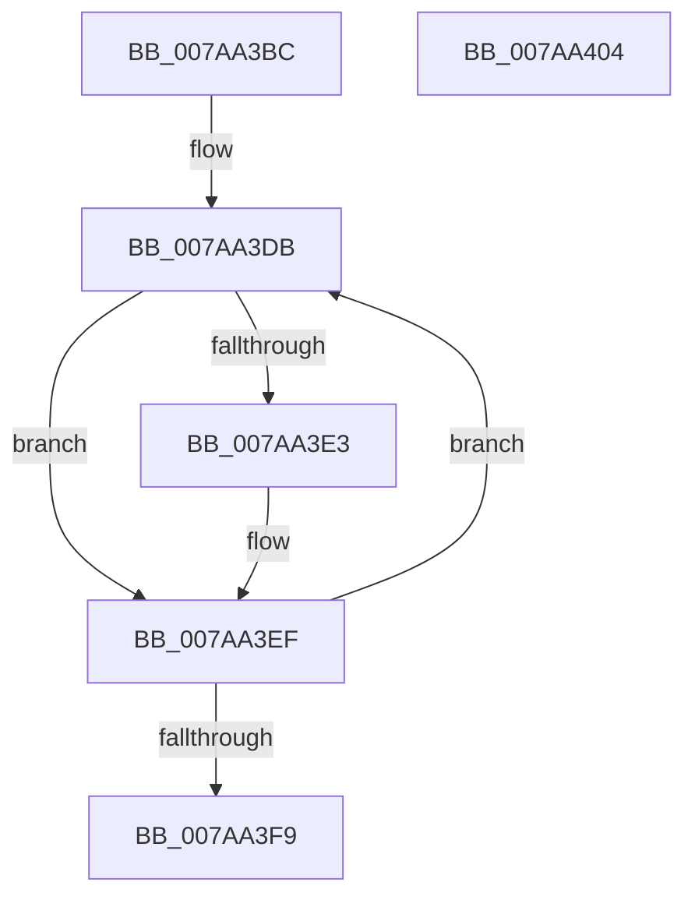

# SmHwAcceleratorCleanup

- RVA: `0x007AA3BC`–`0x007AA405` (길이 `73` bytes)
- VA: `0x00000001407AA3BC`
- 실행 섹션: `PAGE`
- PDB 이름 있음: `예`; PDB Function 태그: `아니요`
- unwind 정보 RVA: `0x0005CAAC`
- 디코드: `21`개 명령, `73/73` bytes 표시
- 미해석 바이트: `0` (있으면 어셈블리에 `.byte`로 보존)

> 이 문서는 커널 이미지의 기계어와 PDB 기호를 분석해 생성했습니다. 4번과 5번은 함수 원형과 자료형을 바이너리 사용 방식에서 추정한 C 해석이며 원본 소스 복구 결과는 아닙니다.

## 1. Dependencies

- 직접 호출 지점: **2**; 고유 호출 대상: **2**
- 직접 호출자로 확인된 함수: **2**
- RIP 상대 이미지 참조: **1**

### Outgoing calls
- `0x007AA3CD` → [ExWaitForRundownProtectionRelease](../../text/2A/ExWaitForRundownProtectionRelease_function_002A4CB0.md) (function, `0x002A4CB0`)
- `0x007AA3E3` → `ext-ms-win-accel-api-km-l1-1-0.dll!AccelCloseResource` (import, 간접 대상; import `ext-ms-win-accel-api-km-l1-1-0.dll!AccelCloseResource`)

### Direct callers
- [SmHwAcceleratorMgrHotRemoveAccelerator](../../text/61/SmHwAcceleratorMgrHotRemoveAccelerator_function_006115FC.md) at `0x006118ED`
- [SmHwAcceleratorMgrReleaseAccelerators](SmHwAcceleratorMgrReleaseAccelerators_function_007AAFD8.md) at `0x007AB07C`

### Static image references
- `0x007AA3E3` → RVA `0x00151198` (`ext-ms-win-accel-api-km-l1-1-0.dll!AccelCloseResource (IAT)`; read)

## 2. Other-region calls and transfers

- 다른 실행 섹션으로 향하는 call: **1**
  - `0x007AA3CD` → [ExWaitForRundownProtectionRelease](../../text/2A/ExWaitForRundownProtectionRelease_function_002A4CB0.md) (`PAGE` → `.text`)
- 별도 외부 분기/꼬리 이동을 확인하지 못했습니다.

## 3. Assembly (complete function range)

```asm
007AA3BC  48 89 5C 24 08                  mov qword ptr [rsp + 8], rbx
007AA3C1  57                              push rdi
007AA3C2  48 83 EC 20                     sub rsp, 0x20
007AA3C6  48 8B D9                        mov rbx, rcx
007AA3C9  48 83 C1 20                     add rcx, 0x20
007AA3CD  E8 DE A8 AF FF                  call 0x1402a4cb0
007AA3D2  48 83 C3 10                     add rbx, 0x10
007AA3D6  BF 02 00 00 00                  mov edi, 2
007AA3DB  48 8B 0B                        mov rcx, qword ptr [rbx]
007AA3DE  48 85 C9                        test rcx, rcx
007AA3E1  74 0C                           je 0x1407aa3ef
007AA3E3  48 FF 15 AE 6D 9A FF            call qword ptr [rip - 0x659252]
007AA3EA  0F 1F 44 00 00                  nop dword ptr [rax + rax]
007AA3EF  48 83 C3 08                     add rbx, 8
007AA3F3  48 83 EF 01                     sub rdi, 1
007AA3F7  75 E2                           jne 0x1407aa3db
007AA3F9  48 8B 5C 24 30                  mov rbx, qword ptr [rsp + 0x30]
007AA3FE  48 83 C4 20                     add rsp, 0x20
007AA402  5F                              pop rdi
007AA403  C3                              ret
007AA404  CC                              int3
```

## 4. C-style interpretation (structured pseudocode)

```c
__int64 __fastcall SmHwAcceleratorCleanup(__int64 a1)
{
    __int64 result;
    __int64 v_rbx;
    __int64 v_rdi;
    __int64 v_rsp;
    unsigned __int64 v_stack_p8;

    v_stack_p8 = v_rbx;
    v_rsp = (v_rsp) - (32);
    a1 = (a1) + (32);
    result = ExWaitForRundownProtectionRelease(a1, a2, a3, a4);
    v_rbx = (a1) + (16);
loc_007AA3DB:
    if (*(unsigned __int64 *)(v_rbx) != 0) {
        result = ext_ms_win_accel_api_km_l1_1_0_dll_AccelCloseResource(*(unsigned __int64 *)(v_rbx), a2, a3, a4);
    }
    v_rbx = (v_rbx) + (8);
    v_rdi = (2) - (1);
    if (condition_is_not_equal) goto loc_007AA3DB;
    v_rsp = (v_rsp) + (32);
    return result;
}
```

## 5. (Beta) C Style

```c
int64_t SmHwAcceleratorCleanup(void *Arg1)
{
    uint8_t *arg1 = (uint8_t *)Arg1;

    int64_t result;
    int64_t local_rbx;
    int64_t local_rdi;
    int64_t local_rsp;
    uint64_t v_stack_p8;

    v_stack_p8 = local_rbx;
    local_rsp = (local_rsp) - (32);
    Arg1 = (Arg1) + (32);
    result = ExWaitForRundownProtectionRelease(Arg1, a2, a3, a4);
    local_rbx = (Arg1) + (16);
loc_007AA3DB:
    if (*(uint64_t *)(local_rbx) != 0) {
        result = kernel_indirect_call(*(uint64_t *)(local_rbx), a2, a3, a4);
    }
    local_rbx = (local_rbx) + (8);
    local_rdi = (2) - (1);
    if (condition_is_not_equal) goto loc_007AA3DB;
    local_rsp = (local_rsp) + (32);
    return result;
}
```

### 관측된 메모리 오프셋

구조체 형식이 확인되지 않은 접근은 인자 기준의 오프셋으로만 기록했습니다.

| 기준 인자 | 오프셋 표현 | 폭 (bit) | 접근 |
|---|---:|---:|---|
| `Arg1` | `+ 0x0` | `64` | `R` |

## 6. Execution-region graph

[열기: 2D/3D 그래프와 함수 탐색 컨트롤 패널](../../../control-panel.html?section=page&rva=0x007AA3BC&view=graph)

- 2D 그래프는 위에서 아래로 흐르고, 3D 그래프는 빈 공간을 드래그해 회전합니다. Shift+드래그는 이동, 휠은 확대·축소, 함수 노드 선택은 대상 보고서 이동입니다.

### Static fallback


