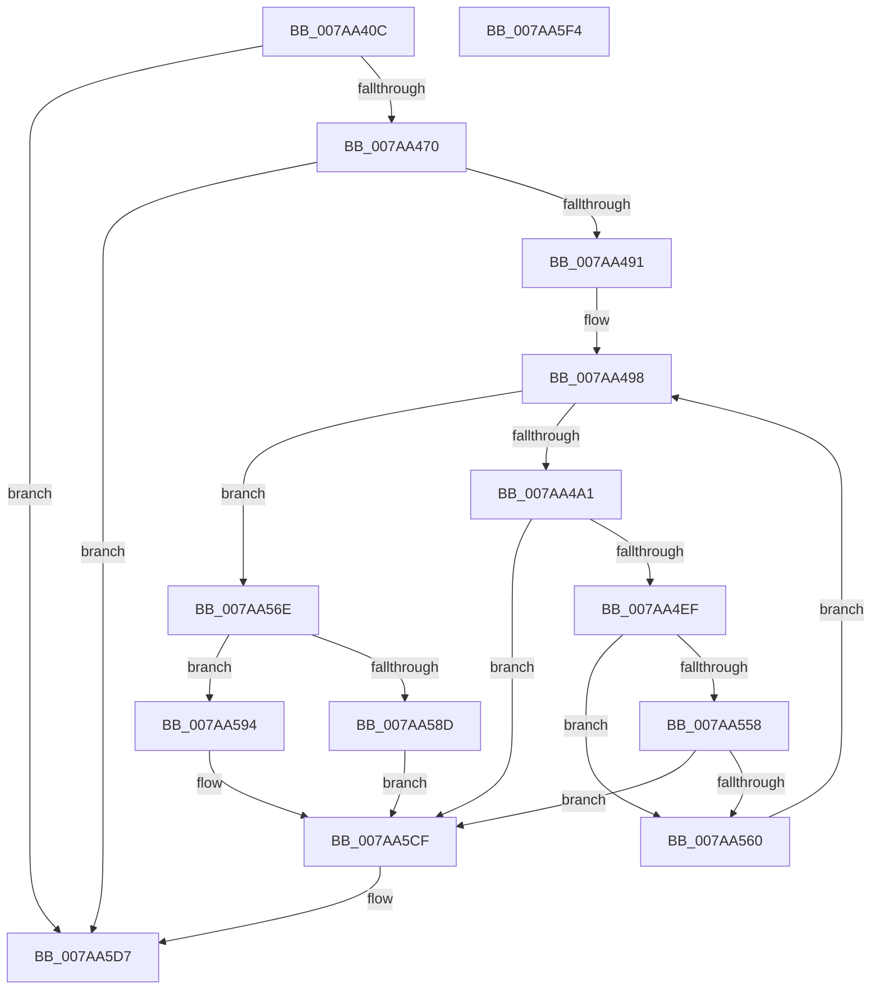

# SmHwAcceleratorCreate

- RVA: `0x007AA40C`–`0x007AA5F5` (길이 `489` bytes)
- VA: `0x00000001407AA40C`
- 실행 섹션: `PAGE`
- PDB 이름 있음: `예`; PDB Function 태그: `아니요`
- unwind 정보 RVA: `0x000D2064`
- 디코드: `133`개 명령, `489/489` bytes 표시
- 미해석 바이트: `0` (있으면 어셈블리에 `.byte`로 보존)

> 이 문서는 커널 이미지의 기계어와 PDB 기호를 분석해 생성했습니다. 4번과 5번은 함수 원형과 자료형을 바이너리 사용 방식에서 추정한 C 해석이며 원본 소스 복구 결과는 아닙니다.

## 1. Dependencies

- 직접 호출 지점: **10**; 고유 호출 대상: **7**
- 직접 호출자로 확인된 함수: **1**
- RIP 상대 이미지 참조: **1**

### Outgoing calls
- `0x007AA455` → [memset](../../text/6C/memset_function_006C6C40.md) (function, `0x006C6C40`)
- `0x007AA461` → [AccelQueryDescriptorSize](../../text/66/AccelQueryDescriptorSize_function_00668750.md) (function, `0x00668750`)
- `0x007AA480` → [SmAllocEx](../../text/34/SmAllocEx_function_0034C794.md) (function, `0x0034C794`)
- `0x007AA4C4` → [memset](../../text/6C/memset_function_006C6C40.md) (function, `0x006C6C40`)
- `0x007AA4D9` → `ext-ms-win-accel-api-km-l1-1-0.dll!AccelQueryResourceInformation` (import, 간접 대상; import `ext-ms-win-accel-api-km-l1-1-0.dll!AccelQueryResourceInformation`)
- `0x007AA500` → [AccelInitializeDescriptor](../../text/66/AccelInitializeDescriptor_function_0066860C.md) (function, `0x0066860C`)
- `0x007AA546` → [AccelInitializeCompressionWorkspace](../../text/66/AccelInitializeCompressionWorkspace_function_006684D0.md) (function, `0x006684D0`)
- `0x007AA580` → [SmAllocEx](../../text/34/SmAllocEx_function_0034C794.md) (function, `0x0034C794`)
- `0x007AA59C` → [memset](../../text/6C/memset_function_006C6C40.md) (function, `0x006C6C40`)
- `0x007AA5D2` → [CmSiFreeMemory](../../text/47/CmSiFreeMemory_function_00475D80.md) (function, `0x00475D80`)

### Direct callers
- [SmHwAcceleratorMgrAcquireAccelerators](SmHwAcceleratorMgrAcquireAccelerators_function_007AA628.md) at `0x007AAB4D`

### Static image references
- `0x007AA4D9` → RVA `0x001511B0` (`ext-ms-win-accel-api-km-l1-1-0.dll!AccelQueryResourceInformation (IAT)`; read)

## 2. Other-region calls and transfers

- 다른 실행 섹션으로 향하는 call: **9**
  - `0x007AA455` → [memset](../../text/6C/memset_function_006C6C40.md) (`PAGE` → `.text`)
  - `0x007AA461` → [AccelQueryDescriptorSize](../../text/66/AccelQueryDescriptorSize_function_00668750.md) (`PAGE` → `.text`)
  - `0x007AA480` → [SmAllocEx](../../text/34/SmAllocEx_function_0034C794.md) (`PAGE` → `.text`)
  - `0x007AA4C4` → [memset](../../text/6C/memset_function_006C6C40.md) (`PAGE` → `.text`)
  - `0x007AA500` → [AccelInitializeDescriptor](../../text/66/AccelInitializeDescriptor_function_0066860C.md) (`PAGE` → `.text`)
  - `0x007AA546` → [AccelInitializeCompressionWorkspace](../../text/66/AccelInitializeCompressionWorkspace_function_006684D0.md) (`PAGE` → `.text`)
  - `0x007AA580` → [SmAllocEx](../../text/34/SmAllocEx_function_0034C794.md) (`PAGE` → `.text`)
  - `0x007AA59C` → [memset](../../text/6C/memset_function_006C6C40.md) (`PAGE` → `.text`)
  - `0x007AA5D2` → [CmSiFreeMemory](../../text/47/CmSiFreeMemory_function_00475D80.md) (`PAGE` → `.text`)
- 별도 외부 분기/꼬리 이동을 확인하지 못했습니다.

## 3. Assembly (complete function range)

```asm
007AA40C  48 89 5C 24 18                  mov qword ptr [rsp + 0x18], rbx
007AA411  4C 89 4C 24 20                  mov qword ptr [rsp + 0x20], r9
007AA416  55                              push rbp
007AA417  56                              push rsi
007AA418  57                              push rdi
007AA419  41 54                           push r12
007AA41B  41 55                           push r13
007AA41D  41 56                           push r14
007AA41F  41 57                           push r15
007AA421  48 8D 6C 24 E1                  lea rbp, [rsp - 0x1f]
007AA426  48 81 EC E0 00 00 00            sub rsp, 0xe0
007AA42D  44 8B A1 20 05 00 00            mov r12d, dword ptr [rcx + 0x520]
007AA434  33 C0                           xor eax, eax
007AA436  83 65 77 00                     and dword ptr [rbp + 0x77], 0
007AA43A  48 8D 4D AF                     lea rcx, [rbp - 0x51]
007AA43E  45 8B E8                        mov r13d, r8d
007AA441  89 45 B3                        mov dword ptr [rbp - 0x4d], eax
007AA444  4C 8B FA                        mov r15, rdx
007AA447  0F 57 C0                        xorps xmm0, xmm0
007AA44A  44 8D 40 64                     lea r8d, [rax + 0x64]
007AA44E  33 D2                           xor edx, edx
007AA450  0F 11 44 24 20                  movups xmmword ptr [rsp + 0x20], xmm0
007AA455  E8 E6 C7 F1 FF                  call 0x1406c6c40
007AA45A  49 8B 0F                        mov rcx, qword ptr [r15]
007AA45D  48 8D 55 77                     lea rdx, [rbp + 0x77]
007AA461  E8 EA E2 EB FF                  call 0x140668750
007AA466  8B D8                           mov ebx, eax
007AA468  85 C0                           test eax, eax
007AA46A  0F 88 67 01 00 00               js 0x1407aa5d7
007AA470  44 8B 75 77                     mov r14d, dword ptr [rbp + 0x77]
007AA474  41 83 C8 FF                     or r8d, 0xffffffff
007AA478  41 8B CE                        mov ecx, r14d
007AA47B  BA 73 6D 41 64                  mov edx, 0x64416d73
007AA480  E8 0F 23 BA FF                  call 0x14034c794
007AA485  48 8B F0                        mov rsi, rax
007AA488  48 85 C0                        test rax, rax
007AA48B  0F 84 46 01 00 00               je 0x1407aa5d7
007AA491  33 FF                           xor edi, edi
007AA493  B9 00 00 00 80                  mov ecx, 0x80000000
007AA498  83 FF 02                        cmp edi, 2
007AA49B  0F 83 CD 00 00 00               jae 0x1407aa56e
007AA4A1  49 8B 04 FF                     mov rax, qword ptr [r15 + rdi*8]
007AA4A5  48 8D 4D B3                     lea rcx, [rbp - 0x4d]
007AA4A9  33 D2                           xor edx, edx
007AA4AB  C7 44 24 20 01 00 10 00         mov dword ptr [rsp + 0x20], 0x100001
007AA4B3  C7 44 24 24 03 00 00 00         mov dword ptr [rsp + 0x24], 3
007AA4BB  48 89 44 24 28                  mov qword ptr [rsp + 0x28], rax
007AA4C0  44 8D 42 64                     lea r8d, [rdx + 0x64]
007AA4C4  E8 77 C7 F1 FF                  call 0x1406c6c40
007AA4C9  48 8D 55 AF                     lea rdx, [rbp - 0x51]
007AA4CD  C7 45 AF 01 00 68 00            mov dword ptr [rbp - 0x51], 0x680001
007AA4D4  48 8D 4C 24 20                  lea rcx, [rsp + 0x20]
007AA4D9  48 FF 15 D0 6C 9A FF            call qword ptr [rip - 0x659330]
007AA4E0  0F 1F 44 00 00                  nop dword ptr [rax + rax]
007AA4E5  8B D8                           mov ebx, eax
007AA4E7  85 C0                           test eax, eax
007AA4E9  0F 88 E0 00 00 00               js 0x1407aa5cf
007AA4EF  8B 45 C3                        mov eax, dword ptr [rbp - 0x3d]
007AA4F2  4C 8B C6                        mov r8, rsi
007AA4F5  49 8B 0C FF                     mov rcx, qword ptr [r15 + rdi*8]
007AA4F9  41 8B D6                        mov edx, r14d
007AA4FC  89 44 BD 77                     mov dword ptr [rbp + rdi*4 + 0x77], eax
007AA500  E8 07 E1 EB FF                  call 0x14066860c
007AA505  33 D2                           xor edx, edx
007AA507  48 C7 44 24 30 01 00 40 00      mov qword ptr [rsp + 0x30], 0x400001
007AA510  8B C7                           mov eax, edi
007AA512  48 89 55 97                     mov qword ptr [rbp - 0x69], rdx
007AA516  F7 D8                           neg eax
007AA518  48 89 55 A7                     mov qword ptr [rbp - 0x59], rdx
007AA51C  48 89 74 24 38                  mov qword ptr [rsp + 0x38], rsi
007AA521  1B C9                           sbb ecx, ecx
007AA523  48 89 54 24 40                  mov qword ptr [rsp + 0x40], rdx
007AA528  83 C1 07                        add ecx, 7
007AA52B  89 55 87                        mov dword ptr [rbp - 0x79], edx
007AA52E  44 8D 42 01                     lea r8d, [rdx + 1]
007AA532  89 4D 8B                        mov dword ptr [rbp - 0x75], ecx
007AA535  48 8D 4C 24 30                  lea rcx, [rsp + 0x30]
007AA53A  44 89 45 8F                     mov dword ptr [rbp - 0x71], r8d
007AA53E  44 89 45 93                     mov dword ptr [rbp - 0x6d], r8d
007AA542  48 89 55 9F                     mov qword ptr [rbp - 0x61], rdx
007AA546  E8 85 DF EB FF                  call 0x1406684d0
007AA54B  B9 00 00 00 80                  mov ecx, 0x80000000
007AA550  8B D8                           mov ebx, eax
007AA552  03 C1                           add eax, ecx
007AA554  85 C1                           test ecx, eax
007AA556  75 08                           jne 0x1407aa560
007AA558  81 FB 23 00 00 C0               cmp ebx, 0xc0000023
007AA55E  75 6F                           jne 0x1407aa5cf
007AA560  8B 45 A7                        mov eax, dword ptr [rbp - 0x59]
007AA563  89 44 BD 67                     mov dword ptr [rbp + rdi*4 + 0x67], eax
007AA567  FF C7                           inc edi
007AA569  E9 2A FF FF FF                  jmp 0x1407aa498
007AA56E  45 8B C5                        mov r8d, r13d
007AA571  BF 48 00 00 00                  mov edi, 0x48
007AA576  44 0B C1                        or r8d, ecx
007AA579  BA 73 6D 41 68                  mov edx, 0x68416d73
007AA57E  8B CF                           mov ecx, edi
007AA580  E8 0F 22 BA FF                  call 0x14034c794
007AA585  48 8B D8                        mov rbx, rax
007AA588  48 85 C0                        test rax, rax
007AA58B  75 07                           jne 0x1407aa594
007AA58D  BB 9A 00 00 C0                  mov ebx, 0xc000009a
007AA592  EB 3B                           jmp 0x1407aa5cf
007AA594  4C 8B C7                        mov r8, rdi
007AA597  33 D2                           xor edx, edx
007AA599  48 8B CB                        mov rcx, rbx
007AA59C  E8 9F C6 F1 FF                  call 0x1406c6c40
007AA5A1  41 0F 10 07                     movups xmm0, xmmword ptr [r15]
007AA5A5  48 8B 45 77                     mov rax, qword ptr [rbp + 0x77]
007AA5A9  48 89 43 30                     mov qword ptr [rbx + 0x30], rax
007AA5AD  48 8B 45 67                     mov rax, qword ptr [rbp + 0x67]
007AA5B1  48 89 43 38                     mov qword ptr [rbx + 0x38], rax
007AA5B5  48 8B 45 7F                     mov rax, qword ptr [rbp + 0x7f]
007AA5B9  F3 0F 7F 43 10                  movdqu xmmword ptr [rbx + 0x10], xmm0
007AA5BE  44 89 73 28                     mov dword ptr [rbx + 0x28], r14d
007AA5C2  44 89 6B 2C                     mov dword ptr [rbx + 0x2c], r13d
007AA5C6  48 89 18                        mov qword ptr [rax], rbx
007AA5C9  44 89 63 40                     mov dword ptr [rbx + 0x40], r12d
007AA5CD  33 DB                           xor ebx, ebx
007AA5CF  48 8B CE                        mov rcx, rsi
007AA5D2  E8 A9 B7 CC FF                  call 0x140475d80
007AA5D7  8B C3                           mov eax, ebx
007AA5D9  48 8B 9C 24 30 01 00 00         mov rbx, qword ptr [rsp + 0x130]
007AA5E1  48 81 C4 E0 00 00 00            add rsp, 0xe0
007AA5E8  41 5F                           pop r15
007AA5EA  41 5E                           pop r14
007AA5EC  41 5D                           pop r13
007AA5EE  41 5C                           pop r12
007AA5F0  5F                              pop rdi
007AA5F1  5E                              pop rsi
007AA5F2  5D                              pop rbp
007AA5F3  C3                              ret
007AA5F4  CC                              int3
```

## 4. C-style interpretation (structured pseudocode)

```c
__int64 __fastcall SmHwAcceleratorCreate(__int64 a1, __int64 a2, int a3, __int64 a4, __int64 a5)
{
    __int64 result;
    __int64 v_rbx;
    __int64 v_rdi;
    __int64 v_rsp;
    unsigned __int64 v_stack_m57;
    unsigned int v_stack_m94;
    unsigned int v_stack_mA4;
    unsigned __int64 v_stack_mA8;
    unsigned __int64 v_stack_mB0;
    unsigned __int64 v_stack_mB8;
    unsigned __int64 v_stack_mC0;
    unsigned int v_stack_mC4;
    unsigned int v_stack_mC8;
    unsigned int v_stack_mCC;
    unsigned int v_stack_mD0;
    unsigned __int64 v_stack_mD8;
    unsigned __int64 v_stack_mE0;
    unsigned __int64 v_stack_mE8;
    unsigned __int64 v_stack_mF0;
    unsigned int v_stack_mF4;
    unsigned __int64 v_stack_mF8;
    unsigned __int64 v_stack_p10;
    unsigned __int64 v_stack_p18;
    unsigned __int64 v_stack_p20;

    v_stack_p18 = v_rbx;
    v_stack_p20 = a4;
    v_rsp = (v_rsp) - (224);
    result = 0;
    v_stack_mA4 = 0;
    a2 = 0;
    v_stack_mF8 = v_xmm0;
    result = memset(v_stack_mA8, a2, result + 100, a4);
    result = AccelQueryDescriptorSize(*(unsigned __int64 *)(a2), v_stack_p20, result + 100, a4);
    if (sign_flag) goto loc_007AA5D7;
    a3 = (unsigned int)((result + 100) | (0xFFFFFFFFULL));
    result = SmAllocEx((unsigned int)((unsigned int)((unsigned int)(v_stack_p20))), (unsigned int)(0x64416D73ULL), a3, a4);
    if (result == 0) goto loc_007AA5D7;
    v_rdi = 0;
loc_007AA498:
    if (0 >= 2) goto loc_007AA56E;
    a2 = 0;
    v_stack_mF8 = 0x100001ULL;
    v_stack_mF4 = 3;
    v_stack_mF0 = *(unsigned __int64 *)(a2 + v_rdi * 8);
    result = memset(v_stack_mA4, a2, a2 + 100, a4);
    v_stack_mA8 = 0x680001ULL;
    result = ext_ms_win_accel_api_km_l1_1_0_dll_AccelQueryResourceInformation(v_stack_mF8, v_stack_mA8, a2 + 100, a4);
    if (sign_flag) goto loc_007AA5CF;
    *(unsigned int *)(v_stack_m57 + v_rdi * 4 + 119) = (unsigned int)((unsigned int)(v_stack_m94));
    result = AccelInitializeDescriptor(*(unsigned __int64 *)(a2 + v_rdi * 8), (unsigned int)((unsigned int)((unsigned int)(v_stack_p20))), result, a4);
    a2 = 0;
    v_stack_mE8 = 0x400001ULL;
    v_stack_mC0 = 0;
    result = (unsigned int)(-(0));
    v_stack_mB0 = 0;
    v_stack_mE0 = result;
    v_stack_mD8 = 0;
    a1 = (unsigned int)((*(unsigned __int64 *)(a2 + v_rdi * 8)) + (7));
    v_stack_mD0 = 0;
    v_stack_mCC = (unsigned int)(a1);
    v_stack_mC8 = (unsigned int)(a2 + 1);
    v_stack_mC4 = (unsigned int)(a2 + 1);
    v_stack_mB8 = 0;
    result = AccelInitializeCompressionWorkspace(v_stack_mE8, a2, a2 + 1, a4);
    result = (unsigned int)((result) + ((unsigned int)((unsigned int)(0x80000000ULL))));
    if ((((unsigned int)((unsigned int)(0x80000000ULL))) & ((unsigned int)(result))) != 0) goto loc_007AA560;
    if (((unsigned int)((unsigned int)((unsigned int)(result)))) != 0xC0000023ULL) goto loc_007AA5CF;
loc_007AA560:
    *(unsigned int *)(v_stack_m57 + v_rdi * 4 + 103) = (unsigned int)((unsigned int)(v_stack_mB0));
    v_rdi = (unsigned int)((v_rdi) + 1);
    goto loc_007AA498;
loc_007AA56E:
    a3 = (unsigned int)(((unsigned int)((unsigned int)((unsigned int)(a3)))) | ((unsigned int)((unsigned int)(0x80000000ULL))));
    result = SmAllocEx(72, (unsigned int)(0x68416D73ULL), a3, a4);
    if (result != 0) goto loc_007AA594;
    goto loc_007AA5CF;
loc_007AA594:
    a2 = 0;
    result = memset((unsigned int)(0xC000009AULL), a2, 72, a4);
    *(unsigned __int64 *)((unsigned int)(0xC000009AULL) + 48) = v_stack_p20;
    *(unsigned __int64 *)((unsigned int)(0xC000009AULL) + 56) = v_stack_p10;
    *(unsigned __int64 *)((unsigned int)(0xC000009AULL) + 16) = v_xmm0;
    *(unsigned int *)((unsigned int)(0xC000009AULL) + 40) = (unsigned int)((unsigned int)(v_stack_p20));
    *(unsigned int *)((unsigned int)(0xC000009AULL) + 44) = (unsigned int)((unsigned int)(a3));
    *(unsigned __int64 *)(a5) = (unsigned int)(0xC000009AULL);
    *(unsigned int *)((unsigned int)(0xC000009AULL) + 64) = (unsigned int)((unsigned int)(*(unsigned int *)(a1 + 1312)));
    v_rbx = 0;
loc_007AA5CF:
    result = CmSiFreeMemory(result, a2, 72, a4);
loc_007AA5D7:
    v_rsp = (v_rsp) + (224);
    return 0;
}
```

## 5. (Beta) C Style

```c
int64_t SmHwAcceleratorCreate(void *Arg1, void *Arg2, int32_t Arg3, int64_t Arg4, void *Arg5)
{
    uint8_t *arg1 = (uint8_t *)Arg1;
    uint8_t *arg2 = (uint8_t *)Arg2;
    uint8_t *arg5 = (uint8_t *)Arg5;

    int64_t result;
    int64_t local_rbx;
    int64_t local_rdi;
    int64_t local_rsp;
    uint64_t v_stack_m57;
    uint32_t v_stack_m94;
    uint32_t v_stack_mA4;
    uint64_t v_stack_mA8;
    uint64_t v_stack_mB0;
    uint64_t v_stack_mB8;
    uint64_t v_stack_mC0;
    uint32_t v_stack_mC4;
    uint32_t v_stack_mC8;
    uint32_t v_stack_mCC;
    uint32_t v_stack_mD0;
    uint64_t v_stack_mD8;
    uint64_t v_stack_mE0;
    uint64_t v_stack_mE8;
    uint64_t v_stack_mF0;
    uint32_t v_stack_mF4;
    uint64_t v_stack_mF8;
    uint64_t v_stack_p10;
    uint64_t v_stack_p18;
    uint64_t v_stack_p20;

    v_stack_p18 = local_rbx;
    v_stack_p20 = Arg4;
    local_rsp = (local_rsp) - (224);
    result = 0;
    v_stack_mA4 = 0;
    Arg2 = 0;
    v_stack_mF8 = v_xmm0;
    result = memset(v_stack_mA8, Arg2, result + 100, Arg4);
    result = AccelQueryDescriptorSize(*(uint64_t *)(arg2), v_stack_p20, result + 100, Arg4);
    if (sign_flag) goto loc_007AA5D7;
    Arg3 = (uint32_t)((result + 100) | (0xFFFFFFFFULL));
    result = SmAllocEx((uint32_t)((uint32_t)((uint32_t)(v_stack_p20))), (uint32_t)(0x64416D73ULL), Arg3, Arg4);
    if (result == 0) goto loc_007AA5D7;
    local_rdi = 0;
loc_007AA498:
    if (0 >= 2) goto loc_007AA56E;
    Arg2 = 0;
    v_stack_mF8 = 0x100001ULL;
    v_stack_mF4 = 3;
    v_stack_mF0 = *(uint64_t *)(arg2 + local_rdi * 8);
    result = memset(v_stack_mA4, Arg2, Arg2 + 100, Arg4);
    v_stack_mA8 = 0x680001ULL;
    result = kernel_indirect_call(v_stack_mF8, v_stack_mA8, Arg2 + 100, Arg4);
    if (sign_flag) goto loc_007AA5CF;
    *(uint32_t *)(v_stack_m57 + local_rdi * 4 + 0x77) = (uint32_t)((uint32_t)(v_stack_m94));
    result = AccelInitializeDescriptor(*(uint64_t *)(arg2 + local_rdi * 8), (uint32_t)((uint32_t)((uint32_t)(v_stack_p20))), result, Arg4);
    Arg2 = 0;
    v_stack_mE8 = 0x400001ULL;
    v_stack_mC0 = 0;
    result = (uint32_t)(-(0));
    v_stack_mB0 = 0;
    v_stack_mE0 = result;
    v_stack_mD8 = 0;
    Arg1 = (uint32_t)((*(uint64_t *)(arg2 + local_rdi * 8)) + (7));
    v_stack_mD0 = 0;
    v_stack_mCC = (uint32_t)(Arg1);
    v_stack_mC8 = (uint32_t)(Arg2 + 1);
    v_stack_mC4 = (uint32_t)(Arg2 + 1);
    v_stack_mB8 = 0;
    result = AccelInitializeCompressionWorkspace(v_stack_mE8, Arg2, Arg2 + 1, Arg4);
    result = (uint32_t)((result) + ((uint32_t)((uint32_t)(0x80000000ULL))));
    if ((((uint32_t)((uint32_t)(0x80000000ULL))) & ((uint32_t)(result))) != 0) goto loc_007AA560;
    if (((uint32_t)((uint32_t)((uint32_t)(result)))) != 0xC0000023ULL) goto loc_007AA5CF;
loc_007AA560:
    *(uint32_t *)(v_stack_m57 + local_rdi * 4 + 0x67) = (uint32_t)((uint32_t)(v_stack_mB0));
    local_rdi = (uint32_t)((local_rdi) + 1);
    goto loc_007AA498;
loc_007AA56E:
    Arg3 = (uint32_t)(((uint32_t)((uint32_t)((uint32_t)(Arg3)))) | ((uint32_t)((uint32_t)(0x80000000ULL))));
    result = SmAllocEx(72, (uint32_t)(0x68416D73ULL), Arg3, Arg4);
    if (result != 0) goto loc_007AA594;
    goto loc_007AA5CF;
loc_007AA594:
    Arg2 = 0;
    result = memset((uint32_t)(0xC000009AULL), Arg2, 72, Arg4);
    *(uint64_t *)((uint32_t)(0xC000009AULL) + 0x30) = v_stack_p20;
    *(uint64_t *)((uint32_t)(0xC000009AULL) + 0x38) = v_stack_p10;
    *(uint64_t *)((uint32_t)(0xC000009AULL) + 0x10) = v_xmm0;
    *(uint32_t *)((uint32_t)(0xC000009AULL) + 0x28) = (uint32_t)((uint32_t)(v_stack_p20));
    *(uint32_t *)((uint32_t)(0xC000009AULL) + 0x2C) = (uint32_t)((uint32_t)(Arg3));
    *(uint64_t *)(arg5) = (uint32_t)(0xC000009AULL);
    *(uint32_t *)((uint32_t)(0xC000009AULL) + 0x40) = (uint32_t)((uint32_t)(*(uint32_t *)(arg1 + 0x520)));
    local_rbx = 0;
loc_007AA5CF:
    result = CmSiFreeMemory(result, Arg2, 72, Arg4);
loc_007AA5D7:
    local_rsp = (local_rsp) + (224);
    return 0;
}
```

### 관측된 메모리 오프셋

구조체 형식이 확인되지 않은 접근은 인자 기준의 오프셋으로만 기록했습니다.

| 기준 인자 | 오프셋 표현 | 폭 (bit) | 접근 |
|---|---:|---:|---|
| `Arg1` | `+ 0x520` | `32` | `R` |
| `Arg2` | `+ 0x0` | `64` | `R` |
| `Arg2` | `+ 0x0` | `128` | `R` |
| `Arg2` | `+ 0x0 + rdi*8` | `64` | `R` |
| `Arg5` | `+ 0x0` | `64` | `W` |

## 6. Execution-region graph

[열기: 2D/3D 그래프와 함수 탐색 컨트롤 패널](../../../control-panel.html?section=page&rva=0x007AA40C&view=graph)

- 2D 그래프는 위에서 아래로 흐르고, 3D 그래프는 빈 공간을 드래그해 회전합니다. Shift+드래그는 이동, 휠은 확대·축소, 함수 노드 선택은 대상 보고서 이동입니다.

### Static fallback


