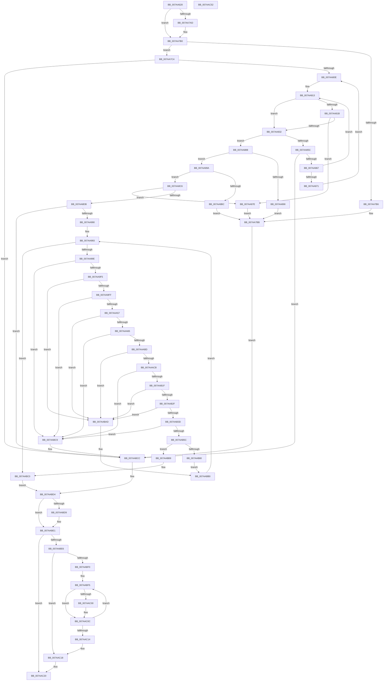

# SmHwAcceleratorMgrAcquireAccelerators

- RVA: `0x007AA628`–`0x007AAC53` (길이 `1,579` bytes)
- VA: `0x00000001407AA628`
- 실행 섹션: `PAGE`
- PDB 이름 있음: `예`; PDB Function 태그: `아니요`
- unwind 정보 RVA: `0x000CCF38`
- 디코드: `361`개 명령, `1,579/1,579` bytes 표시
- 미해석 바이트: `0` (있으면 어셈블리에 `.byte`로 보존)

> 이 문서는 커널 이미지의 기계어와 PDB 기호를 분석해 생성했습니다. 4번과 5번은 함수 원형과 자료형을 바이너리 사용 방식에서 추정한 C 해석이며 원본 소스 복구 결과는 아닙니다.

## 1. Dependencies

- 직접 호출 지점: **25**; 고유 호출 대상: **14**
- 직접 호출자로 확인된 함수: **1**
- RIP 상대 이미지 참조: **14**

### Outgoing calls
- `0x007AA685` → [memset](../../text/6C/memset_function_006C6C40.md) (function, `0x006C6C40`)
- `0x007AA6AC` → [memset](../../text/6C/memset_function_006C6C40.md) (function, `0x006C6C40`)
- `0x007AA79B` → [RtlpQueryRegistryValues](../8C/RtlpQueryRegistryValues_function_008C9050.md) (function, `0x008C9050`)
- `0x007AA7F4` → `ext-ms-win-accel-api-km-l1-1-0.dll!AccelInitializeOffloadWorkspace` (import, 간접 대상; import `ext-ms-win-accel-api-km-l1-1-0.dll!AccelInitializeOffloadWorkspace`)
- `0x007AA825` → [SmAllocEx](../../text/34/SmAllocEx_function_0034C794.md) (function, `0x0034C794`)
- `0x007AA846` → `ext-ms-win-accel-api-km-l1-1-0.dll!AccelEnumAccelerators` (import, 간접 대상; import `ext-ms-win-accel-api-km-l1-1-0.dll!AccelEnumAccelerators`)
- `0x007AA874` → [CmSiFreeMemory](../../text/47/CmSiFreeMemory_function_00475D80.md) (function, `0x00475D80`)
- `0x007AA8CE` → [SmAllocEx](../../text/34/SmAllocEx_function_0034C794.md) (function, `0x0034C794`)
- `0x007AA95D` → [KiStackAttachProcess](../../text/21/KiStackAttachProcess_function_00216820.md) (function, `0x00216820`)
- `0x007AA96B` → `ext-ms-win-accel-api-km-l1-1-0.dll!AccelAcquireResourcesSync` (import, 간접 대상; import `ext-ms-win-accel-api-km-l1-1-0.dll!AccelAcquireResourcesSync`)
- `0x007AA983` → [KiUnstackDetachProcess](../../text/21/KiUnstackDetachProcess_function_00217D30.md) (function, `0x00217D30`)
- `0x007AA9C6` → [memset](../../text/6C/memset_function_006C6C40.md) (function, `0x006C6C40`)
- `0x007AA9DB` → `ext-ms-win-accel-api-km-l1-1-0.dll!AccelQueryResourceInformation` (import, 간접 대상; import `ext-ms-win-accel-api-km-l1-1-0.dll!AccelQueryResourceInformation`)
- `0x007AAA28` → [memset](../../text/6C/memset_function_006C6C40.md) (function, `0x006C6C40`)
- `0x007AAA3D` → `ext-ms-win-accel-api-km-l1-1-0.dll!AccelQueryResourceInformation` (import, 간접 대상; import `ext-ms-win-accel-api-km-l1-1-0.dll!AccelQueryResourceInformation`)
- `0x007AAA8E` → [memset](../../text/6C/memset_function_006C6C40.md) (function, `0x006C6C40`)
- `0x007AAAA3` → `ext-ms-win-accel-api-km-l1-1-0.dll!AccelQueryResourceInformation` (import, 간접 대상; import `ext-ms-win-accel-api-km-l1-1-0.dll!AccelQueryResourceInformation`)
- `0x007AAAF0` → [memset](../../text/6C/memset_function_006C6C40.md) (function, `0x006C6C40`)
- `0x007AAB05` → `ext-ms-win-accel-api-km-l1-1-0.dll!AccelQueryResourceInformation` (import, 간접 대상; import `ext-ms-win-accel-api-km-l1-1-0.dll!AccelQueryResourceInformation`)
- `0x007AAB4D` → [SmHwAcceleratorCreate](SmHwAcceleratorCreate_function_007AA40C.md) (function, `0x007AA40C`)
- `0x007AABCF` → [SmHwAcceleratorMgrReleaseAccelerators](SmHwAcceleratorMgrReleaseAccelerators_function_007AAFD8.md) (function, `0x007AAFD8`)
- `0x007AABDC` → [CmSiFreeMemory](../../text/47/CmSiFreeMemory_function_00475D80.md) (function, `0x00475D80`)
- `0x007AAC00` → `ext-ms-win-accel-api-km-l1-1-0.dll!AccelCloseResource` (import, 간접 대상; import `ext-ms-win-accel-api-km-l1-1-0.dll!AccelCloseResource`)
- `0x007AAC1B` → [CmSiFreeMemory](../../text/47/CmSiFreeMemory_function_00475D80.md) (function, `0x00475D80`)
- `0x007AAC2C` → [_security_check_cookie](../../text/6A/_security_check_cookie_function_006AC640.md) (function, `0x006AC640`)

### Direct callers
- [SmHwAcceleratorMgrPartitionRegister](SmHwAcceleratorMgrPartitionRegister_function_007AADDC.md) at `0x007AAE51`

### Static image references
- `0x007AA64E` → RVA `0x00E0A740` (`.data`; read)
- `0x007AA6D2` → RVA `0x00B06550` (` ?? ::NNGAKEGL::`string'`; read)
- `0x007AA6F0` → RVA `0x00B06580` (` ?? ::NNGAKEGL::`string'`; read)
- `0x007AA71B` → RVA `0x00B06410` (` ?? ::NNGAKEGL::`string'`; read)
- `0x007AA7C4` → RVA `0x0003A0F8` (`.rdata`; read)
- `0x007AA7DE` → RVA `0x00F8C440` (`.data`; read)
- `0x007AA7F4` → RVA `0x00151188` (`ext-ms-win-accel-api-km-l1-1-0.dll!AccelInitializeOffloadWorkspace (IAT)`; read)
- `0x007AA846` → RVA `0x001511A8` (`ext-ms-win-accel-api-km-l1-1-0.dll!AccelEnumAccelerators (IAT)`; read)
- `0x007AA8E2` → RVA `0x00FC6AB0` (`ALMOSTRO`; read)
- `0x007AA8FA` → RVA `0x007AA600` (`SmHwAcceleratorMgrAccelCallback`; read)
- `0x007AA96B` → RVA `0x001511C0` (`ext-ms-win-accel-api-km-l1-1-0.dll!AccelAcquireResourcesSync (IAT)`; read)
- `0x007AA9DB` → RVA `0x001511B0` (`ext-ms-win-accel-api-km-l1-1-0.dll!AccelQueryResourceInformation (IAT)`; read)
- `0x007AAB1F` → RVA `0x00FC5000` (`ALMOSTRO`; read)
- `0x007AAC00` → RVA `0x00151198` (`ext-ms-win-accel-api-km-l1-1-0.dll!AccelCloseResource (IAT)`; read)

## 2. Other-region calls and transfers

- 다른 실행 섹션으로 향하는 call: **14**
  - `0x007AA685` → [memset](../../text/6C/memset_function_006C6C40.md) (`PAGE` → `.text`)
  - `0x007AA6AC` → [memset](../../text/6C/memset_function_006C6C40.md) (`PAGE` → `.text`)
  - `0x007AA825` → [SmAllocEx](../../text/34/SmAllocEx_function_0034C794.md) (`PAGE` → `.text`)
  - `0x007AA874` → [CmSiFreeMemory](../../text/47/CmSiFreeMemory_function_00475D80.md) (`PAGE` → `.text`)
  - `0x007AA8CE` → [SmAllocEx](../../text/34/SmAllocEx_function_0034C794.md) (`PAGE` → `.text`)
  - `0x007AA95D` → [KiStackAttachProcess](../../text/21/KiStackAttachProcess_function_00216820.md) (`PAGE` → `.text`)
  - `0x007AA983` → [KiUnstackDetachProcess](../../text/21/KiUnstackDetachProcess_function_00217D30.md) (`PAGE` → `.text`)
  - `0x007AA9C6` → [memset](../../text/6C/memset_function_006C6C40.md) (`PAGE` → `.text`)
  - `0x007AAA28` → [memset](../../text/6C/memset_function_006C6C40.md) (`PAGE` → `.text`)
  - `0x007AAA8E` → [memset](../../text/6C/memset_function_006C6C40.md) (`PAGE` → `.text`)
  - `0x007AAAF0` → [memset](../../text/6C/memset_function_006C6C40.md) (`PAGE` → `.text`)
  - `0x007AABDC` → [CmSiFreeMemory](../../text/47/CmSiFreeMemory_function_00475D80.md) (`PAGE` → `.text`)
  - `0x007AAC1B` → [CmSiFreeMemory](../../text/47/CmSiFreeMemory_function_00475D80.md) (`PAGE` → `.text`)
  - `0x007AAC2C` → [_security_check_cookie](../../text/6A/_security_check_cookie_function_006AC640.md) (`PAGE` → `.text`)
- 별도 외부 분기/꼬리 이동을 확인하지 못했습니다.

## 3. Assembly (complete function range)

```asm
007AA628  48 8B C4                        mov rax, rsp
007AA62B  48 89 58 10                     mov qword ptr [rax + 0x10], rbx
007AA62F  48 89 70 18                     mov qword ptr [rax + 0x18], rsi
007AA633  48 89 78 20                     mov qword ptr [rax + 0x20], rdi
007AA637  55                              push rbp
007AA638  41 54                           push r12
007AA63A  41 55                           push r13
007AA63C  41 56                           push r14
007AA63E  41 57                           push r15
007AA640  48 8D A8 78 FE FF FF            lea rbp, [rax - 0x188]
007AA647  48 81 EC 60 02 00 00            sub rsp, 0x260
007AA64E  48 8B 05 EB 00 66 00            mov rax, qword ptr [rip + 0x6600eb]
007AA655  48 33 C4                        xor rax, rsp
007AA658  48 89 85 50 01 00 00            mov qword ptr [rbp + 0x150], rax
007AA65F  45 33 E4                        xor r12d, r12d
007AA662  0F 57 C0                        xorps xmm0, xmm0
007AA665  48 8B F1                        mov rsi, rcx
007AA668  44 89 64 24 48                  mov dword ptr [rsp + 0x48], r12d
007AA66D  33 D2                           xor edx, edx
007AA66F  44 89 64 24 4C                  mov dword ptr [rsp + 0x4c], r12d
007AA674  48 8D 4D 10                     lea rcx, [rbp + 0x10]
007AA678  45 8D 44 24 58                  lea r8d, [r12 + 0x58]
007AA67D  0F 11 45 80                     movups xmmword ptr [rbp - 0x80], xmm0
007AA681  0F 11 45 90                     movups xmmword ptr [rbp - 0x70], xmm0
007AA685  E8 B6 C5 F1 FF                  call 0x1406c6c40
007AA68A  0F 57 C0                        xorps xmm0, xmm0
007AA68D  45 8D 44 24 64                  lea r8d, [r12 + 0x64]
007AA692  33 C0                           xor eax, eax
007AA694  48 8D 4D A0                     lea rcx, [rbp - 0x60]
007AA698  33 D2                           xor edx, edx
007AA69A  89 45 A4                        mov dword ptr [rbp - 0x5c], eax
007AA69D  0F 11 44 24 58                  movups xmmword ptr [rsp + 0x58], xmm0
007AA6A2  0F 11 44 24 68                  movups xmmword ptr [rsp + 0x68], xmm0
007AA6A7  0F 11 44 24 38                  movups xmmword ptr [rsp + 0x38], xmm0
007AA6AC  E8 8F C5 F1 FF                  call 0x1406c6c40
007AA6B1  0F 57 C0                        xorps xmm0, xmm0
007AA6B4  4C 89 A5 A0 00 00 00            mov qword ptr [rbp + 0xa0], r12
007AA6BB  B9 00 00 00 04                  mov ecx, 0x4000000
007AA6C0  4C 89 A5 C8 00 00 00            mov qword ptr [rbp + 0xc8], r12
007AA6C7  BA 20 01 00 00                  mov edx, 0x120
007AA6CC  89 8D C0 00 00 00               mov dword ptr [rbp + 0xc0], ecx
007AA6D2  48 8D 05 77 BE 35 00            lea rax, [rip + 0x35be77]
007AA6D9  89 95 A8 00 00 00               mov dword ptr [rbp + 0xa8], edx
007AA6DF  48 89 85 B0 00 00 00            mov qword ptr [rbp + 0xb0], rax
007AA6E6  48 8D 9E 20 05 00 00            lea rbx, [rsi + 0x520]
007AA6ED  44 8B 3B                        mov r15d, dword ptr [rbx]
007AA6F0  48 8D 05 89 BE 35 00            lea rax, [rip + 0x35be89]
007AA6F7  89 95 E0 00 00 00               mov dword ptr [rbp + 0xe0], edx
007AA6FD  4C 8D AE 1C 05 00 00            lea r13, [rsi + 0x51c]
007AA704  89 8D F8 00 00 00               mov dword ptr [rbp + 0xf8], ecx
007AA70A  4C 8D 85 A0 00 00 00            lea r8, [rbp + 0xa0]
007AA711  45 33 C9                        xor r9d, r9d
007AA714  48 89 85 E8 00 00 00            mov qword ptr [rbp + 0xe8], rax
007AA71B  48 8D 15 EE BC 35 00            lea rdx, [rip + 0x35bcee]
007AA722  4C 89 AD B8 00 00 00            mov qword ptr [rbp + 0xb8], r13
007AA729  33 C9                           xor ecx, ecx
007AA72B  44 89 A5 D0 00 00 00            mov dword ptr [rbp + 0xd0], r12d
007AA732  0F 11 45 70                     movups xmmword ptr [rbp + 0x70], xmm0
007AA736  4C 89 A5 D8 00 00 00            mov qword ptr [rbp + 0xd8], r12
007AA73D  41 8B FC                        mov edi, r12d
007AA740  0F 11 85 80 00 00 00            movups xmmword ptr [rbp + 0x80], xmm0
007AA747  48 89 9D F0 00 00 00            mov qword ptr [rbp + 0xf0], rbx
007AA74E  45 8B F4                        mov r14d, r12d
007AA751  0F 11 85 90 00 00 00            movups xmmword ptr [rbp + 0x90], xmm0
007AA758  4C 89 A5 00 01 00 00            mov qword ptr [rbp + 0x100], r12
007AA75F  44 89 A5 08 01 00 00            mov dword ptr [rbp + 0x108], r12d
007AA766  4C 89 A5 10 01 00 00            mov qword ptr [rbp + 0x110], r12
007AA76D  44 89 A5 18 01 00 00            mov dword ptr [rbp + 0x118], r12d
007AA774  66 0F 7F 85 20 01 00 00         movdqa xmmword ptr [rbp + 0x120], xmm0
007AA77C  44 89 A5 30 01 00 00            mov dword ptr [rbp + 0x130], r12d
007AA783  4C 89 A5 38 01 00 00            mov qword ptr [rbp + 0x138], r12
007AA78A  44 89 A5 40 01 00 00            mov dword ptr [rbp + 0x140], r12d
007AA791  4C 89 64 24 50                  mov qword ptr [rsp + 0x50], r12
007AA796  C6 44 24 28 01                  mov byte ptr [rsp + 0x28], 1
007AA79B  E8 B0 E8 11 00                  call 0x1408c9050
007AA7A0  8B 03                           mov eax, dword ptr [rbx]
007AA7A2  41 8D 4C 24 01                  lea ecx, [r12 + 1]
007AA7A7  2B C1                           sub eax, ecx
007AA7A9  3B C1                           cmp eax, ecx
007AA7AB  76 03                           jbe 0x1407aa7b0
007AA7AD  44 89 3B                        mov dword ptr [rbx], r15d
007AA7B0  45 39 65 00                     cmp dword ptr [r13], r12d
007AA7B4  75 0E                           jne 0x1407aa7c4
007AA7B6  BB 44 00 00 C0                  mov ebx, 0xc0000044
007AA7BB  89 5C 24 30                     mov dword ptr [rsp + 0x30], ebx
007AA7BF  E9 08 04 00 00                  jmp 0x1407aabcc
007AA7C4  48 8D 05 2D F9 88 FF            lea rax, [rip - 0x7706d3]
007AA7CB  48 C7 45 80 01 00 20 00         mov qword ptr [rbp - 0x80], 0x200001
007AA7D3  48 89 45 88                     mov qword ptr [rbp - 0x78], rax
007AA7D7  4C 8D BE 28 05 00 00            lea r15, [rsi + 0x528]
007AA7DE  48 8B 05 5B 1C 7E 00            mov rax, qword ptr [rip + 0x7e1c5b]
007AA7E5  48 8D 4D 80                     lea rcx, [rbp - 0x80]
007AA7E9  49 8B D7                        mov rdx, r15
007AA7EC  48 89 45 98                     mov qword ptr [rbp - 0x68], rax
007AA7F0  4C 89 65 90                     mov qword ptr [rbp - 0x70], r12
007AA7F4  48 FF 15 8D 69 9A FF            call qword ptr [rip - 0x659673]
007AA7FB  0F 1F 44 00 00                  nop dword ptr [rax + rax]
007AA800  89 44 24 30                     mov dword ptr [rsp + 0x30], eax
007AA804  8B D8                           mov ebx, eax
007AA806  85 C0                           test eax, eax
007AA808  0F 88 BE 03 00 00               js 0x1407aabcc
007AA80E  BA FF FF FF FF                  mov edx, 0xffffffff
007AA813  8B 44 24 4C                     mov eax, dword ptr [rsp + 0x4c]
007AA817  85 C0                           test eax, eax
007AA819  74 17                           je 0x1407aa832
007AA81B  44 8B C2                        mov r8d, edx
007AA81E  8B C8                           mov ecx, eax
007AA820  BA 73 6D 49 4C                  mov edx, 0x4c496d73
007AA825  E8 6A 1F BA FF                  call 0x14034c794
007AA82A  48 8B F8                        mov rdi, rax
007AA82D  48 85 C0                        test rax, rax
007AA830  74 4C                           je 0x1407aa87e
007AA832  4C 8D 4C 24 48                  lea r9, [rsp + 0x48]
007AA837  48 8B D7                        mov rdx, rdi
007AA83A  4C 8D 44 24 4C                  lea r8, [rsp + 0x4c]
007AA83F  48 8D 0D B2 F8 88 FF            lea rcx, [rip - 0x77074e]
007AA846  48 FF 15 5B 69 9A FF            call qword ptr [rip - 0x6596a5]
007AA84D  0F 1F 44 00 00                  nop dword ptr [rax + rax]
007AA852  89 44 24 30                     mov dword ptr [rsp + 0x30], eax
007AA856  8B D8                           mov ebx, eax
007AA858  85 C0                           test eax, eax
007AA85A  79 2C                           jns 0x1407aa888
007AA85C  3D 23 00 00 C0                  cmp eax, 0xc0000023
007AA861  0F 85 65 03 00 00               jne 0x1407aabcc
007AA867  BA FF FF FF FF                  mov edx, 0xffffffff
007AA86C  48 85 FF                        test rdi, rdi
007AA86F  74 A2                           je 0x1407aa813
007AA871  48 8B CF                        mov rcx, rdi
007AA874  E8 07 B5 CC FF                  call 0x140475d80
007AA879  49 8B FC                        mov rdi, r12
007AA87C  EB 90                           jmp 0x1407aa80e
007AA87E  BB 9A 00 00 C0                  mov ebx, 0xc000009a
007AA883  E9 33 FF FF FF                  jmp 0x1407aa7bb
007AA888  8B 44 24 48                     mov eax, dword ptr [rsp + 0x48]
007AA88C  85 C0                           test eax, eax
007AA88E  75 0A                           jne 0x1407aa89a
007AA890  BB 25 02 00 C0                  mov ebx, 0xc0000225
007AA895  E9 21 FF FF FF                  jmp 0x1407aa7bb
007AA89A  48 8B D8                        mov rbx, rax
007AA89D  C7 44 24 78 01 00 00 00         mov dword ptr [rsp + 0x78], 1
007AA8A5  48 C1 E3 04                     shl rbx, 4
007AA8A9  41 B8 FF FF FF FF               mov r8d, 0xffffffff
007AA8AF  C7 44 24 7C 03 00 00 00         mov dword ptr [rsp + 0x7c], 3
007AA8B7  49 3B D8                        cmp rbx, r8
007AA8BA  76 0A                           jbe 0x1407aa8c6
007AA8BC  BB 95 00 00 C0                  mov ebx, 0xc0000095
007AA8C1  E9 F5 FE FF FF                  jmp 0x1407aa7bb
007AA8C6  BA 73 6D 52 68                  mov edx, 0x68526d73
007AA8CB  48 8B CB                        mov rcx, rbx
007AA8CE  E8 C1 1E BA FF                  call 0x14034c794
007AA8D3  4C 8B F0                        mov r14, rax
007AA8D6  48 85 C0                        test rax, rax
007AA8D9  74 A3                           je 0x1407aa87e
007AA8DB  49 8B 07                        mov rax, qword ptr [r15]
007AA8DE  4C 8D 45 70                     lea r8, [rbp + 0x70]
007AA8E2  48 8B 0D C7 C1 81 00            mov rcx, qword ptr [rip + 0x81c1c7]
007AA8E9  33 D2                           xor edx, edx
007AA8EB  48 89 45 18                     mov qword ptr [rbp + 0x18], rax
007AA8EF  48 8D 05 02 F8 88 FF            lea rax, [rip - 0x7707fe]
007AA8F6  48 89 45 20                     mov qword ptr [rbp + 0x20], rax
007AA8FA  48 8D 05 FF FC FF FF            lea rax, [rip - 0x301]
007AA901  48 89 45 38                     mov qword ptr [rbp + 0x38], rax
007AA905  8B 44 24 48                     mov eax, dword ptr [rsp + 0x48]
007AA909  89 45 28                        mov dword ptr [rbp + 0x28], eax
007AA90C  48 8D 44 24 78                  lea rax, [rsp + 0x78]
007AA911  48 89 45 30                     mov qword ptr [rbp + 0x30], rax
007AA915  8B 44 24 4C                     mov eax, dword ptr [rsp + 0x4c]
007AA919  89 45 58                        mov dword ptr [rbp + 0x58], eax
007AA91C  C7 45 10 01 00 58 00            mov dword ptr [rbp + 0x10], 0x580001
007AA923  48 89 75 40                     mov qword ptr [rbp + 0x40], rsi
007AA927  C7 45 48 01 00 01 00            mov dword ptr [rbp + 0x48], 0x10001
007AA92E  4C 89 65 60                     mov qword ptr [rbp + 0x60], r12
007AA932  C7 45 2C 02 00 00 00            mov dword ptr [rbp + 0x2c], 2
007AA939  48 89 7D 50                     mov qword ptr [rbp + 0x50], rdi
007AA93D  4C 89 64 24 5C                  mov qword ptr [rsp + 0x5c], r12
007AA942  44 89 64 24 64                  mov dword ptr [rsp + 0x64], r12d
007AA947  44 89 64 24 74                  mov dword ptr [rsp + 0x74], r12d
007AA94C  C7 44 24 58 01 00 20 00         mov dword ptr [rsp + 0x58], 0x200001
007AA954  89 5C 24 70                     mov dword ptr [rsp + 0x70], ebx
007AA958  4C 89 74 24 68                  mov qword ptr [rsp + 0x68], r14
007AA95D  E8 BE BE A6 FF                  call 0x140216820
007AA962  48 8D 54 24 58                  lea rdx, [rsp + 0x58]
007AA967  48 8D 4D 10                     lea rcx, [rbp + 0x10]
007AA96B  48 FF 15 4E 68 9A FF            call qword ptr [rip - 0x6597b2]
007AA972  0F 1F 44 00 00                  nop dword ptr [rax + rax]
007AA977  33 D2                           xor edx, edx
007AA979  48 8D 4D 70                     lea rcx, [rbp + 0x70]
007AA97D  8B D8                           mov ebx, eax
007AA97F  89 44 24 30                     mov dword ptr [rsp + 0x30], eax
007AA983  E8 A8 D3 A6 FF                  call 0x140217d30
007AA988  85 DB                           test ebx, ebx
007AA98A  0F 88 3C 02 00 00               js 0x1407aabcc
007AA990  45 8B FC                        mov r15d, r12d
007AA993  44 3B 7C 24 60                  cmp r15d, dword ptr [rsp + 0x60]
007AA998  0F 83 22 02 00 00               jae 0x1407aabc0
007AA99E  4C 89 64 24 40                  mov qword ptr [rsp + 0x40], r12
007AA9A3  48 8D 4D A4                     lea rcx, [rbp - 0x5c]
007AA9A7  41 8B C7                        mov eax, r15d
007AA9AA  33 D2                           xor edx, edx
007AA9AC  48 C7 44 24 38 01 00 10 00      mov qword ptr [rsp + 0x38], 0x100001
007AA9B5  4D 8D 24 C6                     lea r12, [r14 + rax*8]
007AA9B9  49 8B 04 24                     mov rax, qword ptr [r12]
007AA9BD  44 8D 42 64                     lea r8d, [rdx + 0x64]
007AA9C1  48 89 44 24 40                  mov qword ptr [rsp + 0x40], rax
007AA9C6  E8 75 C2 F1 FF                  call 0x1406c6c40
007AA9CB  48 8D 55 A0                     lea rdx, [rbp - 0x60]
007AA9CF  C7 45 A0 01 00 68 00            mov dword ptr [rbp - 0x60], 0x680001
007AA9D6  48 8D 4C 24 38                  lea rcx, [rsp + 0x38]
007AA9DB  48 FF 15 CE 67 9A FF            call qword ptr [rip - 0x659832]
007AA9E2  0F 1F 44 00 00                  nop dword ptr [rax + rax]
007AA9E7  89 44 24 30                     mov dword ptr [rsp + 0x30], eax
007AA9EB  8B D8                           mov ebx, eax
007AA9ED  85 C0                           test eax, eax
007AA9EF  0F 88 D4 01 00 00               js 0x1407aabc9
007AA9F5  83 7D B4 02                     cmp dword ptr [rbp - 0x4c], 2
007AA9F9  0F 85 AE 01 00 00               jne 0x1407aabad
007AA9FF  48 83 64 24 40 00               and qword ptr [rsp + 0x40], 0
007AAA05  48 8D 4D A4                     lea rcx, [rbp - 0x5c]
007AAA09  33 D2                           xor edx, edx
007AAA0B  C7 44 24 38 01 00 10 00         mov dword ptr [rsp + 0x38], 0x100001
007AAA13  C7 44 24 3C 02 00 00 00         mov dword ptr [rsp + 0x3c], 2
007AAA1B  49 8B 04 24                     mov rax, qword ptr [r12]
007AAA1F  48 89 44 24 40                  mov qword ptr [rsp + 0x40], rax
007AAA24  44 8D 42 64                     lea r8d, [rdx + 0x64]
007AAA28  E8 13 C2 F1 FF                  call 0x1406c6c40
007AAA2D  48 8D 55 A0                     lea rdx, [rbp - 0x60]
007AAA31  C7 45 A0 01 00 68 00            mov dword ptr [rbp - 0x60], 0x680001
007AAA38  48 8D 4C 24 38                  lea rcx, [rsp + 0x38]
007AAA3D  48 FF 15 6C 67 9A FF            call qword ptr [rip - 0x659894]
007AAA44  0F 1F 44 00 00                  nop dword ptr [rax + rax]
007AAA49  89 44 24 30                     mov dword ptr [rsp + 0x30], eax
007AAA4D  8B D8                           mov ebx, eax
007AAA4F  85 C0                           test eax, eax
007AAA51  0F 88 72 01 00 00               js 0x1407aabc9
007AAA57  48 F7 45 A8 00 01 00 00         test qword ptr [rbp - 0x58], 0x100
007AAA5F  0F 84 48 01 00 00               je 0x1407aabad
007AAA65  48 83 64 24 40 00               and qword ptr [rsp + 0x40], 0
007AAA6B  48 8D 4D A4                     lea rcx, [rbp - 0x5c]
007AAA6F  33 D2                           xor edx, edx
007AAA71  C7 44 24 38 01 00 10 00         mov dword ptr [rsp + 0x38], 0x100001
007AAA79  C7 44 24 3C 05 00 00 00         mov dword ptr [rsp + 0x3c], 5
007AAA81  49 8B 04 24                     mov rax, qword ptr [r12]
007AAA85  48 89 44 24 40                  mov qword ptr [rsp + 0x40], rax
007AAA8A  44 8D 42 64                     lea r8d, [rdx + 0x64]
007AAA8E  E8 AD C1 F1 FF                  call 0x1406c6c40
007AAA93  48 8D 55 A0                     lea rdx, [rbp - 0x60]
007AAA97  C7 45 A0 01 00 68 00            mov dword ptr [rbp - 0x60], 0x680001
007AAA9E  48 8D 4C 24 38                  lea rcx, [rsp + 0x38]
007AAAA3  48 FF 15 06 67 9A FF            call qword ptr [rip - 0x6598fa]
007AAAAA  0F 1F 44 00 00                  nop dword ptr [rax + rax]
007AAAAF  89 44 24 30                     mov dword ptr [rsp + 0x30], eax
007AAAB3  8B D8                           mov ebx, eax
007AAAB5  85 C0                           test eax, eax
007AAAB7  0F 88 0C 01 00 00               js 0x1407aabc9
007AAABD  BB 01 00 00 00                  mov ebx, 1
007AAAC2  84 5D C8                        test byte ptr [rbp - 0x38], bl
007AAAC5  0F 84 E2 00 00 00               je 0x1407aabad
007AAACB  48 83 64 24 40 00               and qword ptr [rsp + 0x40], 0
007AAAD1  44 8D 43 63                     lea r8d, [rbx + 0x63]
007AAAD5  C7 44 24 38 01 00 10 00         mov dword ptr [rsp + 0x38], 0x100001
007AAADD  48 8D 4D A4                     lea rcx, [rbp - 0x5c]
007AAAE1  89 5C 24 3C                     mov dword ptr [rsp + 0x3c], ebx
007AAAE5  33 D2                           xor edx, edx
007AAAE7  49 8B 04 24                     mov rax, qword ptr [r12]
007AAAEB  48 89 44 24 40                  mov qword ptr [rsp + 0x40], rax
007AAAF0  E8 4B C1 F1 FF                  call 0x1406c6c40
007AAAF5  48 8D 55 A0                     lea rdx, [rbp - 0x60]
007AAAF9  C7 45 A0 01 00 68 00            mov dword ptr [rbp - 0x60], 0x680001
007AAB00  48 8D 4C 24 38                  lea rcx, [rsp + 0x38]
007AAB05  48 FF 15 A4 66 9A FF            call qword ptr [rip - 0x65995c]
007AAB0C  0F 1F 44 00 00                  nop dword ptr [rax + rax]
007AAB11  89 44 24 30                     mov dword ptr [rsp + 0x30], eax
007AAB15  8B D8                           mov ebx, eax
007AAB17  85 C0                           test eax, eax
007AAB19  0F 88 AA 00 00 00               js 0x1407aabc9
007AAB1F  0F B7 05 DA A4 81 00            movzx eax, word ptr [rip + 0x81a4da]
007AAB26  44 8B 45 B0                     mov r8d, dword ptr [rbp - 0x50]
007AAB2A  44 3B C0                        cmp r8d, eax
007AAB2D  73 7E                           jae 0x1407aabad
007AAB2F  41 8B 45 00                     mov eax, dword ptr [r13]
007AAB33  42 39 84 86 18 04 00 00         cmp dword ptr [rsi + r8*4 + 0x418], eax
007AAB3B  73 70                           jae 0x1407aabad
007AAB3D  48 8D 44 24 50                  lea rax, [rsp + 0x50]
007AAB42  49 8B D4                        mov rdx, r12
007AAB45  48 8B CE                        mov rcx, rsi
007AAB48  48 89 44 24 20                  mov qword ptr [rsp + 0x20], rax
007AAB4D  E8 BA F8 FF FF                  call 0x1407aa40c
007AAB52  89 44 24 30                     mov dword ptr [rsp + 0x30], eax
007AAB56  8B D8                           mov ebx, eax
007AAB58  85 C0                           test eax, eax
007AAB5A  78 6D                           js 0x1407aabc9
007AAB5C  48 8B 4C 24 50                  mov rcx, qword ptr [rsp + 0x50]
007AAB61  0F 57 C0                        xorps xmm0, xmm0
007AAB64  41 0F 11 04 24                  movups xmmword ptr [r12], xmm0
007AAB69  8B 51 2C                        mov edx, dword ptr [rcx + 0x2c]
007AAB6C  48 C1 E2 04                     shl rdx, 4
007AAB70  48 83 C2 18                     add rdx, 0x18
007AAB74  48 03 D6                        add rdx, rsi
007AAB77  48 8B 42 08                     mov rax, qword ptr [rdx + 8]
007AAB7B  48 39 10                        cmp qword ptr [rax], rdx
007AAB7E  75 39                           jne 0x1407aabb9
007AAB80  48 89 11                        mov qword ptr [rcx], rdx
007AAB83  48 89 41 08                     mov qword ptr [rcx + 8], rax
007AAB87  48 89 08                        mov qword ptr [rax], rcx
007AAB8A  48 89 4A 08                     mov qword ptr [rdx + 8], rcx
007AAB8E  8B 41 2C                        mov eax, dword ptr [rcx + 0x2c]
007AAB91  B9 01 00 00 00                  mov ecx, 1
007AAB96  01 8C 86 18 04 00 00            add dword ptr [rsi + rax*4 + 0x418], ecx
007AAB9D  01 8E 18 05 00 00               add dword ptr [rsi + 0x518], ecx
007AABA3  45 33 E4                        xor r12d, r12d
007AABA6  4C 89 64 24 50                  mov qword ptr [rsp + 0x50], r12
007AABAB  EB 03                           jmp 0x1407aabb0
007AABAD  45 33 E4                        xor r12d, r12d
007AABB0  41 83 C7 02                     add r15d, 2
007AABB4  E9 DA FD FF FF                  jmp 0x1407aa993
007AABB9  B9 03 00 00 00                  mov ecx, 3
007AABBE  CD 29                           int 0x29
007AABC0  41 8B DC                        mov ebx, r12d
007AABC3  89 5C 24 30                     mov dword ptr [rsp + 0x30], ebx
007AABC7  EB 0B                           jmp 0x1407aabd4
007AABC9  45 33 E4                        xor r12d, r12d
007AABCC  48 8B CE                        mov rcx, rsi
007AABCF  E8 04 04 00 00                  call 0x1407aafd8
007AABD4  48 85 FF                        test rdi, rdi
007AABD7  74 08                           je 0x1407aabe1
007AABD9  48 8B CF                        mov rcx, rdi
007AABDC  E8 9F B1 CC FF                  call 0x140475d80
007AABE1  4D 85 F6                        test r14, r14
007AABE4  74 3A                           je 0x1407aac20
007AABE6  41 8B FC                        mov edi, r12d
007AABE9  44 39 64 24 60                  cmp dword ptr [rsp + 0x60], r12d
007AABEE  76 28                           jbe 0x1407aac18
007AABF0  BB 01 00 00 00                  mov ebx, 1
007AABF5  8B C7                           mov eax, edi
007AABF7  49 8B 0C C6                     mov rcx, qword ptr [r14 + rax*8]
007AABFB  48 85 C9                        test rcx, rcx
007AABFE  74 0C                           je 0x1407aac0c
007AAC00  48 FF 15 91 65 9A FF            call qword ptr [rip - 0x659a6f]
007AAC07  0F 1F 44 00 00                  nop dword ptr [rax + rax]
007AAC0C  03 FB                           add edi, ebx
007AAC0E  3B 7C 24 60                     cmp edi, dword ptr [rsp + 0x60]
007AAC12  72 E1                           jb 0x1407aabf5
007AAC14  8B 5C 24 30                     mov ebx, dword ptr [rsp + 0x30]
007AAC18  49 8B CE                        mov rcx, r14
007AAC1B  E8 60 B1 CC FF                  call 0x140475d80
007AAC20  8B C3                           mov eax, ebx
007AAC22  48 8B 8D 50 01 00 00            mov rcx, qword ptr [rbp + 0x150]
007AAC29  48 33 CC                        xor rcx, rsp
007AAC2C  E8 0F 1A F0 FF                  call 0x1406ac640
007AAC31  4C 8D 9C 24 60 02 00 00         lea r11, [rsp + 0x260]
007AAC39  49 8B 5B 38                     mov rbx, qword ptr [r11 + 0x38]
007AAC3D  49 8B 73 40                     mov rsi, qword ptr [r11 + 0x40]
007AAC41  49 8B 7B 48                     mov rdi, qword ptr [r11 + 0x48]
007AAC45  49 8B E3                        mov rsp, r11
007AAC48  41 5F                           pop r15
007AAC4A  41 5E                           pop r14
007AAC4C  41 5D                           pop r13
007AAC4E  41 5C                           pop r12
007AAC50  5D                              pop rbp
007AAC51  C3                              ret
007AAC52  CC                              int3
```

## 4. C-style interpretation (structured pseudocode)

```c
__int64 __fastcall SmHwAcceleratorMgrAcquireAccelerators(__int64 a1, int a2, __int64 a3, int a4)
{
    __int64 result;
    __int64 v_r12;
    __int64 v_r15;
    __int64 v_rbx;
    __int64 v_rdi;
    __int64 v_rsp;
    unsigned int v_stack_m20C;
    unsigned int v_stack_m210;
    unsigned int v_stack_m214;
    unsigned int v_stack_m218;
    unsigned __int64 v_stack_m220;
    unsigned int v_stack_m224;
    unsigned int v_stack_m228;
    unsigned __int64 v_stack_m22C;
    unsigned __int64 v_stack_m230;
    unsigned __int64 v_stack_m238;
    unsigned int v_stack_m23C;
    unsigned int v_stack_m240;
    unsigned __int64 v_stack_m248;
    unsigned int v_stack_m24C;
    unsigned __int64 v_stack_m250;
    unsigned int v_stack_m258;
    unsigned __int8 v_stack_m260;
    unsigned __int64 v_stack_m268;
    unsigned __int64 v_stack_m28;

    *(unsigned __int64 *)(v_rsp + 16) = v_rbx;
    *(unsigned __int64 *)(v_rsp + 24) = v_rsi;
    *(unsigned __int64 *)(v_rsp + 32) = v_rdi;
    v_rsp = (v_rsp) - (608);
    result = (*(unsigned __int64 *)(v_rip + 6684907)) ^ (v_rsp);
    *(unsigned __int64 *)(v_rsp - 392 + 336) = result;
    v_r12 = 0;
    v_stack_m240 = 0;
    a2 = 0;
    v_stack_m23C = 0;
    *(unsigned __int64 *)(v_rsp - 392 - 128) = v_xmm0;
    *(unsigned __int64 *)(v_rsp - 392 - 112) = v_xmm0;
    result = memset(v_rsp - 392 + 16, a2, v_r12 + 88, a4);
    result = 0;
    a2 = 0;
    *(unsigned int *)(v_rsp - 392 - 92) = 0;
    v_stack_m230 = v_xmm0;
    v_stack_m220 = v_xmm0;
    v_stack_m250 = v_xmm0;
    result = memset(v_rsp - 392 - 96, a2, v_r12 + 100, a4);
    *(unsigned __int64 *)(v_rsp - 392 + 160) = 0;
    *(unsigned __int64 *)(v_rsp - 392 + 200) = 0;
    *(unsigned int *)(v_rsp - 392 + 192) = (unsigned int)((unsigned int)(0x4000000ULL));
    *(unsigned int *)(v_rsp - 392 + 168) = 288;
    *(unsigned __int64 *)(v_rsp - 392 + 176) = v_rip + 3522167;
    *(unsigned int *)(v_rsp - 392 + 224) = 288;
    *(unsigned int *)(v_rsp - 392 + 248) = (unsigned int)((unsigned int)(0x4000000ULL));
    a4 = 0;
    *(unsigned __int64 *)(v_rsp - 392 + 232) = v_rip + 3522185;
    *(unsigned __int64 *)(v_rsp - 392 + 184) = a1 + 1308;
    a1 = 0;
    *(unsigned int *)(v_rsp - 392 + 208) = 0;
    *(unsigned __int64 *)(v_rsp - 392 + 112) = v_xmm0;
    *(unsigned __int64 *)(v_rsp - 392 + 216) = 0;
    *(unsigned __int64 *)(v_rsp - 392 + 128) = v_xmm0;
    *(unsigned __int64 *)(v_rsp - 392 + 240) = a1 + 1312;
    *(unsigned __int64 *)(v_rsp - 392 + 144) = v_xmm0;
    *(unsigned __int64 *)(v_rsp - 392 + 256) = 0;
    *(unsigned int *)(v_rsp - 392 + 264) = 0;
    *(unsigned __int64 *)(v_rsp - 392 + 272) = 0;
    *(unsigned int *)(v_rsp - 392 + 280) = 0;
    *(unsigned __int64 *)(v_rsp - 392 + 288) = v_xmm0;
    *(unsigned int *)(v_rsp - 392 + 304) = 0;
    *(unsigned __int64 *)(v_rsp - 392 + 312) = 0;
    *(unsigned int *)(v_rsp - 392 + 320) = 0;
    v_stack_m238 = 0;
    v_stack_m260 = 1;
    result = RtlpQueryRegistryValues(a1, v_rip + 3521774, v_rsp - 392 + 160, a4);
    result = (unsigned int)(((unsigned int)(*(unsigned int *)(a1 + 1312))) - ((unsigned int)(v_r12 + 1)));
    if (((unsigned int)(result)) >= = ((unsigned int)(v_r12 + 1))) {
        *(unsigned int *)(a1 + 1312) = (unsigned int)((unsigned int)(*(unsigned int *)(a1 + 1312)));
    }
    if ((*(unsigned int *)(a1 + 1308)) != 0) goto loc_007AA7C4;
loc_007AA7BB:
    v_stack_m258 = (unsigned int)((unsigned int)(0xC0000044ULL));
    goto loc_007AABCC;
loc_007AA7C4:
    *(unsigned __int64 *)(v_rsp - 392 - 128) = 0x200001ULL;
    *(unsigned __int64 *)(v_rsp - 392 - 120) = v_rip - 7800531;
    *(unsigned __int64 *)(v_rsp - 392 - 104) = *(unsigned __int64 *)(v_rip + 8264795);
    *(unsigned __int64 *)(v_rsp - 392 - 112) = 0;
    result = ext_ms_win_accel_api_km_l1_1_0_dll_AccelInitializeOffloadWorkspace(v_rsp - 392 - 128, a1 + 1320, v_rsp - 392 + 160, a4);
    v_stack_m258 = (unsigned int)(result);
    if (sign_flag) goto loc_007AABCC;
loc_007AA80E:
loc_007AA813:
    if ((unsigned int)((unsigned int)(v_stack_m23C)) == 0) goto loc_007AA832;
    result = SmAllocEx((unsigned int)((unsigned int)((unsigned int)(v_stack_m23C))), (unsigned int)(0x4C496D73ULL), (unsigned int)((unsigned int)((unsigned int)(0xFFFFFFFFULL))), a4);
    if (result == 0) goto loc_007AA87E;
loc_007AA832:
    result = ext_ms_win_accel_api_km_l1_1_0_dll_AccelEnumAccelerators(v_rip - 7800654, result, v_stack_m23C, v_stack_m240);
    v_stack_m258 = (unsigned int)(result);
    if (!sign_flag) goto loc_007AA888;
    if (((unsigned int)(result)) != 0xC0000023ULL) goto loc_007AABCC;
    if (result == 0) goto loc_007AA813;
    result = CmSiFreeMemory(result, (unsigned int)(0xFFFFFFFFULL), v_stack_m23C, v_stack_m240);
    goto loc_007AA80E;
loc_007AA87E:
    goto loc_007AA7BB;
loc_007AA888:
    if ((unsigned int)((unsigned int)(v_stack_m240)) != 0) goto loc_007AA89A;
    goto loc_007AA7BB;
loc_007AA89A:
    v_stack_m210 = 1;
    v_rbx = ((unsigned int)(v_stack_m240)) << (4);
    v_stack_m20C = 3;
    if (v_rbx <= ((unsigned int)(0xFFFFFFFFULL))) goto loc_007AA8C6;
    goto loc_007AA7BB;
loc_007AA8C6:
    result = SmAllocEx((unsigned int)(0xC0000095ULL), (unsigned int)(0x68526D73ULL), (unsigned int)(0xFFFFFFFFULL), v_stack_m240);
    if (result == 0) goto loc_007AA87E;
    a2 = 0;
    *(unsigned __int64 *)(v_rsp - 392 + 24) = *(unsigned __int64 *)(a1 + 1320);
    *(unsigned __int64 *)(v_rsp - 392 + 32) = v_rip - 7800830;
    *(unsigned __int64 *)(v_rsp - 392 + 56) = v_rip - 769;
    *(unsigned int *)(v_rsp - 392 + 40) = (unsigned int)((unsigned int)(v_stack_m240));
    *(unsigned __int64 *)(v_rsp - 392 + 48) = v_stack_m210;
    *(unsigned int *)(v_rsp - 392 + 88) = (unsigned int)((unsigned int)(v_stack_m23C));
    *(unsigned int *)(v_rsp - 392 + 16) = 0x580001ULL;
    *(unsigned __int64 *)(v_rsp - 392 + 64) = 0;
    *(unsigned int *)(v_rsp - 392 + 72) = 0x10001ULL;
    *(unsigned __int64 *)(v_rsp - 392 + 96) = 0;
    *(unsigned int *)(v_rsp - 392 + 44) = 2;
    *(unsigned __int64 *)(v_rsp - 392 + 80) = 0;
    v_stack_m22C = 0;
    v_stack_m224 = 0;
    v_stack_m214 = 0;
    v_stack_m230 = 0x200001ULL;
    v_stack_m218 = (unsigned int)((unsigned int)(0xC0000095ULL));
    v_stack_m220 = result;
    result = KiStackAttachProcess(*(unsigned __int64 *)(v_rip + 8503751), a2, v_rsp - 392 + 112, v_stack_m240);
    result = ext_ms_win_accel_api_km_l1_1_0_dll_AccelAcquireResourcesSync(v_rsp - 392 + 16, v_stack_m230, v_rsp - 392 + 112, v_stack_m240);
    a2 = 0;
    v_stack_m258 = (unsigned int)(result);
    result = KiUnstackDetachProcess(v_rsp - 392 + 112, a2, v_rsp - 392 + 112, v_stack_m240);
    if (sign_flag) goto loc_007AABCC;
loc_007AA993:
    if (0 >= v_stack_m228) goto loc_007AABC0;
    v_stack_m248 = 0;
    a2 = 0;
    v_stack_m250 = 0x100001ULL;
    v_stack_m248 = *(unsigned __int64 *)(result + 0 * 8);
    result = memset(v_rsp - 392 - 92, a2, a2 + 100, v_stack_m240);
    *(unsigned int *)(v_rsp - 392 - 96) = 0x680001ULL;
    result = ext_ms_win_accel_api_km_l1_1_0_dll_AccelQueryResourceInformation(v_stack_m250, v_rsp - 392 - 96, a2 + 100, v_stack_m240);
    v_stack_m258 = (unsigned int)(result);
    if (sign_flag) goto loc_007AABC9;
    if ((*(unsigned int *)(v_rsp - 392 - 76)) != 2) goto loc_007AABAD;
    a2 = 0;
    v_stack_m250 = 0x100001ULL;
    v_stack_m24C = 2;
    v_stack_m248 = *(unsigned __int64 *)(result + 0 * 8);
    result = memset(v_rsp - 392 - 92, a2, a2 + 100, v_stack_m240);
    *(unsigned int *)(v_rsp - 392 - 96) = 0x680001ULL;
    result = ext_ms_win_accel_api_km_l1_1_0_dll_AccelQueryResourceInformation(v_stack_m250, v_rsp - 392 - 96, a2 + 100, v_stack_m240);
    v_stack_m258 = (unsigned int)(result);
    if (sign_flag) goto loc_007AABC9;
    if (((*(unsigned __int64 *)(v_rsp - 392 - 88)) & (256)) == 0) goto loc_007AABAD;
    a2 = 0;
    v_stack_m250 = 0x100001ULL;
    v_stack_m24C = 5;
    v_stack_m248 = *(unsigned __int64 *)(result + 0 * 8);
    result = memset(v_rsp - 392 - 92, a2, a2 + 100, v_stack_m240);
    *(unsigned int *)(v_rsp - 392 - 96) = 0x680001ULL;
    result = ext_ms_win_accel_api_km_l1_1_0_dll_AccelQueryResourceInformation(v_stack_m250, v_rsp - 392 - 96, a2 + 100, v_stack_m240);
    v_stack_m258 = (unsigned int)(result);
    if (sign_flag) goto loc_007AABC9;
    if (((*(unsigned __int8 *)(v_rsp - 392 - 56)) & (1)) == 0) goto loc_007AABAD;
    v_stack_m250 = 0x100001ULL;
    v_stack_m24C = 1;
    a2 = 0;
    v_stack_m248 = *(unsigned __int64 *)(result + 0 * 8);
    result = memset(v_rsp - 392 - 92, a2, 1 + 99, v_stack_m240);
    *(unsigned int *)(v_rsp - 392 - 96) = 0x680001ULL;
    result = ext_ms_win_accel_api_km_l1_1_0_dll_AccelQueryResourceInformation(v_stack_m250, v_rsp - 392 - 96, 1 + 99, v_stack_m240);
    v_stack_m258 = (unsigned int)(result);
    if (sign_flag) goto loc_007AABC9;
    if (((unsigned int)((unsigned int)(*(unsigned int *)(v_rsp - 392 - 80)))) >= ((unsigned int)(*(unsigned __int16 *)(v_rip + 8496346)))) goto loc_007AABAD;
    if ((*(unsigned int *)(a1 + (unsigned int)(*(unsigned int *)(v_rsp - 392 - 80)) * 4 + 1048)) >= ((unsigned int)((unsigned int)(*(unsigned int *)(a1 + 1308))))) goto loc_007AABAD;
    v_stack_m268 = v_stack_m238;
    result = SmHwAcceleratorCreate(0, result + 0 * 8, (unsigned int)(*(unsigned int *)(v_rsp - 392 - 80)), v_stack_m240);
    v_stack_m258 = (unsigned int)(result);
    if (sign_flag) goto loc_007AABC9;
    *(unsigned __int64 *)(result + 0 * 8) = v_xmm0;
    a2 = ((unsigned int)(*(unsigned int *)(v_stack_m238 + 44))) << (4);
    a2 = (a2) + (24);
    a2 = (a2) + (0);
    if ((*(unsigned __int64 *)(*(unsigned __int64 *)(a2 + 8))) != a2) goto loc_007AABB9;
    *(unsigned __int64 *)(v_stack_m238) = a2;
    *(unsigned __int64 *)(v_stack_m238 + 8) = *(unsigned __int64 *)(a2 + 8);
    *(unsigned __int64 *)(*(unsigned __int64 *)(a2 + 8)) = v_stack_m238;
    *(unsigned __int64 *)(a2 + 8) = v_stack_m238;
    v_r12 = 0;
    v_stack_m238 = 0;
    goto loc_007AABB0;
loc_007AABAD:
    v_r12 = 0;
loc_007AABB0:
    v_r15 = (unsigned int)((0) + (2));
    goto loc_007AA993;
loc_007AABB9:
loc_007AABC0:
    v_stack_m258 = 0;
    goto loc_007AABD4;
loc_007AABC9:
    v_r12 = 0;
loc_007AABCC:
    result = SmHwAcceleratorMgrReleaseAccelerators(0, a2, (unsigned int)(*(unsigned int *)(v_rsp - 392 - 80)), v_stack_m240);
loc_007AABD4:
    if (0 != 0) {
        a1 = 0;
        result = CmSiFreeMemory(a1, a2, (unsigned int)(*(unsigned int *)(v_rsp - 392 - 80)), v_stack_m240);
    }
    if (result == 0) goto loc_007AAC20;
    if (v_stack_m228 <= 0) goto loc_007AAC18;
loc_007AABF5:
    result = 0;
    if (*(unsigned __int64 *)(result + 0 * 8) != 0) {
        result = ext_ms_win_accel_api_km_l1_1_0_dll_AccelCloseResource(*(unsigned __int64 *)(result + 0 * 8), a2, (unsigned int)(*(unsigned int *)(v_rsp - 392 - 80)), v_stack_m240);
    }
    v_rdi = (unsigned int)((0) + (1));
    if (((unsigned int)(v_rdi)) < v_stack_m228) goto loc_007AABF5;
loc_007AAC18:
    result = CmSiFreeMemory(result, a2, (unsigned int)(*(unsigned int *)(v_rsp - 392 - 80)), v_stack_m240);
loc_007AAC20:
    a1 = (*(unsigned __int64 *)(v_rsp - 392 + 336)) ^ (v_rsp);
    result = _security_check_cookie(a1, a2, (unsigned int)(*(unsigned int *)(v_rsp - 392 - 80)), v_stack_m240);
    return result;
}
```

## 5. (Beta) C Style

```c
int64_t SmHwAcceleratorMgrAcquireAccelerators(void *Arg1, int32_t Arg2, int64_t Arg3, int32_t Arg4)
{
    uint8_t *arg1 = (uint8_t *)Arg1;

    int64_t result;
    int64_t local_r12;
    int64_t local_r15;
    int64_t local_rbx;
    int64_t local_rdi;
    int64_t local_rsp;
    uint32_t v_stack_m20C;
    uint32_t v_stack_m210;
    uint32_t v_stack_m214;
    uint32_t v_stack_m218;
    uint64_t v_stack_m220;
    uint32_t v_stack_m224;
    uint32_t v_stack_m228;
    uint64_t v_stack_m22C;
    uint64_t v_stack_m230;
    uint64_t v_stack_m238;
    uint32_t v_stack_m23C;
    uint32_t v_stack_m240;
    uint64_t v_stack_m248;
    uint32_t v_stack_m24C;
    uint64_t v_stack_m250;
    uint32_t v_stack_m258;
    uint8_t v_stack_m260;
    uint64_t v_stack_m268;
    uint64_t v_stack_m28;

    *(uint64_t *)(local_rsp + 0x10) = local_rbx;
    *(uint64_t *)(local_rsp + 0x18) = local_rsi;
    *(uint64_t *)(local_rsp + 0x20) = local_rdi;
    local_rsp = (local_rsp) - (608);
    result = (*(uint64_t *)(v_rip + 0x6600EB)) ^ (local_rsp);
    *(uint64_t *)(local_rsp - 0x188 + 0x150) = result;
    local_r12 = 0;
    v_stack_m240 = 0;
    Arg2 = 0;
    v_stack_m23C = 0;
    *(uint64_t *)(local_rsp - 0x188 - 0x80) = v_xmm0;
    *(uint64_t *)(local_rsp - 0x188 - 0x70) = v_xmm0;
    result = memset(local_rsp - 392 + 16, Arg2, local_r12 + 88, Arg4);
    result = 0;
    Arg2 = 0;
    *(uint32_t *)(local_rsp - 0x188 - 0x5C) = 0;
    v_stack_m230 = v_xmm0;
    v_stack_m220 = v_xmm0;
    v_stack_m250 = v_xmm0;
    result = memset(local_rsp - 392 - 96, Arg2, local_r12 + 100, Arg4);
    *(uint64_t *)(local_rsp - 0x188 + 0xA0) = 0;
    *(uint64_t *)(local_rsp - 0x188 + 0xC8) = 0;
    *(uint32_t *)(local_rsp - 0x188 + 0xC0) = (uint32_t)((uint32_t)(0x4000000ULL));
    *(uint32_t *)(local_rsp - 0x188 + 0xA8) = 288;
    *(uint64_t *)(local_rsp - 0x188 + 0xB0) = v_rip + 3522167;
    *(uint32_t *)(local_rsp - 0x188 + 0xE0) = 288;
    *(uint32_t *)(local_rsp - 0x188 + 0xF8) = (uint32_t)((uint32_t)(0x4000000ULL));
    Arg4 = 0;
    *(uint64_t *)(local_rsp - 0x188 + 0xE8) = v_rip + 3522185;
    *(void **)(local_rsp - 0x188 + 0xB8) = Arg1 + 1308;
    Arg1 = 0;
    *(uint32_t *)(local_rsp - 0x188 + 0xD0) = 0;
    *(uint64_t *)(local_rsp - 0x188 + 0x70) = v_xmm0;
    *(uint64_t *)(local_rsp - 0x188 + 0xD8) = 0;
    *(uint64_t *)(local_rsp - 0x188 + 0x80) = v_xmm0;
    *(void **)(local_rsp - 0x188 + 0xF0) = Arg1 + 1312;
    *(uint64_t *)(local_rsp - 0x188 + 0x90) = v_xmm0;
    *(uint64_t *)(local_rsp - 0x188 + 0x100) = 0;
    *(uint32_t *)(local_rsp - 0x188 + 0x108) = 0;
    *(uint64_t *)(local_rsp - 0x188 + 0x110) = 0;
    *(uint32_t *)(local_rsp - 0x188 + 0x118) = 0;
    *(uint64_t *)(local_rsp - 0x188 + 0x120) = v_xmm0;
    *(uint32_t *)(local_rsp - 0x188 + 0x130) = 0;
    *(uint64_t *)(local_rsp - 0x188 + 0x138) = 0;
    *(uint32_t *)(local_rsp - 0x188 + 0x140) = 0;
    v_stack_m238 = 0;
    v_stack_m260 = 1;
    result = RtlpQueryRegistryValues(Arg1, v_rip + 3521774, local_rsp - 392 + 160, Arg4);
    result = (uint32_t)(((uint32_t)(*(uint32_t *)(arg1 + 0x520))) - ((uint32_t)(local_r12 + 1)));
    if (((uint32_t)(result)) >= = ((uint32_t)(local_r12 + 1))) {
        *(uint32_t *)(arg1 + 0x520) = (uint32_t)((uint32_t)(*(uint32_t *)(arg1 + 0x520)));
    }
    if ((*(uint32_t *)(arg1 + 0x51C)) != 0) goto loc_007AA7C4;
loc_007AA7BB:
    v_stack_m258 = (uint32_t)((uint32_t)(0xC0000044ULL));
    goto loc_007AABCC;
loc_007AA7C4:
    *(uint64_t *)(local_rsp - 0x188 - 0x80) = 0x200001ULL;
    *(uint64_t *)(local_rsp - 0x188 - 0x78) = v_rip - 7800531;
    *(uint64_t *)(local_rsp - 0x188 - 0x68) = *(uint64_t *)(v_rip + 0x7E1C5B);
    *(uint64_t *)(local_rsp - 0x188 - 0x70) = 0;
    result = kernel_indirect_call(local_rsp - 392 - 128, Arg1 + 1320, local_rsp - 392 + 160, Arg4);
    v_stack_m258 = (uint32_t)(result);
    if (sign_flag) goto loc_007AABCC;
loc_007AA80E:
loc_007AA813:
    if ((uint32_t)((uint32_t)(v_stack_m23C)) == 0) goto loc_007AA832;
    result = SmAllocEx((uint32_t)((uint32_t)((uint32_t)(v_stack_m23C))), (uint32_t)(0x4C496D73ULL), (uint32_t)((uint32_t)((uint32_t)(0xFFFFFFFFULL))), Arg4);
    if (result == 0) goto loc_007AA87E;
loc_007AA832:
    result = kernel_indirect_call(v_rip - 7800654, result, v_stack_m23C, v_stack_m240);
    v_stack_m258 = (uint32_t)(result);
    if (!sign_flag) goto loc_007AA888;
    if (((uint32_t)(result)) != 0xC0000023ULL) goto loc_007AABCC;
    if (result == 0) goto loc_007AA813;
    result = CmSiFreeMemory(result, (uint32_t)(0xFFFFFFFFULL), v_stack_m23C, v_stack_m240);
    goto loc_007AA80E;
loc_007AA87E:
    goto loc_007AA7BB;
loc_007AA888:
    if ((uint32_t)((uint32_t)(v_stack_m240)) != 0) goto loc_007AA89A;
    goto loc_007AA7BB;
loc_007AA89A:
    v_stack_m210 = 1;
    local_rbx = ((uint32_t)(v_stack_m240)) << (4);
    v_stack_m20C = 3;
    if (local_rbx <= ((uint32_t)(0xFFFFFFFFULL))) goto loc_007AA8C6;
    goto loc_007AA7BB;
loc_007AA8C6:
    result = SmAllocEx((uint32_t)(0xC0000095ULL), (uint32_t)(0x68526D73ULL), (uint32_t)(0xFFFFFFFFULL), v_stack_m240);
    if (result == 0) goto loc_007AA87E;
    Arg2 = 0;
    *(uint64_t *)(local_rsp - 0x188 + 0x18) = *(uint64_t *)(arg1 + 0x528);
    *(uint64_t *)(local_rsp - 0x188 + 0x20) = v_rip - 7800830;
    *(uint64_t *)(local_rsp - 0x188 + 0x38) = v_rip - 769;
    *(uint32_t *)(local_rsp - 0x188 + 0x28) = (uint32_t)((uint32_t)(v_stack_m240));
    *(uint64_t *)(local_rsp - 0x188 + 0x30) = v_stack_m210;
    *(uint32_t *)(local_rsp - 0x188 + 0x58) = (uint32_t)((uint32_t)(v_stack_m23C));
    *(uint32_t *)(local_rsp - 0x188 + 0x10) = 0x580001ULL;
    *(uint64_t *)(local_rsp - 0x188 + 0x40) = 0;
    *(uint32_t *)(local_rsp - 0x188 + 0x48) = 0x10001ULL;
    *(uint64_t *)(local_rsp - 0x188 + 0x60) = 0;
    *(uint32_t *)(local_rsp - 0x188 + 0x2C) = 2;
    *(uint64_t *)(local_rsp - 0x188 + 0x50) = 0;
    v_stack_m22C = 0;
    v_stack_m224 = 0;
    v_stack_m214 = 0;
    v_stack_m230 = 0x200001ULL;
    v_stack_m218 = (uint32_t)((uint32_t)(0xC0000095ULL));
    v_stack_m220 = result;
    result = KiStackAttachProcess(*(uint64_t *)(v_rip + 0x81C1C7), Arg2, local_rsp - 392 + 112, v_stack_m240);
    result = kernel_indirect_call(local_rsp - 392 + 16, v_stack_m230, local_rsp - 392 + 112, v_stack_m240);
    Arg2 = 0;
    v_stack_m258 = (uint32_t)(result);
    result = KiUnstackDetachProcess(local_rsp - 392 + 112, Arg2, local_rsp - 392 + 112, v_stack_m240);
    if (sign_flag) goto loc_007AABCC;
loc_007AA993:
    if (0 >= v_stack_m228) goto loc_007AABC0;
    v_stack_m248 = 0;
    Arg2 = 0;
    v_stack_m250 = 0x100001ULL;
    v_stack_m248 = *(uint64_t *)(result + 0x0 * 8);
    result = memset(local_rsp - 392 - 92, Arg2, Arg2 + 100, v_stack_m240);
    *(uint32_t *)(local_rsp - 0x188 - 0x60) = 0x680001ULL;
    result = kernel_indirect_call(v_stack_m250, local_rsp - 392 - 96, Arg2 + 100, v_stack_m240);
    v_stack_m258 = (uint32_t)(result);
    if (sign_flag) goto loc_007AABC9;
    if ((*(uint32_t *)(local_rsp - 0x188 - 0x4C)) != 2) goto loc_007AABAD;
    Arg2 = 0;
    v_stack_m250 = 0x100001ULL;
    v_stack_m24C = 2;
    v_stack_m248 = *(uint64_t *)(result + 0x0 * 8);
    result = memset(local_rsp - 392 - 92, Arg2, Arg2 + 100, v_stack_m240);
    *(uint32_t *)(local_rsp - 0x188 - 0x60) = 0x680001ULL;
    result = kernel_indirect_call(v_stack_m250, local_rsp - 392 - 96, Arg2 + 100, v_stack_m240);
    v_stack_m258 = (uint32_t)(result);
    if (sign_flag) goto loc_007AABC9;
    if (((*(uint64_t *)(local_rsp - 0x188 - 0x58)) & (256)) == 0) goto loc_007AABAD;
    Arg2 = 0;
    v_stack_m250 = 0x100001ULL;
    v_stack_m24C = 5;
    v_stack_m248 = *(uint64_t *)(result + 0x0 * 8);
    result = memset(local_rsp - 392 - 92, Arg2, Arg2 + 100, v_stack_m240);
    *(uint32_t *)(local_rsp - 0x188 - 0x60) = 0x680001ULL;
    result = kernel_indirect_call(v_stack_m250, local_rsp - 392 - 96, Arg2 + 100, v_stack_m240);
    v_stack_m258 = (uint32_t)(result);
    if (sign_flag) goto loc_007AABC9;
    if (((*(uint8_t *)(local_rsp - 0x188 - 0x38)) & (1)) == 0) goto loc_007AABAD;
    v_stack_m250 = 0x100001ULL;
    v_stack_m24C = 1;
    Arg2 = 0;
    v_stack_m248 = *(uint64_t *)(result + 0x0 * 8);
    result = memset(local_rsp - 392 - 92, Arg2, 1 + 99, v_stack_m240);
    *(uint32_t *)(local_rsp - 0x188 - 0x60) = 0x680001ULL;
    result = kernel_indirect_call(v_stack_m250, local_rsp - 392 - 96, 1 + 99, v_stack_m240);
    v_stack_m258 = (uint32_t)(result);
    if (sign_flag) goto loc_007AABC9;
    if (((uint32_t)((uint32_t)(*(uint32_t *)(local_rsp - 0x188 - 0x50)))) >= ((uint32_t)(*(uint16_t *)(v_rip + 0x81A4DA)))) goto loc_007AABAD;
    if ((*(uint32_t *)(arg1 + (uint32_t)(*(uint32_t *)(local_rsp - 0x188 - 0x50)) * 4 + 0x418)) >= ((uint32_t)((uint32_t)(*(uint32_t *)(arg1 + 0x51C))))) goto loc_007AABAD;
    v_stack_m268 = v_stack_m238;
    result = SmHwAcceleratorCreate(0, result + 0 * 8, (uint32_t)(*(uint32_t *)(local_rsp - 0x188 - 0x50)), v_stack_m240);
    v_stack_m258 = (uint32_t)(result);
    if (sign_flag) goto loc_007AABC9;
    *(uint64_t *)(result + 0x0 * 8) = v_xmm0;
    Arg2 = ((uint32_t)(*(uint32_t *)(v_stack_m238 + 0x2C))) << (4);
    Arg2 = (Arg2) + (24);
    Arg2 = (Arg2) + (0);
    if ((*(uint64_t *)(*(uint64_t *)(Arg2 + 0x8))) != Arg2) goto loc_007AABB9;
    *(uint64_t *)(v_stack_m238) = Arg2;
    *(uint64_t *)(v_stack_m238 + 0x8) = *(uint64_t *)(Arg2 + 0x8);
    *(uint64_t *)(*(uint64_t *)(Arg2 + 0x8)) = v_stack_m238;
    *(uint64_t *)(Arg2 + 0x8) = v_stack_m238;
    local_r12 = 0;
    v_stack_m238 = 0;
    goto loc_007AABB0;
loc_007AABAD:
    local_r12 = 0;
loc_007AABB0:
    local_r15 = (uint32_t)((0) + (2));
    goto loc_007AA993;
loc_007AABB9:
loc_007AABC0:
    v_stack_m258 = 0;
    goto loc_007AABD4;
loc_007AABC9:
    local_r12 = 0;
loc_007AABCC:
    result = SmHwAcceleratorMgrReleaseAccelerators(0, Arg2, (uint32_t)(*(uint32_t *)(local_rsp - 0x188 - 0x50)), v_stack_m240);
loc_007AABD4:
    if (0 != 0) {
        Arg1 = 0;
        result = CmSiFreeMemory(Arg1, Arg2, (uint32_t)(*(uint32_t *)(local_rsp - 0x188 - 0x50)), v_stack_m240);
    }
    if (result == 0) goto loc_007AAC20;
    if (v_stack_m228 <= 0) goto loc_007AAC18;
loc_007AABF5:
    result = 0;
    if (*(uint64_t *)(result + 0x0 * 8) != 0) {
        result = kernel_indirect_call(*(uint64_t *)(result + 0x0 * 8), Arg2, (uint32_t)(*(uint32_t *)(local_rsp - 0x188 - 0x50)), v_stack_m240);
    }
    local_rdi = (uint32_t)((0) + (1));
    if (((uint32_t)(local_rdi)) < v_stack_m228) goto loc_007AABF5;
loc_007AAC18:
    result = CmSiFreeMemory(result, Arg2, (uint32_t)(*(uint32_t *)(local_rsp - 0x188 - 0x50)), v_stack_m240);
loc_007AAC20:
    Arg1 = (*(uint64_t *)(local_rsp - 0x188 + 0x150)) ^ (local_rsp);
    result = _security_check_cookie(Arg1, Arg2, (uint32_t)(*(uint32_t *)(local_rsp - 0x188 - 0x50)), v_stack_m240);
    return result;
}
```

### 관측된 메모리 오프셋

구조체 형식이 확인되지 않은 접근은 인자 기준의 오프셋으로만 기록했습니다.

| 기준 인자 | 오프셋 표현 | 폭 (bit) | 접근 |
|---|---:|---:|---|
| `Arg1` | `+ 0x0` | `32` | `R` |
| `Arg1` | `+ 0x0` | `32` | `W` |
| `Arg1` | `+ 0x0` | `64` | `R` |
| `Arg1` | `+ 0x418 + r8*4` | `32` | `R` |
| `Arg1` | `+ 0x418 + rax*4` | `32` | `R/W` |
| `Arg1` | `+ 0x518` | `32` | `R/W` |
| `Arg1` | `+ 0x51C` | `64` | `R` |
| `Arg1` | `+ 0x520` | `64` | `R` |
| `Arg1` | `+ 0x528` | `64` | `R` |

## 6. Execution-region graph

[열기: 2D/3D 그래프와 함수 탐색 컨트롤 패널](../../../control-panel.html?section=page&rva=0x007AA628&view=graph)

- 2D 그래프는 위에서 아래로 흐르고, 3D 그래프는 빈 공간을 드래그해 회전합니다. Shift+드래그는 이동, 휠은 확대·축소, 함수 노드 선택은 대상 보고서 이동입니다.

### Static fallback


