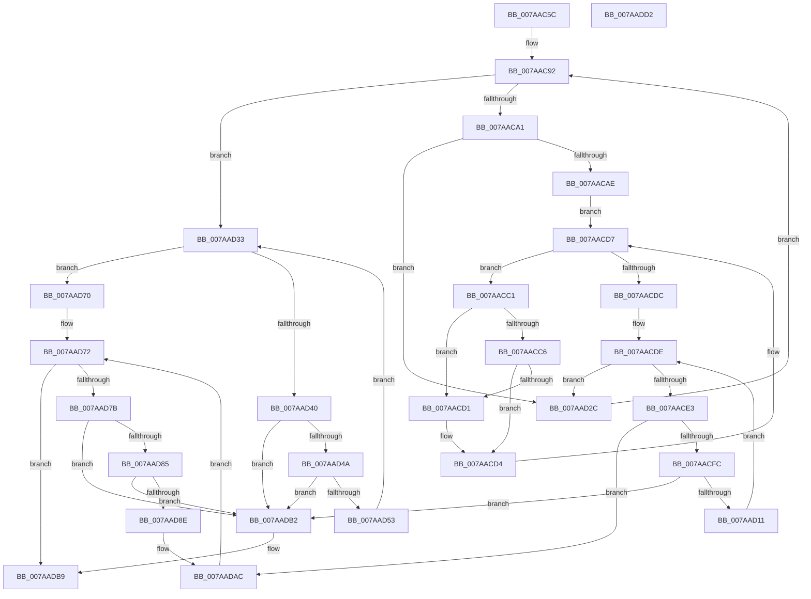

# SmHwAcceleratorMgrCreatePartitionAccelerators

- RVA: `0x007AAC5C`–`0x007AADD3` (길이 `375` bytes)
- VA: `0x00000001407AAC5C`
- 실행 섹션: `PAGE`
- PDB 이름 있음: `예`; PDB Function 태그: `아니요`
- unwind 정보 RVA: `0x000D2084`
- 디코드: `114`개 명령, `375/375` bytes 표시
- 미해석 바이트: `0` (있으면 어셈블리에 `.byte`로 보존)

> 이 문서는 커널 이미지의 기계어와 PDB 기호를 분석해 생성했습니다. 4번과 5번은 함수 원형과 자료형을 바이너리 사용 방식에서 추정한 C 해석이며 원본 소스 복구 결과는 아닙니다.

## 1. Dependencies

- 직접 호출 지점: **4**; 고유 호출 대상: **4**
- 직접 호출자로 확인된 함수: **1**
- RIP 상대 이미지 참조: **1**

### Outgoing calls
- `0x007AACED` → [SmHwAcceleratorParitionCtxCreate](SmHwAcceleratorParitionCtxCreate_function_007AB0A8.md) (function, `0x007AB0A8`)
- `0x007AAD69` → [SmHwAcceleratorPartitionMgrInsertAccelerator](../../text/61/SmHwAcceleratorPartitionMgrInsertAccelerator_function_00611944.md) (function, `0x00611944`)
- `0x007AAD9E` → [SmHwAcceleratorPartitionCtxCleanup](SmHwAcceleratorPartitionCtxCleanup_function_007AB2D8.md) (function, `0x007AB2D8`)
- `0x007AADA7` → [CmSiFreeMemory](../../text/47/CmSiFreeMemory_function_00475D80.md) (function, `0x00475D80`)

### Direct callers
- [SmHwAcceleratorMgrPartitionRegister](SmHwAcceleratorMgrPartitionRegister_function_007AADDC.md) at `0x007AAE94`

### Static image references
- `0x007AAC92` → RVA `0x00FC5000` (`ALMOSTRO`; read)

## 2. Other-region calls and transfers

- 다른 실행 섹션으로 향하는 call: **2**
  - `0x007AAD69` → [SmHwAcceleratorPartitionMgrInsertAccelerator](../../text/61/SmHwAcceleratorPartitionMgrInsertAccelerator_function_00611944.md) (`PAGE` → `.text`)
  - `0x007AADA7` → [CmSiFreeMemory](../../text/47/CmSiFreeMemory_function_00475D80.md) (`PAGE` → `.text`)
- 별도 외부 분기/꼬리 이동을 확인하지 못했습니다.

## 3. Assembly (complete function range)

```asm
007AAC5C  48 89 5C 24 08                  mov qword ptr [rsp + 8], rbx
007AAC61  48 89 74 24 10                  mov qword ptr [rsp + 0x10], rsi
007AAC66  55                              push rbp
007AAC67  57                              push rdi
007AAC68  41 54                           push r12
007AAC6A  41 56                           push r14
007AAC6C  41 57                           push r15
007AAC6E  48 8B EC                        mov rbp, rsp
007AAC71  48 83 EC 30                     sub rsp, 0x30
007AAC75  48 83 65 40 00                  and qword ptr [rbp + 0x40], 0
007AAC7A  48 8D 45 F0                     lea rax, [rbp - 0x10]
007AAC7E  48 89 45 F8                     mov qword ptr [rbp - 8], rax
007AAC82  4C 8B E2                        mov r12, rdx
007AAC85  48 8D 45 F0                     lea rax, [rbp - 0x10]
007AAC89  4C 8B F9                        mov r15, rcx
007AAC8C  48 89 45 F0                     mov qword ptr [rbp - 0x10], rax
007AAC90  33 DB                           xor ebx, ebx
007AAC92  0F B7 05 67 A3 81 00            movzx eax, word ptr [rip + 0x81a367]
007AAC99  3B D8                           cmp ebx, eax
007AAC9B  0F 83 92 00 00 00               jae 0x1407aad33
007AACA1  41 83 BC 9F 18 04 00 00 00      cmp dword ptr [r15 + rbx*4 + 0x418], 0
007AACAA  8B C3                           mov eax, ebx
007AACAC  74 7E                           je 0x1407aad2c
007AACAE  45 33 F6                        xor r14d, r14d
007AACB1  48 C1 E0 04                     shl rax, 4
007AACB5  4D 8D 47 18                     lea r8, [r15 + 0x18]
007AACB9  4C 03 C0                        add r8, rax
007AACBC  49 8B 10                        mov rdx, qword ptr [r8]
007AACBF  EB 16                           jmp 0x1407aacd7
007AACC1  4D 85 F6                        test r14, r14
007AACC4  74 0B                           je 0x1407aacd1
007AACC6  8B 4A 44                        mov ecx, dword ptr [rdx + 0x44]
007AACC9  41 8B 46 44                     mov eax, dword ptr [r14 + 0x44]
007AACCD  3B C8                           cmp ecx, eax
007AACCF  73 03                           jae 0x1407aacd4
007AACD1  4C 8B F2                        mov r14, rdx
007AACD4  48 8B 12                        mov rdx, qword ptr [rdx]
007AACD7  49 3B D0                        cmp rdx, r8
007AACDA  75 E5                           jne 0x1407aacc1
007AACDC  33 F6                           xor esi, esi
007AACDE  83 FE 02                        cmp esi, 2
007AACE1  7D 49                           jge 0x1407aad2c
007AACE3  44 8B C6                        mov r8d, esi
007AACE6  48 8D 4D 40                     lea rcx, [rbp + 0x40]
007AACEA  49 8B D6                        mov rdx, r14
007AACED  E8 B6 03 00 00                  call 0x1407ab0a8
007AACF2  8B F8                           mov edi, eax
007AACF4  85 C0                           test eax, eax
007AACF6  0F 88 B0 00 00 00               js 0x1407aadac
007AACFC  48 8B 4D F8                     mov rcx, qword ptr [rbp - 8]
007AAD00  48 8D 55 F0                     lea rdx, [rbp - 0x10]
007AAD04  48 8B 45 40                     mov rax, qword ptr [rbp + 0x40]
007AAD08  48 39 11                        cmp qword ptr [rcx], rdx
007AAD0B  0F 85 A1 00 00 00               jne 0x1407aadb2
007AAD11  48 89 48 08                     mov qword ptr [rax + 8], rcx
007AAD15  48 8D 55 F0                     lea rdx, [rbp - 0x10]
007AAD19  48 89 10                        mov qword ptr [rax], rdx
007AAD1C  48 89 01                        mov qword ptr [rcx], rax
007AAD1F  48 83 65 40 00                  and qword ptr [rbp + 0x40], 0
007AAD24  FF C6                           inc esi
007AAD26  48 89 45 F8                     mov qword ptr [rbp - 8], rax
007AAD2A  EB B2                           jmp 0x1407aacde
007AAD2C  FF C3                           inc ebx
007AAD2E  E9 5F FF FF FF                  jmp 0x1407aac92
007AAD33  48 8B 4D F0                     mov rcx, qword ptr [rbp - 0x10]
007AAD37  48 8D 45 F0                     lea rax, [rbp - 0x10]
007AAD3B  48 3B C8                        cmp rcx, rax
007AAD3E  74 30                           je 0x1407aad70
007AAD40  48 8D 45 F0                     lea rax, [rbp - 0x10]
007AAD44  48 39 41 08                     cmp qword ptr [rcx + 8], rax
007AAD48  75 68                           jne 0x1407aadb2
007AAD4A  48 8B 01                        mov rax, qword ptr [rcx]
007AAD4D  48 39 48 08                     cmp qword ptr [rax + 8], rcx
007AAD51  75 5F                           jne 0x1407aadb2
007AAD53  48 8D 55 F0                     lea rdx, [rbp - 0x10]
007AAD57  48 89 45 F0                     mov qword ptr [rbp - 0x10], rax
007AAD5B  48 89 50 08                     mov qword ptr [rax + 8], rdx
007AAD5F  48 8B D1                        mov rdx, rcx
007AAD62  48 89 4D 40                     mov qword ptr [rbp + 0x40], rcx
007AAD66  49 8B CC                        mov rcx, r12
007AAD69  E8 D6 6B E6 FF                  call 0x140611944
007AAD6E  EB C3                           jmp 0x1407aad33
007AAD70  33 FF                           xor edi, edi
007AAD72  48 8D 45 F0                     lea rax, [rbp - 0x10]
007AAD76  48 3B C8                        cmp rcx, rax
007AAD79  74 3E                           je 0x1407aadb9
007AAD7B  48 8D 45 F0                     lea rax, [rbp - 0x10]
007AAD7F  48 39 41 08                     cmp qword ptr [rcx + 8], rax
007AAD83  75 2D                           jne 0x1407aadb2
007AAD85  48 8B 01                        mov rax, qword ptr [rcx]
007AAD88  48 39 48 08                     cmp qword ptr [rax + 8], rcx
007AAD8C  75 24                           jne 0x1407aadb2
007AAD8E  48 8D 55 F0                     lea rdx, [rbp - 0x10]
007AAD92  48 89 45 F0                     mov qword ptr [rbp - 0x10], rax
007AAD96  48 89 50 08                     mov qword ptr [rax + 8], rdx
007AAD9A  48 89 4D 40                     mov qword ptr [rbp + 0x40], rcx
007AAD9E  E8 35 05 00 00                  call 0x1407ab2d8
007AADA3  48 8B 4D 40                     mov rcx, qword ptr [rbp + 0x40]
007AADA7  E8 D4 AF CC FF                  call 0x140475d80
007AADAC  48 8B 4D F0                     mov rcx, qword ptr [rbp - 0x10]
007AADB0  EB C0                           jmp 0x1407aad72
007AADB2  B9 03 00 00 00                  mov ecx, 3
007AADB7  CD 29                           int 0x29
007AADB9  48 8B 5C 24 60                  mov rbx, qword ptr [rsp + 0x60]
007AADBE  8B C7                           mov eax, edi
007AADC0  48 8B 74 24 68                  mov rsi, qword ptr [rsp + 0x68]
007AADC5  48 83 C4 30                     add rsp, 0x30
007AADC9  41 5F                           pop r15
007AADCB  41 5E                           pop r14
007AADCD  41 5C                           pop r12
007AADCF  5F                              pop rdi
007AADD0  5D                              pop rbp
007AADD1  C3                              ret
007AADD2  CC                              int3
```

## 4. C-style interpretation (structured pseudocode)

```c
__int64 __fastcall SmHwAcceleratorMgrCreatePartitionAccelerators(__int64 a1, __int64 a2)
{
    __int64 result;
    __int64 v_r14;
    __int64 v_rbx;
    __int64 v_rdi;
    __int64 v_rsi;
    __int64 v_rsp;
    unsigned __int64 v_stack_m30;
    unsigned __int64 v_stack_m38;
    unsigned __int64 v_stack_p10;
    unsigned __int64 v_stack_p18;
    unsigned __int64 v_stack_p8;

    v_stack_p8 = v_rbx;
    v_stack_p10 = v_rsi;
    v_rsp = (v_rsp) - (48);
    v_stack_m30 = v_stack_m38;
    v_stack_m38 = v_stack_m38;
    v_rbx = 0;
loc_007AAC92:
    if (0 >= ((unsigned int)(*(unsigned __int16 *)(v_rip + 8495975)))) goto loc_007AAD33;
    if ((*(unsigned int *)(a1 + v_rbx * 4 + 1048)) == 0) goto loc_007AAD2C;
    v_r14 = 0;
    result = (0) << (4);
    a3 = (a1 + 24) + (result);
    goto loc_007AACD7;
loc_007AACC1:
    if (0 == 0) goto loc_007AACD1;
    if (((unsigned int)((unsigned int)(*(unsigned int *)(*(unsigned __int64 *)(a3) + 68)))) < ((unsigned int)((unsigned int)(*(unsigned int *)(v_r14 + 68))))) {
        v_r14 = *(unsigned __int64 *)(a3);
    }
loc_007AACD7:
    if ((*(unsigned __int64 *)(*(unsigned __int64 *)(a3))) != a3) goto loc_007AACC1;
    v_rsi = 0;
loc_007AACDE:
    if (0 >= 2) goto loc_007AAD2C;
    result = SmHwAcceleratorParitionCtxCreate(v_stack_p18, v_r14, 0, a4);
    if (sign_flag) goto loc_007AADAC;
    if ((*(unsigned __int64 *)(v_stack_m30)) != v_stack_m38) goto loc_007AADB2;
    *(unsigned __int64 *)(v_stack_p18 + 8) = v_stack_m30;
    *(unsigned __int64 *)(v_stack_p18) = v_stack_m38;
    *(unsigned __int64 *)(v_stack_m30) = v_stack_p18;
    v_rsi = (unsigned int)((v_rsi) + 1);
    v_stack_m30 = v_stack_p18;
    goto loc_007AACDE;
loc_007AAD2C:
    v_rbx = (unsigned int)((v_rbx) + 1);
    goto loc_007AAC92;
loc_007AAD33:
    if (v_stack_m38 == v_stack_m38) goto loc_007AAD70;
    if ((*(unsigned __int64 *)(v_stack_m38 + 8)) != v_stack_m38) goto loc_007AADB2;
    if ((*(unsigned __int64 *)(*(unsigned __int64 *)(v_stack_m38) + 8)) != v_stack_m38) goto loc_007AADB2;
    v_stack_m38 = *(unsigned __int64 *)(v_stack_m38);
    *(unsigned __int64 *)(*(unsigned __int64 *)(v_stack_m38) + 8) = v_stack_m38;
    v_stack_p18 = v_stack_m38;
    result = SmHwAcceleratorPartitionMgrInsertAccelerator(a2, v_stack_m38, 0, a4);
    goto loc_007AAD33;
loc_007AAD70:
    v_rdi = 0;
loc_007AAD72:
    if (a2 == v_stack_m38) goto loc_007AADB9;
    if ((*(unsigned __int64 *)(a2 + 8)) != v_stack_m38) goto loc_007AADB2;
    if ((*(unsigned __int64 *)(*(unsigned __int64 *)(a2) + 8)) != a2) goto loc_007AADB2;
    v_stack_m38 = *(unsigned __int64 *)(a2);
    *(unsigned __int64 *)(*(unsigned __int64 *)(a2) + 8) = v_stack_m38;
    v_stack_p18 = a2;
    result = SmHwAcceleratorPartitionCtxCleanup(a2, v_stack_m38, 0, a4);
    result = CmSiFreeMemory(v_stack_p18, v_stack_m38, 0, a4);
loc_007AADAC:
    goto loc_007AAD72;
loc_007AADB2:
loc_007AADB9:
    v_rsp = (v_rsp) + (48);
    return 0;
}
```

## 5. (Beta) C Style

```c
int64_t SmHwAcceleratorMgrCreatePartitionAccelerators(void *Arg1, int64_t Arg2)
{
    uint8_t *arg1 = (uint8_t *)Arg1;

    int64_t result;
    int64_t local_r14;
    int64_t local_rbx;
    int64_t local_rdi;
    int64_t local_rsi;
    int64_t local_rsp;
    uint64_t v_stack_m30;
    uint64_t v_stack_m38;
    uint64_t v_stack_p10;
    uint64_t v_stack_p18;
    uint64_t v_stack_p8;

    v_stack_p8 = local_rbx;
    v_stack_p10 = local_rsi;
    local_rsp = (local_rsp) - (48);
    v_stack_m30 = v_stack_m38;
    v_stack_m38 = v_stack_m38;
    local_rbx = 0;
loc_007AAC92:
    if (0 >= ((uint32_t)(*(uint16_t *)(v_rip + 0x81A367)))) goto loc_007AAD33;
    if ((*(uint32_t *)(arg1 + local_rbx * 4 + 0x418)) == 0) goto loc_007AAD2C;
    local_r14 = 0;
    result = (0) << (4);
    a3 = (Arg1 + 24) + (result);
    goto loc_007AACD7;
loc_007AACC1:
    if (0 == 0) goto loc_007AACD1;
    if (((uint32_t)((uint32_t)(*(uint32_t *)(*(uint64_t *)(a3) + 0x44)))) < ((uint32_t)((uint32_t)(*(uint32_t *)(local_r14 + 0x44))))) {
        local_r14 = *(uint64_t *)(a3);
    }
loc_007AACD7:
    if ((*(uint64_t *)(*(uint64_t *)(a3))) != a3) goto loc_007AACC1;
    local_rsi = 0;
loc_007AACDE:
    if (0 >= 2) goto loc_007AAD2C;
    result = SmHwAcceleratorParitionCtxCreate(v_stack_p18, local_r14, 0, a4);
    if (sign_flag) goto loc_007AADAC;
    if ((*(uint64_t *)(v_stack_m30)) != v_stack_m38) goto loc_007AADB2;
    *(uint64_t *)(v_stack_p18 + 0x8) = v_stack_m30;
    *(uint64_t *)(v_stack_p18) = v_stack_m38;
    *(uint64_t *)(v_stack_m30) = v_stack_p18;
    local_rsi = (uint32_t)((local_rsi) + 1);
    v_stack_m30 = v_stack_p18;
    goto loc_007AACDE;
loc_007AAD2C:
    local_rbx = (uint32_t)((local_rbx) + 1);
    goto loc_007AAC92;
loc_007AAD33:
    if (v_stack_m38 == v_stack_m38) goto loc_007AAD70;
    if ((*(uint64_t *)(v_stack_m38 + 0x8)) != v_stack_m38) goto loc_007AADB2;
    if ((*(uint64_t *)(*(uint64_t *)(v_stack_m38) + 0x8)) != v_stack_m38) goto loc_007AADB2;
    v_stack_m38 = *(uint64_t *)(v_stack_m38);
    *(uint64_t *)(*(uint64_t *)(v_stack_m38) + 0x8) = v_stack_m38;
    v_stack_p18 = v_stack_m38;
    result = SmHwAcceleratorPartitionMgrInsertAccelerator(Arg2, v_stack_m38, 0, a4);
    goto loc_007AAD33;
loc_007AAD70:
    local_rdi = 0;
loc_007AAD72:
    if (Arg2 == v_stack_m38) goto loc_007AADB9;
    if ((*(uint64_t *)(Arg2 + 0x8)) != v_stack_m38) goto loc_007AADB2;
    if ((*(uint64_t *)(*(uint64_t *)(Arg2) + 0x8)) != Arg2) goto loc_007AADB2;
    v_stack_m38 = *(uint64_t *)(Arg2);
    *(uint64_t *)(*(uint64_t *)(Arg2) + 0x8) = v_stack_m38;
    v_stack_p18 = Arg2;
    result = SmHwAcceleratorPartitionCtxCleanup(Arg2, v_stack_m38, 0, a4);
    result = CmSiFreeMemory(v_stack_p18, v_stack_m38, 0, a4);
loc_007AADAC:
    goto loc_007AAD72;
loc_007AADB2:
loc_007AADB9:
    local_rsp = (local_rsp) + (48);
    return 0;
}
```

### 관측된 메모리 오프셋

구조체 형식이 확인되지 않은 접근은 인자 기준의 오프셋으로만 기록했습니다.

| 기준 인자 | 오프셋 표현 | 폭 (bit) | 접근 |
|---|---:|---:|---|
| `Arg1` | `+ 0x0` | `64` | `R` |
| `Arg1` | `+ 0x18` | `64` | `R` |
| `Arg1` | `+ 0x418 + rbx*4` | `32` | `R` |

## 6. Execution-region graph

[열기: 2D/3D 그래프와 함수 탐색 컨트롤 패널](../../../control-panel.html?section=page&rva=0x007AAC5C&view=graph)

- 2D 그래프는 위에서 아래로 흐르고, 3D 그래프는 빈 공간을 드래그해 회전합니다. Shift+드래그는 이동, 휠은 확대·축소, 함수 노드 선택은 대상 보고서 이동입니다.

### Static fallback


