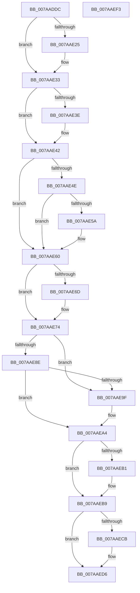

# SmHwAcceleratorMgrPartitionRegister

- RVA: `0x007AADDC`–`0x007AAEF4` (길이 `280` bytes)
- VA: `0x00000001407AADDC`
- 실행 섹션: `PAGE`
- PDB 이름 있음: `예`; PDB Function 태그: `아니요`
- unwind 정보 RVA: `0x0005E6B4`
- 디코드: `79`개 명령, `280/280` bytes 표시
- 미해석 바이트: `0` (있으면 어셈블리에 `.byte`로 보존)

> 이 문서는 커널 이미지의 기계어와 PDB 기호를 분석해 생성했습니다. 4번과 5번은 함수 원형과 자료형을 바이너리 사용 방식에서 추정한 C 해석이며 원본 소스 복구 결과는 아닙니다.

## 1. Dependencies

- 직접 호출 지점: **8**; 고유 호출 대상: **8**
- 직접 호출자로 확인된 함수: **1**
- RIP 상대 이미지 참조: **0**

### Outgoing calls
- `0x007AAE15` → [KeAbPreAcquire](../../text/21/KeAbPreAcquire_function_00210230.md) (function, `0x00210230`)
- `0x007AAE2E` → [ExfAcquirePushLockExclusiveEx](../../text/20/ExfAcquirePushLockExclusiveEx_function_0020FC90.md) (function, `0x0020FC90`)
- `0x007AAE51` → [SmHwAcceleratorMgrAcquireAccelerators](SmHwAcceleratorMgrAcquireAccelerators_function_007AA628.md) (function, `0x007AA628`)
- `0x007AAE94` → [SmHwAcceleratorMgrCreatePartitionAccelerators](SmHwAcceleratorMgrCreatePartitionAccelerators_function_007AAC5C.md) (function, `0x007AAC5C`)
- `0x007AAEB4` → [ExfTryToWakePushLock](../../text/26/ExfTryToWakePushLock_function_00265DD0.md) (function, `0x00265DD0`)
- `0x007AAEBC` → [KeAbPostRelease](../../text/2E/KeAbPostRelease_function_002E1600.md) (function, `0x002E1600`)
- `0x007AAEC1` → [KeLeaveCriticalRegion](../../text/25/KeLeaveCriticalRegion_function_0025D8B0.md) (function, `0x0025D8B0`)
- `0x007AAED1` → [SmHwAcceleratorMgrPartitionUnregister](SmHwAcceleratorMgrPartitionUnregister_function_007AAEFC.md) (function, `0x007AAEFC`)

### Direct callers
- [SmHwAcceleratorPartitionMgrStart](SmHwAcceleratorPartitionMgrStart_function_007AB480.md) at `0x007AB542`

### Static image references
- 디코드된 RIP-relative 메모리 참조가 없습니다.

## 2. Other-region calls and transfers

- 다른 실행 섹션으로 향하는 call: **5**
  - `0x007AAE15` → [KeAbPreAcquire](../../text/21/KeAbPreAcquire_function_00210230.md) (`PAGE` → `.text`)
  - `0x007AAE2E` → [ExfAcquirePushLockExclusiveEx](../../text/20/ExfAcquirePushLockExclusiveEx_function_0020FC90.md) (`PAGE` → `.text`)
  - `0x007AAEB4` → [ExfTryToWakePushLock](../../text/26/ExfTryToWakePushLock_function_00265DD0.md) (`PAGE` → `.text`)
  - `0x007AAEBC` → [KeAbPostRelease](../../text/2E/KeAbPostRelease_function_002E1600.md) (`PAGE` → `.text`)
  - `0x007AAEC1` → [KeLeaveCriticalRegion](../../text/25/KeLeaveCriticalRegion_function_0025D8B0.md) (`PAGE` → `.text`)
- 별도 외부 분기/꼬리 이동을 확인하지 못했습니다.

## 3. Assembly (complete function range)

```asm
007AADDC  48 8B C4                        mov rax, rsp
007AADDF  48 89 58 08                     mov qword ptr [rax + 8], rbx
007AADE3  48 89 68 10                     mov qword ptr [rax + 0x10], rbp
007AADE7  48 89 70 18                     mov qword ptr [rax + 0x18], rsi
007AADEB  48 89 78 20                     mov qword ptr [rax + 0x20], rdi
007AADEF  41 56                           push r14
007AADF1  48 83 EC 20                     sub rsp, 0x20
007AADF5  65 48 8B 04 25 88 01 00 00      mov rax, qword ptr gs:[0x188]
007AADFE  48 8B F2                        mov rsi, rdx
007AAE01  48 83 CB FF                     or rbx, 0xffffffffffffffff
007AAE05  45 33 C0                        xor r8d, r8d
007AAE08  33 D2                           xor edx, edx
007AAE0A  48 8B F9                        mov rdi, rcx
007AAE0D  66 01 98 E4 01 00 00            add word ptr [rax + 0x1e4], bx
007AAE14  90                              nop
007AAE15  E8 16 54 A6 FF                  call 0x140210230
007AAE1A  F0 48 0F BA 2F 00               lock bts qword ptr [rdi], 0
007AAE20  48 8B E8                        mov rbp, rax
007AAE23  73 0E                           jae 0x1407aae33
007AAE25  4C 8B C7                        mov r8, rdi
007AAE28  48 8B D0                        mov rdx, rax
007AAE2B  48 8B CF                        mov rcx, rdi
007AAE2E  E8 5D 4E A6 FF                  call 0x14020fc90
007AAE33  41 BE 01 00 00 00               mov r14d, 1
007AAE39  48 85 ED                        test rbp, rbp
007AAE3C  74 04                           je 0x1407aae42
007AAE3E  44 88 75 0A                     mov byte ptr [rbp + 0xa], r14b
007AAE42  83 CD FF                        or ebp, 0xffffffff
007AAE45  83 BF 18 05 00 00 00            cmp dword ptr [rdi + 0x518], 0
007AAE4C  75 12                           jne 0x1407aae60
007AAE4E  48 8B CF                        mov rcx, rdi
007AAE51  E8 D2 F7 FF FF                  call 0x1407aa628
007AAE56  85 C0                           test eax, eax
007AAE58  79 06                           jns 0x1407aae60
007AAE5A  89 AF 18 05 00 00               mov dword ptr [rdi + 0x518], ebp
007AAE60  48 8D 47 08                     lea rax, [rdi + 8]
007AAE64  48 8B 48 08                     mov rcx, qword ptr [rax + 8]
007AAE68  48 39 01                        cmp qword ptr [rcx], rax
007AAE6B  74 07                           je 0x1407aae74
007AAE6D  B9 03 00 00 00                  mov ecx, 3
007AAE72  CD 29                           int 0x29
007AAE74  48 89 06                        mov qword ptr [rsi], rax
007AAE77  48 89 4E 08                     mov qword ptr [rsi + 8], rcx
007AAE7B  48 89 31                        mov qword ptr [rcx], rsi
007AAE7E  48 89 70 08                     mov qword ptr [rax + 8], rsi
007AAE82  48 89 7E 10                     mov qword ptr [rsi + 0x10], rdi
007AAE86  39 AF 18 05 00 00               cmp dword ptr [rdi + 0x518], ebp
007AAE8C  74 11                           je 0x1407aae9f
007AAE8E  48 8B D6                        mov rdx, rsi
007AAE91  48 8B CF                        mov rcx, rdi
007AAE94  E8 C3 FD FF FF                  call 0x1407aac5c
007AAE99  8B E8                           mov ebp, eax
007AAE9B  85 C0                           test eax, eax
007AAE9D  78 05                           js 0x1407aaea4
007AAE9F  45 33 F6                        xor r14d, r14d
007AAEA2  33 ED                           xor ebp, ebp
007AAEA4  F0 48 0F C1 1F                  lock xadd qword ptr [rdi], rbx
007AAEA9  80 E3 06                        and bl, 6
007AAEAC  80 FB 02                        cmp bl, 2
007AAEAF  75 08                           jne 0x1407aaeb9
007AAEB1  48 8B CF                        mov rcx, rdi
007AAEB4  E8 17 AF AB FF                  call 0x140265dd0
007AAEB9  48 8B CF                        mov rcx, rdi
007AAEBC  E8 3F 67 B3 FF                  call 0x1402e1600
007AAEC1  E8 EA 29 AB FF                  call 0x14025d8b0
007AAEC6  45 85 F6                        test r14d, r14d
007AAEC9  74 0B                           je 0x1407aaed6
007AAECB  48 8B D6                        mov rdx, rsi
007AAECE  48 8B CF                        mov rcx, rdi
007AAED1  E8 26 00 00 00                  call 0x1407aaefc
007AAED6  48 8B 5C 24 30                  mov rbx, qword ptr [rsp + 0x30]
007AAEDB  8B C5                           mov eax, ebp
007AAEDD  48 8B 6C 24 38                  mov rbp, qword ptr [rsp + 0x38]
007AAEE2  48 8B 74 24 40                  mov rsi, qword ptr [rsp + 0x40]
007AAEE7  48 8B 7C 24 48                  mov rdi, qword ptr [rsp + 0x48]
007AAEEC  48 83 C4 20                     add rsp, 0x20
007AAEF0  41 5E                           pop r14
007AAEF2  C3                              ret
007AAEF3  CC                              int3
```

## 4. C-style interpretation (structured pseudocode)

```c
__int64 __fastcall SmHwAcceleratorMgrPartitionRegister(__int64 a1, __int64 a2, int a3)
{
    __int64 result;
    __int64 v_r14;
    __int64 v_rbp;
    __int64 v_rbx;
    __int64 v_rsp;
    unsigned __int64 v_stack_p10;
    unsigned __int64 v_stack_p18;
    unsigned __int64 v_stack_p20;
    unsigned __int64 v_stack_p8;

    *(unsigned __int64 *)(v_rsp + 8) = v_rbx;
    *(unsigned __int64 *)(v_rsp + 16) = v_rbp;
    *(unsigned __int64 *)(v_rsp + 24) = v_rsi;
    *(unsigned __int64 *)(v_rsp + 32) = v_rdi;
    v_rsp = (v_rsp) - (32);
    v_rbx = (v_rbx) | (-1);
    a3 = 0;
    a2 = 0;
    result = KeAbPreAcquire(a1, a2, a3, a4);
    if (!(condition_is_above_or_equal)) {
        a3 = a1;
        a2 = result;
        a1 = a1;
        result = ExfAcquirePushLockExclusiveEx(a1, a2, a3, a4);
    }
    if (result != 0) {
        *(unsigned __int8 *)(result + 10) = 1;
    }
    v_rbp = (unsigned int)((result) | (0xFFFFFFFFULL));
    if ((*(unsigned int *)(a1 + 1304)) != 0) goto loc_007AAE60;
    result = SmHwAcceleratorMgrAcquireAccelerators(a1, a2, a3, a4);
    if (sign_flag) {
        *(unsigned int *)(a1 + 1304) = (unsigned int)(v_rbp);
    }
    if ((*(unsigned __int64 *)(*(unsigned __int64 *)(a1 + 8 + 8))) != (a1 + 8)) {
        a1 = 3;
    }
    *(unsigned __int64 *)(a2) = a1 + 8;
    *(unsigned __int64 *)(a2 + 8) = a1;
    *(unsigned __int64 *)(a1) = a2;
    *(unsigned __int64 *)(a1 + 8 + 8) = a2;
    *(unsigned __int64 *)(a2 + 16) = a1;
    if ((*(unsigned int *)(a1 + 1304)) == ((unsigned int)(v_rbp))) goto loc_007AAE9F;
    result = SmHwAcceleratorMgrCreatePartitionAccelerators(a1, a2, a3, a4);
    v_rbp = (unsigned int)((unsigned int)(result));
    v_r14 = 1;
    if (!(sign_flag)) {
        v_r14 = 0;
        v_rbp = 0;
    }
    v_rbx = (unsigned __int8)((v_rbx) & (6));
    if (((unsigned __int8)(v_rbx)) == 2) {
        a1 = a1;
        result = ExfTryToWakePushLock(a1, a2, a3, a4);
    }
    result = KeAbPostRelease(a1, a2, a3, a4);
    result = KeLeaveCriticalRegion(a1, a2, a3, a4);
    if (0 != 0) {
        a2 = a2;
        a1 = a1;
        result = SmHwAcceleratorMgrPartitionUnregister(a1, a2, a3, a4);
    }
    v_rsp = (v_rsp) + (32);
    return 0;
}
```

## 5. (Beta) C Style

```c
int64_t SmHwAcceleratorMgrPartitionRegister(void *Arg1, void *Arg2, int32_t Arg3)
{
    uint8_t *arg1 = (uint8_t *)Arg1;
    uint8_t *arg2 = (uint8_t *)Arg2;

    int64_t result;
    int64_t local_r14;
    int64_t local_rbp;
    int64_t local_rbx;
    int64_t local_rsp;
    uint64_t v_stack_p10;
    uint64_t v_stack_p18;
    uint64_t v_stack_p20;
    uint64_t v_stack_p8;

    *(uint64_t *)(local_rsp + 0x8) = local_rbx;
    *(uint64_t *)(local_rsp + 0x10) = local_rbp;
    *(uint64_t *)(local_rsp + 0x18) = local_rsi;
    *(uint64_t *)(local_rsp + 0x20) = local_rdi;
    local_rsp = (local_rsp) - (32);
    local_rbx = (local_rbx) | (-1);
    Arg3 = 0;
    Arg2 = 0;
    result = KeAbPreAcquire(Arg1, Arg2, Arg3, a4);
    if (!(condition_is_above_or_equal)) {
        Arg3 = Arg1;
        Arg2 = result;
        Arg1 = Arg1;
        result = ExfAcquirePushLockExclusiveEx(Arg1, Arg2, Arg3, a4);
    }
    if (result != 0) {
        *(uint8_t *)(result + 0xA) = 1;
    }
    local_rbp = (uint32_t)((result) | (0xFFFFFFFFULL));
    if ((*(uint32_t *)(arg1 + 0x518)) != 0) goto loc_007AAE60;
    result = SmHwAcceleratorMgrAcquireAccelerators(Arg1, Arg2, Arg3, a4);
    if (sign_flag) {
        *(uint32_t *)(arg1 + 0x518) = (uint32_t)(local_rbp);
    }
    if ((*(uint64_t *)(*(uint64_t *)(arg1 + 0x8 + 0x8))) != (Arg1 + 8)) {
        Arg1 = 3;
    }
    *(void **)(arg2) = Arg1 + 8;
    *(void **)(arg2 + 0x8) = Arg1;
    *(void **)(arg1) = Arg2;
    *(void **)(arg1 + 0x8 + 0x8) = Arg2;
    *(void **)(arg2 + 0x10) = Arg1;
    if ((*(uint32_t *)(arg1 + 0x518)) == ((uint32_t)(local_rbp))) goto loc_007AAE9F;
    result = SmHwAcceleratorMgrCreatePartitionAccelerators(Arg1, Arg2, Arg3, a4);
    local_rbp = (uint32_t)((uint32_t)(result));
    local_r14 = 1;
    if (!(sign_flag)) {
        local_r14 = 0;
        local_rbp = 0;
    }
    local_rbx = (uint8_t)((local_rbx) & (6));
    if (((uint8_t)(local_rbx)) == 2) {
        Arg1 = Arg1;
        result = ExfTryToWakePushLock(Arg1, Arg2, Arg3, a4);
    }
    result = KeAbPostRelease(Arg1, Arg2, Arg3, a4);
    result = KeLeaveCriticalRegion(Arg1, Arg2, Arg3, a4);
    if (0 != 0) {
        Arg2 = Arg2;
        Arg1 = Arg1;
        result = SmHwAcceleratorMgrPartitionUnregister(Arg1, Arg2, Arg3, a4);
    }
    local_rsp = (local_rsp) + (32);
    return 0;
}
```

### 관측된 메모리 오프셋

구조체 형식이 확인되지 않은 접근은 인자 기준의 오프셋으로만 기록했습니다.

| 기준 인자 | 오프셋 표현 | 폭 (bit) | 접근 |
|---|---:|---:|---|
| `Arg1` | `+ 0x0` | `64` | `R/W` |
| `Arg1` | `+ 0x8` | `64` | `R` |
| `Arg1` | `+ 0x8` | `64` | `W` |
| `Arg1` | `+ 0x518` | `32` | `R` |
| `Arg1` | `+ 0x518` | `32` | `W` |
| `Arg2` | `+ 0x0` | `64` | `W` |
| `Arg2` | `+ 0x8` | `64` | `W` |
| `Arg2` | `+ 0x10` | `64` | `W` |

## 6. Execution-region graph

[열기: 2D/3D 그래프와 함수 탐색 컨트롤 패널](../../../control-panel.html?section=page&rva=0x007AADDC&view=graph)

- 2D 그래프는 위에서 아래로 흐르고, 3D 그래프는 빈 공간을 드래그해 회전합니다. Shift+드래그는 이동, 휠은 확대·축소, 함수 노드 선택은 대상 보고서 이동입니다.

### Static fallback


