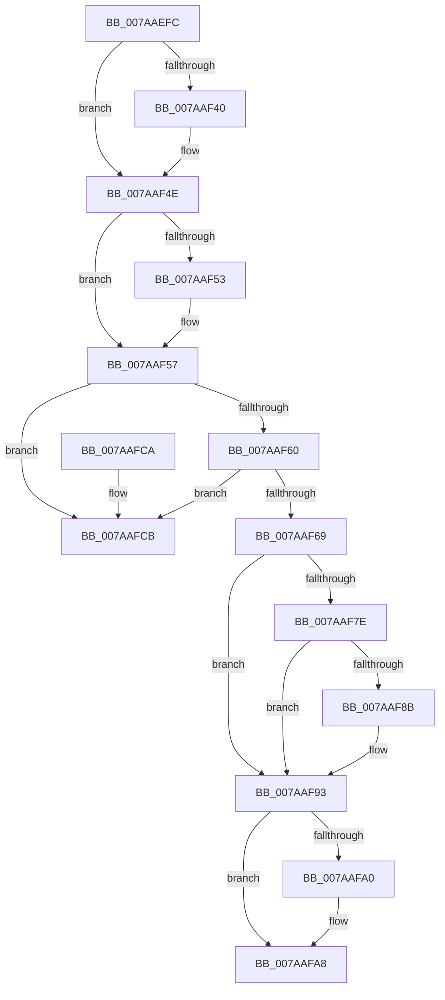

# SmHwAcceleratorMgrPartitionUnregister

- RVA: `0x007AAEFC`–`0x007AAFD2` (길이 `214` bytes)
- VA: `0x00000001407AAEFC`
- 실행 섹션: `PAGE`
- PDB 이름 있음: `예`; PDB Function 태그: `아니요`
- unwind 정보 RVA: `0x00069AD0`
- 디코드: `60`개 명령, `214/214` bytes 표시
- 미해석 바이트: `0` (있으면 어셈블리에 `.byte`로 보존)

> 이 문서는 커널 이미지의 기계어와 PDB 기호를 분석해 생성했습니다. 4번과 5번은 함수 원형과 자료형을 바이너리 사용 방식에서 추정한 C 해석이며 원본 소스 복구 결과는 아닙니다.

## 1. Dependencies

- 직접 호출 지점: **6**; 고유 호출 대상: **6**
- 직접 호출자로 확인된 함수: **2**
- RIP 상대 이미지 참조: **0**

### Outgoing calls
- `0x007AAF30` → [KeAbPreAcquire](../../text/21/KeAbPreAcquire_function_00210230.md) (function, `0x00210230`)
- `0x007AAF49` → [ExfAcquirePushLockExclusiveEx](../../text/20/ExfAcquirePushLockExclusiveEx_function_0020FC90.md) (function, `0x0020FC90`)
- `0x007AAF8E` → [SmHwAcceleratorMgrReleaseAccelerators](SmHwAcceleratorMgrReleaseAccelerators_function_007AAFD8.md) (function, `0x007AAFD8`)
- `0x007AAFA3` → [ExfTryToWakePushLock](../../text/26/ExfTryToWakePushLock_function_00265DD0.md) (function, `0x00265DD0`)
- `0x007AAFAB` → [KeAbPostRelease](../../text/2E/KeAbPostRelease_function_002E1600.md) (function, `0x002E1600`)
- `0x007AAFB0` → [KeLeaveCriticalRegion](../../text/25/KeLeaveCriticalRegion_function_0025D8B0.md) (function, `0x0025D8B0`)

### Direct callers
- [SmHwAcceleratorMgrPartitionRegister](SmHwAcceleratorMgrPartitionRegister_function_007AADDC.md) at `0x007AAED1`
- [SmHwAcceleratorPartitionMgrCleanup](SmHwAcceleratorPartitionMgrCleanup_function_007AB34C.md) at `0x007AB3EF`

### Static image references
- 디코드된 RIP-relative 메모리 참조가 없습니다.

## 2. Other-region calls and transfers

- 다른 실행 섹션으로 향하는 call: **5**
  - `0x007AAF30` → [KeAbPreAcquire](../../text/21/KeAbPreAcquire_function_00210230.md) (`PAGE` → `.text`)
  - `0x007AAF49` → [ExfAcquirePushLockExclusiveEx](../../text/20/ExfAcquirePushLockExclusiveEx_function_0020FC90.md) (`PAGE` → `.text`)
  - `0x007AAFA3` → [ExfTryToWakePushLock](../../text/26/ExfTryToWakePushLock_function_00265DD0.md) (`PAGE` → `.text`)
  - `0x007AAFAB` → [KeAbPostRelease](../../text/2E/KeAbPostRelease_function_002E1600.md) (`PAGE` → `.text`)
  - `0x007AAFB0` → [KeLeaveCriticalRegion](../../text/25/KeLeaveCriticalRegion_function_0025D8B0.md) (`PAGE` → `.text`)
- 별도 외부 분기/꼬리 이동을 확인하지 못했습니다.

## 3. Assembly (complete function range)

```asm
007AAEFC  48 89 5C 24 08                  mov qword ptr [rsp + 8], rbx
007AAF01  48 89 6C 24 10                  mov qword ptr [rsp + 0x10], rbp
007AAF06  48 89 74 24 18                  mov qword ptr [rsp + 0x18], rsi
007AAF0B  57                              push rdi
007AAF0C  48 83 EC 20                     sub rsp, 0x20
007AAF10  65 48 8B 04 25 88 01 00 00      mov rax, qword ptr gs:[0x188]
007AAF19  48 8B F2                        mov rsi, rdx
007AAF1C  48 83 CB FF                     or rbx, 0xffffffffffffffff
007AAF20  45 33 C0                        xor r8d, r8d
007AAF23  33 D2                           xor edx, edx
007AAF25  48 8B F9                        mov rdi, rcx
007AAF28  66 01 98 E4 01 00 00            add word ptr [rax + 0x1e4], bx
007AAF2F  90                              nop
007AAF30  E8 FB 52 A6 FF                  call 0x140210230
007AAF35  F0 48 0F BA 2F 00               lock bts qword ptr [rdi], 0
007AAF3B  48 8B E8                        mov rbp, rax
007AAF3E  73 0E                           jae 0x1407aaf4e
007AAF40  4C 8B C7                        mov r8, rdi
007AAF43  48 8B D0                        mov rdx, rax
007AAF46  48 8B CF                        mov rcx, rdi
007AAF49  E8 42 4D A6 FF                  call 0x14020fc90
007AAF4E  48 85 ED                        test rbp, rbp
007AAF51  74 04                           je 0x1407aaf57
007AAF53  C6 45 0A 01                     mov byte ptr [rbp + 0xa], 1
007AAF57  48 8B 0E                        mov rcx, qword ptr [rsi]
007AAF5A  48 39 71 08                     cmp qword ptr [rcx + 8], rsi
007AAF5E  75 6B                           jne 0x1407aafcb
007AAF60  48 8B 46 08                     mov rax, qword ptr [rsi + 8]
007AAF64  48 39 30                        cmp qword ptr [rax], rsi
007AAF67  75 62                           jne 0x1407aafcb
007AAF69  48 89 08                        mov qword ptr [rax], rcx
007AAF6C  48 89 41 08                     mov qword ptr [rcx + 8], rax
007AAF70  48 8D 47 08                     lea rax, [rdi + 8]
007AAF74  48 83 66 10 00                  and qword ptr [rsi + 0x10], 0
007AAF79  48 39 00                        cmp qword ptr [rax], rax
007AAF7C  75 15                           jne 0x1407aaf93
007AAF7E  8B 87 18 05 00 00               mov eax, dword ptr [rdi + 0x518]
007AAF84  FF C8                           dec eax
007AAF86  83 F8 FD                        cmp eax, -3
007AAF89  77 08                           ja 0x1407aaf93
007AAF8B  48 8B CF                        mov rcx, rdi
007AAF8E  E8 45 00 00 00                  call 0x1407aafd8
007AAF93  F0 48 0F C1 1F                  lock xadd qword ptr [rdi], rbx
007AAF98  80 E3 06                        and bl, 6
007AAF9B  80 FB 02                        cmp bl, 2
007AAF9E  75 08                           jne 0x1407aafa8
007AAFA0  48 8B CF                        mov rcx, rdi
007AAFA3  E8 28 AE AB FF                  call 0x140265dd0
007AAFA8  48 8B CF                        mov rcx, rdi
007AAFAB  E8 50 66 B3 FF                  call 0x1402e1600
007AAFB0  E8 FB 28 AB FF                  call 0x14025d8b0
007AAFB5  48 8B 5C 24 30                  mov rbx, qword ptr [rsp + 0x30]
007AAFBA  48 8B 6C 24 38                  mov rbp, qword ptr [rsp + 0x38]
007AAFBF  48 8B 74 24 40                  mov rsi, qword ptr [rsp + 0x40]
007AAFC4  48 83 C4 20                     add rsp, 0x20
007AAFC8  5F                              pop rdi
007AAFC9  C3                              ret
007AAFCA  CC                              int3
007AAFCB  B9 03 00 00 00                  mov ecx, 3
007AAFD0  CD 29                           int 0x29
```

## 4. C-style interpretation (structured pseudocode)

```c
__int64 __fastcall SmHwAcceleratorMgrPartitionUnregister(__int64 a1, __int64 a2, int a3)
{
    __int64 result;
    __int64 v_rbx;
    __int64 v_rsp;
    unsigned __int64 v_stack_p10;
    unsigned __int64 v_stack_p18;
    unsigned __int64 v_stack_p8;

    v_stack_p8 = v_rbx;
    v_stack_p10 = v_rbp;
    v_stack_p18 = v_rsi;
    v_rsp = (v_rsp) - (32);
    v_rbx = (v_rbx) | (-1);
    a3 = 0;
    a2 = 0;
    result = KeAbPreAcquire(a1, a2, a3, a4);
    if (!(condition_is_above_or_equal)) {
        a3 = a1;
        a2 = result;
        a1 = a1;
        result = ExfAcquirePushLockExclusiveEx(a1, a2, a3, a4);
    }
    if (result != 0) {
        *(unsigned __int8 *)(result + 10) = 1;
    }
    if ((*(unsigned __int64 *)(*(unsigned __int64 *)(a2) + 8)) != a2) goto loc_007AAFCB;
    if ((*(unsigned __int64 *)(*(unsigned __int64 *)(a2 + 8))) != a2) goto loc_007AAFCB;
    *(unsigned __int64 *)(*(unsigned __int64 *)(a2 + 8)) = *(unsigned __int64 *)(a2);
    *(unsigned __int64 *)(*(unsigned __int64 *)(a2) + 8) = *(unsigned __int64 *)(a2 + 8);
    if ((*(unsigned __int64 *)(a1 + 8)) != (a1 + 8)) goto loc_007AAF93;
    result = (unsigned int)(((unsigned int)(*(unsigned int *)(a1 + 1304))) - 1);
    if (((unsigned int)(result)) <= -3) {
        a1 = a1;
        result = SmHwAcceleratorMgrReleaseAccelerators(a1, a2, a3, a4);
    }
    v_rbx = (unsigned __int8)((v_rbx) & (6));
    if (((unsigned __int8)(v_rbx)) == 2) {
        a1 = a1;
        result = ExfTryToWakePushLock(a1, a2, a3, a4);
    }
    result = KeAbPostRelease(a1, a2, a3, a4);
    result = KeLeaveCriticalRegion(a1, a2, a3, a4);
    v_rsp = (v_rsp) + (32);
    return result;
loc_007AAFCB:
    return result;
}
```

## 5. (Beta) C Style

```c
int64_t SmHwAcceleratorMgrPartitionUnregister(void *Arg1, void *Arg2, int32_t Arg3)
{
    uint8_t *arg1 = (uint8_t *)Arg1;
    uint8_t *arg2 = (uint8_t *)Arg2;

    int64_t result;
    int64_t local_rbx;
    int64_t local_rsp;
    uint64_t v_stack_p10;
    uint64_t v_stack_p18;
    uint64_t v_stack_p8;

    v_stack_p8 = local_rbx;
    v_stack_p10 = local_rbp;
    v_stack_p18 = local_rsi;
    local_rsp = (local_rsp) - (32);
    local_rbx = (local_rbx) | (-1);
    Arg3 = 0;
    Arg2 = 0;
    result = KeAbPreAcquire(Arg1, Arg2, Arg3, a4);
    if (!(condition_is_above_or_equal)) {
        Arg3 = Arg1;
        Arg2 = result;
        Arg1 = Arg1;
        result = ExfAcquirePushLockExclusiveEx(Arg1, Arg2, Arg3, a4);
    }
    if (result != 0) {
        *(uint8_t *)(result + 0xA) = 1;
    }
    if ((*(uint64_t *)(*(uint64_t *)(arg2) + 0x8)) != Arg2) goto loc_007AAFCB;
    if ((*(uint64_t *)(*(uint64_t *)(arg2 + 0x8))) != Arg2) goto loc_007AAFCB;
    *(uint64_t *)(*(uint64_t *)(arg2 + 0x8)) = *(uint64_t *)(arg2);
    *(uint64_t *)(*(uint64_t *)(arg2) + 0x8) = *(uint64_t *)(arg2 + 0x8);
    if ((*(uint64_t *)(arg1 + 0x8)) != (Arg1 + 8)) goto loc_007AAF93;
    result = (uint32_t)(((uint32_t)(*(uint32_t *)(arg1 + 0x518))) - 1);
    if (((uint32_t)(result)) <= -3) {
        Arg1 = Arg1;
        result = SmHwAcceleratorMgrReleaseAccelerators(Arg1, Arg2, Arg3, a4);
    }
    local_rbx = (uint8_t)((local_rbx) & (6));
    if (((uint8_t)(local_rbx)) == 2) {
        Arg1 = Arg1;
        result = ExfTryToWakePushLock(Arg1, Arg2, Arg3, a4);
    }
    result = KeAbPostRelease(Arg1, Arg2, Arg3, a4);
    result = KeLeaveCriticalRegion(Arg1, Arg2, Arg3, a4);
    local_rsp = (local_rsp) + (32);
    return result;
loc_007AAFCB:
    return result;
}
```

### 관측된 메모리 오프셋

구조체 형식이 확인되지 않은 접근은 인자 기준의 오프셋으로만 기록했습니다.

| 기준 인자 | 오프셋 표현 | 폭 (bit) | 접근 |
|---|---:|---:|---|
| `Arg1` | `+ 0x0` | `64` | `R` |
| `Arg1` | `+ 0x0` | `64` | `R/W` |
| `Arg1` | `+ 0x8` | `64` | `R` |
| `Arg1` | `+ 0x518` | `32` | `R` |
| `Arg2` | `+ 0x0` | `64` | `R` |
| `Arg2` | `+ 0x8` | `64` | `R` |
| `Arg2` | `+ 0x10` | `64` | `R/W` |

## 6. Execution-region graph

[열기: 2D/3D 그래프와 함수 탐색 컨트롤 패널](../../../control-panel.html?section=page&rva=0x007AAEFC&view=graph)

- 2D 그래프는 위에서 아래로 흐르고, 3D 그래프는 빈 공간을 드래그해 회전합니다. Shift+드래그는 이동, 휠은 확대·축소, 함수 노드 선택은 대상 보고서 이동입니다.

### Static fallback


