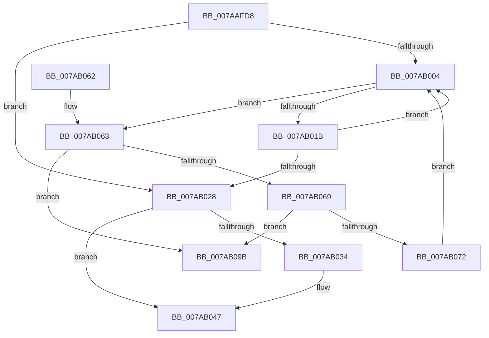

# SmHwAcceleratorMgrReleaseAccelerators

- RVA: `0x007AAFD8`–`0x007AB0A2` (길이 `202` bytes)
- VA: `0x00000001407AAFD8`
- 실행 섹션: `PAGE`
- PDB 이름 있음: `예`; PDB Function 태그: `아니요`
- unwind 정보 RVA: `0x000AA92C`
- 디코드: `54`개 명령, `202/202` bytes 표시
- 미해석 바이트: `0` (있으면 어셈블리에 `.byte`로 보존)

> 이 문서는 커널 이미지의 기계어와 PDB 기호를 분석해 생성했습니다. 4번과 5번은 함수 원형과 자료형을 바이너리 사용 방식에서 추정한 C 해석이며 원본 소스 복구 결과는 아닙니다.

## 1. Dependencies

- 직접 호출 지점: **3**; 고유 호출 대상: **3**
- 직접 호출자로 확인된 함수: **2**
- RIP 상대 이미지 참조: **2**

### Outgoing calls
- `0x007AB034` → `ext-ms-win-accel-api-km-l1-1-0.dll!AccelDestroyOffloadWorkspace` (import, 간접 대상; import `ext-ms-win-accel-api-km-l1-1-0.dll!AccelDestroyOffloadWorkspace`)
- `0x007AB07C` → [SmHwAcceleratorCleanup](SmHwAcceleratorCleanup_function_007AA3BC.md) (function, `0x007AA3BC`)
- `0x007AB084` → [CmSiFreeMemory](../../text/47/CmSiFreeMemory_function_00475D80.md) (function, `0x00475D80`)

### Direct callers
- [SmHwAcceleratorMgrAcquireAccelerators](SmHwAcceleratorMgrAcquireAccelerators_function_007AA628.md) at `0x007AABCF`
- [SmHwAcceleratorMgrPartitionUnregister](SmHwAcceleratorMgrPartitionUnregister_function_007AAEFC.md) at `0x007AAF8E`

### Static image references
- `0x007AAFF7` → RVA `0x00FC5000` (`ALMOSTRO`; read)
- `0x007AB034` → RVA `0x00151180` (`ext-ms-win-accel-api-km-l1-1-0.dll!AccelDestroyOffloadWorkspace (IAT)`; read)

## 2. Other-region calls and transfers

- 다른 실행 섹션으로 향하는 call: **1**
  - `0x007AB084` → [CmSiFreeMemory](../../text/47/CmSiFreeMemory_function_00475D80.md) (`PAGE` → `.text`)
- 별도 외부 분기/꼬리 이동을 확인하지 못했습니다.

## 3. Assembly (complete function range)

```asm
007AAFD8  48 8B C4                        mov rax, rsp
007AAFDB  48 89 58 08                     mov qword ptr [rax + 8], rbx
007AAFDF  48 89 68 10                     mov qword ptr [rax + 0x10], rbp
007AAFE3  48 89 70 18                     mov qword ptr [rax + 0x18], rsi
007AAFE7  48 89 78 20                     mov qword ptr [rax + 0x20], rdi
007AAFEB  41 56                           push r14
007AAFED  48 83 EC 20                     sub rsp, 0x20
007AAFF1  45 33 F6                        xor r14d, r14d
007AAFF4  48 8B D9                        mov rbx, rcx
007AAFF7  66 44 3B 35 01 A0 81 00         cmp r14w, word ptr [rip + 0x81a001]
007AAFFF  41 8B FE                        mov edi, r14d
007AB002  73 24                           jae 0x1407ab028
007AB004  8B CF                           mov ecx, edi
007AB006  48 C1 E1 04                     shl rcx, 4
007AB00A  48 83 C1 18                     add rcx, 0x18
007AB00E  8B EF                           mov ebp, edi
007AB010  48 03 CB                        add rcx, rbx
007AB013  48 8B 31                        mov rsi, qword ptr [rcx]
007AB016  48 3B F1                        cmp rsi, rcx
007AB019  75 48                           jne 0x1407ab063
007AB01B  0F B7 05 DE 9F 81 00            movzx eax, word ptr [rip + 0x819fde]
007AB022  FF C7                           inc edi
007AB024  3B F8                           cmp edi, eax
007AB026  72 DC                           jb 0x1407ab004
007AB028  48 8B 8B 28 05 00 00            mov rcx, qword ptr [rbx + 0x528]
007AB02F  48 85 C9                        test rcx, rcx
007AB032  74 13                           je 0x1407ab047
007AB034  48 FF 15 45 61 9A FF            call qword ptr [rip - 0x659ebb]
007AB03B  0F 1F 44 00 00                  nop dword ptr [rax + rax]
007AB040  4C 89 B3 28 05 00 00            mov qword ptr [rbx + 0x528], r14
007AB047  48 8B 5C 24 30                  mov rbx, qword ptr [rsp + 0x30]
007AB04C  48 8B 6C 24 38                  mov rbp, qword ptr [rsp + 0x38]
007AB051  48 8B 74 24 40                  mov rsi, qword ptr [rsp + 0x40]
007AB056  48 8B 7C 24 48                  mov rdi, qword ptr [rsp + 0x48]
007AB05B  48 83 C4 20                     add rsp, 0x20
007AB05F  41 5E                           pop r14
007AB061  C3                              ret
007AB062  CC                              int3
007AB063  48 39 4E 08                     cmp qword ptr [rsi + 8], rcx
007AB067  75 32                           jne 0x1407ab09b
007AB069  48 8B 06                        mov rax, qword ptr [rsi]
007AB06C  48 39 70 08                     cmp qword ptr [rax + 8], rsi
007AB070  75 29                           jne 0x1407ab09b
007AB072  48 89 01                        mov qword ptr [rcx], rax
007AB075  48 89 48 08                     mov qword ptr [rax + 8], rcx
007AB079  48 8B CE                        mov rcx, rsi
007AB07C  E8 3B F3 FF FF                  call 0x1407aa3bc
007AB081  48 8B CE                        mov rcx, rsi
007AB084  E8 F7 AC CC FF                  call 0x140475d80
007AB089  FF 8C AB 18 04 00 00            dec dword ptr [rbx + rbp*4 + 0x418]
007AB090  FF 8B 18 05 00 00               dec dword ptr [rbx + 0x518]
007AB096  E9 69 FF FF FF                  jmp 0x1407ab004
007AB09B  B9 03 00 00 00                  mov ecx, 3
007AB0A0  CD 29                           int 0x29
```

## 4. C-style interpretation (structured pseudocode)

```c
__int64 __fastcall SmHwAcceleratorMgrReleaseAccelerators(__int64 a1)
{
    __int64 result;
    __int64 v_r14;
    __int64 v_rdi;
    __int64 v_rsp;
    unsigned __int64 v_stack_p10;
    unsigned __int64 v_stack_p18;
    unsigned __int64 v_stack_p20;
    unsigned __int64 v_stack_p8;

    *(unsigned __int64 *)(v_rsp + 8) = v_rbx;
    *(unsigned __int64 *)(v_rsp + 16) = v_rbp;
    *(unsigned __int64 *)(v_rsp + 24) = v_rsi;
    *(unsigned __int64 *)(v_rsp + 32) = v_rdi;
    v_rsp = (v_rsp) - (32);
    v_r14 = 0;
    if (0 >= (*(unsigned __int16 *)(v_rip + 8495105))) goto loc_007AB028;
loc_007AB004:
    a1 = (0) << (4);
    a1 = (a1) + (24);
    a1 = (a1) + (a1);
    if ((*(unsigned __int64 *)(a1)) != a1) goto loc_007AB063;
    v_rdi = (unsigned int)((0) + 1);
    if (((unsigned int)(v_rdi)) < ((unsigned int)(*(unsigned __int16 *)(v_rip + 8495070)))) goto loc_007AB004;
loc_007AB028:
    result = *(unsigned __int16 *)(v_rip + 8495070);
    if (*(unsigned __int64 *)(a1 + 1320) != 0) {
        result = ext_ms_win_accel_api_km_l1_1_0_dll_AccelDestroyOffloadWorkspace(*(unsigned __int64 *)(a1 + 1320), a2, a3, a4);
        *(unsigned __int64 *)(a1 + 1320) = 0;
    }
    v_rsp = (v_rsp) + (32);
    return result;
loc_007AB063:
    if ((*(unsigned __int64 *)(v_stack_p18 + 8)) != (*(unsigned __int64 *)(a1 + 1320))) goto loc_007AB09B;
    if ((*(unsigned __int64 *)(*(unsigned __int64 *)(v_stack_p18) + 8)) != v_stack_p18) goto loc_007AB09B;
    *(unsigned __int64 *)(*(unsigned __int64 *)(a1 + 1320)) = *(unsigned __int64 *)(v_stack_p18);
    *(unsigned __int64 *)(*(unsigned __int64 *)(v_stack_p18) + 8) = *(unsigned __int64 *)(a1 + 1320);
    result = SmHwAcceleratorCleanup(v_stack_p18, a2, a3, a4);
    result = CmSiFreeMemory(v_stack_p18, a2, a3, a4);
    goto loc_007AB004;
loc_007AB09B:
    return result;
}
```

## 5. (Beta) C Style

```c
int64_t SmHwAcceleratorMgrReleaseAccelerators(void *Arg1)
{
    uint8_t *arg1 = (uint8_t *)Arg1;

    int64_t result;
    int64_t local_r14;
    int64_t local_rdi;
    int64_t local_rsp;
    uint64_t v_stack_p10;
    uint64_t v_stack_p18;
    uint64_t v_stack_p20;
    uint64_t v_stack_p8;

    *(uint64_t *)(local_rsp + 0x8) = local_rbx;
    *(uint64_t *)(local_rsp + 0x10) = local_rbp;
    *(uint64_t *)(local_rsp + 0x18) = local_rsi;
    *(uint64_t *)(local_rsp + 0x20) = local_rdi;
    local_rsp = (local_rsp) - (32);
    local_r14 = 0;
    if (0 >= (*(uint16_t *)(v_rip + 0x81A001))) goto loc_007AB028;
loc_007AB004:
    Arg1 = (0) << (4);
    Arg1 = (Arg1) + (24);
    Arg1 = (Arg1) + (Arg1);
    if ((*(uint64_t *)(arg1)) != Arg1) goto loc_007AB063;
    local_rdi = (uint32_t)((0) + 1);
    if (((uint32_t)(local_rdi)) < ((uint32_t)(*(uint16_t *)(v_rip + 0x819FDE)))) goto loc_007AB004;
loc_007AB028:
    result = *(uint16_t *)(v_rip + 0x819FDE);
    if (*(uint64_t *)(arg1 + 0x528) != 0) {
        result = kernel_indirect_call(*(uint64_t *)(arg1 + 0x528), a2, a3, a4);
        *(uint64_t *)(arg1 + 0x528) = 0;
    }
    local_rsp = (local_rsp) + (32);
    return result;
loc_007AB063:
    if ((*(uint64_t *)(v_stack_p18 + 0x8)) != (*(uint64_t *)(arg1 + 0x528))) goto loc_007AB09B;
    if ((*(uint64_t *)(*(uint64_t *)(v_stack_p18) + 0x8)) != v_stack_p18) goto loc_007AB09B;
    *(uint64_t *)(*(uint64_t *)(arg1 + 0x528)) = *(uint64_t *)(v_stack_p18);
    *(uint64_t *)(*(uint64_t *)(v_stack_p18) + 0x8) = *(uint64_t *)(arg1 + 0x528);
    result = SmHwAcceleratorCleanup(v_stack_p18, a2, a3, a4);
    result = CmSiFreeMemory(v_stack_p18, a2, a3, a4);
    goto loc_007AB004;
loc_007AB09B:
    return result;
}
```

### 관측된 메모리 오프셋

구조체 형식이 확인되지 않은 접근은 인자 기준의 오프셋으로만 기록했습니다.

| 기준 인자 | 오프셋 표현 | 폭 (bit) | 접근 |
|---|---:|---:|---|
| `Arg1` | `+ 0x418 + rbp*4` | `32` | `R/W` |
| `Arg1` | `+ 0x518` | `32` | `R/W` |
| `Arg1` | `+ 0x528` | `64` | `R` |
| `Arg1` | `+ 0x528` | `64` | `W` |

## 6. Execution-region graph

[열기: 2D/3D 그래프와 함수 탐색 컨트롤 패널](../../../control-panel.html?section=page&rva=0x007AAFD8&view=graph)

- 2D 그래프는 위에서 아래로 흐르고, 3D 그래프는 빈 공간을 드래그해 회전합니다. Shift+드래그는 이동, 휠은 확대·축소, 함수 노드 선택은 대상 보고서 이동입니다.

### Static fallback


