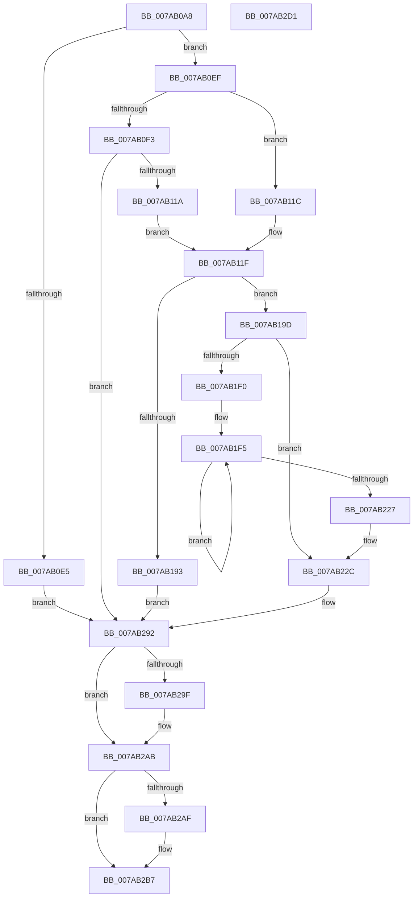

# SmHwAcceleratorParitionCtxCreate

- RVA: `0x007AB0A8`–`0x007AB2D2` (길이 `554` bytes)
- VA: `0x00000001407AB0A8`
- 실행 섹션: `PAGE`
- PDB 이름 있음: `예`; PDB Function 태그: `아니요`
- unwind 정보 RVA: `0x000A7408`
- 디코드: `149`개 명령, `554/554` bytes 표시
- 미해석 바이트: `0` (있으면 어셈블리에 `.byte`로 보존)

> 이 문서는 커널 이미지의 기계어와 PDB 기호를 분석해 생성했습니다. 4번과 5번은 함수 원형과 자료형을 바이너리 사용 방식에서 추정한 C 해석이며 원본 소스 복구 결과는 아닙니다.

## 1. Dependencies

- 직접 호출 지점: **10**; 고유 호출 대상: **9**
- 직접 호출자로 확인된 함수: **1**
- RIP 상대 이미지 참조: **2**

### Outgoing calls
- `0x007AB0D9` → [ExAcquireRundownProtection](../../text/21/ExAcquireRundownProtection_function_00216620.md) (function, `0x00216620`)
- `0x007AB101` → `ext-ms-win-accel-api-km-l1-1-0.dll!AccelShareAddressSpaceWithResource` (import, 간접 대상; import `ext-ms-win-accel-api-km-l1-1-0.dll!AccelShareAddressSpaceWithResource`)
- `0x007AB186` → [SmAllocEx](../../text/34/SmAllocEx_function_0034C794.md) (function, `0x0034C794`)
- `0x007AB1A6` → [memset](../../text/6C/memset_function_006C6C40.md) (function, `0x006C6C40`)
- `0x007AB209` → [SmHwInitializeAccelDescriptor](SmHwInitializeAccelDescriptor_function_007AB58C.md) (function, `0x007AB58C`)
- `0x007AB241` → [SmHwInitializeAccelDescriptor](SmHwInitializeAccelDescriptor_function_007AB58C.md) (function, `0x007AB58C`)
- `0x007AB258` → [InterlockedPushListSList](../../text/6B/InterlockedPushListSList_function_006BA620.md) (function, `0x006BA620`)
- `0x007AB268` → [ExAcquireRundownProtectionEx](../../text/41/ExAcquireRundownProtectionEx_function_0041BEE0.md) (function, `0x0041BEE0`)
- `0x007AB29F` → `ext-ms-win-accel-api-km-l1-1-0.dll!AccelStopSharingAddressSpaceWithResource` (import, 간접 대상; import `ext-ms-win-accel-api-km-l1-1-0.dll!AccelStopSharingAddressSpaceWithResource`)
- `0x007AB2B2` → [ExReleaseRundownProtection](../../text/34/ExReleaseRundownProtection_function_00349E80.md) (function, `0x00349E80`)

### Direct callers
- [SmHwAcceleratorMgrCreatePartitionAccelerators](SmHwAcceleratorMgrCreatePartitionAccelerators_function_007AAC5C.md) at `0x007AACED`

### Static image references
- `0x007AB101` → RVA `0x001511A0` (`ext-ms-win-accel-api-km-l1-1-0.dll!AccelShareAddressSpaceWithResource (IAT)`; read)
- `0x007AB29F` → RVA `0x001511B8` (`ext-ms-win-accel-api-km-l1-1-0.dll!AccelStopSharingAddressSpaceWithResource (IAT)`; read)

## 2. Other-region calls and transfers

- 다른 실행 섹션으로 향하는 call: **6**
  - `0x007AB0D9` → [ExAcquireRundownProtection](../../text/21/ExAcquireRundownProtection_function_00216620.md) (`PAGE` → `.text`)
  - `0x007AB186` → [SmAllocEx](../../text/34/SmAllocEx_function_0034C794.md) (`PAGE` → `.text`)
  - `0x007AB1A6` → [memset](../../text/6C/memset_function_006C6C40.md) (`PAGE` → `.text`)
  - `0x007AB258` → [InterlockedPushListSList](../../text/6B/InterlockedPushListSList_function_006BA620.md) (`PAGE` → `.text`)
  - `0x007AB268` → [ExAcquireRundownProtectionEx](../../text/41/ExAcquireRundownProtectionEx_function_0041BEE0.md) (`PAGE` → `.text`)
  - `0x007AB2B2` → [ExReleaseRundownProtection](../../text/34/ExReleaseRundownProtection_function_00349E80.md) (`PAGE` → `.text`)
- 별도 외부 분기/꼬리 이동을 확인하지 못했습니다.

## 3. Assembly (complete function range)

```asm
007AB0A8  48 8B C4                        mov rax, rsp
007AB0AB  48 89 58 18                     mov qword ptr [rax + 0x18], rbx
007AB0AF  48 89 48 08                     mov qword ptr [rax + 8], rcx
007AB0B3  55                              push rbp
007AB0B4  56                              push rsi
007AB0B5  57                              push rdi
007AB0B6  41 54                           push r12
007AB0B8  41 55                           push r13
007AB0BA  41 56                           push r14
007AB0BC  41 57                           push r15
007AB0BE  48 83 EC 40                     sub rsp, 0x40
007AB0C2  48 83 60 20 00                  and qword ptr [rax + 0x20], 0
007AB0C7  4C 8D 72 20                     lea r14, [rdx + 0x20]
007AB0CB  49 8B CE                        mov rcx, r14
007AB0CE  49 63 E8                        movsxd rbp, r8d
007AB0D1  48 8B FA                        mov rdi, rdx
007AB0D4  4C 89 74 24 38                  mov qword ptr [rsp + 0x38], r14
007AB0D9  E8 42 B5 A6 FF                  call 0x140216620
007AB0DE  0F B6 F0                        movzx esi, al
007AB0E1  84 C0                           test al, al
007AB0E3  75 0A                           jne 0x1407ab0ef
007AB0E5  BB 89 01 00 C0                  mov ebx, 0xc0000189
007AB0EA  E9 A3 01 00 00                  jmp 0x1407ab292
007AB0EF  85 ED                           test ebp, ebp
007AB0F1  75 29                           jne 0x1407ab11c
007AB0F3  48 8B 4F 10                     mov rcx, qword ptr [rdi + 0x10]
007AB0F7  4C 8D 84 24 98 00 00 00         lea r8, [rsp + 0x98]
007AB0FF  B2 01                           mov dl, 1
007AB101  48 FF 15 98 60 9A FF            call qword ptr [rip - 0x659f68]
007AB108  0F 1F 44 00 00                  nop dword ptr [rax + rax]
007AB10D  45 33 C9                        xor r9d, r9d
007AB110  8B D8                           mov ebx, eax
007AB112  85 C0                           test eax, eax
007AB114  0F 88 78 01 00 00               js 0x1407ab292
007AB11A  EB 03                           jmp 0x1407ab11f
007AB11C  4C 8B CD                        mov r9, rbp
007AB11F  44 8B 47 40                     mov r8d, dword ptr [rdi + 0x40]
007AB123  33 D2                           xor edx, edx
007AB125  42 8B 44 8F 30                  mov eax, dword ptr [rdi + r9*4 + 0x30]
007AB12A  4C 8B ED                        mov r13, rbp
007AB12D  46 8B 64 8F 38                  mov r12d, dword ptr [rdi + r9*4 + 0x38]
007AB132  FF C8                           dec eax
007AB134  41 03 C0                        add eax, r8d
007AB137  41 F7 F0                        div r8d
007AB13A  4D 0F AF E0                     imul r12, r8
007AB13E  44 8B F8                        mov r15d, eax
007AB141  BA 73 6D 41 63                  mov edx, 0x63416d73
007AB146  41 8B C0                        mov eax, r8d
007AB149  44 89 BC 24 88 00 00 00         mov dword ptr [rsp + 0x88], r15d
007AB151  0F AF 47 28                     imul eax, dword ptr [rdi + 0x28]
007AB155  41 8B CF                        mov ecx, r15d
007AB158  44 8B 47 2C                     mov r8d, dword ptr [rdi + 0x2c]
007AB15C  4D 0F AF E7                     imul r12, r15
007AB160  48 83 C0 2F                     add rax, 0x2f
007AB164  41 0F BA E8 1F                  bts r8d, 0x1f
007AB169  48 83 E0 F0                     and rax, 0xfffffffffffffff0
007AB16D  49 83 C4 5F                     add r12, 0x5f
007AB171  48 0F AF C8                     imul rcx, rax
007AB175  49 83 E4 F0                     and r12, 0xfffffffffffffff0
007AB179  48 89 44 24 20                  mov qword ptr [rsp + 0x20], rax
007AB17E  48 89 4C 24 28                  mov qword ptr [rsp + 0x28], rcx
007AB183  49 03 CC                        add rcx, r12
007AB186  E8 09 16 BA FF                  call 0x14034c794
007AB18B  48 8B D8                        mov rbx, rax
007AB18E  48 85 C0                        test rax, rax
007AB191  75 0A                           jne 0x1407ab19d
007AB193  BB 9A 00 00 C0                  mov ebx, 0xc000009a
007AB198  E9 F5 00 00 00                  jmp 0x1407ab292
007AB19D  33 D2                           xor edx, edx
007AB19F  48 8B CB                        mov rcx, rbx
007AB1A2  44 8D 42 50                     lea r8d, [rdx + 0x50]
007AB1A6  E8 95 BA F1 FF                  call 0x1406c6c40
007AB1AB  48 8B 4C 24 28                  mov rcx, qword ptr [rsp + 0x28]
007AB1B0  4C 03 E3                        add r12, rbx
007AB1B3  4C 8B 74 24 20                  mov r14, qword ptr [rsp + 0x20]
007AB1B8  49 03 CC                        add rcx, r12
007AB1BB  44 89 7B 38                     mov dword ptr [rbx + 0x38], r15d
007AB1BF  4D 03 F4                        add r14, r12
007AB1C2  48 89 7B 20                     mov qword ptr [rbx + 0x20], rdi
007AB1C6  4C 8D 7B 50                     lea r15, [rbx + 0x50]
007AB1CA  89 6B 3C                        mov dword ptr [rbx + 0x3c], ebp
007AB1CD  49 8B F4                        mov rsi, r12
007AB1D0  48 8B 84 24 98 00 00 00         mov rax, qword ptr [rsp + 0x98]
007AB1D8  48 83 63 30 00                  and qword ptr [rbx + 0x30], 0
007AB1DD  48 89 43 28                     mov qword ptr [rbx + 0x28], rax
007AB1E1  4C 89 64 24 30                  mov qword ptr [rsp + 0x30], r12
007AB1E6  48 89 4C 24 28                  mov qword ptr [rsp + 0x28], rcx
007AB1EB  4C 3B F1                        cmp r14, rcx
007AB1EE  73 3C                           jae 0x1407ab22c
007AB1F0  4C 8B 64 24 20                  mov r12, qword ptr [rsp + 0x20]
007AB1F5  44 8B C5                        mov r8d, ebp
007AB1F8  4C 89 36                        mov qword ptr [rsi], r14
007AB1FB  48 8B D7                        mov rdx, rdi
007AB1FE  48 89 5E 08                     mov qword ptr [rsi + 8], rbx
007AB202  48 8B CE                        mov rcx, rsi
007AB205  4C 89 7E 10                     mov qword ptr [rsi + 0x10], r15
007AB209  E8 7E 03 00 00                  call 0x1407ab58c
007AB20E  42 8B 44 AF 38                  mov eax, dword ptr [rdi + r13*4 + 0x38]
007AB213  49 8B F6                        mov rsi, r14
007AB216  0F AF 47 40                     imul eax, dword ptr [rdi + 0x40]
007AB21A  4D 03 F4                        add r14, r12
007AB21D  4C 03 F8                        add r15, rax
007AB220  4C 3B 74 24 28                  cmp r14, qword ptr [rsp + 0x28]
007AB225  72 CE                           jb 0x1407ab1f5
007AB227  4C 8B 64 24 30                  mov r12, qword ptr [rsp + 0x30]
007AB22C  48 83 26 00                     and qword ptr [rsi], 0
007AB230  44 8B C5                        mov r8d, ebp
007AB233  48 8B D7                        mov rdx, rdi
007AB236  48 89 5E 08                     mov qword ptr [rsi + 8], rbx
007AB23A  48 8B CE                        mov rcx, rsi
007AB23D  4C 89 7E 10                     mov qword ptr [rsi + 0x10], r15
007AB241  E8 46 03 00 00                  call 0x1407ab58c
007AB246  44 8B 8C 24 88 00 00 00         mov r9d, dword ptr [rsp + 0x88]
007AB24E  48 8D 4B 10                     lea rcx, [rbx + 0x10]
007AB252  4C 8B C6                        mov r8, rsi
007AB255  49 8B D4                        mov rdx, r12
007AB258  E8 C3 F3 F0 FF                  call 0x1406ba620
007AB25D  8B 94 24 88 00 00 00            mov edx, dword ptr [rsp + 0x88]
007AB264  48 8D 4B 30                     lea rcx, [rbx + 0x30]
007AB268  E8 73 0C C7 FF                  call 0x14041bee0
007AB26D  48 8B 43 20                     mov rax, qword ptr [rbx + 0x20]
007AB271  F0 FF 40 44                     lock inc dword ptr [rax + 0x44]
007AB275  48 8B 84 24 80 00 00 00         mov rax, qword ptr [rsp + 0x80]
007AB27D  33 F6                           xor esi, esi
007AB27F  48 83 A4 24 98 00 00 00 00      and qword ptr [rsp + 0x98], 0
007AB288  4C 8B 74 24 38                  mov r14, qword ptr [rsp + 0x38]
007AB28D  48 89 18                        mov qword ptr [rax], rbx
007AB290  33 DB                           xor ebx, ebx
007AB292  48 8B 8C 24 98 00 00 00         mov rcx, qword ptr [rsp + 0x98]
007AB29A  48 85 C9                        test rcx, rcx
007AB29D  74 0C                           je 0x1407ab2ab
007AB29F  48 FF 15 12 5F 9A FF            call qword ptr [rip - 0x65a0ee]
007AB2A6  0F 1F 44 00 00                  nop dword ptr [rax + rax]
007AB2AB  85 F6                           test esi, esi
007AB2AD  74 08                           je 0x1407ab2b7
007AB2AF  49 8B CE                        mov rcx, r14
007AB2B2  E8 C9 EB B9 FF                  call 0x140349e80
007AB2B7  8B C3                           mov eax, ebx
007AB2B9  48 8B 9C 24 90 00 00 00         mov rbx, qword ptr [rsp + 0x90]
007AB2C1  48 83 C4 40                     add rsp, 0x40
007AB2C5  41 5F                           pop r15
007AB2C7  41 5E                           pop r14
007AB2C9  41 5D                           pop r13
007AB2CB  41 5C                           pop r12
007AB2CD  5F                              pop rdi
007AB2CE  5E                              pop rsi
007AB2CF  5D                              pop rbp
007AB2D0  C3                              ret
007AB2D1  CC                              int3
```

## 4. C-style interpretation (structured pseudocode)

```c
__int64 __fastcall SmHwAcceleratorParitionCtxCreate(__int64 a1, __int64 a2, int a3, int a4)
{
    __int64 result;
    __int64 v_r12;
    __int64 v_r14;
    __int64 v_r15;
    __int64 v_rbx;
    __int64 v_rsi;
    __int64 v_rsp;
    unsigned __int64 v_stack_m40;
    unsigned __int64 v_stack_m48;
    unsigned __int64 v_stack_m50;
    unsigned __int64 v_stack_m58;
    unsigned int v_stack_p10;
    unsigned __int64 v_stack_p18;
    unsigned __int64 v_stack_p20;
    unsigned __int64 v_stack_p8;

    *(unsigned __int64 *)(v_rsp + 24) = v_rbx;
    *(unsigned __int64 *)(v_rsp + 8) = a1;
    v_rsp = (v_rsp) - (64);
    v_stack_m40 = a2 + 32;
    result = ExAcquireRundownProtection(a2 + 32, a2, a3, a4);
    if ((unsigned __int8)(result) != 0) goto loc_007AB0EF;
    goto loc_007AB292;
loc_007AB0EF:
    if ((unsigned int)((int)(a3)) != 0) goto loc_007AB11C;
    result = ext_ms_win_accel_api_km_l1_1_0_dll_AccelShareAddressSpaceWithResource(*(unsigned __int64 *)(a2 + 16), 1, v_stack_p20, a4);
    a4 = 0;
    if (sign_flag) goto loc_007AB292;
    goto loc_007AB11F;
loc_007AB11C:
loc_007AB11F:
    a2 = 0;
    result = (unsigned int)(((unsigned int)(*(unsigned int *)(a2 + (int)(a3) * 4 + 48))) - 1);
    result = (unsigned int)((result) + ((unsigned int)((unsigned int)(*(unsigned int *)(a2 + 64)))));
    v_r12 = ((unsigned int)(*(unsigned int *)(a2 + (int)(a3) * 4 + 56))) * ((unsigned int)(*(unsigned int *)(a2 + 64)));
    v_stack_p10 = (unsigned int)((unsigned int)((unsigned int)(result)));
    result = (unsigned int)(((unsigned int)((unsigned int)((unsigned int)(*(unsigned int *)(a2 + 64))))) * (*(unsigned int *)(a2 + 40)));
    v_r12 = (v_r12) * ((unsigned int)((unsigned int)(result)));
    result = (result) + (47);
    result = (result) & (-16);
    v_r12 = (v_r12) + (95);
    a1 = ((unsigned int)((unsigned int)((unsigned int)((unsigned int)(result))))) * (result);
    v_r12 = (v_r12) & (-16);
    v_stack_m58 = result;
    v_stack_m50 = a1;
    a1 = (a1) + (v_r12);
    result = SmAllocEx(a1, (unsigned int)(0x63416D73ULL), (unsigned int)(*(unsigned int *)(a2 + 44)), (int)(a3));
    if (result != 0) goto loc_007AB19D;
    goto loc_007AB292;
loc_007AB19D:
    a2 = 0;
    result = memset((unsigned int)(0xC000009AULL), a2, a2 + 80, (int)(a3));
    v_r12 = (v_r12) + ((unsigned int)(0xC000009AULL));
    a1 = (v_stack_m50) + (v_r12);
    *(unsigned int *)((unsigned int)(0xC000009AULL) + 56) = (unsigned int)((unsigned int)((unsigned int)(result)));
    v_r14 = (v_stack_m58) + (v_r12);
    *(unsigned __int64 *)((unsigned int)(0xC000009AULL) + 32) = 0;
    *(unsigned int *)((unsigned int)(0xC000009AULL) + 60) = (unsigned int)((int)(a3));
    *(unsigned __int64 *)((unsigned int)(0xC000009AULL) + 40) = v_stack_p20;
    v_stack_m48 = v_r12;
    v_stack_m50 = a1;
    if (v_r14 >= a1) goto loc_007AB22C;
loc_007AB1F5:
    *(unsigned __int64 *)(v_r12) = v_r14;
    *(unsigned __int64 *)(v_r12 + 8) = (unsigned int)(0xC000009AULL);
    *(unsigned __int64 *)(v_r12 + 16) = (unsigned int)(0xC000009AULL) + 80;
    result = SmHwInitializeAccelDescriptor(v_r12, 0, (unsigned int)((unsigned int)((int)(a3))), (int)(a3));
    result = (unsigned int)(((unsigned int)(*(unsigned int *)(a2 + (int)(a3) * 4 + 56))) * (*(unsigned int *)(a2 + 64)));
    v_r14 = (v_r14) + (v_stack_m58);
    v_r15 = ((unsigned int)(0xC000009AULL) + 80) + (result);
    if (v_r14 < v_stack_m50) goto loc_007AB1F5;
loc_007AB22C:
    *(unsigned __int64 *)(v_r14 + 8) = (unsigned int)(0xC000009AULL);
    *(unsigned __int64 *)(v_r14 + 16) = v_r15;
    result = SmHwInitializeAccelDescriptor(v_r14, 0, (unsigned int)((unsigned int)((int)(a3))), (int)(a3));
    result = InterlockedPushListSList((unsigned int)(0xC000009AULL) + 16, v_stack_m48, v_r14, (unsigned int)(v_stack_p10));
    result = ExAcquireRundownProtectionEx((unsigned int)(0xC000009AULL) + 48, (unsigned int)(v_stack_p10), v_r14, (unsigned int)(v_stack_p10));
    v_rsi = 0;
    *(unsigned __int64 *)(v_stack_p8) = (unsigned int)(0xC000009AULL);
    v_rbx = 0;
loc_007AB292:
    result = v_stack_p8;
    if (v_stack_p20 != 0) {
        result = ext_ms_win_accel_api_km_l1_1_0_dll_AccelStopSharingAddressSpaceWithResource(v_stack_p20, (unsigned int)(v_stack_p10), v_r14, (unsigned int)(v_stack_p10));
    }
    if (0 != 0) {
        a1 = v_stack_m40;
        result = ExReleaseRundownProtection(a1, (unsigned int)(v_stack_p10), v_r14, (unsigned int)(v_stack_p10));
    }
    v_rsp = (v_rsp) + (64);
    return 0;
}
```

## 5. (Beta) C Style

```c
int64_t SmHwAcceleratorParitionCtxCreate(int64_t Arg1, void *Arg2, int32_t Arg3, int32_t Arg4)
{
    uint8_t *arg2 = (uint8_t *)Arg2;

    int64_t result;
    int64_t local_r12;
    int64_t local_r14;
    int64_t local_r15;
    int64_t local_rbx;
    int64_t local_rsi;
    int64_t local_rsp;
    uint64_t v_stack_m40;
    uint64_t v_stack_m48;
    uint64_t v_stack_m50;
    uint64_t v_stack_m58;
    uint32_t v_stack_p10;
    uint64_t v_stack_p18;
    uint64_t v_stack_p20;
    uint64_t v_stack_p8;

    *(uint64_t *)(local_rsp + 0x18) = local_rbx;
    *(uint64_t *)(local_rsp + 0x8) = Arg1;
    local_rsp = (local_rsp) - (64);
    v_stack_m40 = Arg2 + 32;
    result = ExAcquireRundownProtection(Arg2 + 32, Arg2, Arg3, Arg4);
    if ((uint8_t)(result) != 0) goto loc_007AB0EF;
    goto loc_007AB292;
loc_007AB0EF:
    if ((uint32_t)((int32_t)(Arg3)) != 0) goto loc_007AB11C;
    result = kernel_indirect_call(*(uint64_t *)(arg2 + 0x10), 1, v_stack_p20, Arg4);
    Arg4 = 0;
    if (sign_flag) goto loc_007AB292;
    goto loc_007AB11F;
loc_007AB11C:
loc_007AB11F:
    Arg2 = 0;
    result = (uint32_t)(((uint32_t)(*(uint32_t *)(arg2 + (int32_t)(Arg3) * 4 + 0x30))) - 1);
    result = (uint32_t)((result) + ((uint32_t)((uint32_t)(*(uint32_t *)(arg2 + 0x40)))));
    local_r12 = ((uint32_t)(*(uint32_t *)(arg2 + (int32_t)(Arg3) * 4 + 0x38))) * ((uint32_t)(*(uint32_t *)(arg2 + 0x40)));
    v_stack_p10 = (uint32_t)((uint32_t)((uint32_t)(result)));
    result = (uint32_t)(((uint32_t)((uint32_t)((uint32_t)(*(uint32_t *)(arg2 + 0x40))))) * (*(uint32_t *)(arg2 + 0x28)));
    local_r12 = (local_r12) * ((uint32_t)((uint32_t)(result)));
    result = (result) + (47);
    result = (result) & (-16);
    local_r12 = (local_r12) + (95);
    Arg1 = ((uint32_t)((uint32_t)((uint32_t)((uint32_t)(result))))) * (result);
    local_r12 = (local_r12) & (-16);
    v_stack_m58 = result;
    v_stack_m50 = Arg1;
    Arg1 = (Arg1) + (local_r12);
    result = SmAllocEx(Arg1, (uint32_t)(0x63416D73ULL), (uint32_t)(*(uint32_t *)(arg2 + 0x2C)), (int32_t)(Arg3));
    if (result != 0) goto loc_007AB19D;
    goto loc_007AB292;
loc_007AB19D:
    Arg2 = 0;
    result = memset((uint32_t)(0xC000009AULL), Arg2, Arg2 + 80, (int32_t)(Arg3));
    local_r12 = (local_r12) + ((uint32_t)(0xC000009AULL));
    Arg1 = (v_stack_m50) + (local_r12);
    *(uint32_t *)((uint32_t)(0xC000009AULL) + 0x38) = (uint32_t)((uint32_t)((uint32_t)(result)));
    local_r14 = (v_stack_m58) + (local_r12);
    *(uint64_t *)((uint32_t)(0xC000009AULL) + 0x20) = 0;
    *(uint32_t *)((uint32_t)(0xC000009AULL) + 0x3C) = (uint32_t)((int32_t)(Arg3));
    *(uint64_t *)((uint32_t)(0xC000009AULL) + 0x28) = v_stack_p20;
    v_stack_m48 = local_r12;
    v_stack_m50 = Arg1;
    if (local_r14 >= Arg1) goto loc_007AB22C;
loc_007AB1F5:
    *(uint64_t *)(local_r12) = local_r14;
    *(uint64_t *)(local_r12 + 0x8) = (uint32_t)(0xC000009AULL);
    *(uint64_t *)(local_r12 + 0x10) = (uint32_t)(0xC000009AULL) + 80;
    result = SmHwInitializeAccelDescriptor(local_r12, 0, (uint32_t)((uint32_t)((int32_t)(Arg3))), (int32_t)(Arg3));
    result = (uint32_t)(((uint32_t)(*(uint32_t *)(arg2 + (int32_t)(Arg3) * 4 + 0x38))) * (*(uint32_t *)(arg2 + 0x40)));
    local_r14 = (local_r14) + (v_stack_m58);
    local_r15 = ((uint32_t)(0xC000009AULL) + 80) + (result);
    if (local_r14 < v_stack_m50) goto loc_007AB1F5;
loc_007AB22C:
    *(uint64_t *)(local_r14 + 0x8) = (uint32_t)(0xC000009AULL);
    *(uint64_t *)(local_r14 + 0x10) = local_r15;
    result = SmHwInitializeAccelDescriptor(local_r14, 0, (uint32_t)((uint32_t)((int32_t)(Arg3))), (int32_t)(Arg3));
    result = InterlockedPushListSList((uint32_t)(0xC000009AULL) + 16, v_stack_m48, local_r14, (uint32_t)(v_stack_p10));
    result = ExAcquireRundownProtectionEx((uint32_t)(0xC000009AULL) + 48, (uint32_t)(v_stack_p10), local_r14, (uint32_t)(v_stack_p10));
    local_rsi = 0;
    *(uint64_t *)(v_stack_p8) = (uint32_t)(0xC000009AULL);
    local_rbx = 0;
loc_007AB292:
    result = v_stack_p8;
    if (v_stack_p20 != 0) {
        result = kernel_indirect_call(v_stack_p20, (uint32_t)(v_stack_p10), local_r14, (uint32_t)(v_stack_p10));
    }
    if (0 != 0) {
        Arg1 = v_stack_m40;
        result = ExReleaseRundownProtection(Arg1, (uint32_t)(v_stack_p10), local_r14, (uint32_t)(v_stack_p10));
    }
    local_rsp = (local_rsp) + (64);
    return 0;
}
```

### 관측된 메모리 오프셋

구조체 형식이 확인되지 않은 접근은 인자 기준의 오프셋으로만 기록했습니다.

| 기준 인자 | 오프셋 표현 | 폭 (bit) | 접근 |
|---|---:|---:|---|
| `Arg2` | `+ 0x10` | `64` | `R` |
| `Arg2` | `+ 0x20` | `64` | `R` |
| `Arg2` | `+ 0x28` | `32` | `R` |
| `Arg2` | `+ 0x2C` | `32` | `R` |
| `Arg2` | `+ 0x30 + r9*4` | `32` | `R` |
| `Arg2` | `+ 0x38 + r13*4` | `32` | `R` |
| `Arg2` | `+ 0x38 + r9*4` | `32` | `R` |
| `Arg2` | `+ 0x40` | `32` | `R` |

## 6. Execution-region graph

[열기: 2D/3D 그래프와 함수 탐색 컨트롤 패널](../../../control-panel.html?section=page&rva=0x007AB0A8&view=graph)

- 2D 그래프는 위에서 아래로 흐르고, 3D 그래프는 빈 공간을 드래그해 회전합니다. Shift+드래그는 이동, 휠은 확대·축소, 함수 노드 선택은 대상 보고서 이동입니다.

### Static fallback


