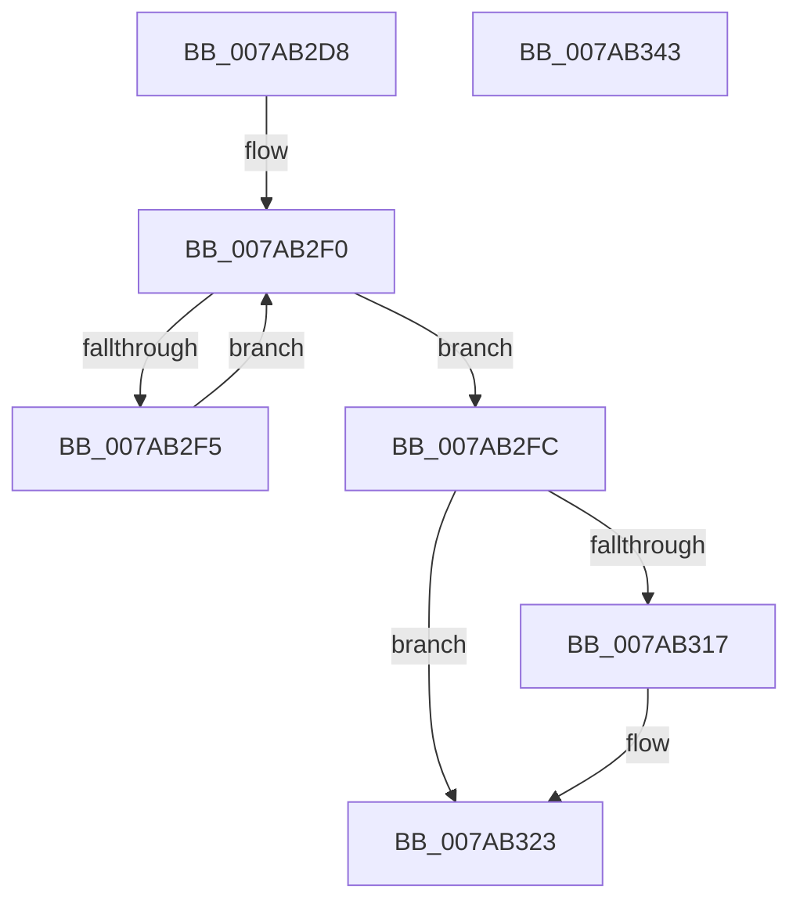

# SmHwAcceleratorPartitionCtxCleanup

- RVA: `0x007AB2D8`–`0x007AB344` (길이 `108` bytes)
- VA: `0x00000001407AB2D8`
- 실행 섹션: `PAGE`
- PDB 이름 있음: `예`; PDB Function 태그: `아니요`
- unwind 정보 RVA: `0x0005CAAC`
- 디코드: `31`개 명령, `108/108` bytes 표시
- 미해석 바이트: `0` (있으면 어셈블리에 `.byte`로 보존)

> 이 문서는 커널 이미지의 기계어와 PDB 기호를 분석해 생성했습니다. 4번과 5번은 함수 원형과 자료형을 바이너리 사용 방식에서 추정한 C 해석이며 원본 소스 복구 결과는 아닙니다.

## 1. Dependencies

- 직접 호출 지점: **5**; 고유 호출 대상: **5**
- 직접 호출자로 확인된 함수: **3**
- RIP 상대 이미지 참조: **1**

### Outgoing calls
- `0x007AB2E9` → [ExpInterlockedFlushSList](../../text/6B/ExpInterlockedFlushSList_function_006BA5F0.md) (function, `0x006BA5F0`)
- `0x007AB300` → [ExReleaseRundownProtectionEx](../../text/2A/ExReleaseRundownProtectionEx_function_002A55B0.md) (function, `0x002A55B0`)
- `0x007AB309` → [ExWaitForRundownProtectionRelease](../../text/2A/ExWaitForRundownProtectionRelease_function_002A4CB0.md) (function, `0x002A4CB0`)
- `0x007AB317` → `ext-ms-win-accel-api-km-l1-1-0.dll!AccelStopSharingAddressSpaceWithResource` (import, 간접 대상; import `ext-ms-win-accel-api-km-l1-1-0.dll!AccelStopSharingAddressSpaceWithResource`)
- `0x007AB333` → [ExReleaseRundownProtection](../../text/34/ExReleaseRundownProtection_function_00349E80.md) (function, `0x00349E80`)

### Direct callers
- [SmHwAcceleratorMgrHotRemoveAccelerator](../../text/61/SmHwAcceleratorMgrHotRemoveAccelerator_function_006115FC.md) at `0x006118D9`
- [SmHwAcceleratorMgrCreatePartitionAccelerators](SmHwAcceleratorMgrCreatePartitionAccelerators_function_007AAC5C.md) at `0x007AAD9E`
- [SmHwAcceleratorPartitionMgrCleanup](SmHwAcceleratorPartitionMgrCleanup_function_007AB34C.md) at `0x007AB443`

### Static image references
- `0x007AB317` → RVA `0x001511B8` (`ext-ms-win-accel-api-km-l1-1-0.dll!AccelStopSharingAddressSpaceWithResource (IAT)`; read)

## 2. Other-region calls and transfers

- 다른 실행 섹션으로 향하는 call: **4**
  - `0x007AB2E9` → [ExpInterlockedFlushSList](../../text/6B/ExpInterlockedFlushSList_function_006BA5F0.md) (`PAGE` → `.text`)
  - `0x007AB300` → [ExReleaseRundownProtectionEx](../../text/2A/ExReleaseRundownProtectionEx_function_002A55B0.md) (`PAGE` → `.text`)
  - `0x007AB309` → [ExWaitForRundownProtectionRelease](../../text/2A/ExWaitForRundownProtectionRelease_function_002A4CB0.md) (`PAGE` → `.text`)
  - `0x007AB333` → [ExReleaseRundownProtection](../../text/34/ExReleaseRundownProtection_function_00349E80.md) (`PAGE` → `.text`)
- 별도 외부 분기/꼬리 이동을 확인하지 못했습니다.

## 3. Assembly (complete function range)

```asm
007AB2D8  48 89 5C 24 08                  mov qword ptr [rsp + 8], rbx
007AB2DD  57                              push rdi
007AB2DE  48 83 EC 20                     sub rsp, 0x20
007AB2E2  48 8B F9                        mov rdi, rcx
007AB2E5  48 83 C1 10                     add rcx, 0x10
007AB2E9  E8 02 F3 F0 FF                  call 0x1406ba5f0
007AB2EE  33 D2                           xor edx, edx
007AB2F0  48 85 C0                        test rax, rax
007AB2F3  74 07                           je 0x1407ab2fc
007AB2F5  48 8B 00                        mov rax, qword ptr [rax]
007AB2F8  FF C2                           inc edx
007AB2FA  EB F4                           jmp 0x1407ab2f0
007AB2FC  48 8D 4F 30                     lea rcx, [rdi + 0x30]
007AB300  E8 AB A2 AF FF                  call 0x1402a55b0
007AB305  48 8D 4F 30                     lea rcx, [rdi + 0x30]
007AB309  E8 A2 99 AF FF                  call 0x1402a4cb0
007AB30E  48 8B 4F 28                     mov rcx, qword ptr [rdi + 0x28]
007AB312  48 85 C9                        test rcx, rcx
007AB315  74 0C                           je 0x1407ab323
007AB317  48 FF 15 9A 5E 9A FF            call qword ptr [rip - 0x65a166]
007AB31E  0F 1F 44 00 00                  nop dword ptr [rax + rax]
007AB323  48 8B 47 20                     mov rax, qword ptr [rdi + 0x20]
007AB327  F0 FF 48 44                     lock dec dword ptr [rax + 0x44]
007AB32B  48 8B 4F 20                     mov rcx, qword ptr [rdi + 0x20]
007AB32F  48 83 C1 20                     add rcx, 0x20
007AB333  E8 48 EB B9 FF                  call 0x140349e80
007AB338  48 8B 5C 24 30                  mov rbx, qword ptr [rsp + 0x30]
007AB33D  48 83 C4 20                     add rsp, 0x20
007AB341  5F                              pop rdi
007AB342  C3                              ret
007AB343  CC                              int3
```

## 4. C-style interpretation (structured pseudocode)

```c
__int64 __fastcall SmHwAcceleratorPartitionCtxCleanup(__int64 a1, int a2)
{
    __int64 result;
    __int64 v_rsp;
    unsigned __int64 v_stack_p8;

    v_stack_p8 = v_rbx;
    v_rsp = (v_rsp) - (32);
    a1 = (a1) + (16);
    result = ExpInterlockedFlushSList(a1, a2, a3, a4);
    a2 = 0;
loc_007AB2F0:
    if (result == 0) goto loc_007AB2FC;
    a2 = (unsigned int)((a2) + 1);
    goto loc_007AB2F0;
loc_007AB2FC:
    result = ExReleaseRundownProtectionEx(a1 + 48, a2, a3, a4);
    result = ExWaitForRundownProtectionRelease(a1 + 48, a2, a3, a4);
    if (*(unsigned __int64 *)(a1 + 40) != 0) {
        result = ext_ms_win_accel_api_km_l1_1_0_dll_AccelStopSharingAddressSpaceWithResource(*(unsigned __int64 *)(a1 + 40), a2, a3, a4);
    }
    a1 = (*(unsigned __int64 *)(a1 + 32)) + (32);
    result = ExReleaseRundownProtection(a1, a2, a3, a4);
    v_rsp = (v_rsp) + (32);
    return result;
}
```

## 5. (Beta) C Style

```c
int64_t SmHwAcceleratorPartitionCtxCleanup(void *Arg1, int32_t Arg2)
{
    uint8_t *arg1 = (uint8_t *)Arg1;

    int64_t result;
    int64_t local_rsp;
    uint64_t v_stack_p8;

    v_stack_p8 = local_rbx;
    local_rsp = (local_rsp) - (32);
    Arg1 = (Arg1) + (16);
    result = ExpInterlockedFlushSList(Arg1, Arg2, a3, a4);
    Arg2 = 0;
loc_007AB2F0:
    if (result == 0) goto loc_007AB2FC;
    Arg2 = (uint32_t)((Arg2) + 1);
    goto loc_007AB2F0;
loc_007AB2FC:
    result = ExReleaseRundownProtectionEx(Arg1 + 48, Arg2, a3, a4);
    result = ExWaitForRundownProtectionRelease(Arg1 + 48, Arg2, a3, a4);
    if (*(uint64_t *)(arg1 + 0x28) != 0) {
        result = kernel_indirect_call(*(uint64_t *)(arg1 + 0x28), Arg2, a3, a4);
    }
    Arg1 = (*(uint64_t *)(arg1 + 0x20)) + (32);
    result = ExReleaseRundownProtection(Arg1, Arg2, a3, a4);
    local_rsp = (local_rsp) + (32);
    return result;
}
```

### 관측된 메모리 오프셋

구조체 형식이 확인되지 않은 접근은 인자 기준의 오프셋으로만 기록했습니다.

| 기준 인자 | 오프셋 표현 | 폭 (bit) | 접근 |
|---|---:|---:|---|
| `Arg1` | `+ 0x20` | `64` | `R` |
| `Arg1` | `+ 0x28` | `64` | `R` |
| `Arg1` | `+ 0x30` | `64` | `R` |

## 6. Execution-region graph

[열기: 2D/3D 그래프와 함수 탐색 컨트롤 패널](../../../control-panel.html?section=page&rva=0x007AB2D8&view=graph)

- 2D 그래프는 위에서 아래로 흐르고, 3D 그래프는 빈 공간을 드래그해 회전합니다. Shift+드래그는 이동, 휠은 확대·축소, 함수 노드 선택은 대상 보고서 이동입니다.

### Static fallback


